# Super Phage 기술 문서

> **박테리오파지가 세균에 침투해 증식하는 과정을 플레이로 옮긴 2D 탑뷰 게임**

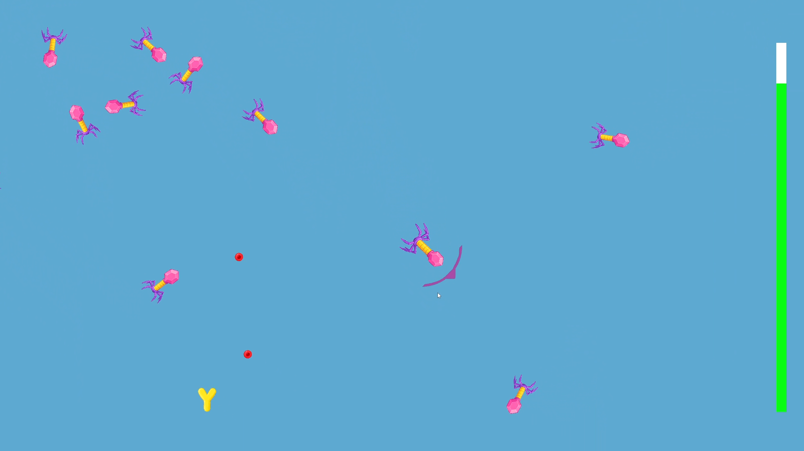 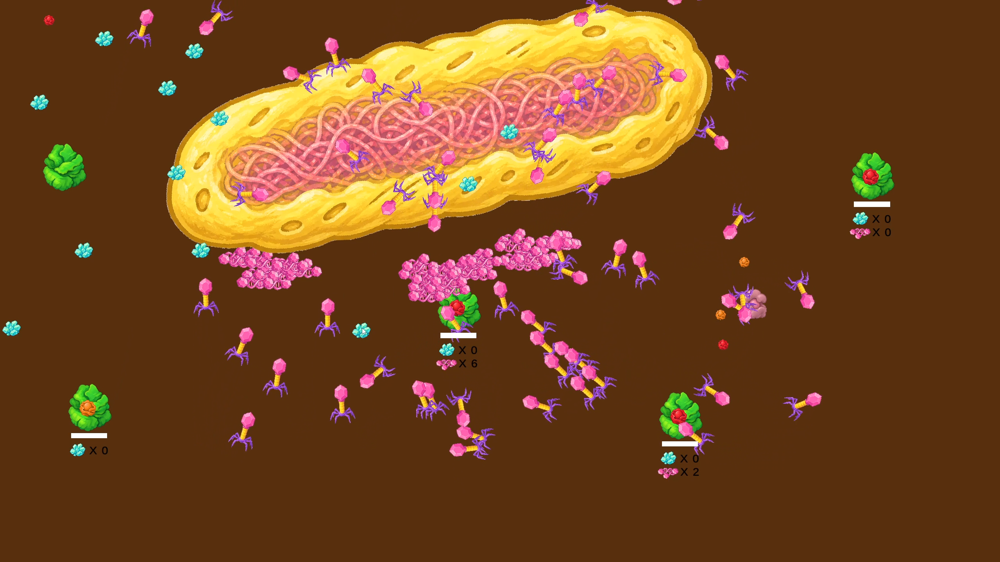

| 항목      | 내용                                                                                                                                                               |
| --------- | ------------------------------------------------------------------------------------------------------------------------------------------------------------------ |
| 장르      | 2D 탑뷰 · 유영(회피) + 증식(드래그 앤 드롭 생산)                                                                                                                   |
| 개발 기간 | 2주 (커밋 기준 2026.06.24 ~ 2026.07.09)                                                                                                                            |
| 인원      | 개인 프로젝트                                                                                                                                                      |
| 담당      | 기획, Unity 개발, 에셋 제작(이미지는 AI 이미지 생성으로 직접 제작)                                                                                                 |
| 개발 환경 | Unity 6000.3.15f1 · C# · URP · Unity Input System · JetBrains Rider 2026.2.1                                                                                       |
| 주요 기술 | 공통 이동 컴포넌트(`SwimMotor`) · 상속 기반 생성기(`MicroEntityEmitter`) · 싱글톤 + `DontDestroyOnLoad` 씬 간 상태 · 드래그 앤 드롭 생산 · 에너지 단계별 이동 속도 |
| 링크      | [시연 영상](https://www.youtube.com/watch?v=ffu6aTLB6I0) · [프로젝트 저장소](https://github.com/KooHoo-Dev/3rd-2D-Project-Lets-Gitit)                              |

## 목차

1. [프로젝트 개요](#1-프로젝트-개요)
2. [플레이](#2-플레이)
3. [유영 필드 · 하나의 모터로 움직이는 네 객체](#3-유영-필드--하나의-모터로-움직이는-네-객체)
4. [세균 내부 · 드롭 한 번이 다음 단계를 연다](#4-세균-내부--드롭-한-번이-다음-단계를-연다)
5. [씬 전환 · 다시 돌아와도 진행이 남도록](#5-씬-전환--다시-돌아와도-진행이-남도록)
6. [만들며 생긴 문제](#6-만들며-생긴-문제)
7. [결과와 돌아보기](#7-결과와-돌아보기)

---

## 1. 프로젝트 개요

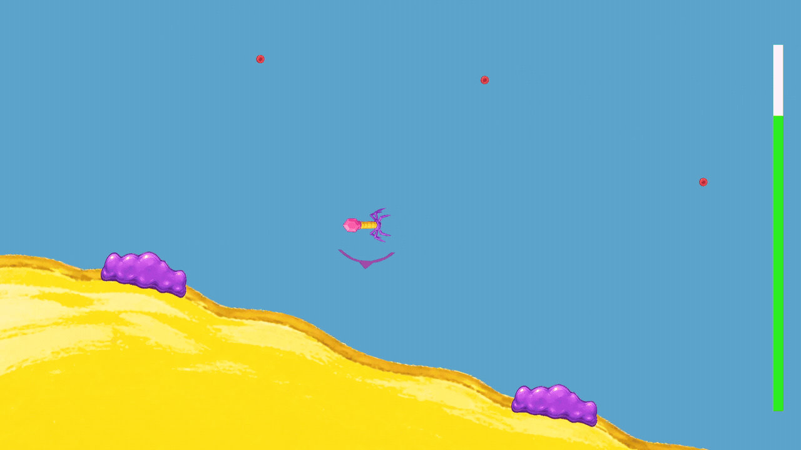

박테리오파지가 세균에 침투해 증식하는 과정을 플레이로 옮긴 2D 탑뷰 게임입니다. 유영 필드에서 항체를 피해 세균에 붙고, 세균 내부에서 리보솜에 mRNA와 재료를 넣어 파지를 증식시킵니다. 세균을 터뜨리면 유영 필드로 돌아와 다음 세균을 찾습니다.

<!-- 준비할 그림: 아이디어 참고 영상 캡처 → images/idea_reference.png. 아래 세균 내부 화면과 나란히 둡니다. -->

출발점은 박테리오파지가 빠르게 증식하는 영상이었습니다([아이디어 참고 영상](https://www.youtube.com/shorts/AszJQo2DlNc)). 자료를 조사하면서 주목한 것은 앞 단계의 산물이 다음 단계의 재료가 되고, 이 연결이 반복되면서 증식이 완료되는 구조였습니다. 그래서 복잡한 증식 과정을 추상화해 직관적인 조작만으로 체험하게 하는 것을 목표로 삼았고, 다음 세 가지 경험을 정했습니다.

- 박테리오파지가 되어 미시세계의 움직임을 경험합니다.
- 여러 단계가 맞물리는 증식 과정을 직접 체험합니다.
- 반복할수록 증식에 속도가 붙습니다.

개발자로서의 목표는 2주 안에 2D 탑뷰 게임의 다양한 기능을 직접 구현해 보며 핵심 루프를 완성하는 것이었습니다. 자유 유영, 씬마다 확실히 구별되는 플레이 방식, 후진·드래그처럼 서로 다른 조작, 자동으로 진행되는 공장 시스템이 그 예입니다. 구현에서 가장 신경 쓴 점은 **여러 객체가 똑같이 하는 동작을 공통 클래스로 묶는 것**이었습니다. 수정은 한 곳에서 끝내고, 새 객체는 자기 판단만 더하면 되도록 하기 위해서입니다.

---

## 2. 플레이

### 2.1 등장하는 오브젝트

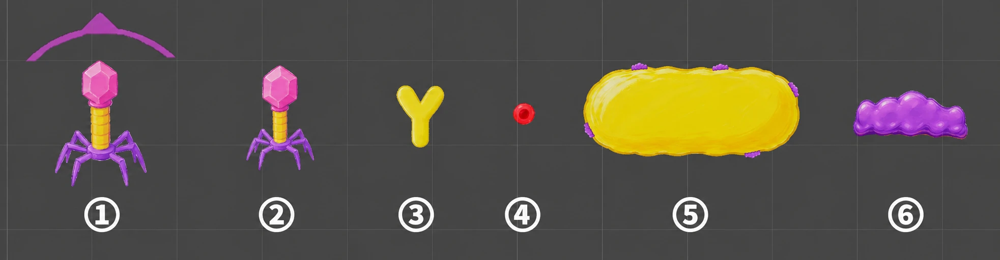

| ① 파지(플레이어)                       | ② 파지 AI                                      | ③ 항체                       |
| -------------------------------------- | ---------------------------------------------- | ---------------------------- |
| 플레이어가 조종하는 박테리오파지입니다 | 맵에서 자유롭게 돌아다니는 증식된 파지들입니다 | 플레이어를 쫓아오는 적입니다 |

| ④ 에너지 오브                         | ⑤ 세균            | ⑥ 수용체                                        |
| ------------------------------------- | ----------------- | ----------------------------------------------- |
| 파지가 움직일 수 있게 하는 연료입니다 | 침투할 대상입니다 | 파지가 3초 붙으면 세균 안으로 들어가는 곳입니다 |

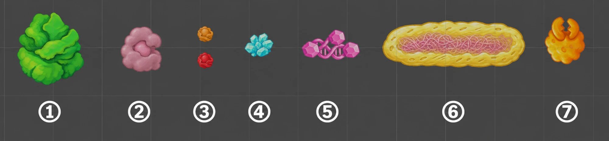

| ① 리보솜                                        | ② RNA 중합효소            | ③ mRNA                                        | ④ 아미노산                           |
| ----------------------------------------------- | ------------------------- | --------------------------------------------- | ------------------------------------ |
| 재료를 받아 분해효소나 파지를 만드는 공장입니다 | 2초마다 mRNA를 내보냅니다 | 리보솜에 무엇을 만들지 정해 주는 설계도입니다 | 필드 곳곳에 생겨나는 생산 재료입니다 |

| ⑤ AGTC                                     | ⑥ 핵양체                            | ⑦ 핵산 분해효소                      |
| ------------------------------------------ | ----------------------------------- | ------------------------------------ |
| 파지를 만들 때 필요한 유전 물질 재료입니다 | 분해효소가 닿으면 AGTC를 내놓습니다 | 핵양체로 헤엄쳐 가서 AGTC를 꺼냅니다 |

### 2.2 한 판의 흐름

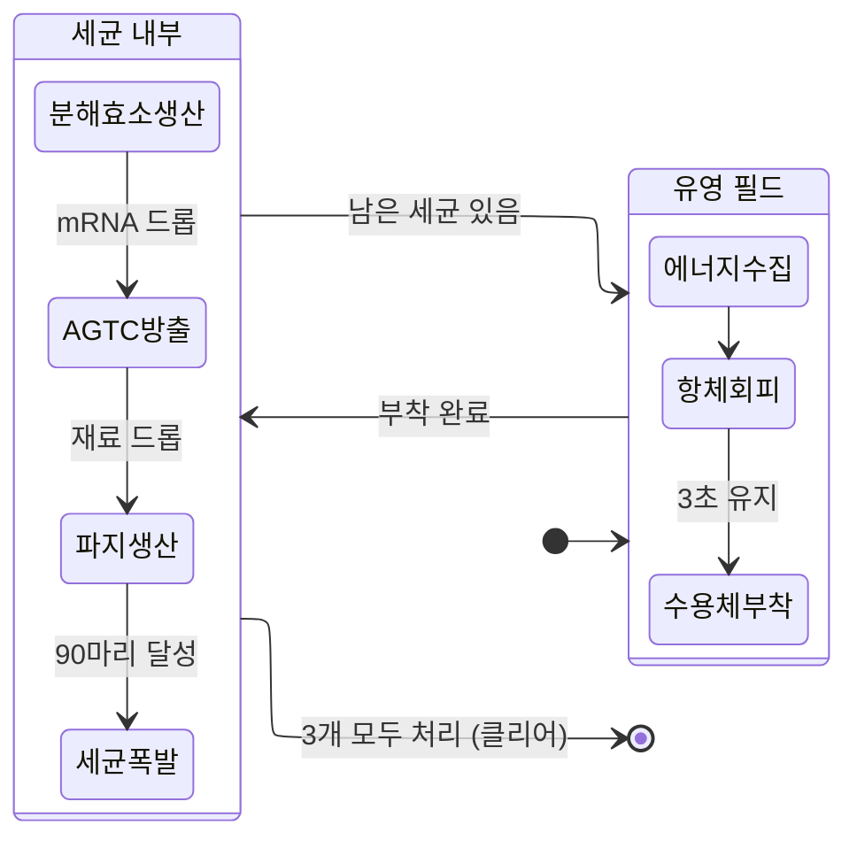

| 구분      | 유영 필드 (`SwimField`)                                                | 세균 내부 필드 (`BacteriaField`)                             |
| --------- | ---------------------------------------------------------------------- | ------------------------------------------------------------ |
| 목표      | 항체를 피해 세균의 수용체에 3초간 부착합니다                           | 리보솜에 mRNA와 재료를 공급해 파지를 90마리까지 증식시킵니다 |
| 위협      | 항체의 추격 · 에너지가 줄면 느려지는 이동 속도                         | 없음 (생산 순서와 재료 공급이 과제)                          |
| 보조      | 에너지 오브 · 가장 가까운 세균을 가리키는 추적기                       | 화면 가장자리에 마우스를 두면 카메라 이동                    |
| 끝나는 때 | 부착 → 세균 내부 / 항체에 2초 붙잡힘 → 재시작 / 세균 3개 처리 → 클리어 | 포식 버튼 → 세균이 터지고 유영 필드로 복귀                   |

### 2.3 조작법

| 씬        | 입력                        | 동작                                                                |
| --------- | --------------------------- | ------------------------------------------------------------------- |
| 유영 필드 | `W` `A` `S` `D`             | 입력 방향으로 머리를 돌리며 전진합니다. 입력을 떼면 서서히 멈춥니다 |
| 유영 필드 | `Space` + 이동 키           | 후진합니다. 머리는 입력 방향을 향한 채 반대쪽으로 느리게 물러납니다 |
| 세균 내부 | 마우스 왼쪽 버튼 드래그     | mRNA·아미노산·AGTC를 집어 리보솜 위에 놓습니다                      |
| 세균 내부 | 화면 가장자리로 마우스 이동 | 카메라가 그 방향으로 이동합니다                                     |
| 세균 내부 | 포식 버튼 클릭              | 파지 90마리 이후 나타나며, 누르면 유영 필드로 돌아갑니다            |

후진은 조작이 반전된 것처럼 느껴집니다. 전진과 같은 속도로는 플레이 테스트에서 조작이 급격히 어려워져, 후진 속도를 5에서 2로 낮춰 정밀하게 움직이게 했습니다.

---

## 3. 유영 필드 · 하나의 모터로 움직이는 네 객체

### 3.1 어디로 갈지는 각자, 어떻게 움직일지는 `SwimMotor`

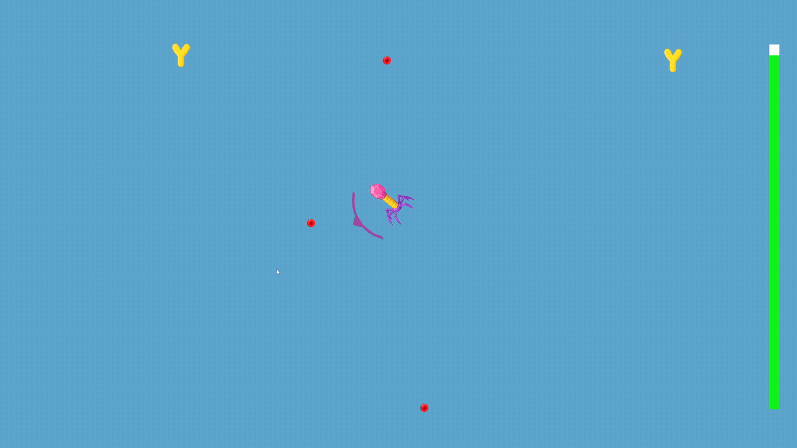

플레이어·항체·파지 AI·분해효소는 모두 방향을 바꾸며 헤엄칩니다. 그래서 회전·이동·감속은 공통 컴포넌트 `SwimMotor` 하나에 두고, 각 객체는 어디로 갈지만 정해 넘기게 했습니다.

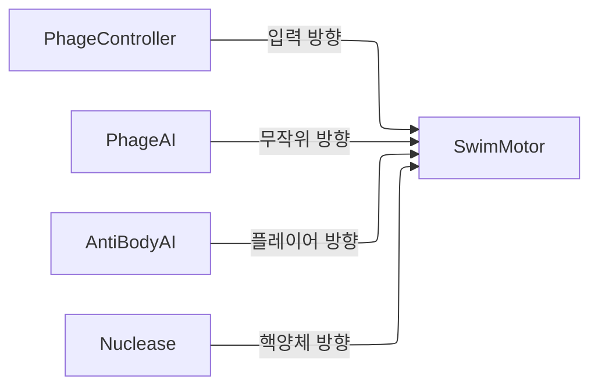

| 객체                         | 언제, 어디로 (각자 정함)                       |
| ---------------------------- | ---------------------------------------------- |
| `PhageController` (플레이어) | 키보드 입력 방향으로, 후진 키를 누르면 후진    |
| `PhageAI`                    | 3초 안팎의 무작위 간격마다 무작위 방향으로     |
| `AntiBodyAI`                 | 감지 거리 안에 플레이어가 들어오면 그 방향으로 |
| `Nuclease`                   | 핵양체를 목표로 그 방향으로                    |

### 3.2 `SwimMotor`의 동작: 회전 속도 제한과 감속

| 호출                                | 하는 일                                                                   |
| ----------------------------------- | ------------------------------------------------------------------------- |
| `SetGoalDirection(dir)`             | 목표 방향을 저장합니다.                                                   |
| `SetGoalDirection(dir, isBackward)` | 후진 여부까지 받아 이동 속도와 회전 속도를 정합니다.                      |
| `Brake()`                           | 목표 방향으로 회전하는 동작을 멈춥니다                                    |
| `SetMoveSpeed(speed)`               | 전진 속도를 바꿉니다. `PhageEnergy`가 에너지 단계별 속도를 넘길 때 씁니다 |

```csharp
// SwimMotor.cs — 매 물리 프레임 회전 → 이동 → 감속
private void FixedUpdate()
{
    if (hasGoalDirection)
    {
        float targetAngle = Mathf.Atan2(goalDirection.y, goalDirection.x) * Mathf.Rad2Deg;
        // (Why) 한 물리 프레임에 돌 수 있는 각도를 제한해, 입력 방향이 바뀌어도 몸이 한 번에 꺾이지 않고 돌면서 방향을 바꾼다
        currentAngle = Mathf.MoveTowardsAngle(currentAngle, targetAngle, currentRotationSpeed * Time.fixedDeltaTime);
    }

    // ... currentAngle로 머리 방향(headDirection) 계산 (생략)

    // (Why) 후진도 같은 목표 각도로 회전하고, 이동 방향만 머리 반대쪽으로 뒤집는다
    currentDirection = isBackwardMove ? -headDirection : headDirection;

    Vector2 movePosition = rb.position + (currentDirection * currentSpeed * Time.fixedDeltaTime);
    rb.MovePosition(movePosition);
    rb.MoveRotation(currentAngle + angleOffset);

    currentSpeed = Mathf.MoveTowards(currentSpeed, 0f, deceleration * Time.fixedDeltaTime);
}
```

[SwimMotor.cs 원문](https://github.com/KooHoo-Dev/3rd-2D-Project-Lets-Gitit/blob/eae150e07462fd1182b42051f80d290e7cc21a23/Assets/Scripts/Common/SwimMotor.cs#L30)

- **방향은 돌면서 바뀝니다.** 회전 속도에 제한이 있어, 입력이 바뀌어도 머리를 돌리며 방향을 틉니다.
- **멈출 때는 미끄러집니다.** `Brake()`는 속도를 0으로 만들지 않고 회전 목표만 끊습니다. 남은 속도는 매 프레임 감속되며 줄어듭니다.
- **충돌은 물리 엔진, 속도는 코드가 맡습니다.** `MovePosition`으로 움직여 벽과의 충돌은 물리 엔진이 막고, 속도와 감속은 코드에서 계산한 값을 따릅니다.

> 현재 `SwimMotor`의 방향 설정 메서드는 `SetGoalDirection(dir)`과 `SetGoalDirection(dir, isBackward)` 두 개로 오버로딩되어 있습니다.
>
> 지금 다시 만든다면 가독성을 높이기 위해 `SetGoalDirection(Vector2 dir, bool isBackward = false)`처럼 디폴트 매개변수를 써서 하나의 함수로 구현할 것 같습니다.

### 3.3 이동 로직을 공유할 것인가

네 객체가 모두 "방향을 바꾸며 헤엄치는" 움직임을 가집니다. 이동 코드를 객체마다 둘지, 하나를 함께 쓸지 정해야 했습니다.

|      | [A] 객체마다 이동 코드 작성                        | [B] 공통 `SwimMotor` + 방향만 넘기기 ✓                                  |
| ---- | -------------------------------------------------- | ----------------------------------------------------------------------- |
| 방식 | 각 스크립트의 `Update`에서 위치·회전을 직접 바꾼다 | 입력·AI는 `SetGoalDirection`/`Brake`만 호출하고, 이동은 모터가 처리한다 |
| 장점 | 객체별로 움직임을 따로 손보기 쉽다                 | 회전·감속·후진 규칙이 한곳에 있고, 새 객체는 방향만 정하면 된다         |
| 단점 | 같은 회전·감속 코드가 네 곳에 생긴다               | 모터를 고치면 모든 객체의 움직임이 함께 바뀐다                          |

[B]를 골랐습니다. 목표 방향을 언제, 어디로 보낼지는 입력이나 AI가 정하고, 그 방향으로 어떻게 움직일지는 `SwimMotor`가 맡습니다. 덕분에 플레이어 외에 세 객체가 방향만 정해 같은 움직임을 얻었습니다. 대신 한 객체만을 위해 모터를 고칠 수 없게 되었고, 분해효소에서는 이로인한 문제(§6.1)가 발생하기도 했습니다.

### 3.4 에너지 · 속도를 3단계로 끊어 낮추기

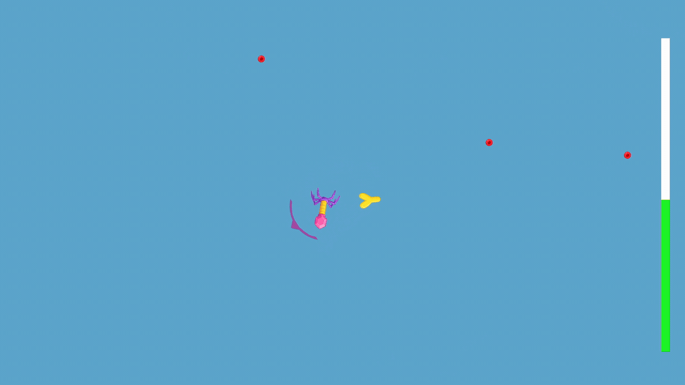

에너지는 초당 3씩 줄고, 40과 20을 경계로 이동 속도가 두 번 낮아집니다. 속도는 항체의 이동 속도(3)를 기준으로 정해, 에너지가 떨어질수록 항체의 위협이 커집니다. 에너지가 0이 되어도 죽지는 않고 가장 느린 속도(2)가 유지됩니다. 에너지 오브를 먹으면 5가 회복됩니다.

| 에너지 구간 | 파지 전진 속도 | 항체와 비교 | 100에서 시작해 도달하는 시간 |
| ----------- | -------------- | ----------- | ---------------------------- |
| 40 초과     | 5              | 더 빠름     | 시작 ~ 20초                  |
| 20 초과     | 3              | 같음        | 20초 ~ 약 26.7초             |
| 20 이하     | 2              | 더 느림     | 약 26.7초 이후               |

에너지가 줄 때 속도를 어떻게 낮출지 정해야 했습니다.

|      | [A] 에너지 비율만큼 연속으로 감속                                            | [B] 구간 3단계로 끊어서 감속 ✓                                                |
| ---- | ---------------------------------------------------------------------------- | ----------------------------------------------------------------------------- |
| 방식 | 매 프레임 `속도 = 최대 × 에너지 비율`로 계산한다                             | 40·20을 경계로 5 → 3 → 2로 낮추고, 단계가 바뀔 때만 `SetMoveSpeed`를 호출한다 |
| 장점 | 변화가 부드럽다                                                              | 구간 안에서는 속도가 그대로이고, 단계마다 항체보다 빠른지가 분명하다          |
| 단점 | 에너지가 줄어드는 내내 계속 느려진다. 항체보다 빠른지 느린지 경계가 흐릿하다 | 경계에서 속도가 한 번에 바뀐다                                                |

[B]를 골랐습니다. 에너지는 밋밋할 수 있는 이동에 짧은 목표를 주어, 플레이어가 계속 움직일 동기를 얻게 하려는 장치입니다. 에너지를 챙기는 동안 계속 느려지며 스트레스를 받는 경험은 원하지 않았습니다. 첫 감속 구간을 40으로 낮게 설정해 둔 이유도 에너지를 먹으려는 노력을 거의 하지 않은 상황에 대한 페널티로 작용하길 바랬기 때문입니다.

**※ 오브가 파지를 따라잡지 못한 문제** 플레이 테스트 중, 에너지 오브 옆을 스쳐 지나가면 오브가 파지를 쫓아오기만 하고 끝내 따라잡지 못했습니다. 오브는 파지가 트리거에 들어온 순간부터 파지 쪽으로 끌려오는데, 오브 속도(4)가 파지의 최고 속도(5)보다 느렸기 때문입니다. 충분히 노력했는데도 에너지를 먹지 못하는 것은 위의 의도와 맞지 않아, 오브 속도를 6으로 올렸습니다.

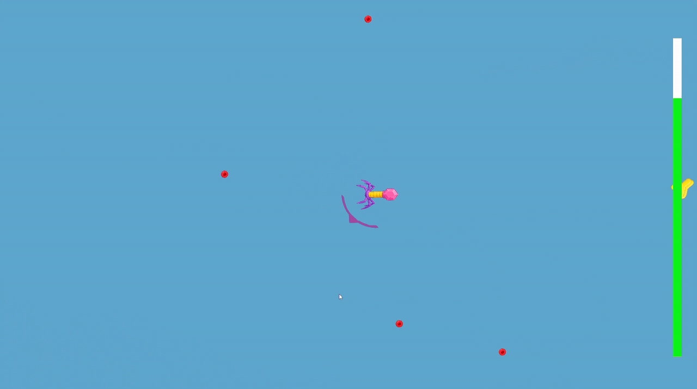
_오브가 파지를 따라잡지 못하던 상황 — Before: 오브 속도 4 / After: 오브 속도 6_

이 문제는 코드만 봐서는 드러나지 않았고, 플레이 테스트에서 발견했습니다. 의도를 정해 두고 수치를 넣어도, 실제로 플레이해 보기 전까지는 그 수치가 의도대로 느껴지는지 알 수 없다는 것을 배웠습니다.

### 3.5 항체는 플레이어를 얼마나 자주 찾는가

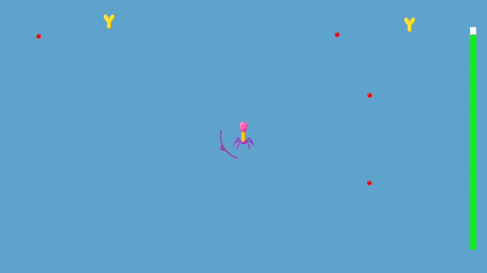

항체는 감지 반경 안에 들어온 플레이어를 추적합니다. 플레이어가 반경 안에 있는지를 무엇으로, 얼마나 자주 검사할지 정해야 했습니다.

|      | [A] 감지 반경 크기의 트리거 콜라이더                                  | [B] 매 프레임 거리 검사          | [C] 0.5초 간격 코루틴 + 제곱거리 비교 ✓                                          |
| ---- | --------------------------------------------------------------------- | -------------------------------- | -------------------------------------------------------------------------------- |
| 방식 | 항체마다 감지용 트리거를 붙이고, 플레이어가 드나들 때 추격을 전환한다 | `Update`에서 거리를 비교한다     | `DetectPhage` 코루틴이 0.5초마다 추격 여부만 갱신하고, `Update`는 그 값만 읽는다 |
| 장점 | 범위 진입·이탈을 물리 엔진이 알려 준다                                | 범위 진입·이탈에 바로 반응한다   | 검사할 콜라이더가 늘지 않고, 매 프레임 검사보다 연산이 적다                      |
| 단점 | 항체마다 콜라이더가 하나씩 늘어난다                                   | 항체 수 × 프레임 수만큼 검사한다 | 범위에 드나든 뒤 최대 0.5초 늦게 반응한다                                        |

[C]를 골랐습니다. 감지 대상이 플레이어 하나뿐이고 가까운지만 알면 되므로, 거리 계산으로 충분했습니다. 거리는 루트 연산 없이 제곱거리(`sqrMagnitude`)로 비교합니다. 항체 25개가 60fps로 매 프레임 검사하면 초당 약 1,500번, 0.5초마다 검사하면 초당 50번이고, 추적 민감도 면에서 체감 차이는 없었습니다.

```csharp
// AntiBodyAI.cs — 0.5초마다 플레이어가 감지 반경 안에 있는지 검사
private IEnumerator DetectPhage()
{
    while (true)
    {
        Vector3 offset = transform.position - target.transform.position;
        isChasing = offset.sqrMagnitude <= (detectDistance * detectDistance);

        yield return new WaitForSeconds(detectInterval);
    }
}
```

[AntiBodyAI.cs 원문](https://github.com/KooHoo-Dev/3rd-2D-Project-Lets-Gitit/blob/eae150e07462fd1182b42051f80d290e7cc21a23/Assets/Scripts/SwimField/Enemy/AntiBodyAI.cs#L24)

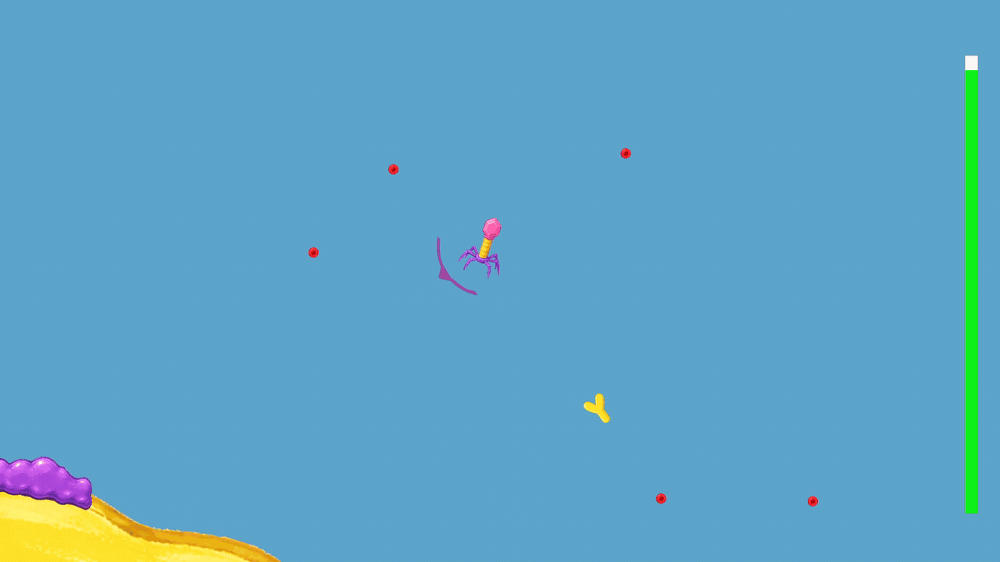

항체에 붙잡힌 상태가 2초 이어지면 파지가 죽습니다. 항체의 트리거가 잠깐 떨어졌다 다시 붙어도 접촉 시간이 끊기지 않도록, **마지막 접촉 후 0.6초 안**이면 접촉이 이어지는 것으로 봅니다.

---

## 4. 세균 내부 · 액션 한 번이 다음 단계를 연다

### 4.1 앞 단계의 산물이 다음 재료가 되는 구조

<!-- 준비할 그림: 아이디어 참고 영상의 증식 장면 캡처를 아래 화면과 나란히 둡니다. -->

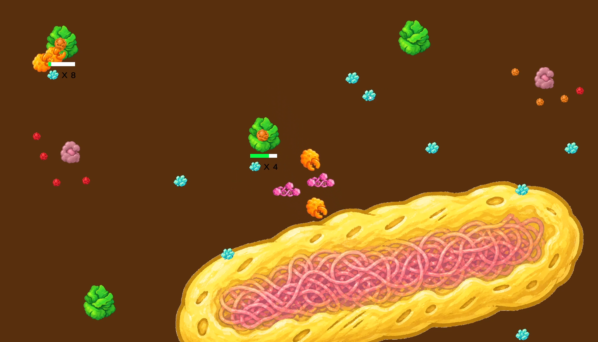

실제 포식 과정에서 상태가 바뀌는 지점을 플레이어가 개입하는 지점으로 정했습니다. <span style="color:#a9e39a">리보솜</span>에 <span style="color:#ff9f9f">mRNA</span>를 넣어야 <span style="color:#ffc48a">분해효소</span>가 생산되고, <span style="color:#ffc48a">분해효소</span>가 <span style="color:#f3e39b">핵양체</span>에 닿아야 파지의 재료인 <span style="color:#f5aade">AGTC</span>가 나옵니다. 플레이어가 개입하는 순간 다음 변화가 일어나므로, 그 변화를 바로 체감합니다.

이는 실제 파지의 포식 과정을 단순화한 결과입니다. 원래 파지는 머리·몸통·다리를 따로 생산한 뒤 조립하지만, 조립 단계를 빼고 게이지가 차면 완성체가 리보솜에서 바로 튀어나오게 했습니다. 실제 과정을 모두 체험하게 하면 지루할 것이라 생각했습니다.

### 4.2 재료 흐름

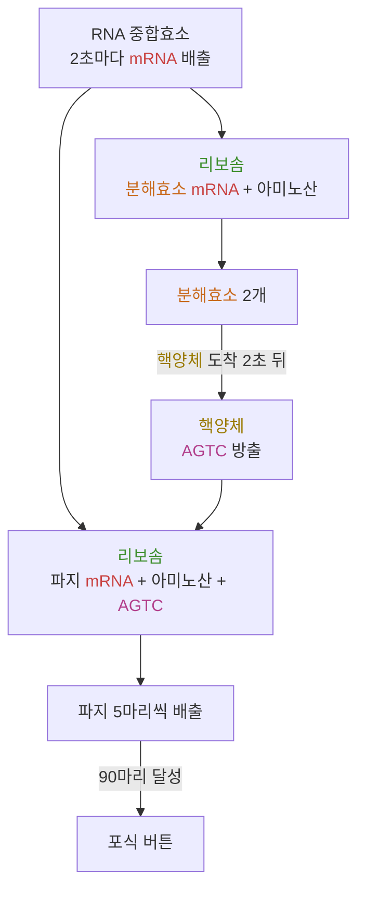

| 생산 종류     | 한 회차의 소비      | 한 회차의 배출 | 생산 간격               |
| ------------- | ------------------- | -------------- | ----------------------- |
| 핵산 분해효소 | 아미노산 1          | 분해효소 2개   | 3초                     |
| 파지          | 아미노산 1 + AGTC 1 | 파지 5마리     | 처음 1.2초, 최저 0.45초 |

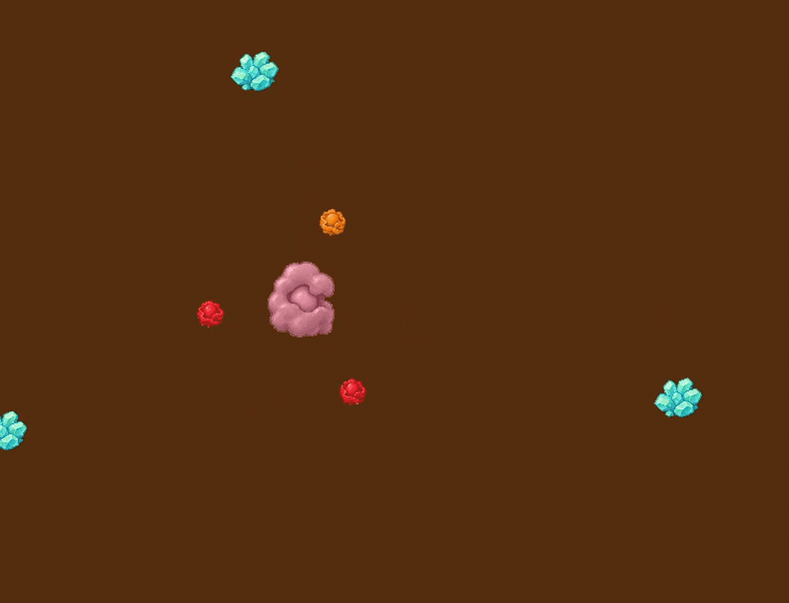

### 4.3 드롭에서 생산까지

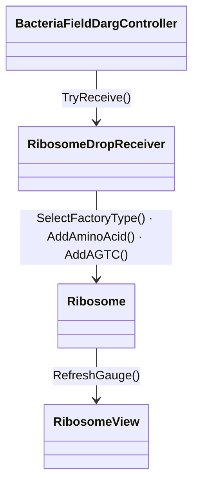

| 클래스                        | 맡은 일                                                |
| ----------------------------- | ------------------------------------------------------ |
| `BacteriaFieldDargController` | 드래그할 오브젝트와 드롭 대상을 찾습니다               |
| `RibosomeDropReceiver`        | 드롭된 종류를 생산 종류 선택 또는 재료 추가로 바꿉니다 |
| `Ribosome`                    | 생산 종류·재료 수량·타이머를 관리하고 생산합니다       |
| `RibosomeView`                | 재료 수량과 진행 게이지를 표시합니다                   |

```csharp
// RibosomeDropReceiver.cs — 드롭된 종류를 생산 종류 선택 또는 재료 추가로 바꿈
public bool TryReceive(MicroEntity entity)
{
    if (entity == null) return false;

    // (Why) 무엇을 받을지는 수신기 한곳에서 정한다. 드래그 컨트롤러는 반환값만 보고 원본을 지울지 정한다
    switch (entity.entityType)
    {
        case EntityType.AminoAcid:
            ribosome.AddAminoAcid();
            return true;
        case EntityType.mRNA_Nuclease:
            ribosome.SelectFactoryType(RibosomeFactoryType.Nuclease);
            return true;
        // AGTC → AddAGTC(), mRNA_Phage → SelectFactoryType(Phage) (같은 모양이라 생략)
        default : return false;
    }
}
```

[RibosomeDropReceiver.cs 원문](https://github.com/KooHoo-Dev/3rd-2D-Project-Lets-Gitit/blob/eae150e07462fd1182b42051f80d290e7cc21a23/Assets/Scripts/Bacteria%20Elements/Ribosome/RibosomeDropReceiver.cs#L9)

- **드래그 컨트롤러는 놓은 자리에 무엇이 있는지만 압니다.** 그 오브젝트가 생산 종류인지 재료인지는 수신기가 판단합니다.
- **받아들였을 때만 원본이 사라집니다.** 수신기가 `false`를 돌려주면(파지 AI나 분해효소를 놓은 경우) 오브젝트는 그 자리에 남습니다.
- **재료가 모두 갖춰진 프레임부터 생산 타이머가 흐릅니다.** 재료를 구하는 동안의 시간은 생산 시간에 더해지지 않습니다.

### 4.4 공통 생성기 `MicroEntityEmitter`

리보솜·핵양체·RNA 중합효소는 무엇을 낼지만 다르고, 생성·초기화·배출 절차는 같습니다. 그래서 절차는 `MicroEntityEmitter`에 두고, 각 생산자는 자기가 고른 프리팹을 `Emit`에 넘깁니다. 처음에는 기반 클래스가 프리팹 배열을 가지고 있었지만, 하위 클래스의 프리팹 필드와 중복되어 프리팹 선택을 생산자 쪽으로 옮겼습니다.

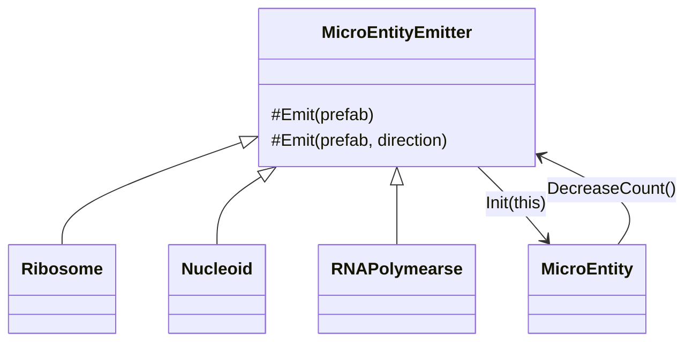

```csharp
// MicroEntityEmitter.cs — 생산자가 넘긴 프리팹을 상한 안에서 생성·초기화하고 배출
protected void Emit(GameObject prefab, Vector2 direction)
{
    if (prefab == null) return;
    if (currentEntities >= maxEntities) return;

    GameObject spawnedObject = Instantiate(prefab, emitPoint.position, Quaternion.identity);

    MicroEntity entity = spawnedObject.GetComponent<MicroEntity>();
    // (Why) 생성 주체를 등록해 두어, 파괴될 때 이 생성기의 수량을 줄이게 한다
    entity.Init(this);

    currentEntities += 1;

    // ... 배출 방향을 정하고 Eject 코루틴으로 밀어냄 (생략)
}
```

[MicroEntityEmitter.cs 원문](https://github.com/KooHoo-Dev/3rd-2D-Project-Lets-Gitit/blob/eae150e07462fd1182b42051f80d290e7cc21a23/Assets/Scripts/Bacteria%20Elements/MicroEntities/MicroEntityEmitter.cs#L28)

- **생성기마다 상한이 있습니다.** 상한에 닿으면 생성하지 않고, 생성물이 파괴되면 수량이 줄어 다시 생성됩니다.
- **생성물은 자기를 만든 쪽을 기억합니다.** `Init(this)`로 등록하고, 파괴될 때 `DecreaseCount()`로 알립니다.
- **무엇을 낼지는 생산자가 정합니다.** 리보솜은 생산 종류에 맞는 프리팹을, 핵양체는 AGTC와 배출 방향을, RNA 중합효소는 무작위 mRNA를 넘깁니다.

### 4.5 파지 생산 간격을 고정할 것인가


같은 리보솜에서 파지를 반복 생산할 때 간격을 어떻게 둘지 정해야 했습니다.

|      | [A] 고정 간격                                                     | [B] 생산할수록 간격 단축 + 하한 ✓                                   |
| ---- | ----------------------------------------------------------------- | ------------------------------------------------------------------- |
| 방식 | 모든 생산에 같은 간격을 쓴다                                      | 요청한 파지 수만큼 간격을 줄이고, 하한은 0.45초로 둔다              |
| 장점 | 계산이 단순하다                                                   | 반복할수록 증식에 속도가 붙고, 후반에 대량으로 불어나는 쾌감이 있다 |
| 단점 | 처음부터 90마리까지 같은 속도라, 증식의 규모가 커지는 느낌이 없다 | 하한에 걸린 뒤로는 더 빨라지지 않는다                               |

[B]를 골랐습니다. 증식은 반복할수록 더 큰 규모로 일어나야 대량 증식의 쾌감이 생긴다고 생각했습니다. 생산 간격 계산을 따로 빼고 파지에만 가속을 넣었습니다.

```csharp
// Ribosome.cs — 파지 생산만 회차가 쌓일수록 간격을 줄임
private float GetCurrentProduceInterval()
{
    if (FactoryType != RibosomeFactoryType.Phage)
    {
        return ProduceInterval;
    }

    // (Why) 요청한 파지 수만큼 간격을 줄여 증식에 속도가 붙게 하고, Mathf.Max로 하한(0.45초)을 둔다
    float acceleratedInterval = PhageProduceInterval - producedPhageCount * PhageProduceAcceleration;
    return Mathf.Max(MinimumPhageProduceInterval, acceleratedInterval);
}
```

| 파지 생산 회차 | 그때까지 요청한 파지 수 | 다음 생산 간격                           |
| -------------- | ----------------------- | ---------------------------------------- |
| 1회차          | 0                       | 1.2초                                    |
| 2회차          | 5                       | 1.2 − 5 × 0.08 = 0.8초                   |
| 3회차부터      | 10                      | 1.2 − 10 × 0.08 = 0.4 → **0.45초**(하한) |

---

## 5. 씬 전환 · 다시 돌아와도 진행이 남도록

### 5.1 돌아오면 무엇이 남는가

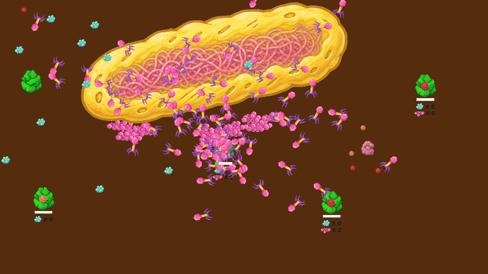

세균을 터뜨리고 유영 필드로 돌아오면, 플레이어는 들어가기 전 위치에서 다시 시작합니다. 터뜨린 세균은 사라지고 그 자리에 파지 50마리가 퍼집니다. 세균 세 개를 모두 터뜨리면 클리어 화면이 열립니다.

### 5.2 기록하고 되살리는 흐름

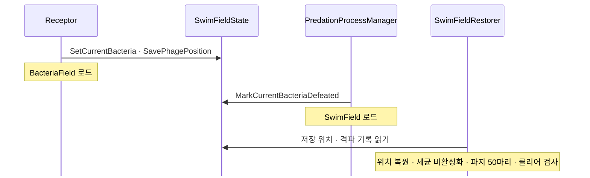

| 시점                | 누가                                | 하는 일                                                              |
| ------------------- | ----------------------------------- | -------------------------------------------------------------------- |
| 세균에 들어갈 때    | `Receptor`                          | 수용체에 3초 붙으면 대상 세균의 ID·위치와 플레이어 위치를 기록합니다 |
| 포식 버튼을 누를 때 | `PredationProcessManager`           | 현재 대상을 격파 기록으로 옮깁니다                                   |
| 유영 필드 로드 직후 | `SwimFieldRestorer`                 | 위치 복원 → 격파한 세균 끄기 → 파지 무리 생성 → 클리어 검사          |
| 사망 · 엔딩 재시작  | `PhageDeathController` · `EndingUI` | `Clear()`로 기록을 지우고 처음부터 시작합니다                        |

```csharp
// SwimFieldRestorer.cs — 유영 씬 로드 직후 기록 반영
private void Start()
{
    RestorePhagePosition();
    RestoreBacterias();
    SpawnPendingPhageAIs();
    // (Why) 위치·세균·파지 무리를 모두 반영한 뒤, 마지막에 클리어 여부를 검사한다
    CheckGameClear();
}
```

### 5.3 두 파트를 한 씬에 둘 것인가

유영 필드와 세균 내부를 한 씬 안에서 전환할지, 서로 다른 씬으로 나눌지 정해야 했습니다.

|      | [A] 한 씬 안에서 오브젝트 묶음을 켜고 끄기 | [B] 별도의 Unity 씬 두 개 ✓                                                   |
| ---- | ------------------------------------------ | ----------------------------------------------------------------------------- |
| 장점 | 상태가 씬 안에 그대로 남는다               | 각 씬이 필요한 입력(이동 키 / 포인터)과 카메라(추적 / 가장자리 이동)만 가진다 |
| 단점 | 입력·카메라·오브젝트가 한 씬에 섞인다      | 씬을 다시 불러오면 오브젝트가 새로 만들어져, 진행 기록을 따로 보관해야 한다   |

[B]를 골랐습니다. 두 파트는 넘어갈 때마다 조작·목표·진행 규칙이 한꺼번에 바뀌어, 필요한 입력과 오브젝트를 씬 단위로 나눌 이유가 있었습니다.

진행 기록은 씬 밖에 둘 곳이 필요해 `SwimFieldState`를 만들었습니다. 다른 매니저와 같은 공통 싱글톤 클래스 `SingletonBase`를 상속하고, `DontDestroyOnLoad`로 씬 전환 중에도 유지됩니다. 지금처럼 기록만 보관하는 용도로는 static 필드 클래스로도 충분해, 그보다 무거운 구조를 쓴 셈입니다. 또 씬 전환 때 싱글톤이 멈추는 문제(§6.3)를 겪었습니다.

에너지는 기록하지 않고 복귀할 때 100에서 새로 시작합니다. 수용체에 붙어 있는 동안에는 에너지를 먹을 수 없어, 아슬아슬한 에너지로 들어가는 경우가 많았기 때문입니다. 실제 파지도 세균에 침투하면서 껍데기만 남고, 복귀한 플레이어는 세균 안에서 새로 태어난 파지 중 한 마리가 됩니다.

---

## 6. 만들며 생긴 문제

### 6.1 분해효소가 핵양체 안으로 파고든 문제

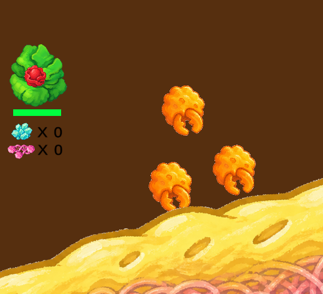 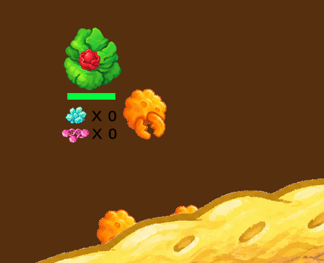

분해효소는 핵양체 표면에 멈춰 붙어야 했습니다. 그런데 핵양체를 감지하고 멈추더라도, 관성 때문에 안쪽으로 파고들어 갔습니다.

원인은 분해효소도 공통 모터 `SwimMotor`로 움직인다는 점이었습니다. 모터는 이동 명령이 끊긴 뒤에도 남은 속도를 감속시키며 계속 움직입니다(§3.2). 그래서 도착을 감지한 순간 방향 갱신을 멈춰도, 남은 관성만큼 더 밀려 들어갔습니다.

분해효소 전용 이동 코드를 새로 쓰거나 모터의 관성 처리를 고치는 방법도 있었습니다. 하지만 관성 없이 멈추는 움직임은 분해효소 하나에만 필요했고, 모터를 고치면 다른 세 객체의 움직임까지 바뀔 수 있었습니다. 그래서 프리팹의 콜라이더 앞부분을 늘려 핵양체를 더 일찍 감지하게 했습니다. 감지한 뒤 남은 관성으로 미끄러져 표면에서 멈춥니다.

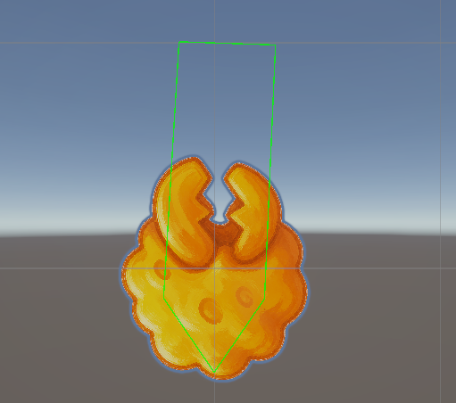

코드는 바꾸지 않고 프리팹 하나만 조정해 해결했습니다. 문제를 꼭 코드로 풀어야 하는 것은 아니며, 관점을 바꾸면 더 간단한 방법이 있을 수 있다는 것을 경험했습니다.

### 6.2 카메라를 따라가는 화면이 떨린 문제

카메라가 파지를 따라갈 때 화면이 떨려 보였습니다.

파지가 움직이는 시점과 카메라가 따라가는 시점이 달랐습니다. 파지는 `SwimMotor`가 `FixedUpdate`에서 `MovePosition`으로 움직이므로 물리 주기마다만 움직입니다. 카메라는 `Update`에서 매 프레임 따라갔습니다. 그래서 어떤 프레임에서는 파지가 움직였고 어떤 프레임에서는 그대로여서, 화면에서 파지와 배경의 위치가 들쭉날쭉해졌습니다.

두 곳을 고쳐 시점을 맞췄습니다.

| 바뀐 곳                    | Before   | After        | 효과                                                      |
| -------------------------- | -------- | ------------ | --------------------------------------------------------- |
| `FollowCamera`의 위치 갱신 | `Update` | `LateUpdate` | 그 프레임의 이동이 끝난 뒤에 카메라가 따라감              |
| 파지의 `Rigidbody2D` 보간  | None     | Interpolate  | 물리 주기 사이의 프레임에서도 파지의 위치를 부드럽게 채움 |

수정한 뒤 화면이 떨리지 않았습니다. 물리로 움직이는 대상을 따라가는 카메라는 대상의 이동이 끝난 뒤에 갱신해야 하고, 물리 이동은 보간으로 프레임 사이를 채워야 한다는 것을 배웠습니다.

### 6.3 세균 내부에 다시 들어가면 싱글톤이 멈춘 문제

처음 세균 내부에 들어갔을 때는 정상이었는데, 유영 필드로 나갔다가 다시 들어오면 세균 내부의 싱글톤들이 동작하지 않았습니다.

이 프로젝트의 싱글톤은 모두 `SingletonBase<T>`를 상속하지만, 씬을 넘어 유지되는 것(`SwimFieldState`)과 한 씬 안에서만 쓰는 것(`PredationProcessManager` 등)이 섞여 있습니다. 공통 부모의 `OnDestroy`는 파괴될 때 "앱이 종료 중" 표시를 켜고, 이 표시가 켜지면 `Instance`가 계속 `null`을 돌려줬습니다. 씬 전용 싱글톤은 씬을 나갈 때마다 파괴되므로, 씬 전환이 앱 종료로 처리된 것입니다.

```csharp
// SingletonBase.cs — 인스턴스가 파괴될 때 정리
protected virtual void OnDestroy()
{
    if (instance == this)
    {
        OnDispose();
        instance = null;
        isInitialized = false;
        // (Why) OnDestroy는 씬 전환으로 파괴될 때도 불린다. 종료 표시는 앱이 끝날 때만 불리는 OnApplicationQuit에만 둔다
        // applicationIsQuitting = true;   ← 제거
    }
}
```

종료 표시는 이미 `OnApplicationQuit`에 있었으므로, `OnDestroy`의 줄을 지웠습니다. 수정한 뒤 여러 번 드나들어도 싱글톤이 정상 동작했습니다.

같은 시기에 공통 클래스 `MicroEntity`에서도 비슷한 문제가 있었습니다. 파괴될 때 자신을 만든 쪽의 수량을 줄이는데, `emitter == null || spawner == null`이면 빠져나가게 묶어 두어 mRNA가 최대 수량에 한 번 닿으면 더 생성되지 않았습니다. 오브젝트 하나에는 둘 중 한쪽만 들어 있으므로 조건이 항상 참이었습니다. if문을 둘로 나눠 해결했습니다. 두 문제 모두, 여러 곳이 함께 쓰는 클래스의 삭제·종료 처리 하나가 모든 사용처에 적용된다는 것을 놓친 실수였습니다.

### 6.4 항체가 파지 주변을 공전한 문제

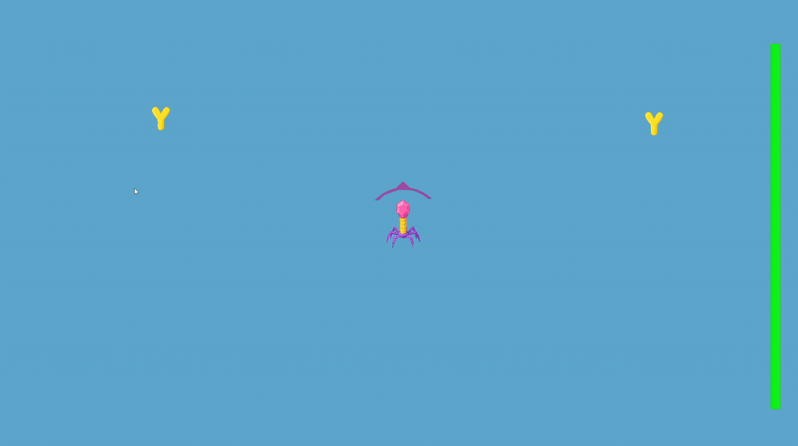

항체가 파지에 가까워지면 다가오지 않고 그 주변을 맴돌았습니다.

처음에는 추적 로직을 의심해 `AntiBodyAI`와 `SwimMotor`의 방향·회전 계산을 한참 고쳤지만 공전은 사라지지 않았습니다. 원인은 코드 밖에 있었습니다. 항체 스프라이트(자식 오브젝트)가 원점에서 (-0.68, -2.56)만큼 어긋나 있어, 항체가 회전할 때마다 그림이 기준 위치를 중심으로 원을 그렸습니다.

스프라이트의 로컬 위치를 (0, 0, 0)으로 맞추자 항체가 파지를 향해 곧바로 쫓아왔습니다. 같은 방법으로 풀리지 않으면 코드뿐 아니라 오브젝트 구성·에셋 설정도 점검해야 한다는 것을 배웠습니다.

---

## 7. 결과와 돌아보기

### 7.1 구현 결과

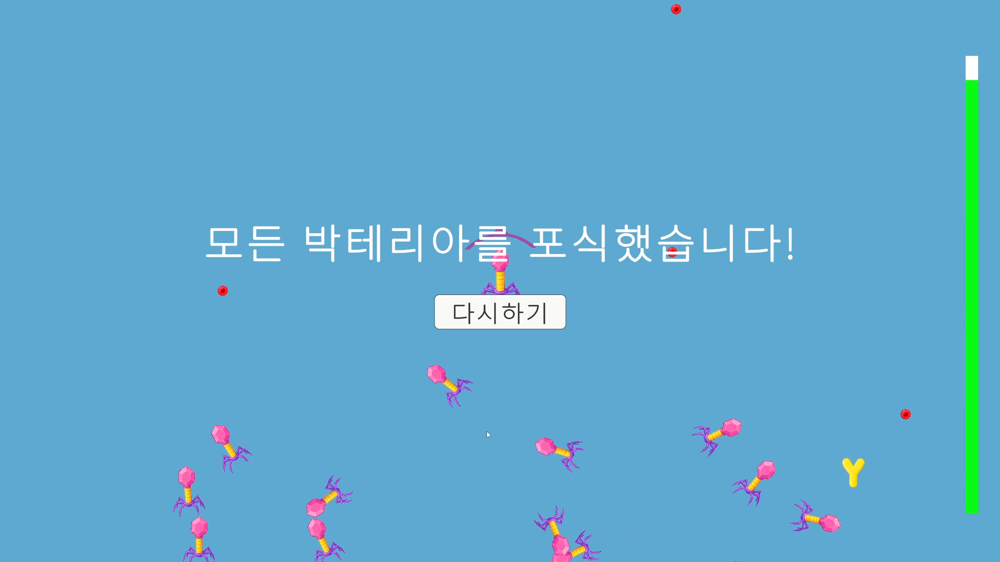

2주 안에 유영 → 부착 → 증식 → 폭발 → 복귀로 이어지는 핵심 루프를 처음부터 끝까지 구현했습니다. §1에서 목표로 한 2D 탑뷰 게임의 다양한 기능들도 구현해 볼 수 있었습니다. 회전과 관성이 있는 자유 유영(§3.2), 씬마다 다른 조작과 카메라(§5.3), 후진(§2.3)과 드래그 앤 드롭(§4.3), 재료가 모이면 스스로 생산하는 리보솜(§4.2)입니다.

| 목표 경험 (§1)                        | 구현한 시스템                                             | 어디서      |
| ------------------------------------- | --------------------------------------------------------- | ----------- |
| 여러 단계가 맞물리는 증식 과정을 체험 | 세균 내부를 별도 씬으로, 상태가 바뀌는 지점을 드롭으로    | §4 · §5.3   |
| 에너지는 스트레스가 아니라 짧은 목표  | 3단계 감속, 오브를 파지보다 빠르게, 복귀하면 100에서 시작 | §3.4 · §5.3 |
| 반복할수록 증식에 속도가 붙음         | 파지 생산 간격 1.2초 → 최저 0.45초                        | §4.5        |

플레이 테스트를 하며 의도에 맞춰 바꾼 값입니다.

| 항목                              | 변경 전      | 변경 후             | 이유                                             |
| --------------------------------- | ------------ | ------------------- | ------------------------------------------------ |
| 에너지 오브 속도                  | 4            | 6                   | 파지의 최고 속도(5)보다 느려 끝내 따라잡지 못함  |
| 항체 이동 속도                    | 5            | 3                   | 세균 부착을 방해하는 끈질긴 추적자가 되지 않도록 |
| 에너지 소모(초당)                 | 1            | 3                   | 이동에 짧은 목표를 주도록                        |
| 리보솜 생산에 필요한 재료         | 종류마다 3개 | 종류마다 1개        | 포식 과정의 템포를 빠르게                        |
| 아미노산 최대 스폰 수 · 스폰 간격 | 10개 · 1초   | 50개 → 30개 · 0.5초 | 너무 많으면 식별이 어려워서                      |

### 7.2 아쉬운 점과 개선 계획

| #   | 아쉬운 점                      | 원인 구분 | 개선 계획                                                                         |
| --- | ------------------------------ | --------- | --------------------------------------------------------------------------------- |
| 1   | 목표가 바로 이해되지 않음      | 기획/UI   | 현재 목표를 단계별로 보여 주는 HUD("가까운 세균 찾기", "수용체에 3초 접촉")       |
| 2   | 위험 상황 피드백이 약함        | 구현      | 이미 누적 중인 항체 접촉 시간을 경고 게이지로 표시하고, 화면 흔들림·경고음을 더함 |
| 3   | 세균 내부 생산의 전략성이 낮음 | 기획      | 강화 세균 1종 추가(내부 자원 요구량이 높고, 주변에 항체가 더 많음)                |
| 4   | 결과 화면의 성취감이 약함      | 일정/UI   | 격파 수·생존 시간·평가를 정리하는 결과 화면                                       |
| 5   | 사운드가 없음                  | 일정/구현 | 항체 접촉 경고음, 생산 완료음, 폭발음 등 피드백 중심으로 도입                     |

### 7.3 배운 점: 공통으로 묶을 것인가

이 프로젝트의 구현 선택은 대부분 "여러 객체가 같은 일을 하면 공통 클래스로 묶는다"였습니다.

| 공통 클래스          | 얻은 것                                           | 그 대가로 생긴 일                                                 |
| -------------------- | ------------------------------------------------- | ----------------------------------------------------------------- |
| `SwimMotor`          | 네 객체가 방향만 정하면 같은 움직임을 얻음        | 분해효소 하나 때문에 모터를 고칠 수 없어 콜라이더로 우회(§6.1)    |
| `MicroEntityEmitter` | 세 생산자가 생성·배출 절차를 함께 씀              | 생산 중 상한에 걸리면 배출은 생략돼도 재료는 차감됨               |
| `MicroEntity`        | 모든 생성물이 파괴될 때 수량을 줄이는 규칙을 공유 | 삭제 조건 하나가 모든 생성물에 걸려 mRNA가 더 생성되지 않음(§6.3) |
| `SingletonBase<T>`   | 모든 싱글톤이 같은 방식(`.Instance`)으로 접근     | 종료 처리 가정이 씬 전용 싱글톤까지 적용되어 재진입 시 멈춤(§6.3) |

공통 클래스는 처음 쓸 때는 빠르고 재사용도 쉬웠습니다. 문제는 처음 가정한 쓰임새와 사용처가 늘어난 뒤의 쓰임새가 달라질 때 생겼습니다. 공통 클래스의 조건 하나는 모든 사용처에 동시에 적용되므로, 삭제·종료처럼 수명에 관련된 처리는 사용처별 차이를 먼저 확인해야 합니다. 공통으로 묶을 기능이 기획 단계에서 명확하면 유용하지만, 수정이 잦은 기능이라면 묶을 때의 비용도 함께 따져야 한다고 생각합니다.

수치에서도 배운 것이 있습니다. 바꿀 필요는 대부분 코드가 아니라 플레이 화면에서 드러났고, 어느 쪽으로 바꿀지는 매번 "이 값이 의도한 경험과 맞는가"로 정했습니다. 의도를 먼저 정하고 플레이 테스트로 확인하는 과정도 구현의 일부입니다.
