# Hive Purge — 팀 리딩과 보스 개발

> **1인칭으로 사방에서 밀려드는 군중을 상대하다가, 보스가 나타나면 3인칭으로 전환해 패턴과 공격 범위를 읽고 맞서는 라운드형 액션 슈터**

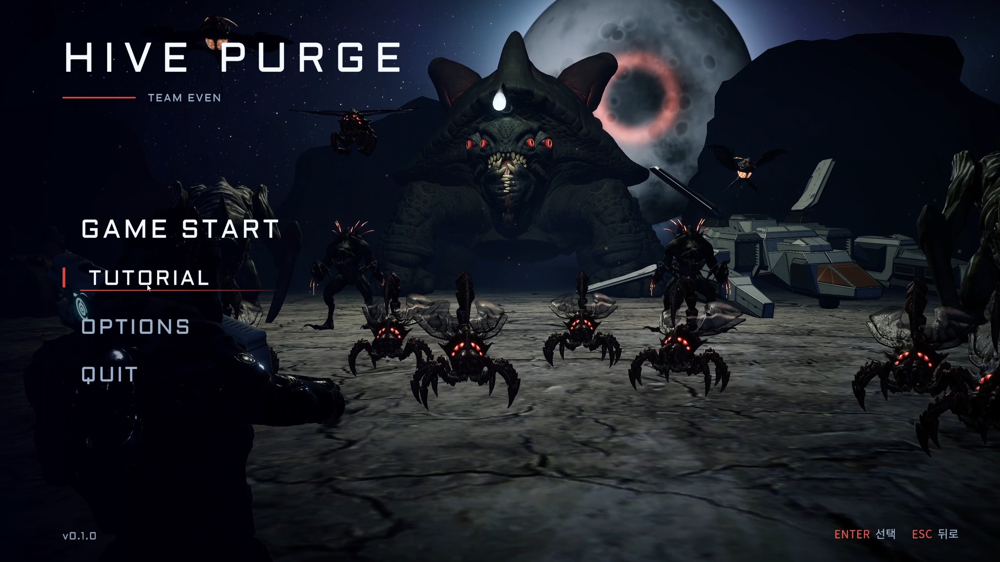

<!-- 대표 이미지(포트폴리오 페이지·슬라이드 표지): images/cover.png — 문서 맨 앞 그림은 main.jpg지만, 빌드할 때 cover는 이 파일로 둔다 -->

| 항목      | 내용                                                                                |
| --------- | ----------------------------------------------------------------------------------- |
| 장르      | 1인칭 군중전과 3인칭 보스전을 잇는 라운드형 액션 슈터                               |
| 개발 기간 | 2026.10.19 ~ 2026.11.03                                                             |
| 인원      | 팀 프로젝트 · 개발 4명 (팀장 1 · 팀원 3)                                            |
| 담당      | **팀장**(컨셉 기획서·작업 카드, 일정 관리, PR 리뷰·병합) + **보스 개발**            |
| 개발 환경 | Unity 6000.3.15f1 (URP) · Git(GitHub, Git flow)                                     |
| 협업 도구 | 노션(기획서·규약·피드백) · 아사나(카드·일정) · 디스코드(소통·마감 알림)             |
| 주요 기술 | 공통 보스 클래스 상속 · TSV 데이터 테이블 연동 · MDA 컨셉 기획서 · 유저 스토리 카드 |
| 링크      | [GitHub](https://github.com/KooHoo-Dev/3rd_3D_1-3D-Project-team_even) · 시연 영상 ✍ |

## 목차

1. [개요](#1-개요)

**Part 1. 팀 리딩**

2. [객관적 지침: MDA로 구체화한 컨셉 기획서](#2-객관적-지침-mda로-구체화한-컨셉-기획서)
3. [유저 스토리 기반의 오너십 분배](#3-유저-스토리-기반의-오너십-분배)
4. [최소한의 합의: 작업 규약](#4-최소한의-합의-작업-규약)
5. [진행 상황을 한눈에: 아사나 대시보드와 디스코드 알림](#5-진행-상황을-한눈에-아사나-대시보드와-디스코드-알림)
6. [진행 중의 의사결정](#6-진행-중의-의사결정)

**Part 2. 보스 개발**

7. [보스 시스템 구조](#7-보스-시스템-구조)
8. [보스 전투 시스템](#8-보스-전투-시스템)

<!-- 9·10장은 두 파트 공통이라 목록을 나눔 -->

9. [트러블슈팅](#9-트러블슈팅)
10. [결과와 돌아보기](#10-결과와-돌아보기)

---

## 1. 개요

### 1.1 프로젝트 소개

| 군중전                                        | 보스 등장                              | 보스전                                                 |
| --------------------------------------------- | -------------------------------------- | ------------------------------------------------------ |
| 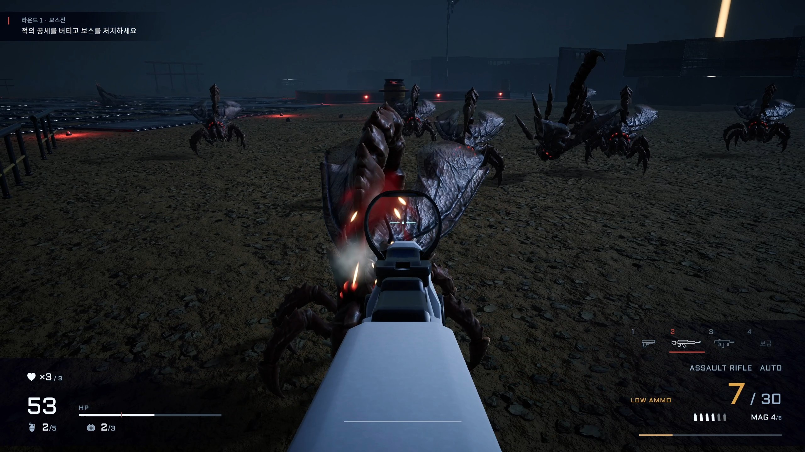             | 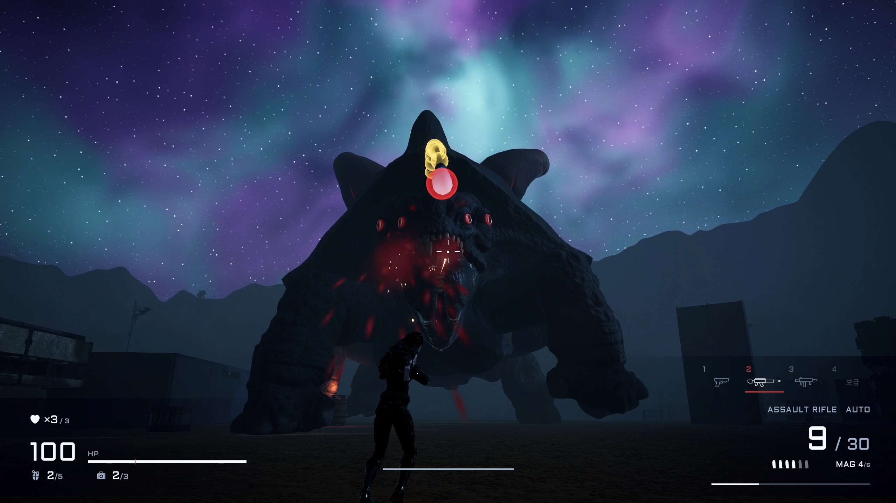   | 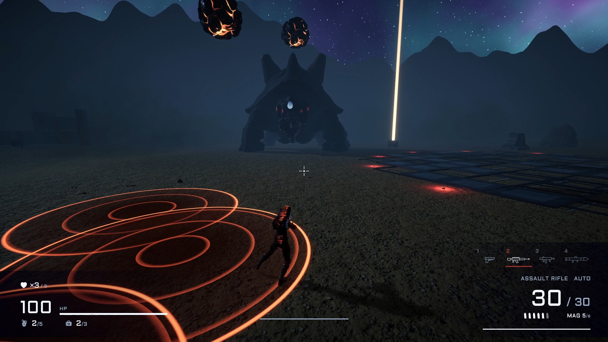                       |
| 1인칭으로 사방에서 달려드는 몬스터를 상대한다 | 보스 등장 연출과 함께 3인칭으로 바뀐다 | 넓은 시야에서 보스의 공격 범위를 읽고 피한 뒤 반격한다 |

**Hive Purge**는 사방에서 밀려드는 군중을 막아 내는 군중전과, 거대한 보스의 패턴과 공격 범위를 읽고 맞서는 보스전으로 이루어진 라운드형 액션 슈터입니다.

저는 두 가지를 맡았습니다.

- **팀 리딩** — 컨셉 기획서와 작업 카드를 쓰고, 일정을 관리하고, 팀원의 PR을 리뷰·병합했습니다(94건).
- **보스 개발** — 모든 보스가 함께 쓰는 공통 클래스와 첫 번째 보스 Clypeosaurus(공격 5종)를 만들었습니다.

### 1.2 목표

네 명이 모였다면 네 명 이상의 결과를 내는 팀을 만드는 것이 목표였습니다.

1. **스스로 부족하다고 느낀 팀장으로서의 역량을 기르고 싶었습니다.** 이전에는 세부 사항까지 직접 정해 주는 방식으로 팀을 운영했는데, 팀장의 부담이 크고 팀원의 잠재력을 끌어내기 어렵다는 피드백을 받았습니다. 그래서 이번에는 팀장이 쥐고 있던 책임을 팀원에게 위임해보면서, 이 방식의 문제를 개선해보고자 했습니다.
2. **네 명의 역량이 시너지를 내게 하고 싶었습니다.** 팀장이 결정하고 팀원이 구현하는 대신, 각자 맡은 영역에서 더 나은 방법을 스스로 찾고 제안하게 해, 네 명의 아이디어가 한 게임에 모이게 하고 싶었습니다.

---

# Part 1. 팀 리딩

## 2. 객관적 지침: MDA로 구체화한 컨셉 기획서

세부 구현을 팀원에게 맡기려면, 먼저 네 명이 같은 게임을 보고 있어야 했습니다. "재미있는 슈터" 같은 목표로는 각자 다른 게임을 만들게 됩니다. 그래서 컨셉 기획서를 팀장의 지시서가 아니라 **모두가 판단 기준으로 삼는 객관적 지침**으로 썼습니다.

### 2.1 MDA로 나눈 기획서의 역할

MDA는 게임을 Mechanics(규칙·구현) → Dynamics(플레이 중 일어나는 상황) → Aesthetics(플레이어가 느끼는 감정)의 세 층으로 봅니다. 기획서는 Aesthetics에서 출발해 Dynamics까지만 정하고, Mechanics는 카드 담당자에게 남겼습니다.

| MDA 층         | 기획서에서 정한 것                      | 누가 정했나 |
| -------------- | --------------------------------------- | ----------- |
| **Aesthetics** | 압박감 → 성취감, 한 라운드의 경험 5단계 | 팀장        |
| **Dynamics**   | 시간대별 상황과 그때 유도되는 플레이    | 팀장        |
| **Mechanics**  | 비워 둠                                 | 카드 담당자 |

- 기획서가 정한 감정과 상황이 카드의 "결과"가 되고, 그 결과를 어떻게 만들지는 담당자가 정합니다(→ [3.3](#33-구현-방식은-담당자가-정한다)).
- 다만 경험에 꼭 필요한 일부 규칙은 미리 합의하거나 팀장이 정했습니다.

### 2.2 Aesthetics: 플레이어가 느껴야 할 감정

> 플레이어는 압도적인 적의 공세 속에서 극한의 압박감을 마주하며, 전술적 판단으로 위기를 돌파해 극적인 성취감을 획득한다. — _압박감은 성취감을 위한 재료이다._

감정 단계마다 플레이어가 그때 놓이는 상황과, 그 상황이 이끌어 낼 행동을 함께 정했습니다. 행동은 "이동 경로를 찾는다"처럼 화면에서 바로 보이는 것으로 정해, 빌드 테스트에서 실제로 나오는지 확인하는 기준으로 썼습니다(→ [6.1](#61-빌드-테스트-피드백을-어떻게-작업으로-바꿀-것인가)).

| 느끼는 감정 | 플레이어가 놓이는 상황                                     | 유도되는 플레이                             |
| ----------- | ---------------------------------------------------------- | ------------------------------------------- |
| 압도감      | 여러 방향에서 몰려오는 적에게 압도되어 한곳에 머물 수 없다 | 주변을 살피고 이동 경로를 찾는다            |
| 안도감      | 적을 처치하거나 위치를 바꿔 가며 주도권을 되찾는다         | 사격과 이동으로 다음 위치를 확보한다        |
| 불안감      | 새 적 유형과 늘어난 적에 기존 대응이 다시 흔들린다         | 동선을 다시 정하고 수류탄·보급을 쓴다       |
| 긴장감      | 예고 신호 뒤 나타난 보스와 대치한다                        | 3인칭으로 공격 범위를 읽고 회피·반격한다    |
| 성취감      | 약점을 공략해 거대한 적을 쓰러뜨린다                       | 예고와 회복 시간을 익혀 의도적으로 대응한다 |

### 2.3 Dynamics: 라운드 시나리오

감정을 만들 상황은 한 라운드의 시간표로 정했습니다. 어느 시점에 어떤 위협이 들어오고, 그때 플레이어가 무엇을 하게 되는지를 적었습니다.

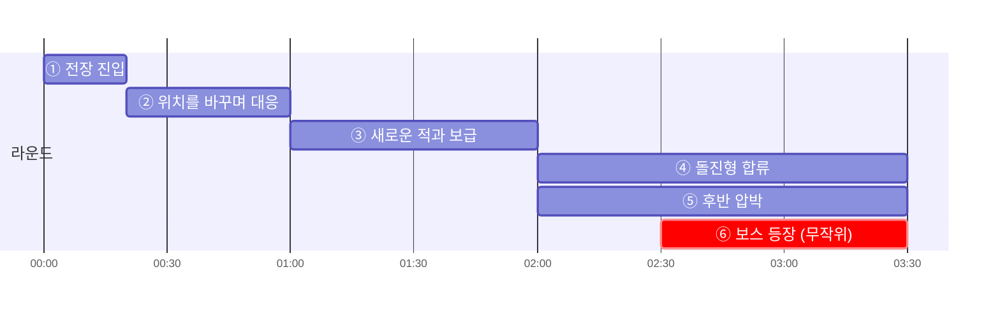

| 구간                 | 상황                                 | 의도                                  | 유도하는 플레이                           |
| -------------------- | ------------------------------------ | ------------------------------------- | ----------------------------------------- |
| ① 전장 진입          | 주변이 빈 개활지, 사방의 근접 몬스터 | 주변을 둘러보며 위험을 파악하게 한다. | 멀리 있는 고지대·엄폐물을 찾아 움직인다   |
| ② 위치를 바꾸며 대응 | 한 자리를 오래 지키면 독안개 공격    | 한 자리에서 버티지 못하게 한다        | 공격을 피하며 계속 다음 위치로 옮긴다     |
| ③ 새로운 적과 보급   | 측면 침투형·공중 공격형, 공중 보급   | 익숙해진 대응을 흔든다                | 대응 순서를 바꾸고 보급을 얻으러 움직인다 |
| ④ 돌진형 합류        | 한 방향으로 빠르게 밀집하는 돌진형   | 모아 둔 수류탄을 쓸 상황을 만든다     | 모인 무리에 수류탄을 던져 포위를 뚫는다   |
| ⑤ 후반 압박          | 크게 늘어난 적의 수                  | 모아 둔 보급을 쓰게 한다              | 수류탄·회복 팩을 몰아 써서 버틴다         |
| ⑥ 보스 등장          | 2:30~3:30 사이 무작위 시점의 보스    | 보급·체력 관리를 압박한다             | 3인칭 시야로 예고를 읽고 피한 뒤 반격한다 |

보스 등장 시점은 2:30~3:30 사이에서 무작위로 정하고, 남은 시간도 화면에 보여 주지 않습니다. 거센 후반 압박을 버티는 동안 보스가 언제 나올지 모르게 해, 보급과 체력을 끝까지 안정적으로 관리해야 한다는 압박을 주기 위해서입니다.

---

## 3. 유저 스토리 기반의 오너십 분배

기획서의 경험을 아사나 유저 스토리 카드로 나눴습니다. 카드는 구현할 **결과**로 정의하고, 에픽과 카드마다 책임자를 정했습니다. 팀원이 **목표에 대한 책임**과 **구현의 자율성**을 함께 갖게 하려는 것이었습니다.

### 3.1 에픽과 책임자

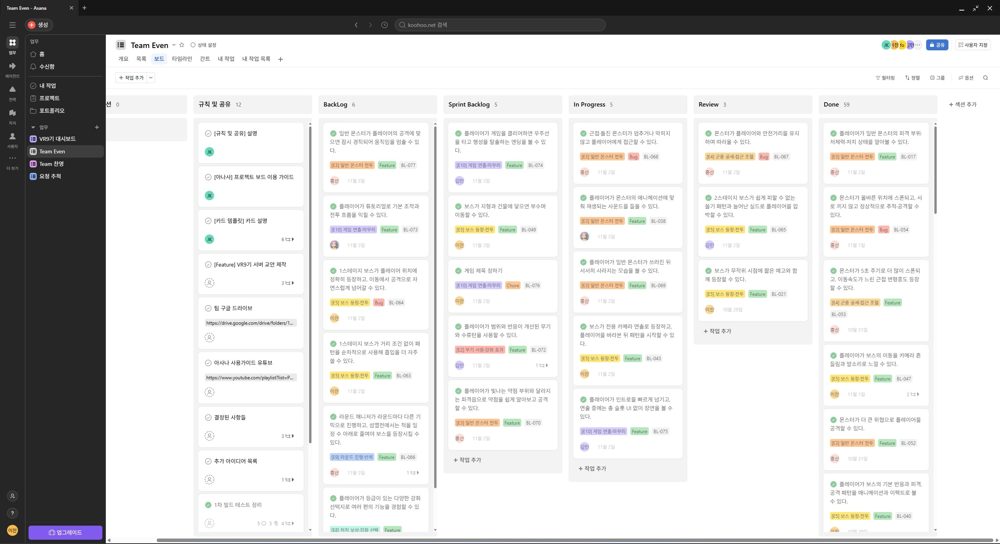

기획서의 경험을 기능 묶음 10개(에픽)로 나누고, 에픽마다 책임자를 정했습니다.

| 에픽         | 기능 묶음                                        | 책임자     |
| ------------ | ------------------------------------------------ | ---------- |
| E1 · E2      | 플레이어 조작·시야·생존 / 무기 사용·강화 효과    | 팀원1      |
| E3 · E4      | 일반 몬스터 전투 / 군중 공세·접근 조절           | 팀원2      |
| E5           | 보스 등장·전투                                   | 팀장(본인) |
| E6 · E7 · E8 | 전장 구성 / 공중 보급·획득 / 처치 보상·강화 선택 | 팀원3      |
| E9 · E10     | 라운드 진행·반복 / 게임 연출·마무리              | 팀장(본인) |

에픽 밖의 일로, 팀원1은 두 번째 보스를, 팀원3은 사운드를 맡았습니다.

### 3.2 카드: 구현할 결과로 정의하고, 주체를 책임자로

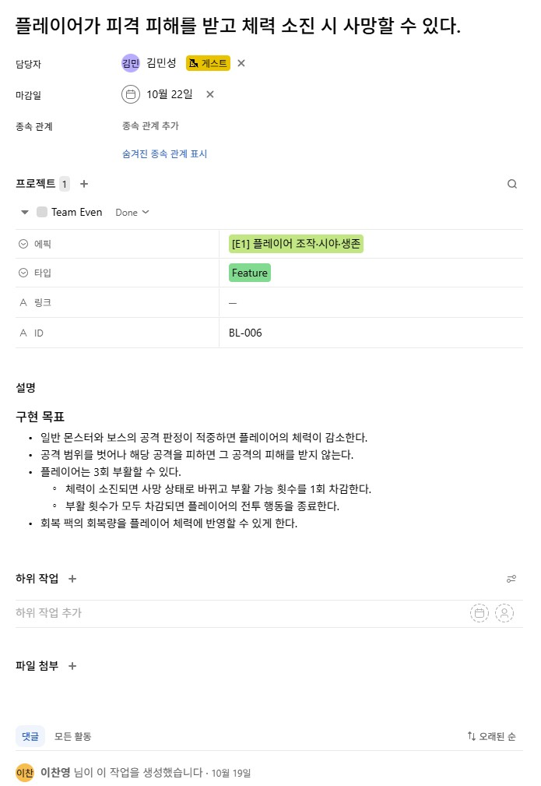

카드 제목은 모두 "**주체**가 ~할 수 있다"로 쓰고, 본문에 완료 조건인 "구현 목표"를 적었습니다. 무엇을 어떻게 만들지가 아니라, 다 만들었을 때 **누가 무엇을 할 수 있게 되는지**를 적습니다.

| 카드 제목 (실제)                                                         | 책임자          |
| ------------------------------------------------------------------------ | --------------- |
| 플레이어가 라이플로 조준하고 적에게 사격 피해를 줄 수 있다.              | 플레이어 담당   |
| 근접 몬스터가 과밀할 때 대기·선회하고 공간이 생기면 다시 접근할 수 있다. | 몬스터 담당     |
| 보스가 공기 흡입으로 플레이어를 끌어당겨 근거리 전투를 유도할 수 있다.   | 보스 담당(본인) |

"카드마다 유저의 경험과 책임을 더 분명하게 정의하라"는 피드백을 받고 만든 형식입니다.

- **경험을 전달한다** — 제목에 주체가 겪을 경험을 씁니다.
- **책임자를 드러낸다** — "플레이어가 ~"로 시작하는 카드는 플레이어 담당의 책임이고, 조건대로 완성됐는지 확인하는 것까지 담당자의 몫입니다.

### 3.3 구현 방식은 담당자가 정한다

카드가 정하는 것은 결과와 완료 조건까지입니다. 그 결과를 어떤 구조로 만들지는 담당자가 정했습니다. 예를 들어 공기 흡입 카드는 결과만 정했고, 팀원이 만든 흡입 API 위에서 언제 공격으로 이어갈지는 제가 정했습니다(→ [8.4.4](#844-공기-흡입-흡입이-끝난-이유로-공격을-정하기)).

리뷰는 팀장이 모두 했습니다. 다만 담당자가 기존 시스템과 연동하고 직접 테스트까지 마친 뒤 리뷰에 올리게 했습니다. 그래서 팀장은 버그와 연동 문제를 처음부터 확인하는 대신, 담당자가 만들어 둔 테스트를 해 보며 리뷰할 수 있었고, 그만큼 리뷰 시간이 줄었습니다.

| 항목 (아사나 기록, 2026-11-09 기준) | 값                             |
| ----------------------------------- | ------------------------------ |
| 전체 작업 / 완료                    | 97 / 97                        |
| 담당자가 정해진 작업                | 97 / 97                        |
| 처음 계획한 일                      | 33개, 모두 완료                |
| 진행하며 새로 생긴 일               | 45개 (빌드 테스트 직후에 몰림) |
| 기타 카드                           | 19개                           |

---

## 4. 최소한의 합의: 작업 규약

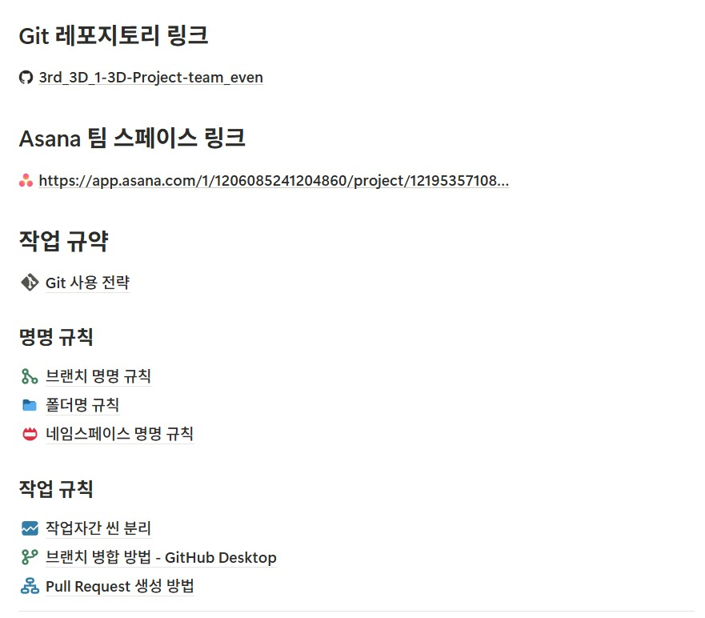

_프로젝트 시작 전에 노션에 정리한 작업 규약 목록_

각자 자율적으로 작업하는 동안 서로 부딪히지 않도록, 꼭 필요한 것만 프로젝트 시작 전에 합의했습니다. 내용은 이전 프로젝트들에서 쌓아 온 것입니다.

### 4.1 합의한 규약

| 규약              | 정한 내용                                    | 목적                             |
| ----------------- | -------------------------------------------- | -------------------------------- |
| Git 전략          | Git flow, release 브랜치 제외                | `main`을 안정 버전으로 유지      |
| 커밋 메시지       | `Feat`·`Fix` 등 머리말 + 요약                | 기록만 보고 변경을 알게          |
| 브랜치 이름       | `feat/구체적인-작업명`                       | 이름만 보고 작업을 알게          |
| 폴더·네임스페이스 | 에셋 종류 → 기능 단위, `프로젝트명.폴더경로` | 담당자가 자기 기능 폴더에서 작업 |
| 씬 분리           | 개인 작업은 테스트 씬, 통합은 프리팹으로     | 씬 파일 충돌 방지 (→ 4.2)        |
| Pull Request      | 대상은 반드시 `develop`, 작업 목록 적기      | —                                |

- release 브랜치는 프로젝트 규모를 생각해 뺐습니다.
- 브랜치 이름은 `feat/System`처럼 넓은 이름 대신 `feat/DialogueSystem`처럼 구체적으로 씁니다.

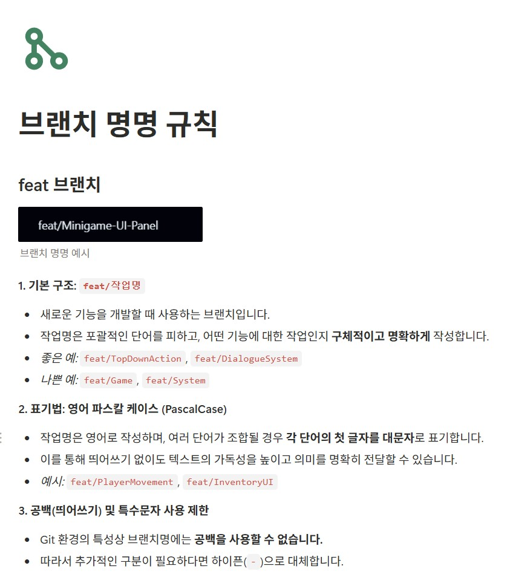

_규약 중 브랜치 명명 규칙 페이지_

### 4.2 씬 충돌을 어떻게 다룰 것인가

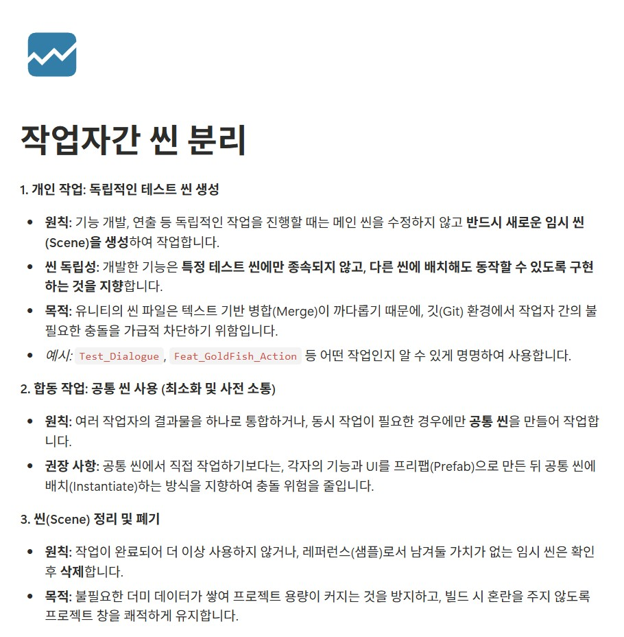

_규약 중 작업자간 씬 분리 페이지_

유니티 씬은 텍스트(YAML)로 저장되어 Git으로 병합하기 쉬워 보입니다. 하지만 씬은 GUID와 fileID가 얽혀 있어, 텍스트여도 사람이 읽고 판단하기 어렵습니다.

```yaml
# TestMap_V1.unity — 씬에 놓인 보스 프리팹 하나
--- !u!1001 &67786932
PrefabInstance:
  m_Modification:
    m_Modifications:
    - target: {fileID: 823172667169261941, guid: bcec5365afe62e148b51db0a39e0879f, type: 3}
      propertyPath: attacks.Array.size
      value: 3
```

| 방식                        | 특징                                                                        |
| --------------------------- | --------------------------------------------------------------------------- |
| 충돌이 나면 풀기            | 충돌 구간이 숫자 묶음이라 판단하기 어렵다. 잘못 합치면 참조가 조용히 끊긴다 |
| **충돌이 생기지 않게 막기** | 각자 테스트 씬에서 작업하고, 기능은 프리팹으로 공통 씬에 둔다               |

씬 충돌은 잘 푸는 것보다 생기지 않게 하는 쪽을 택했습니다. 같은 이유로 보스는 테스트 씬에 혼자 놓아도 데이터 표로 스스로 초기화되게 만들었습니다. GUID로 참조한다는 점은 병합 중 `.meta`가 빠져 참조가 끊긴 문제와도 이어집니다(→ [9.1](#91-협업-레포의-에셋-깨짐-문제)).

---

## 5. 진행 상황을 한눈에: 아사나 대시보드와 디스코드 알림

책임을 맡겼다고 진행 상황을 보지 않은 것은 아닙니다. 아사나 데이터로 대시보드를 만들어, 나눠 둔 작업이 원활하게 돌아가는지 확인했습니다.

### 5.1 아사나 대시보드: 어디에 부하가 걸렸는지

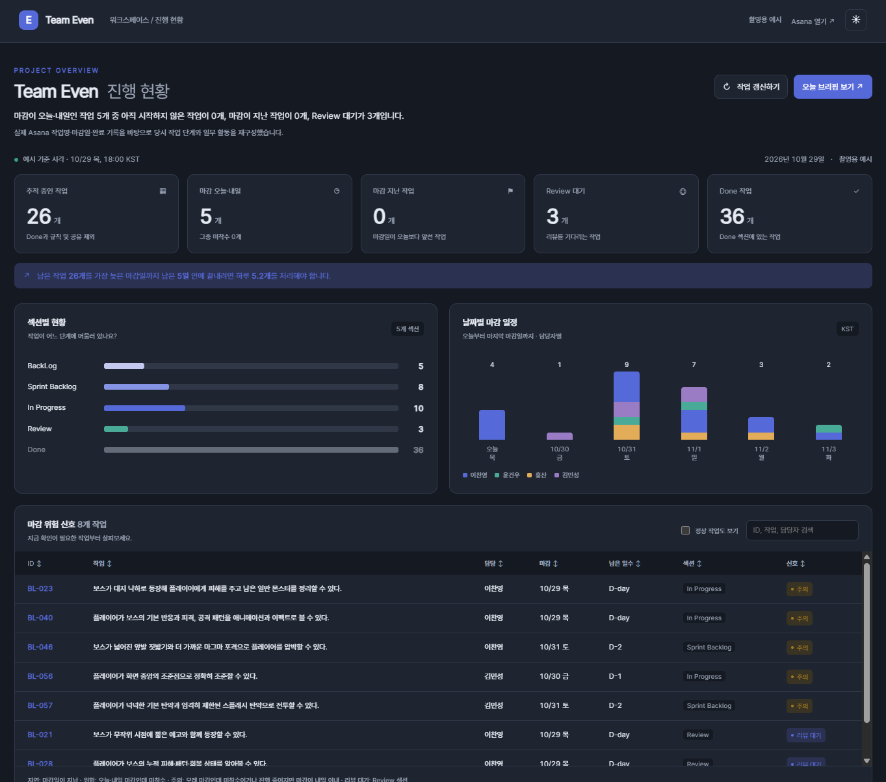

| 대시보드에서 본 것                     | 판단한 것                 |
| -------------------------------------- | ------------------------- |
| 마감 오늘·내일, 마감 지남, Review 대기 | 오늘 처리할 양, 리뷰 밀림 |
| 섹션별 현황 (BackLog → Done)           | 작업이 머물러 있는 단계   |
| 날짜별 마감 일정 (담당자별 색)         | 마감이 몰린 사람과 날짜   |
| 마감 위험 신호                         | 지금 확인할 작업          |

부하가 걸린 팀원을 찾으면, 왜 부하가 걸리는지 묻고 일정을 조정했습니다.

### 5.2 지난 24시간 변화: 팀원의 컨디션

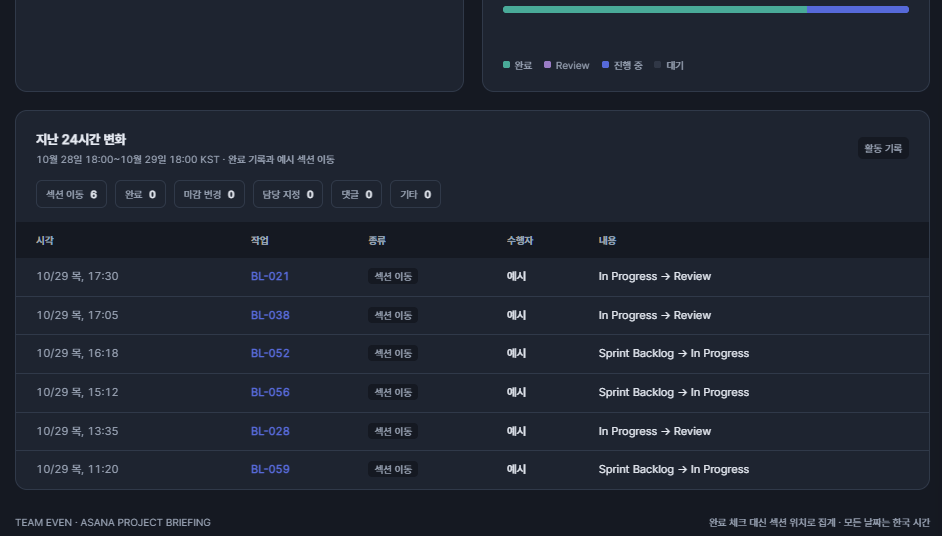

카드의 상태 변화로 누가 몇 시에 작업을 마쳤는지 확인했습니다. 밤샘한 팀원에게는 문제가 없는지 묻고, 컨디션이 나빠 보이면 이후 일정에 여유를 줬습니다. 반복해서 밤샘하는 팀원에게는 일찍 마무리하고 다음 날 이어서 하게 했습니다.

밤샘을 이어 가기보다 쉬고 다시 시작해야 **일정한 작업량**을 낼 수 있다고 판단했기 때문입니다. 일정한 작업량은 팀장이 기간마다 맡길 일을 가늠하는 기준이었습니다.

### 5.3 디스코드 아침 알림: 각자 자기 일정을

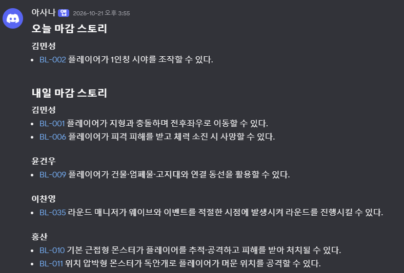

팀원도 자기 일정을 관리할 수 있게, 매일 아침 디스코드로 웹훅 알림을 보냈습니다. 담당자별로 **오늘 마감**과 **내일 마감** 작업을 나눠 보여 줍니다.

---

## 6. 진행 중의 의사결정

### 6.1 빌드 테스트 피드백을 어떻게 작업으로 바꿀 것인가

| 공통 의견                                                 | 정반대 의견 · 에픽별 의견                                          |
| --------------------------------------------------------- | ------------------------------------------------------------------ |
| 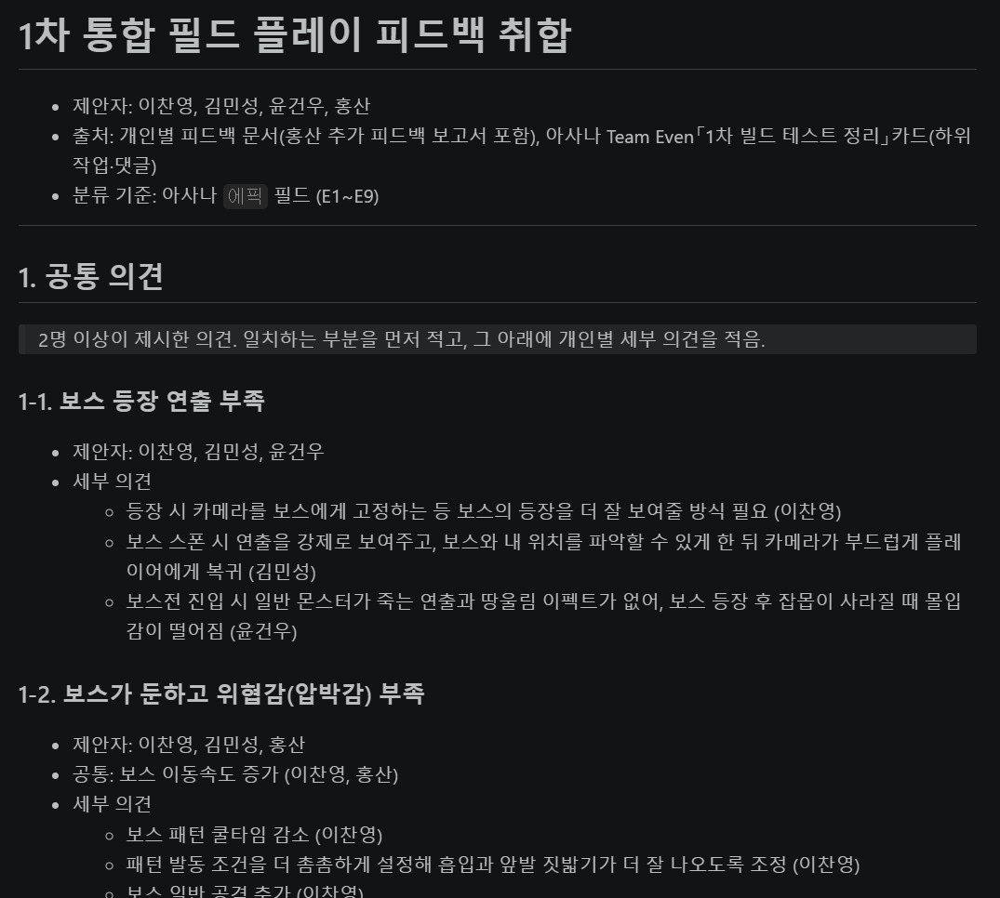 | 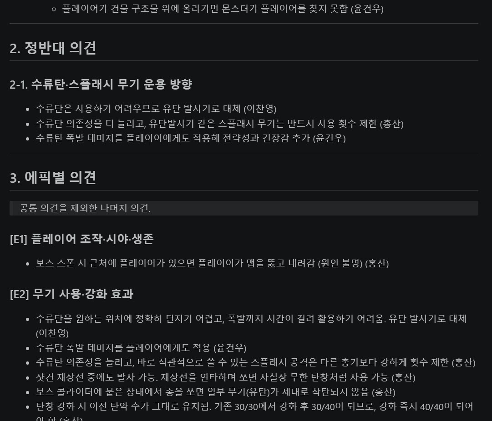 |

_1차 빌드 테스트 피드백 취합 문서_

| 분류        | 기준                           | 1차 빌드 테스트의 예                   |
| ----------- | ------------------------------ | -------------------------------------- |
| 공통 의견   | 2명 이상이 낸 의견             | 보스가 둔하고 위협감이 부족하다 (3명)  |
| 정반대 의견 | 같은 대상에 서로 반대인 의견   | 수류탄을 유탄 발사기로 / 수류탄을 개선 |
| 에픽별 의견 | 나머지를 에픽(E1~E10)으로 분류 | [E5] 패턴 발동 시 시각 피드백 필요     |

팀원 넷이 각자 플레이하고 쓴 피드백을 한 문서로 모아, 공통 의견 · 정반대 의견 · 에픽별 의견으로 나눈 뒤 한 번에 논의했습니다. 흩어진 피드백을 그대로 두고 이야기하면 같은 말이 반복되고, 서로 부딪히는 의견이 정리되지 않기 때문입니다. 반영 여부는 팀장이 최종 판단했고(기준 → 6.2), 승인한 것만 카드로 만들어 책임 영역대로 배정했습니다. 두 번의 빌드 테스트 피드백이 각각 하루 만에 카드가 됐고, 회의 결론이 그대로 카드의 "구현 목표"가 됐습니다.

- "보스가 플레이어를 바라보지 않는다" → 카드 "보스가 전용 카메라 연출로 등장하고, 플레이어를 바라본 뒤 패턴을 시작할 수 있다."
- "보스 이동 시 피드백이 부족하다" → 카드 "플레이어가 보스의 이동을 카메라 흔들림과 발소리로 느낄 수 있다."
- "흡입 패턴이 더 자주 나오면 좋겠다" → 카드 "1스테이지 보스가 거리 조건 없이 흡입을 더 자주 쓸 수 있다." (→ [8.1.2](#812-기획한-패턴을-바꿀-것인가))

※ **유도한 플레이가 나오지 않았을 때 — 보급을 향한 이동.** 의도는 플레이어가 보급을 얻으러 맵을 돌아다니며 싸우는 것이었습니다. 하지만 빌드 테스트에서는 보급이 중요하지 않아, 수류탄·회복 팩 없이 한 곳에서 버티는 모습이 나왔습니다.

| 바꾼 것                         | 노린 행동                     |
| ------------------------------- | ----------------------------- |
| 적의 위협 수위를 높임           | 한 곳에 머물기 어렵게         |
| 무한 탄약을 제한, 보급으로 보충 | 보급을 향해 이동하며 전투하게 |
| 강력한 "무기 보급" 추가         | 플레이어가 스스로 보급을 찾게 |

### 6.2 무엇을 기준으로 피드백을 반영하고 보류하는가

| 순서 | 질문                                                                |
| ---- | ------------------------------------------------------------------- |
| 1    | 우리가 보여 주려는 경험(초기 의도)을 벗어나지 않고, 거기에 필요한가 |
| 2    | 남은 기간 안에 할 수 있는가                                         |

기간 안에 완성하는 것은 반드시 지켜야 할 조건이었고, 무엇을 넣고 뺄지 정하려면 기준이 필요했습니다. 기준의 중심을 초기 의도에 둔 것은, 그 의도가 팀이 함께 정한 재미의 정의였기 때문입니다. 좋아 보이는 기능은 끝없이 나올 수 있지만, 하나씩 받아들이며 의도를 고치다 보면 방향을 잃고 기간 안에 완성하지 못할 수도 있다고 판단했습니다. 그래서 아무리 재미있어 보여도 초기 의도를 벗어나면 반영하지 않았고, 가치는 있지만 지금 하기 어려운 의견은 버리지 않고 아사나 "보류 사항" 카드 7건으로 남겼습니다(예: 건물 파괴 이펙트, 은은한 환경광).

---

# Part 2. 보스 개발

## 7. 보스 시스템 구조

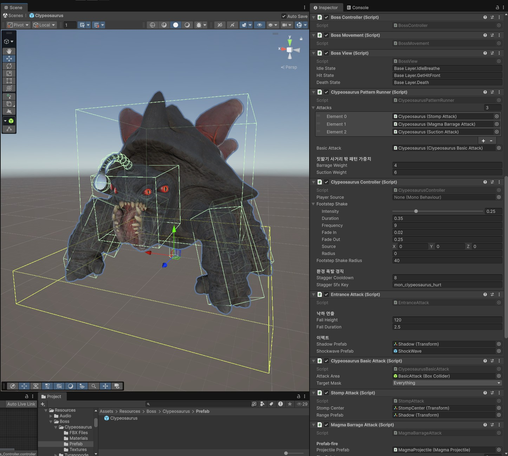

_공통 컴포넌트와 보스 전용 컴포넌트가 한 오브젝트에 붙어 있다_

보스 코드는 데이터 표 → 공통 계층 → 보스별 계층으로 나뉩니다. 두 보스가 같은 공통 계층을 씁니다.

### 7.1 데이터 · 공통 계층 · 보스별 계층

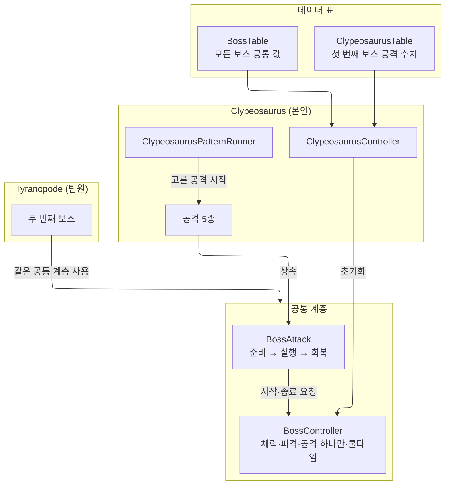

_데이터는 보스별 컨트롤러가 읽어 공통 계층과 공격에 나눠 줍니다._

| 클래스                      | 하는 일                                       | 하지 않는 일           | 자세히                                                       |
| --------------------------- | --------------------------------------------- | ---------------------- | ------------------------------------------------------------ |
| `BossController`            | 체력·피격·무적, 공격 하나만 허용, 공통 쿨타임 | 공격 고르기, 공격 동작 | [8.3.2](#832-공격-실행-생명주기-준비--실행--회복)            |
| `BossAttack` (abstract)     | 공격 하나의 준비 → 실행 → 회복과 취소         | 단계마다 할 일         | [8.2.2](#822-클래스-책임과-상속-구조)                        |
| `ClypeosaurusController`    | 데이터 표로 보스·공격 초기화, 체력 구간 경직  | 패턴 고르기            | [8.2.1](#821-데이터-테이블-이원화)                           |
| `ClypeosaurusPatternRunner` | 거리와 가중치로 다음 패턴 고르기              | 공격 실행              | [8.3.1](#831-패턴-선정-사거리-안이면-짓밟기-밖이면-가중치로) |
| 공격 5종                    | 등장 낙하 · 짓밟기 · 포격 · 흡입 · 기본 공격  | 단계 진행·쿨타임       | [8.4](#84-개별-패턴과-전투-상호작용)                         |

---

## 8. 보스 전투 시스템

### 8.1 전투 기획 의도와 패턴 구조

#### 8.1.1 핵심 전투 루프

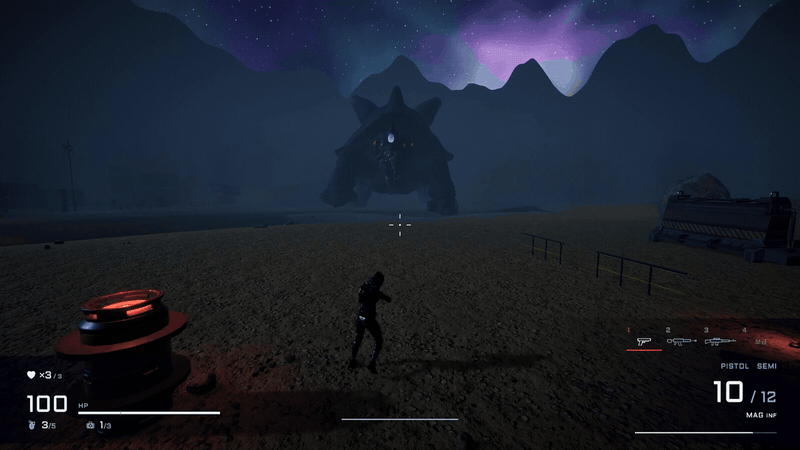

_범위가 표시되는 준비 → 공격 → 보스가 멈춘 회복_

첫 번째 보스 Clypeosaurus는 **어렵지는 않지만 충분히 위협적인, 학습용 보스**로 구상했습니다. 플레이어가 "패턴 → 반격 → 패턴"이 반복되는 보스전에 익숙해지게 하는 것이 목적입니다.

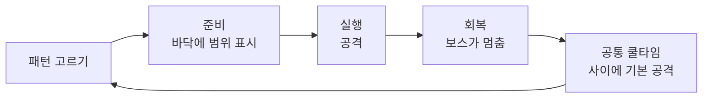

- 준비는 플레이어가 공격을 읽는 시간, 회복은 반격하는 시간입니다.
- 모든 패턴이 같은 순서를 따르므로, 패턴이 바뀌어도 "예고를 보고 피한 뒤 멈춘 틈에 반격한다"는 리듬은 같습니다.

| 패턴        | 하는 일                                    |
| ----------- | ------------------------------------------ |
| 등장 낙하   | 그림자로 착지 지점을 예고하고 떨어진다     |
| 앞발 짓밟기 | 사거리 안의 플레이어에게 충격파를 낸다     |
| 마그마 포격 | 플레이어 주변에 마그마를 연달아 떨어뜨린다 |
| 공기 흡입   | 멀리 있는 플레이어를 보스 앞으로 끌어온다  |
| 기본 공격   | 가까이 붙은 플레이어를 바로 할퀸다         |

#### 8.1.2 기획한 패턴을 바꿀 것인가

기획서는 첫 번째 보스를 "크고 움직임은 둔하지만 공격 하나의 위협은 큰" 보스로 정했고, 원거리 전격 포로 멀리 있는 플레이어도 공격하게 했습니다. 하지만 보스가 느려서 플레이어는 멀리 떨어진 채 싸울 수 있었습니다. 그 거리에서는 짓밟기 같은 위협적인 패턴이 닿지 않아 보스전이 급격히 쉬워졌고, 플레이어는 보스의 다양한 패턴을 보지 못했습니다.

| 방식                  | 문제                                                            |
| --------------------- | --------------------------------------------------------------- |
| 원거리 전격 포 (기획) | 멀리서도 맞힐 수 있지만, 멀리 떨어진 상태는 그대로 유지된다     |
| **공기 흡입**         | 합의한 기획을 고쳐야 한다. 팀원의 흡입 API 위에서 만들어야 한다 |

기획한 패턴은 의도를 구현하는 수단이지 의도 자체가 아니라고 판단했습니다. 지켜야 할 것은 "보스와 대치하며 패턴을 읽고 반격하는 경험"이었고, 그러려면 멀리 있는 플레이어를 맞히는 것이 아니라 보스 앞으로 데려와야 했습니다. 판단 기준은 팀원의 피드백을 거를 때와 같습니다(→ [6.2](#62-무엇을-기준으로-피드백을-반영하고-보류하는가)).

※ 빌드 테스트에서 "흡입이 더 자주 나와도 좋겠다"는 의견이 나와, 흡입의 거리 조건을 지우고 패턴 고르기 규칙을 바꿨습니다(→ 8.3.1). 이제 거리를 유지하는 플레이어도 흡입에 끌려오고, 끌려오면 짓밟기 사거리 안에 들어와 근접 패턴까지 이어집니다.

### 8.2 데이터 테이블 및 클래스 구조

#### 8.2.1 데이터 테이블 이원화

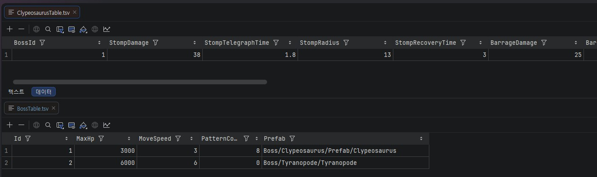

보스 수치는 코드가 아니라 TSV 표에 두고, 표를 둘로 나눴습니다. 최대 체력·이동 속도·공통 쿨타임처럼 모든 보스에 있는 값은 공통 표(`BossTable`)에, 짓밟기 피해·포격 반경·흡입 최대 시간 같은 공격 수치 32칸은 보스별 표(`ClypeosaurusTable`)에 둡니다. 코드를 나눈 기준(→ 8.5)과 같습니다.

`ClypeosaurusController`가 전용 표에서 `BossId`를 읽어 공통 표의 보스 정의를 찾고, 두 값을 `BossController`와 공격 5종에 나눠 줍니다.

#### 8.2.2 클래스 책임과 상속 구조

새 공격은 `BossAttack`을 상속해 정해진 칸만 채웁니다. 단계 진행·회복·쿨타임·취소 정리는 공통 클래스가 맡습니다.

| 칸                       | 언제                    | 하위 공격이 하는 일 (예)      |
| ------------------------ | ----------------------- | ----------------------------- |
| `MeetsStartCondition()`  | 시작해도 되는지 물을 때 | 짓밟기 사거리, 등장은 한 번만 |
| `OnWindup()`             | 준비에 들어갈 때        | 범위 표시, 준비 동작          |
| `OnActiveStarted()` 필수 | 실행에 들어갈 때        | 공격 동작 시작                |
| `OnActiveTick(dt)`       | 실행 중 매 프레임       | 끝나면 `CompleteActive()`     |
| `OnCancelled()`          | 취소될 때               | 투사체·이펙트 정리            |

- 밖에서는 `CanStart()`·`TryStart()`로 시작하고, 사운드는 `PhaseChanged` 이벤트로 단계 변화를 듣습니다.
- 공격 5종 모두 `OnActiveStarted()` 하나만 필수로 구현해 만들었습니다.

#### 8.2.3 보스 등장을 다른 파트에 어떻게 알릴 것인가

보스가 등장하면 플레이어 시점 전환, 카메라 흔들림, 사운드, 보스전 보상 집계가 함께 반응해야 합니다. 기본은 직접 호출로 두고, 이미 일어난 사실을 알리는지, 받는 쪽이 서로 독립적인지, 보내는 쪽이 결과를 받지 않아도 되는지를 따져 모두 "그렇다"일 때만 이벤트를 썼습니다.

| 질문                        | 이벤트가 맞는 답               | 보스 등장              |
| --------------------------- | ------------------------------ | ---------------------- |
| 무엇을 전달하는가           | 이미 일어난 사실               | "등장했다"는 사실      |
| 받는 쪽의 책임은 독립적인가 | 한쪽을 고쳐도 다른 쪽은 그대로 | 네 파트가 각자 다른 일 |
| 보내는 쪽이 결과를 받는가   | 아니다                         | 아니다                 |

이벤트를 쓰는 것 자체가 아니라, 연결하고 고치는 수고를 줄이는 것이 목적이었습니다. 보스 등장은 세 질문 모두 이벤트 쪽이라, 라운드가 `BossWarningEvent`·`BossAppearedEvent`를 발행하고 플레이어·`GameSoundRouter`·`UpgradeManager`가 각자 구독합니다. 반대로 공격의 시작·종료는 보내는 쪽이 "시작해도 되는가"라는 결과를 받아야 해서 직접 호출로 두었습니다(→ 8.3.2).

### 8.3 보스 행동 절차

#### 8.3.1 패턴 선정: 사거리 안이면 짓밟기, 밖이면 가중치로


_가까우면 앞발 짓밟기, 멀어지면 흡입이나 포격_

공통 패턴 선택기(`BossPatternRunner`)는 시작할 수 있는 후보 중 하나를 무작위로 고릅니다. Clypeosaurus용 선택기는 여기에 두 가지를 더했습니다. 짓밟기가 후보에 있으면 짓밟기만 남기고, 없으면 포격과 흡입을 가중치로 고릅니다.

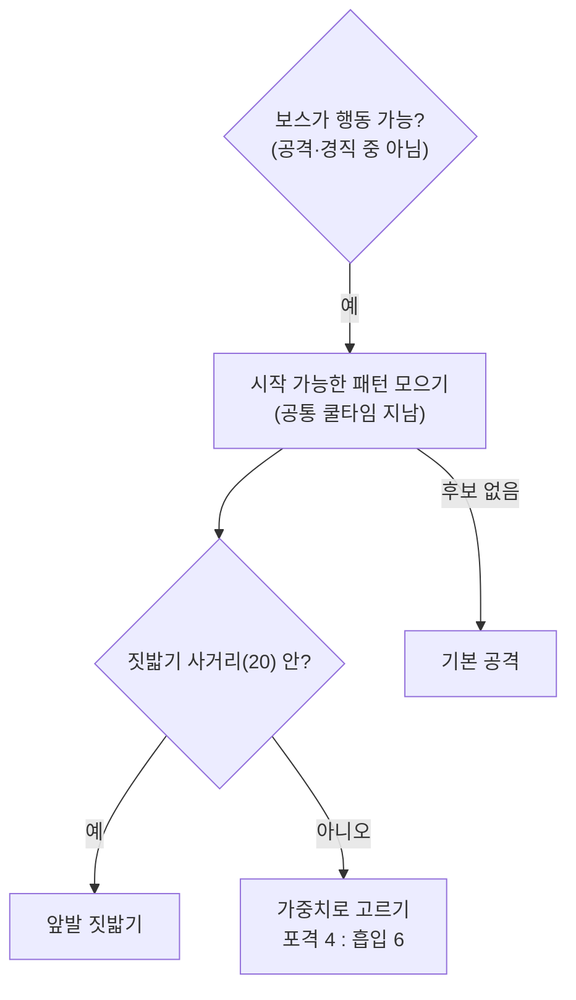

```csharp
// ClypeosaurusPatternRunner.cs — 지금 쓸 수 있는 패턴 중 하나를 고른다
foreach (var attack in attacks)
{
    // … 다른 오브젝트의 공격·중복 확인 (생략)
    if (attack.UsesPatternCooldown == false || attack.CanStart() == false) continue;

    // (Why) 가까이 있으면 근접 패턴이 가장 자연스럽다 → 짓밟기를 우선한다
    if (attack is StompAttack)
    {
        candidates.Clear();
        candidates.Add(attack);
        break;
    }

    if (GetWeight(attack) > 0f) candidates.Add(attack);
}
```

- 거리는 선택기가 직접 재지 않습니다. `CanStart()`가 짓밟기의 시작 조건(플레이어가 수평 거리 20 안)을 확인하므로, 짓밟기가 후보에 들어왔다면 곧 "가깝다"는 뜻입니다.
- 사거리 밖에서는 포격 4 : 흡입 6으로 고릅니다. 흡입이 더 자주 나와 멀리 있는 플레이어를 보스 앞으로 데려옵니다.
- 시작할 패턴이 없으면 기본 공격을 시도합니다.

[`ClypeosaurusPatternRunner` 원문](https://github.com/KooHoo-Dev/3rd_3D_1-3D-Project-team_even/blob/db706ef5ab2280158b830f0b714556cf02ecf6ce/Assets/Scripts/Boss/Clypeosaurus/ClypeosaurusPatternRunner.cs#L24-L85)

#### 8.3.2 공격 실행 생명주기: 준비 · 실행 · 회복

고른 공격은 `BossAttack`이 준비 → 실행 → 회복 순서로 진행합니다. 공격 두 개가 겹치지 않게 하는 것은 `BossController`가 맡습니다. 공격은 시작할 때 보스에게 허락을 받고, 끝날 때 알립니다.

```csharp
// BossController.cs — 공격은 한 번에 하나만, 끝나면 공통 쿨타임
internal bool TryBeginAttack(BossAttack attack)
{
    if (CanStartAttackFor(attack) == false) return false;
    currentAttack = attack;
    movement.Pause();
    return true;
}

internal void EndAttack(BossAttack attack, bool completed = false)
{
    if (currentAttack != attack) return;
    currentAttack = null;

    // (Why) 끝까지 수행한 패턴만 쿨타임을 건다. 일반 공격은 쿨타임과 별개
    if (completed && attack.UsesPatternCooldown) nextAttackTime = Time.time + Def.PatternCooldown;
    // … 이동 재개·정지 (생략)
}
```

- 공격 중에는 보스가 멈추고, 끝나면 다시 움직입니다.
- 끝까지 수행한 패턴만 공통 쿨타임을 겁니다. 취소된 공격에는 쿨타임을 걸지 않습니다.

[`TryBeginAttack`·`EndAttack` 원문](https://github.com/KooHoo-Dev/3rd_3D_1-3D-Project-team_even/blob/db706ef5ab2280158b830f0b714556cf02ecf6ce/Assets/Scripts/Boss/BossController.cs#L117-L144)

### 8.4 개별 패턴과 전투 상호작용

#### 8.4.1 등장 낙하: `NavMeshAgent`를 잠시 떼고 떨어뜨리기

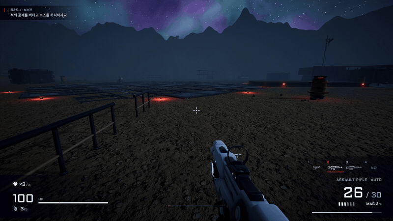

_그림자로 착지 지점을 예고한 뒤 떨어져 포효한다_

보스는 하늘에서 떨어지며 등장합니다. 길 찾기를 맡은 `NavMeshAgent`는 등장하는 동안만 꺼 두고, 착지하면 되돌립니다.

| 단계          | 하는 일                                               |
| ------------- | ----------------------------------------------------- |
| 준비          | 무적, `NavMeshAgent` 끄기, 공중으로 이동, 그림자 표시 |
| 낙하          | 점점 빨라지며 떨어진다                                |
| 착지          | `NavMeshAgent` 다시 켜기, 충격파와 피해               |
| 포효가 끝나면 | 무적을 끄고 회복으로                                  |

```csharp
// EntranceAttack.cs — 착지: Agent를 되돌리지 못하면 등장을 취소한다
private void Land()
{
    stage = EntranceStage.Roaring;

    if (RestoreAgent() == false)
    {
        Debug.LogError("[Entrance] 착지 지점에 navMesh가 없습니다.", this);
        Cancel();
        return;
    }

    Range.Clear();
    view.PlayState(RoarState);
    RaiseImpacted(landingPoint);
    // … 충격파 이펙트 생성 (생략)
    ApplyLandingDamage();
}
```

- 그림자는 준비하는 동안 0에서 등장 반경까지 커져 착지 지점을 예고합니다.
- 착지 지점에 NavMesh가 없으면 오류를 남기고 취소하며, 취소할 때도 `NavMeshAgent`를 되돌립니다.

[`EntranceAttack` 원문](https://github.com/KooHoo-Dev/3rd_3D_1-3D-Project-team_even/blob/db706ef5ab2280158b830f0b714556cf02ecf6ce/Assets/Scripts/Boss/Clypeosaurus/EntranceAttack.cs#L79-L171)

#### 8.4.2 앞발 짓밟기: 사거리 안의 근접 패턴

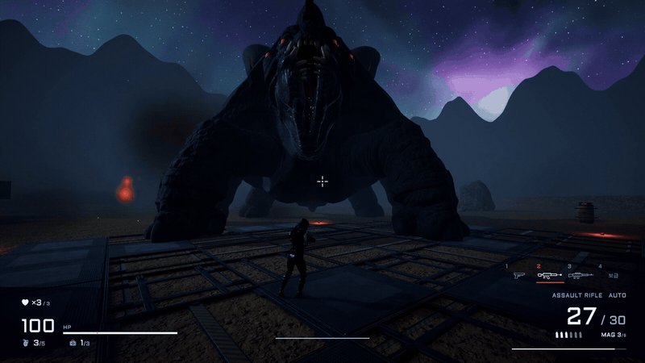

_앞발 위치에 범위를 표시한 뒤 원형 충격파_

근접 패턴입니다. 플레이어가 수평 거리 20 안에 있으면 다른 패턴보다 먼저 고릅니다(→ 8.3.1). 앞발 위치에 1.8초 동안 범위를 표시한 뒤 반경 13의 원형 충격파(피해 38)를 내고, 3초 동안 멈춰 반격할 틈을 줍니다.

#### 8.4.3 마그마 포격: 착탄 지점 계획과 연속 발사

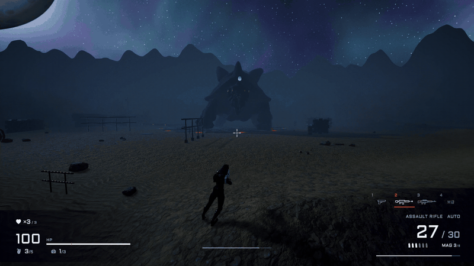

_발사관이 점등되고, 플레이어 주변에 마그마가 차례로 떨어진다_

보스 등의 발사관이 점등된 뒤, 켜진 발사관 수만큼 플레이어 주변에 착탄 구역을 표시하고 마그마를 차례로 떨어뜨립니다. 플레이어가 움직이면 다음 묶음은 새 위치 주변에 떨어집니다.

| 단계           | 하는 일                                          |
| -------------- | ------------------------------------------------ |
| 준비           | 켜진 발사관을 모으고 쏠 발 수를 정한다           |
| 착탄 지점 계획 | 플레이어 주변 지면에 겹치지 않게 고른다          |
| 발사           | 애니메이션 이벤트에서 시작해 일정 간격으로 쏜다  |
| 착탄           | 정해진 시간에 착탄 지점에 떨어져 범위를 판정한다 |
| 회복           | 마지막 투사체가 땅에 닿은 뒤                     |

```csharp
// MagmaBarrageAttack.cs — 발사관마다 플레이어 주변의 착탄 지점을 하나씩 정한다
for (int attempt = 0; attempt < PlacementAttempts; attempt++)
{
    Vector2 offset = UnityEngine.Random.insideUnitCircle * data.BarrageSpreadRadius;
    Vector3 origin = center + new Vector3(offset.x, groundProbeHeight, offset.y);

    // (Why) 맵에 높낮이가 있어 지점마다 실제 지면 높이를 찾고, 지면이 없는 곳(맵 밖)은 고르지 않는다
    if (Physics.Raycast(origin, Vector3.down, out var hit, groundProbeDistance, groundMask,
            QueryTriggerInteraction.Ignore) == false) continue;
    if (hit.collider.TryGetDamageable(out _)) continue;
    if (HasOverlap(hit.point, minimumDistance)) continue;

    landingPoints.Add(hit.point);
    placed = true;
    break;
}
```

- 위에서 아래로 Raycast를 쏴 실제 지면을 찾고, 몬스터·플레이어 위나 이미 고른 지점 근처는 다시 고릅니다.
- 첫 발은 애니메이션 이벤트가 시작합니다. 이벤트가 두 번 와도 한 번만 쏘고, 아예 오지 않으면 애니메이션이 끝날 때 공격을 마쳐 실행 단계에 갇히지 않습니다.
- 투사체는 물리 엔진 대신 포물선 식으로 초기 속도를 정해, 예고한 시간에 예고한 지점에 떨어집니다. 착탄 순간 엄폐물 뒤에 있는 플레이어는 피해를 받지 않습니다.

[`MagmaBarrageAttack` 원문](https://github.com/KooHoo-Dev/3rd_3D_1-3D-Project-team_even/blob/db706ef5ab2280158b830f0b714556cf02ecf6ce/Assets/Scripts/Boss/Clypeosaurus/MagmaBarrageAttack.cs#L93-L126)

#### 8.4.4 공기 흡입: 흡입이 끝난 이유로 공격을 정하기

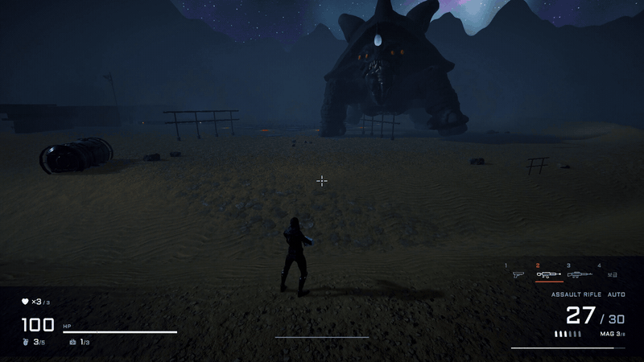

_반대로 달려도 끌려가다가 할퀴기로 이어진다_

플레이어를 끌어당기는 속도 계산은 플레이어 담당 팀원이 만든 흡입 API가 맡습니다. 저는 API에 넘길 설정을 표에서 만들고, 흡입이 **왜 끝났는지**에 따라 할퀴기로 이어갈지 취소할지를 정했습니다.

```csharp
// SuctionAttack.cs — 흡입이 끝난 이유에 따라 공격으로 이어가거나 취소한다
protected override void OnActiveTick(float deltaTime)
{
    // … 대상이 피해를 받을 수 없으면 취소, 할퀴기 중이면 애니메이션이 끝날 때 공격 종료 (생략)

    if (activeInhale == null) { Cancel(); return; }
    if (activeInhale.IsRunning) return;

    InhaleEndReason reason = activeInhale.EndReason;
    StopInhale();
    if (reason != InhaleEndReason.Timeout && reason != InhaleEndReason.NearDwell) { Cancel(); return; }

    attacking = true;
    attackStartedFrame = Time.frameCount;
    view.PlayState(AttackState);
}
```

- 흡입이 10초 동안 이어졌거나, 플레이어가 위험 구역에 2초 머물렀을 때만 할퀴기로 이어집니다.
- 플레이어가 리셋되거나 흡입 중심이 사라지는 등 다른 이유로 끝나면 공격하지 않고 취소합니다.
- 할퀴기 피해는 애니메이션 이벤트에서 한 번만 줍니다.

[`SuctionAttack` 원문](https://github.com/KooHoo-Dev/3rd_3D_1-3D-Project-team_even/blob/db706ef5ab2280158b830f0b714556cf02ecf6ce/Assets/Scripts/Boss/Clypeosaurus/SuctionAttack.cs#L118-L165)

#### 8.4.5 기본 공격: 가까이 붙은 플레이어에게 주는 저항

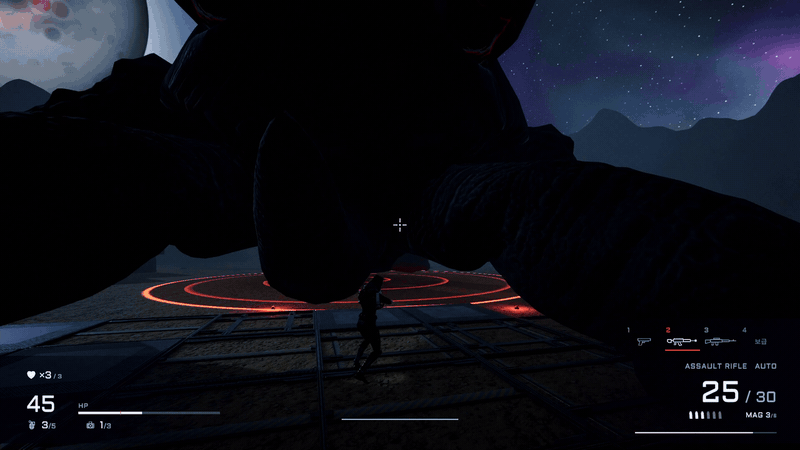

_몸 아래로 들어간 플레이어를 바로 할퀸다_

기본 공격은 처음 기획에 없던 공격입니다. 보스가 크다 보니 두 가지 빈틈이 생겼습니다.

- **몸 아래 사각지대** — 보스의 몸 아래로 들어가면 어떤 공격도 받지 않고, 위를 보며 공격할 수 있었습니다.
- **근접 무저항** — 바짝 붙어도 패턴의 쿨타임 동안에는 아무 저항이 없었습니다.

그래서 공통 쿨타임과 상관없이(`UsesPatternCooldown = false`) 가까이 붙은 플레이어를 바로 공격하는 기본 공격을 더했습니다. 플레이어가 보스의 공격 범위 안에 들어오면 준비 동작 없이 바로 할퀴고(피해 20), 2초 간격으로 반복합니다.

- 패턴을 시작할 수 없을 때 패턴 선택기가 기본 공격을 시도합니다(→ 8.3.1).
- 휘두르는 순간 플레이어가 아직 범위 안에 있는지 다시 확인해, 그사이 피한 플레이어는 맞지 않습니다.

✍ (넣을지 선택) 보스 에셋에 할퀴기 애니메이션이 없어, Claude를 활용해 직접 만들었습니다.

#### 8.4.6 전투 상호작용: 경직 · 범위 표시 · 건물 부수기

- **체력 구간 경직** — 체력이 75%·50%·25%를 처음 넘으면 공격을 취소하고 경직합니다. 한 번에 두 구간을 넘어도 경직은 한 번입니다.
- **환경 폭발 경직** — 연료 셀 폭발 같은 충격을 받으면 8초에 한 번까지 경직합니다. 등장 중(무적)에는 받지 않습니다.
- **공격 범위 표시** — 각 공격이 바닥에 범위를 표시하고, 회복으로 넘어가거나 취소될 때 공통 클래스가 지웁니다.
- **건물 부수기** — 보스의 몸통·다리와 겹친 건물을 파괴 이펙트와 함께 없앱니다. 공통 계층에 두어 다른 보스에도 붙일 수 있습니다.

### 8.5 구조 확장성 검증: 보스 코드를 어떻게 나눌 것인가

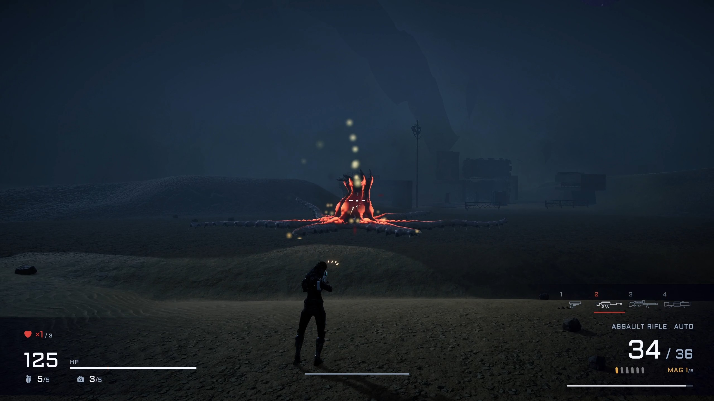

_같은 공통 틀 위에서 팀원이 만든 두 번째 보스_

처음부터 공통 클래스와 보스별 클래스로 나눠 만들었습니다. 두 번째 보스는 다른 사람이 맡을 가능성이 컸고, 그 사람이 같은 틀 위에서 바로 자기 패턴을 만들 수 있어야 했습니다. 기준은 "두 번째 보스에도 그대로 필요한가"였고, 공통 클래스에 넣을 것은 회의에서 논의한 내용을 바탕으로 정했습니다.

두 번째 보스 Tyranopode는 팀원이 공통 클래스를 고치지 않고 그 위에서 만들었습니다.

| 항목        | 공통 계층                       | Clypeosaurus (본인)     | Tyranopode (팀원)                         |
| ----------- | ------------------------------- | ----------------------- | ----------------------------------------- |
| 체력·피격   | `BossController`                | 그대로 + 체력 구간 경직 | 그대로 + 부위 피해를 보스 체력으로        |
| 공격 단계   | `BossAttack` 준비 → 실행 → 회복 | 공격 5종이 상속         | 공격 9종이 상속 + 준비 중 매 프레임 할 일 |
| 패턴 고르기 | 후보 중 무작위                  | 짓밟기 우선 + 가중치    | 거리 구간 · 부위 파괴 · 난이도 보정       |
| 공격 간격   | 공통 쿨타임                     | 공통 쿨타임 (8초)       | 자기 표로 (공통 쿨타임 0)                 |
| 수치 표     | `BossTable` (공통 값)           | `ClypeosaurusTable`     | `TyranopodeTable`                         |

두 보스 모두 같은 단계 진행과 "공격은 한 번에 하나" 규칙을 받았고, 패턴 고르기와 공격 간격처럼 보스마다 다른 것은 각 보스가 정했습니다.

### 8.6 방어적 예외 처리와 이유

보스 공격은 경직·사망으로 끊기거나, 애니메이션 이벤트·NavMesh처럼 코드 밖의 것에 기대다 실패할 수 있습니다. 어느 경우든 지킨 것은 하나입니다. **보스가 "공격 중"에 갇혀 다음 공격을 못 하게 되지 않는 것**입니다.

공격을 끊는 쪽은 모두 `BossAttack.Cancel()`을 부릅니다. `Cancel`은 하위 공격에게 정리를 맡기고(`OnCancelled` — 투사체, 흡입, `NavMeshAgent` 등 자기가 만든 것을 치움), 보스에게 공격이 끝났다고 알립니다.

```csharp
// BossAttack.cs — 취소: 하위 공격의 정리가 실패해도 보스는 반드시 풀어 준다
public void Cancel()
{
    Range.Clear();
    if (IsRunning == false) return;

    Phase = SkillPhase.Idle;
    try
    {
        OnCancelled();
    }
    finally
    {
        Boss.EndAttack(this);
        NotifyPhase();
    }
}
```

지금 공격들의 `OnCancelled`는 예외를 던지지 않으니, `try`/`finally`는 방어 코드입니다. 앞으로 보스가 늘면 다른 사람이 이 칸을 채우게 되므로, 그 정리 코드가 실패하더라도 보스가 "공격 중"에 갇히지 않게 하려고 넣었습니다.

[`Cancel` 원문](https://github.com/KooHoo-Dev/3rd_3D_1-3D-Project-team_even/blob/db706ef5ab2280158b830f0b714556cf02ecf6ce/Assets/Scripts/Boss/BossAttack.cs#L132-L152)

| 상황                           | 처리                                   | 위치                     |
| ------------------------------ | -------------------------------------- | ------------------------ |
| 공격 중 피격 경직              | 진행 중인 공격을 취소하고 멈춘다       | 공통                     |
| 공격 중 보스 사망              | 이동을 멈추고 공격을 취소한다          | 공통                     |
| 보스 비활성·대상 사라짐        | 다음 프레임에 취소한다                 | 공통                     |
| 무적(등장) 중 피해·경직        | 모두 무시한다                          | 공통                     |
| 취소된 공격                    | 공통 쿨타임을 걸지 않는다              | 공통                     |
| 착탄 지점을 못 찾음            | 취소, 1초 동안 포격 후보에서 뺀다      | `MagmaBarrageAttack`     |
| 발사 애니메이션 이벤트가 안 옴 | 애니메이션이 끝나면 발사 없이 회복으로 | `MagmaBarrageAttack`     |
| 이벤트가 두 번 옴              | 발사·피해는 한 번만                    | 포격 · 흡입              |
| 흡입 API를 못 찾음             | 경고 후 취소                           | `SuctionAttack`          |
| 착지 지점에 NavMesh 없음       | 오류 후 취소, `NavMeshAgent` 복구      | `EntranceAttack`         |
| 프리팹·발사관 연결 누락        | 초기화에서 예외로 바로 알린다          | 각 공격 `Initialize`     |
| 씬에 보스만 놓고 테스트        | 데이터 표로 스스로 초기화한다          | `ClypeosaurusController` |

---

## 9. 트러블슈팅

### 9.1 협업 레포의 에셋 깨짐 문제

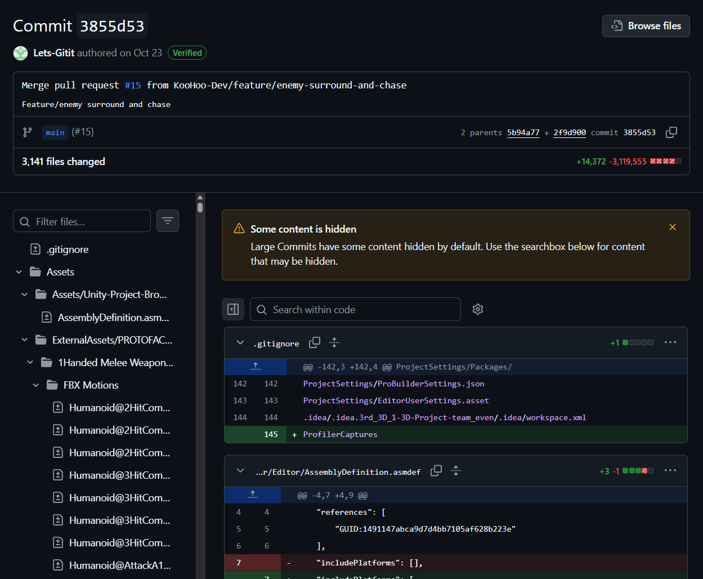

#### (a) 병합 중 `.meta` 파일이 빠져 참조가 깨지던 문제

**[증상]** 작업자마다 다르게 깨졌습니다. 어떤 작업자는 머티리얼이 빠져 맵 전체가 하얗게 보였고, 다른 작업자는 브랜치를 바꿀 때마다 `.meta` 수천 개가 변경 목록에 잡혀 매번 되돌려야 했습니다.

**[원인]** 팀원이 로컬에서 브랜치를 병합하면서 외부 에셋의 `.meta` 2,581개(애니메이션 에셋 2,488 · FinalIK 아이콘 93)가 빠졌고, 이 브랜치가 `develop`에 병합되며 팀 전체로 퍼졌습니다. 유니티는 `.meta` 안의 GUID로 에셋을 참조하는데, `.meta`가 없으면 PC마다 새 GUID를 만들어 참조가 끊깁니다.

**[찾은 과정]** 같은 레포인데 작업자마다 화면이 달라, 처음에는 `.gitignore`를 의심했습니다. 실제로 패키지 파일 하나를 무시하려다 `ProjectSettings/Packages/` 폴더 전체를 무시하게 적어 둔 줄이 있어 먼저 지웠고, 이어서 병합 중 `.meta`가 빠진 것을 찾았습니다.

**[해결]** 이전 커밋에서 `.meta`를 되살려 다시 올리고, 고친 `.gitignore`와 함께 팀원 모두 각자의 브랜치에 병합하게 했습니다. 이후 `.gitignore`는 팀장만 고치고, 추가할 것은 요청받아 반영하는 것이 좋다는 것을 배웠습니다.

#### (b) 같은 시기의 LFS · 줄바꿈 문제

| 문제                    | 원인                                        | 해결                             |
| ----------------------- | ------------------------------------------- | -------------------------------- |
| 사운드 에셋이 꼬였다    | LFS 대상 `.mp3`가 실제 파일로 커밋됐다      | LFS 포인터로 바로잡았다          |
| 바이너리 씬·프리팹 손상 | `.prefab`·`.unity`를 모두 텍스트로 취급했다 | `.gitattributes`를 `text=auto`로 |

- 텍스트로 취급하게 하자, 바이너리로 저장된 외부 에셋이 체크아웃 때 줄바꿈 변환으로 깨졌습니다("Invalid serialized file header").

### 9.2 보스가 멀어진 플레이어를 쫓지 않던 문제

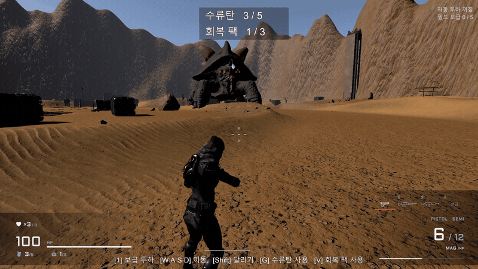

_플레이어가 멀어졌는데 보스가 제자리에서 회전만 한다_

**[증상]** 플레이어가 일정 거리 이상 멀어지면, 보스가 이동을 멈추고 제자리에서 회전만 했습니다.

**[찾은 과정]** 회전은 제 코드가 NavMesh와 상관없이 돌리고, 이동은 팀원의 코드가 플레이어 위치 근처(4m)의 NavMesh로 경로를 잡습니다. 회전은 되는데 이동만 멈췄으므로, 코드가 아니라 NavMesh 쪽으로 좁혔습니다.

**[원인과 해결]** NavMesh는 경사 45°, 단차 0.75m를 넘는 곳에는 구워지지 않아, 플레이어가 고지대에 있으면 보스가 목적지를 찾지 못했습니다. 라운드 맵에서 고저차가 심한 구간을 줄여 NavMesh가 끊기는 곳을 없앴고, 다시 구운 맵에서는 재발하지 않았습니다.

---

## 10. 결과와 돌아보기

### 10.1 목표를 이뤘는가

| 목표        | 결과                                                                          |
| ----------- | ----------------------------------------------------------------------------- |
| ① 팀장 역량 | 카드 97개 모두 담당자가 정해졌고 모두 마쳤다. 배정을 기다리는 병목이 사라졌다 |
| ② 시너지    | 담당자가 자기 영역의 기능을 스스로 기획해 넓혔다                              |

이전에는 한 사람의 작업이 끝날 때마다 팀장이 다음 작업을 배정해야 했습니다. 이번에는 책임 영역 단위로 맡기자, 각자 다음 할 일을 스스로 찾았고 진행 중에 생긴 작업도 책임 영역대로 이어받았습니다.

맡은 영역에 확실한 발언권을 보장하자, 개선 의견을 자유롭게 내는 분위기가 만들어졌고 담당자가 자기 영역을 스스로 넓혔습니다.

- **무기 (팀원1)** — 라이플만 계획했지만 산탄총·저격소총 등을 더했습니다.
- **보급 (팀원3)** — 보급 종류를 여러 개로 나눴습니다.
- **몬스터 (팀원2)** — 돌진·기절·원거리 독 구름 몬스터를 더했습니다.

### 10.2 정해 둔 것보다 의도를 기준으로 판단했는가 ✍

| 결정                                                                        | 기준으로 삼은 것          | 얻은 것                               | 대가                                |
| --------------------------------------------------------------------------- | ------------------------- | ------------------------------------- | ----------------------------------- |
| [6.2](#62-무엇을-기준으로-피드백을-반영하고-보류하는가) 피드백 반영·보류    | 초기 의도 → 남은 기간     | 방향과 일정 유지, 보류 7건 보존       | 재미있어 보이는 제안도 미뤘다       |
| [8.1.2](#812-기획한-패턴을-바꿀-것인가) 기획한 패턴 변경                    | 대치하며 반격하는 경험    | 멀리 있는 플레이어도 패턴을 보게 됐다 | 합의한 기획을 고쳤다                |
| [8.5](#85-구조-확장성-검증-보스-코드를-어떻게-나눌-것인가) 보스 코드 나누기 | 두 번째 보스에도 필요한가 | 다른 사람이 같은 틀로 보스를 만들었다 | 공통 부분을 더 명확히 정리해야 했다 |
| [8.2.3](#823-보스-등장을-다른-파트에-어떻게-알릴-것인가) 등장 알림 방식     | 연결·수정 수고 줄이기     | 받는 쪽이 각자 구독한다               | —                                   |

팀원의 제안을 거르던 기준과 제 개발에서 기획을 바꾼 기준이 같았습니다. 지켜야 할 것은 정해 둔 기획이 아니라 그 기획이 노린 경험이었습니다.

### 10.3 아쉬운 점과 개선 계획

**1. 팀장이 볼 수 없는 곳에서 문제가 반복됐습니다.**

자율성이 올라간 만큼, 누가 어디서 무엇을 고치는지 다 알 수 없었습니다. PR 템플릿에 "새 파일의 `.meta` 포함" 같은 확인 항목이 있었지만, 사람이 체크하는 방식이라 빠뜨리는 것을 막지 못했습니다.

| 반복된 문제                 | 예                                                   |
| --------------------------- | ---------------------------------------------------- |
| 에셋 파일이 깨졌다          | `.meta` 누락, 줄바꿈 변환, 대소문자만 다른 파일 이름 |
| 데이터 표가 코드와 어긋났다 | 병합 뒤 표의 열이 코드와 맞지 않았다                 |

→ 사람이 체크하던 항목을 PR 단계의 CI 자동 검사로 옮기겠습니다. 에셋이 바뀐 PR에서는 `.meta` 짝·LFS 포인터·파일 이름을, 표가 바뀐 PR에서는 표를 실제로 읽어 열이 맞는지 확인합니다.

**2. 버그를 직접 풀기보다 배정하는 역할이 됐습니다.**

코드를 모두 알 수 없어, 발견한 버그를 책임 영역별로 배정했습니다. 통합 과정의 문제(`.meta` 복구 등)만 직접 풀었습니다.

→ 기계로 잡을 수 있는 문제는 자동 검사가 먼저 잡게 해, 팀장은 배정과 우선순위 판단에 집중하겠습니다.

### 10.4 배운 점

**1. 책임과 함께 발언권을 줘야 자율성이 생긴다.** 일을 맡기는 것만으로는 부족했고, 맡은 영역의 발언권을 보장하자 담당자가 지시를 기다리지 않고 개선을 기획했습니다.

**2. 자율성은 기준과 짝을 이뤄야 한다.** 기준이 있는 곳은 자유롭게 맡길 수 있었고, 기준이 없는 곳에서는 사고가 반복됐습니다. 맡기는 범위가 넓어질수록, 팀장이 직접 보던 것을 기준과 자동 검사가 대신 보게 해야 합니다.
