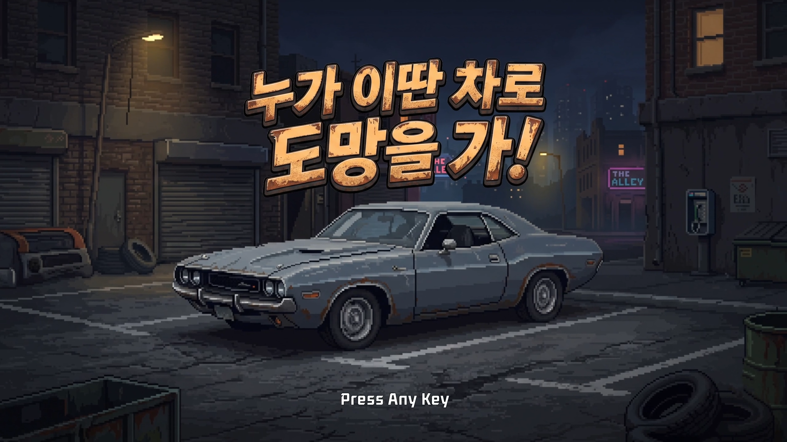
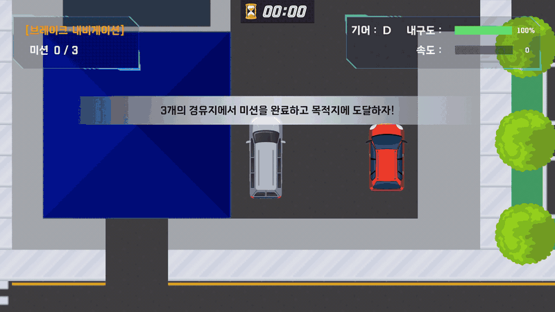
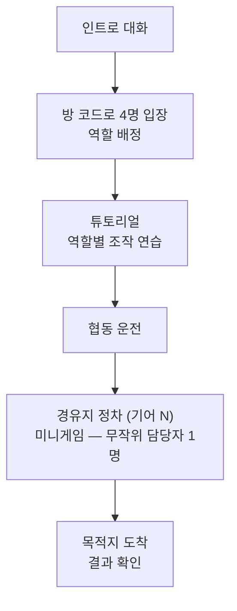
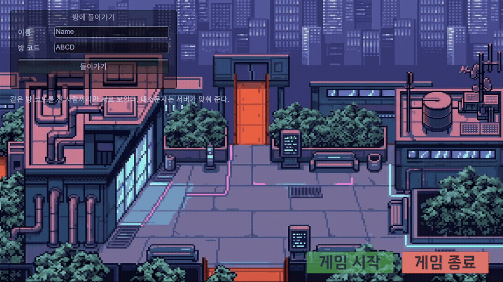
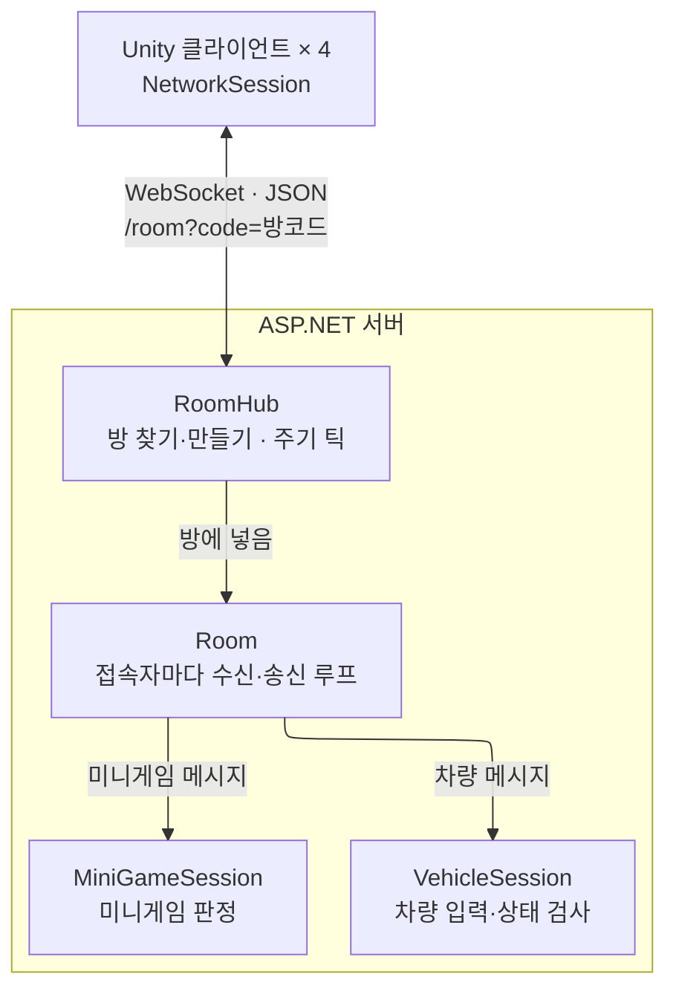
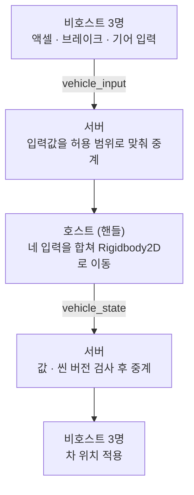
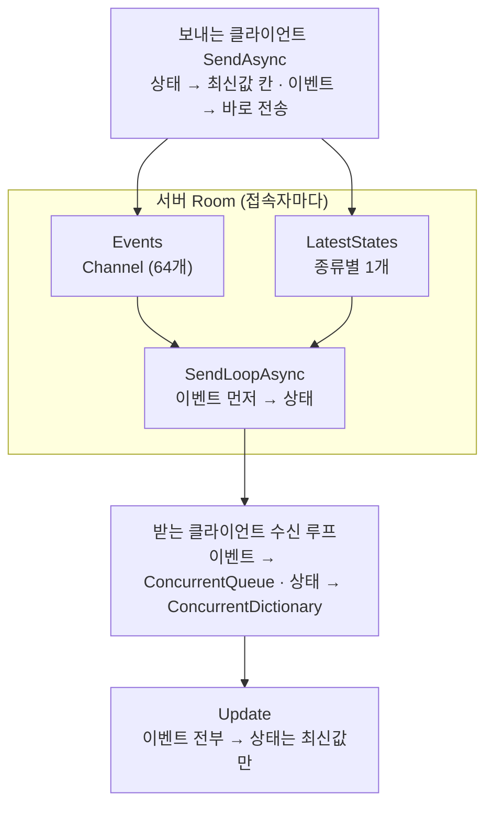
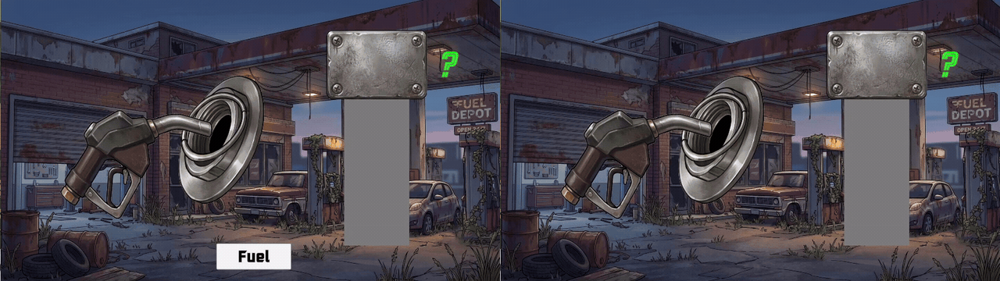
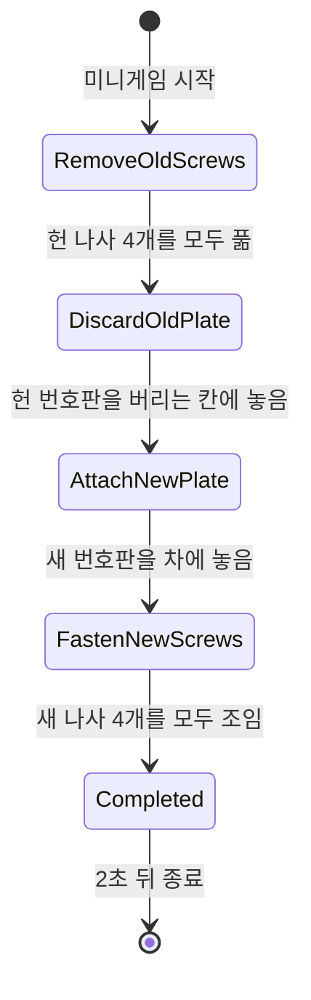
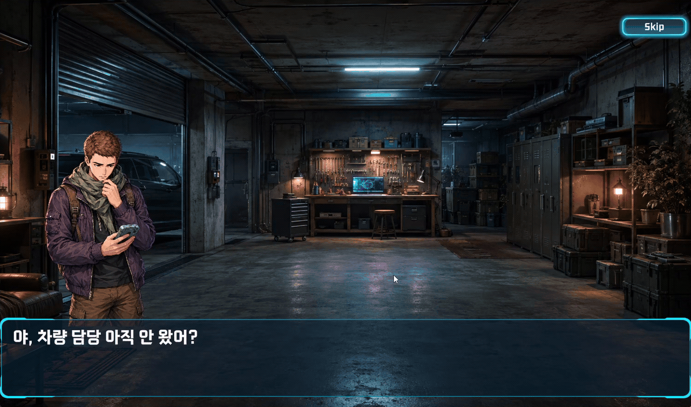

# 누가 이딴 차로 도망을 가! — 4인 협동 운전 게임의 WebSocket 서버와 동기화

> **핸들·액셀·브레이크·기어를 네 명이 나눠 맡는 온라인 협동 운전 게임에서, 서버(ASP.NET)와 클라이언트 네트워크를 맡아 모두의 입력을 차 한 대로 모은 과정**



<!-- 대표 이미지(포트폴리오 페이지·슬라이드 표지): images/cover.png — 문서 맨 앞 그림은 main.png지만, 빌드할 때 cover는 이 파일로 둔다 -->

| 항목      | 내용                                                                                                                                                         |
| --------- | ------------------------------------------------------------------------------------------------------------------------------------------------------------ |
| 장르      | 4인 협동 드라이빙 액션 · 탑다운 · PC 온라인 멀티플레이                                                                                                       |
| 개발 기간 | 2026.08.25 ~ 2026.09.12                                                                                                                                      |
| 인원      | 팀 프로젝트 · 개발 4명                                                                                                                                       |
| 담당      | **팀장** + **서버·네트워크** · 인트로 대화 시스템 · 튜토리얼 설계                                                                                            |
| 개발 환경 | 클라이언트 Unity 6000.3.15f1 (URP) / 서버 ASP.NET Core (.NET 10) · Git(GitHub, Git flow)                                                                     |
| 주요 기술 | WebSocket 방 서버 · 상태와 이벤트를 나눈 송수신 큐 · 서버가 판정하는 미니게임(`SemaphoreSlim`)                                                               |
| 링크      | [클라이언트 GitHub](https://github.com/KooHoo-Dev/3rd-TeamProject-CY) · [서버 GitHub](https://github.com/KooHoo-Dev/3rd-TeamProject-CY-Server) · 시연 영상 ✍ |

## 목차

1. [개요](#1-개요)
2. [플레이](#2-플레이)
3. [네 명을 한 방, 한 씬에](#3-네-명을-한-방-한-씬에)
4. [차 한 대를 넷이 운전하기](#4-차-한-대를-넷이-운전하기)
5. [기다릴수록 늘어나던 지연](#5-기다릴수록-늘어나던-지연)
6. [서버가 판정하는 미니게임](#6-서버가-판정하는-미니게임)
7. [플레이어를 게임으로 안내하기](#7-플레이어를-게임으로-안내하기)
8. [만들며 생긴 문제](#8-만들며-생긴-문제)
9. [결과와 돌아보기](#9-결과와-돌아보기)

---

## 1. 개요

### 1.1 프로젝트 소개

《누가 이딴 차로 도망을 가!》는 은행을 털고 도망치는 네 명의 도둑이 **차 한 대의 핸들·액셀·브레이크·기어를 한 명씩 나눠 맡아** 함께 운전하는 탑다운 협동 게임입니다. 네 명은 서로 말로 상황을 전하며 경유지에 들러 미니게임(주유·바리케이드 해킹·번호판 교체)을 마치고, 최대한 빨리 목적지에 도착해야 합니다. 이 게임의 재미는 각자의 조작 타이밍이 어긋나며 생기는 혼란과, 소통을 반복하며 점점 손발이 맞아 가는 협동에 있습니다.

목표한 경험은 네 명이 각자 맡은 페달과 핸들을 조작하면 그 입력이 한 대의 차에 모여, **"우리가 같이 운전하고 있다"고 느끼는 것**입니다.

서버는 처음 다뤄 보는 영역이었습니다. 그래서 더욱 네트워크 라이브러리에 맡기지 않고, 접속부터 메시지 송수신까지 **서버 통신 과정을 직접 구현해 보는 것**을 목표로 삼았습니다.

### 1.2 팀 구성과 내 담당

| 담당           | 맡은 시스템                                                                    |
| -------------- | ------------------------------------------------------------------------------ |
| **팀장(본인)** | **서버·네트워크** · 인트로 대화 시스템 · 튜토리얼 설계와 진행 구현 · 기능 병합 |
| 팀원 1         | 차량·게임플레이 코어(차량 조작·충돌·내구도·타이머·내비게이션)                  |
| 팀원 2         | UI·미니게임 클라이언트 3종                                                     |
| 팀원 3         | 맵·콘텐츠·사운드(레벨 디자인·튜토리얼 맵 제작과 배치)                          |

팀장으로서 컨셉 기획서를 쓰고, 작업 범위를 두 단계로 나눠 분배했습니다. 1차 구현은 게임이 돌아가기 위한 핵심 루프, 2차 구현은 재미를 더하는 추가 콘텐츠입니다. 또 Git flow 규약을 정하고 팀원의 기능 브랜치를 병합했습니다.

---

## 2. 플레이



_네 명이 한 대의 차를 나눠 운전하다 경유지에 서서 미니게임을 합니다._

### 2.1 네 개의 역할

| 역할                | 조작                 | 판단해야 하는 것                        |
| ------------------- | -------------------- | --------------------------------------- |
| 핸들                | 좌우 조향            | 도로 방향, 코너 진입 시점               |
| 액셀                | 가속                 | 출발·가속, 액셀을 뗄 시점               |
| 브레이크·내비게이션 | 감속·정지, 전체 지도 | 코너 속도, 장애물, 정차 위치, 경로 안내 |
| 기어                | D/R/N 변경           | 상황에 맞는 기어, 경유지에서 중립(N)    |

네 명 가운데 핸들 담당의 클라이언트가 **호스트**입니다. 호스트는 네 명의 입력을 모아 차를 움직이고, 튜토리얼 종료 같은 진행 버튼을 누릅니다. 나머지 세 명(**비호스트**)은 자기 입력만 보냅니다.

### 2.2 한 판의 흐름



_경유지 칸에 차를 세우고 기어를 N으로 두면 미니게임이 시작되고, 네 명 중 무작위 한 명(**담당자**)이 수행합니다. 미니게임 중에도 시간은 흐르고, 나머지 세 명은 담당자의 화면을 지켜봅니다._

---

## 3. 네 명을 한 방, 한 씬에

네 명이 함께 운전하려면 먼저 같은 방, 같은 씬에 있어야 했습니다. 그 바탕이 되는 서버를 직접 만들었습니다.



_같은 방 코드로 접속하면 로비가 한 칸씩 채워집니다._

### 3.1 서버를 직접 만들 것인가

네 명이 한 방에서 같은 차를 움직이려면 메시지를 주고받을 서버가 필요했습니다.

|      | Unity Dedicated Server + 네트워크 라이브러리 | ASP.NET Core WebSocket 서버를 직접 만든다 ✓   |
| ---- | -------------------------------------------- | --------------------------------------------- |
| 방식 | 라이브러리의 RPC·네트워크 변수로 동기화      | 접속·방·메시지 형식·송수신 루프를 직접 작성   |
| 장점 | 접속·직렬화·동기화를 라이브러리가 맡는다     | 통신 과정을 직접 다룬다. 서버가 가볍다        |
| 단점 | 메시지가 오가는 과정이 감춰진다              | 동시성·느린 접속을 직접 처리. JSON이라 무겁다 |

**서버를 직접 만드는 쪽을 골랐습니다.** 이 프로젝트에서 얻고 싶었던 것은 서버 통신 과정을 직접 구현해 보는 경험이었고, 라이브러리에 맡기면 게임은 더 빨리 돌아가겠지만 메시지가 어떻게 오가는지는 보이지 않습니다. 그 대신 라이브러리가 맡아 주던 일을 직접 정해야 했습니다. 서버가 Unity가 아니어서 차량 물리를 서버에서 그대로 돌릴 수 없었고, 메시지를 주고받는 구조도 직접 설계하다가 기다릴수록 입력이 밀리는 지연을 만나기도 했습니다.

패키지 목록의 Netcode for GameObjects는 한 PC에서 여러 클라이언트를 띄워 테스트하기 위해(Multiplayer Play Mode) 넣은 것이고, 통신에는 쓰지 않았습니다.

접속·방 입장·채팅까지 되는 기본 구조는 수업에서 다룬 예제를 바탕으로 했고, 그 위에 미니게임 판정, 차량 입력·상태 중계, 라운드·교통 상태 메시지를 새로 만들었습니다. 서버 파일 10개 중 6개를 새로 만들고, 방을 관리하는 `Room`에는 씬 전환·세션 위임·접속자별 송신 큐를 더했습니다.

### 3.2 서버와 클라이언트의 구성



_접속하면 RoomHub가 방 코드로 Room을 찾아 넣고, 그 뒤의 메시지는 Room이 접속자마다 받고 보냅니다. 메시지는 모두 `Type` 필드를 가진 JSON이고, 양쪽은 같은 이름의 메시지 클래스(`*Protocol.cs`)를 나눠 가집니다._

서버는 첫 메시지가 `hello`가 아니면 방에 들이지 않고, 접속자 ID(`u1`, `u2` …)는 클라이언트가 정하지 않고 `RoomHub`가 `Interlocked.Increment`로 매깁니다.

이 구조에서 지킨 규칙은 세 가지입니다.

1. **네 화면에서 같아야 하는 것은 서버가 정한다.** 접속자 ID, 씬 전환, 미니게임의 담당자와 판정이 여기에 속합니다.
2. **차량 물리는 호스트가 계산하고, 서버는 검사해 중계한다.**
3. **상태와 이벤트는 다른 길로 보낸다.**

### 3.3 메시지 처리는 맡는 세션에게

기본 구조의 `Room`은 메시지 종류마다 `if`로 직접 처리했습니다. 여기에 미니게임과 차량을 그대로 붙이면 `Room` 하나가 방 관리·송수신·미니게임 판정·차량 검사를 모두 맡게 됩니다. 그래서 첫 미니게임을 붙일 때부터 **맡는 영역마다 클래스를 나눴습니다.**

```csharp
// Room.cs — 접속자 한 명의 수신 루프
while (token.IsCancellationRequested == false)
{
    string text = await ReceiveTextAsync(member.Socket, token);
    TypeOnly kind = JsonSerializer.Deserialize<TypeOnly>(text);

    // … round_state · traffic_state는 Room이 그대로 중계 (생략)

    // (Why) 미니게임·차량 메시지는 Room이 해석하지 않고 맡는 세션에 넘긴다
    bool handledByMiniGame = await miniGameSession.TryHandleAsync(kind.Type, member.User.Id, text);
    if (handledByMiniGame) continue;

    bool handledByVehicle = vehicleSession.TryHandle(kind.Type, member.User.Id, text);
    if (handledByVehicle) continue;

    // … move · chat · scene_change_request는 Room이 직접 처리 (생략)
}
```

- 세션이 "처리했다(`true`)"를 돌려주면 다음 메시지로 넘어갑니다.
- 미니게임 3종과 차량이 붙는 동안 수신 루프는 세션마다 두 줄씩만 늘었습니다.
- 미니게임 상태가 한 클래스에 모여, 뒤에서 `SemaphoreSlim` 하나로 지킬 수 있었습니다.

[`Room.ReceiveLoopAsync` 원문](https://github.com/KooHoo-Dev/3rd-TeamProject-CY-Server/blob/ad1b8d75b0db98dcaaaf72fc3ab4aef6d7740740/HelloServer/Room.cs#L141)

### 3.4 씬 전환은 서버의 명령으로만

로비 → 튜토리얼 → 본 게임으로 넘어갈 때, 버튼을 누른 클라이언트도 **직접 씬을 바꾸지 않습니다.** 각자 씬을 바꾸면 버튼을 누른 사람만 먼저 넘어가고, 나머지 세 명은 이전 씬에 남은 채 서로 다른 씬의 메시지를 주고받게 됩니다. 그래서 클라이언트는 요청만 보내고, 서버가 방 전체에 보낸 `scene_change`를 받아 네 명이 같은 순간에 넘어가게 했습니다.

```csharp
// Room.cs — 씬 전환 요청을 받아 방 전체에 전환 명령을 보낸다
private async Task HandleSceneChangeAsync(Member member, string text)
{
    SceneChangeRequestMessage request =
        JsonSerializer.Deserialize<SceneChangeRequestMessage>(text);

    string sceneName = request?.SceneName?.Trim();

    // (Why) 씬마다 번호를 올려, 이전 씬에서 늦게 도착한 차량 상태를 새 씬에 적용하지 않게 한다
    sceneVersion++;
    vehicleSession.SetSceneVersion(sceneVersion);

    await BroadcastAsync(new SceneChangeMessage { SceneName = sceneName, SceneVersion = sceneVersion });
}
```

[`HandleSceneChangeAsync` 원문](https://github.com/KooHoo-Dev/3rd-TeamProject-CY-Server/blob/ad1b8d75b0db98dcaaaf72fc3ab4aef6d7740740/HelloServer/Room.cs#L209)

※ 처음에는 튜토리얼에서 본 게임으로 넘어가면 비호스트 화면의 차가 시작 위치가 아닌 곳에 놓였습니다. 호스트는 씬이 바뀌기 직전까지 위치를 포함한 차량 상태를 보내는데, 그 상태가 늦게 도착하면 비호스트가 새 씬에서 튜토리얼의 차 위치를 그대로 적용한 것입니다. 메시지만 보고는 어느 씬의 상태인지 알 수 없었습니다.

그래서 서버가 씬을 바꿀 때마다 번호(씬 버전, `sceneVersion`)를 올려 `scene_change`에 담고, 호스트는 차량 상태에 지금 씬의 번호를 담아 보내게 했습니다. 번호가 다른 상태는 서버의 `VehicleSession`과 클라이언트가 모두 버리고, 비호스트는 새 씬에 들어오면 차를 시작 위치로 옮깁니다.

---

## 4. 차 한 대를 넷이 운전하기

목표한 경험의 중심입니다. 네 명의 입력이 한 대의 차에 모이려면, 누군가는 그 입력을 합쳐 차를 움직여야 했습니다.



_비호스트의 입력은 서버 → 호스트 → 서버를 거쳐 차의 움직임으로 돌아옵니다._

### 4.1 차량 물리를 누가 계산하는가

네 명의 입력을 합쳐 차를 움직일 곳을 서버와 클라이언트 한 명 중에서 정해야 했습니다. 서버는 Unity가 아니라 ASP.NET이어서, 서버가 계산하려면 Unity 물리를 쓸 수 없었습니다.

|      | 서버가 계산                                   | 핸들 담당 클라이언트(호스트)가 계산 ✓                  |
| ---- | --------------------------------------------- | ------------------------------------------------------ |
| 방식 | 서버가 입력 네 개로 위치를 계산해 보낸다      | 호스트가 입력을 합쳐 움직이고 위치를 보낸다            |
| 장점 | 기준이 한 곳이라 네 화면과 지연이 같다        | Unity 물리와 팀원의 차량 코드를 그대로 쓴다            |
| 단점 | 차 물리와 맵 충돌을 서버에 다시 만들어야 한다 | 입력이 서버를 두 번 거친다. 호스트 값을 검증할 수 없다 |

**호스트가 계산하는 쪽을 골랐습니다.** 차량 조작은 이미 팀원이 `Rigidbody2D`로 만들고 있었고, 같은 물리를 서버에 다시 만드는 것보다 호스트에 맡기는 편이 일정 안에 4인 운전을 완성하는 데 맞다고 판단했습니다. 대신 호스트가 나가거나 느리면 모두가 멈추고, 서버는 호스트가 보낸 값이 맞는지 확인할 수 없게 되었습니다.

### 4.2 서버는 클라이언트 값을 그대로 믿지 않는다

값이 맞는지 확인할 수는 없어도, 클라이언트가 보낸 값을 그대로 중계하지는 않도록 최소한의 검사를 두었습니다.

```csharp
// VehicleSession.cs — 클라이언트가 보낸 값을 그대로 중계하지 않는다
private void HandleVehicleInput(string userId, string json)
{
    VehicleInputMessage message =
        JsonSerializer.Deserialize<VehicleInputMessage>(json);

    // (Why) 누가 보냈는지는 클라이언트가 적은 값이 아니라 서버가 아는 접속 ID로 채운다
    message.UserId = userId;
    message.Steer = Math.Clamp(message.Steer, -1f, 1f);
    message.Accel = Math.Clamp(message.Accel, 0f, 1f);
    message.Brake = Math.Clamp(message.Brake, 0f, 1f);
    message.Gear = Math.Clamp(message.Gear, 0, 2);

    _ = broadcastAsync(message);
}
```

- 입력은 보낸 사람을 서버가 채우고, 범위를 넘는 값은 허용 범위로 맞춥니다.
- 차량 상태는 `NaN`·무한대를 버리고, 씬 버전이 다르면 버립니다.

[`VehicleSession.cs` 원문](https://github.com/KooHoo-Dev/3rd-TeamProject-CY-Server/blob/ad1b8d75b0db98dcaaaf72fc3ab4aef6d7740740/HelloServer/Vehicle/VehicleSession.cs#L32)

---

## 5. 기다릴수록 늘어나던 지연

서버를 직접 만들며 만난 가장 큰 문제입니다. 이 문제를 풀면서 메시지를 "상태"와 "이벤트"로 나눠 다루게 되었습니다.


_수정 전 빌드에서는 액셀을 누르고 한참 뒤에야 차가 움직였습니다._

### 5.1 증상: 아무도 조작하지 않아도 지연이 늘었다

이 문제는 에디터에서는 보이지 않았고, **빌드한 클라이언트 4개로 테스트하면서** 처음 드러났습니다. 로비까지는 네 클라이언트가 함께 움직였지만, 게임 씬에 들어가면 호스트를 포함한 네 명 모두가 서로의 조작을 늦게 보았습니다. 같은 빌드가 팀원 한 명의 PC에서만 문제없이 돌았습니다.

지연은 **게임을 켜 둔 시간이 길수록 늘어났습니다.** 들어가자마자 액셀을 누르면 약 5초, 조금 기다렸다가 누르면 20초 넘게 늦었습니다.

결정적인 단서는 **아무도 조작하지 않아도 지연이 늘었다**는 점이었습니다. 입력 처리가 문제라면 입력이 없는 동안에는 지연이 쌓일 이유가 없습니다. 그래서 원인을 입력이 아니라 입력이 없어도 계속 오가는 게임 플레이 통신으로 좁혔습니다.

### 5.2 원인: 모든 메시지를 이벤트처럼 줄 세웠다

게임 씬에 들어가면 아무도 조작하지 않아도 입력·차량 상태·라운드 상태·로비 위치 메시지가 계속 흐릅니다.

| 메시지                              | 보내는 쪽              | 클라이언트 하나가 받는 양 |
| ----------------------------------- | ---------------------- | ------------------------- |
| 비호스트 3명의 입력 `vehicle_input` | 비호스트 (초당 20회씩) | 초당 60개                 |
| 차량 상태 `vehicle_state`           | 호스트 (초당 15회)     | 초당 15개                 |
| 라운드 상태 `round_state`           | 호스트 (초당 5회)      | 초당 5개                  |
| 로비 위치 `state`                   | 서버 (초당 10회)       | 초당 10개                 |
| **합계**                            |                        | **초당 약 90개**          |

JSON의 양 자체는 서버가 처리하기에 많지 않았습니다. 문제는 받는 쪽이었습니다. 당시 클라이언트의 수신 루프는 메시지를 하나 받을 때마다 구독자를 모두 부르고, 그 처리가 끝나야 다음 메시지를 읽었습니다. 받는 쪽이 이 속도를 따라가지 못하면 메시지가 TCP 수신 버퍼에 쌓입니다. 그리고 WebSocket(TCP)은 순서를 보장하므로, 나중에 누른 `Accel = 1`은 앞에 쌓인 수백 개의 `Accel = 0`을 다 읽기 전까지 도착하지 못합니다. 기다린 시간만큼 지연이 늘어난 이유입니다.

그런데 차량 입력과 위치는 지난 값이 모두 필요한 기록이 아니라 **지금 값 하나만 의미 있는 상태**입니다. 호스트에게 필요한 것은 액셀 담당의 마지막 입력 하나입니다. 반대로 씬 전환·입장·퇴장·미니게임 완료는 하나라도 빠지거나 순서가 바뀌면 안 되는 **이벤트**입니다.

### 5.3 상태 메시지도 순서대로 보낼 것인가

|      | 보내는 횟수를 줄인다          | 받는 쪽을 빠르게 한다                 | 상태는 최신값만, 이벤트는 순서대로 ✓  |
| ---- | ----------------------------- | ------------------------------------- | ------------------------------------- |
| 방식 | 입력이 바뀔 때만 보낸다       | 쌓이기 전에 다 처리한다               | 같은 종류의 상태는 이전 값을 덮어쓴다 |
| 장점 | 지금 흐르는 양이 바로 준다    | 메시지 구조를 바꾸지 않는다           | 몇 개가 오든 쌓일 자리가 없다         |
| 단점 | 양이 다시 늘면 같은 문제 발생 | 지난 값까지 다 처리하여 성능에 기댄다 | 송신·서버·수신 세 곳을 바꿔야 한다    |

처음 든 생각은 보내는 횟수를 줄이는 것이었지만, 그것은 지금의 숫자를 낮출 뿐 구조는 그대로라고 보았습니다. 게임이 커져 정말로 많이 보내야 할 때 같은 문제가 다시 생깁니다. 그래서 **입력 송신 주기(초당 20회)는 그대로 두고**, 상태 메시지가 어디에도 줄을 서지 않게 바꿨습니다.

### 5.4 송신, 서버, 수신 모두 최신값만



_보내는 쪽, 서버, 받는 쪽이 각자 메시지를 상태와 이벤트로 나눠 담습니다. 연결은 하나라서, 서버는 이벤트를 먼저 보내고 상태를 그 뒤에 보냅니다._

| 구분              | 메시지                                                                           | 처리                        |
| ----------------- | -------------------------------------------------------------------------------- | --------------------------- |
| 상태 (덮어씀)     | `vehicle_input` · `vehicle_state` · `round_state` · `traffic_state` · `state` 등 | 종류별 마지막 값 하나       |
| 이벤트 (순서대로) | `welcome` · `join` · `leave` · `scene_change` · `chat` · 미니게임 시작·완료 등   | 하나도 버리지 않고 순서대로 |

입력은 보낸 사람별로 칸을 나눴습니다(`vehicle_input:u2`). 액셀 담당과 브레이크 담당의 입력이 같은 칸을 덮어쓰면 한 사람의 입력이 사라지기 때문입니다. 보내는 클라이언트도 같은 규칙으로, 상태는 최신값 칸에 넣었다가 마지막 값만 보냅니다.

#### 서버: 접속자마다 송신 루프

기본 구조의 서버는 방 전체에 보낼 때 접속자마다 보내기 작업을 만들고 `Task.WhenAll`로 모두 끝날 때까지 기다렸습니다. 그러면 느린 접속자 한 명 때문에 그 브로드캐스트를 부른 수신 루프와 틱까지 함께 멈춥니다. 그래서 **접속자마다 송신 루프를 따로 두고**, 보내는 쪽은 큐에 넣고 신호만 준 뒤 바로 돌아오게 했습니다.

```csharp
// Room.cs — 접속자 한 명의 송신 루프
while (member.Socket.State == WebSocketState.Open)
{
    await member.OutboundSignal.WaitAsync(token);

    lock (member.OutboundGate)
        member.OutboundSignalPending = false;

    // 이벤트는 반드시 먼저, FIFO 순서대로 전송한다.
    while (member.Events.Reader.TryRead(out string eventJson))
        await SendRawAsync(member, eventJson, token);

    // 상태는 각 종류별 마지막 값만 전송한다.
    foreach (string key in member.LatestStates.Keys)
    {
        if (member.LatestStates.TryRemove(key, out string stateJson))
            await SendRawAsync(member, stateJson, token);
    }
}
```

- 신호는 `OutboundSignalPending` 플래그로 한 번만 쌓여, 메시지가 100개 들어와도 루프가 100번 깨어나지 않습니다.
- 한 명 때문에 방 전체가 기다리지 않도록, 따라오지 못하는 접속자는 그 사람만 끊습니다.

[`SendLoopAsync` 원문](https://github.com/KooHoo-Dev/3rd-TeamProject-CY-Server/blob/ad1b8d75b0db98dcaaaf72fc3ab4aef6d7740740/HelloServer/Room.cs#L324)

| 상황                           | 처리                      |
| ------------------------------ | ------------------------- |
| 메시지 하나를 3초 안에 못 보냄 | 그 접속자만 끊는다        |
| 이벤트 큐(64개)가 가득 참      | 그 접속자만 끊는다        |
| 정상 퇴장·서버 종료            | 송신 루프를 조용히 끝낸다 |

#### 수신: 담기만 하고, 적용은 `Update`에서

```csharp
// NetworkSession.cs — 메인 스레드에서 이벤트는 전부, 상태는 최신값만
private void Update()
{
    while (eventMessages.TryDequeue(out ReceivedMessage message))
    {
        if (message.Type == "scene_change")
        {
            // (Why) 씬이 바뀌면 이전 씬의 상태는 적용하지 않고 버린다
            latestReceivedStates.Clear();
            Handle(message.Json);
            return;
        }

        Handle(message.Json);
    }

    foreach (string stateKey in latestReceivedStates.Keys)
    {
        if (latestReceivedStates.TryRemove(stateKey, out string json))
        {
            Handle(json);
        }
    }
}
```

- 수신 루프는 메인 스레드가 아닌 곳에서 돌기 때문에(`ConfigureAwait(false)`) 게임 오브젝트를 건드리지 않고 분류해서 담기만 합니다. 두 스레드가 함께 쓰므로 `ConcurrentQueue`·`ConcurrentDictionary`를 썼습니다.
- 한 프레임 사이에 같은 종류의 상태가 몇 개가 와도 `Handle`은 한 번만 불립니다.

[`Update` 원문](https://github.com/KooHoo-Dev/3rd-TeamProject-CY/blob/3b3daec0639f604ec865c601e4d0d78f82b11a1b/Assets/Scripts/Network/NetworkSession.cs#L215)

### 5.5 왜 빌드에서만 따라가지 못했나

당시에는 "받는 쪽이 따라가지 못해 쌓인다"까지만 판단하고 고쳤습니다. 에디터에서는 괜찮고, 팀원 한 명의 PC에서도 정상적으로 작동했습니다. 그 이유는 프로젝트가 끝난 뒤 다시 확인했습니다.

수정 전 수신 루프는 `ReceiveAsync`를 기다린 뒤 메인 스레드로 돌아와 메시지를 처리했습니다. Unity는 메인 스레드로 돌아온 작업을 프레임마다 처리하므로, 이 루프는 **한 프레임에 메시지를 하나씩만** 꺼냈습니다. 그리고 빌드는 VSync가 켜져 있어 모니터 주사율에 프레임이 묶였습니다.

| 환경                      | 프레임         | 초당 꺼내는 양 | 결과                |
| ------------------------- | -------------- | -------------- | ------------------- |
| 에디터 (VSync 꺼짐)       | 제한 없음      | 90개 이상      | 문제 없다           |
| 빌드 · 60Hz 모니터        | 60             | 약 60개        | 매초 약 30개 쌓인다 |
| 빌드 · 고주사율 (팀원 PC) | 90 초과로 추정 | 90개 이상      | 문제 없다           |

수정 전 버전을 다시 빌드해 보니, **VSync만 끄자 지연 없이 돌아갔습니다.**

상태를 이벤트처럼 줄 세운 구조가 **근본 원인**이고, 프레임 제한은 그 문제를 **빌드에서 드러나게 한 조건**이었다고 봅니다. 프레임 제한만 풀면 당장은 괜찮아도, 받는 쪽이 조금만 느려지면 상태가 다시 쌓이는 구조이기 때문입니다.

실제 수정에는 두 변경이 함께 들어갔습니다. 상태를 최신값만 남기도록 바꾼 것, 그리고 수신 루프에 넣은 `ConfigureAwait(false)`로 꺼내는 속도가 프레임에 묶이지 않게 된 것입니다. 당시에는 앞의 것에 집중해 뒤의 변경이 가진 의미를 따로 생각하지 못했고, 둘을 나눠 시험해 보지도 못했습니다.


_수정 뒤에는 기다린 시간과 상관없이 네 화면의 차가 함께 움직입니다._

---

## 6. 서버가 판정하는 미니게임

경유지 미니게임은 네 명 중 한 명만 수행하지만, 나머지 세 명도 같은 화면을 지켜봅니다. 네 화면이 같은 담당자와 같은 결과를 보도록 판정을 서버에 두었습니다. 차량과 달리 미니게임의 판정은 시간·순서·단계만 따지는 규칙이라, Unity 물리 없이도 서버에서 계산할 수 있었습니다.



_담당자가 주유하면 다른 화면에서도 함께 움직입니다._

### 6.1 왜 서버가 판정하는가

담당자를 클라이언트가 각자 뽑으면 네 화면의 담당자가 달라질 수 있고, 담당자가 아닌 사람의 입력이 섞일 수도 있습니다. 그래서 담당자 선정, 담당자 입력만 받기, 단계 진행과 성공·실패 판정을 모두 서버(`MiniGameSession`)에서 하고, 클라이언트는 서버가 알려 준 결과를 그리기만 하게 했습니다.

| 미니게임             | 서버가 판정하는 것               |
| -------------------- | -------------------------------- |
| 주유소 · 정량 주유   | 뗀 순간의 게이지가 성공 구간인가 |
| 바리케이드 · 회로    | 정답 순서를 몇 번째까지 맞혔나   |
| 정비소 · 번호판 교체 | 지금 단계에 맞는 입력인가        |

- 주유 게이지는 누른 시각부터 서버가 계산해 주기적으로 알립니다. 성공 구간은 90~100%(설정값)이고, 100%를 넘기면 실패입니다.
- 회로는 틀리면 처음부터 다시 하고, 2초 동안 입력을 받지 않습니다.

### 6.2 모두 준비되면 담당자를 뽑는다

시작 요청(`minigame_start_request`)과 각 클라이언트의 준비 완료(`minigame_client_ready`)는 어느 쪽이 먼저 올지 모릅니다. 그래서 둘 중 무엇이 도착하든 `TryStartPendingMiniGameAsync`를 부르고, 조건이 모두 갖춰졌을 때 한 번만 시작되게 했습니다.

```csharp
// MiniGameSession.cs — 대기 중인 미니게임을 시작할 수 있으면 시작한다
private async Task TryStartPendingMiniGameAsync()
{
    if (currentMiniGameType != null)
        return;

    // … 미니게임 종류 확인 (생략)

    string[] memberIds = getMemberIds();

    // (Why) 한 명이라도 미니게임 화면을 준비하지 못했으면 시작하지 않는다. 늦게 들어온 화면이 시작 신호를 놓치지 않게 한 결정
    foreach (string memberId in memberIds)
    {
        if (readyUsers.Contains(memberId) == false)
            return;
    }

    string operatorId = memberIds[Random.Shared.Next(memberIds.Length)];

    // … 미니게임별 초기화 후 방 전체에 담당자를 알린다 (생략)
}
```

- 네 명 모두 미니게임 화면을 준비해야 시작합니다.
- 담당자는 서버가 접속자 중에서 무작위로 한 명 뽑아 방 전체에 알립니다.

[`TryStartPendingMiniGameAsync` 원문](https://github.com/KooHoo-Dev/3rd-TeamProject-CY-Server/blob/ad1b8d75b0db98dcaaaf72fc3ab4aef6d7740740/HelloServer/MiniGames/MiniGameSession.cs#L215)

### 6.3 번호판 교체의 단계


_관전자 화면입니다. 헌 번호판을 버리고 새 번호판을 붙이면 미션이 끝나고 다시 운전으로 돌아갑니다._

번호판 교체 미니게임은 단계가 넷이라, 서버가 지금 몇 번째 단계인지를 들고 있습니다.



단계마다 받을 수 있는 입력이 다릅니다. 헌 나사를 다 풀기 전에는 번호판을 끌 수 없고, 새 번호판을 붙이기 전에는 새 나사를 조일 수 없습니다. 서버는 지금 단계에 맞지 않는 입력을 버립니다.

- 같은 나사를 두 번 눌러도 `HashSet.Add`가 `false`를 돌려주므로 한 번만 셉니다.
- 번호판을 끄는 위치는 세 명이 따라 보기만 하면 되므로 상태로 최신 위치만 보내고(→ [5.4](#54-송신-서버-수신-모두-최신값만)), 나사·놓기·완료는 하나도 빠지면 안 되는 이벤트로 보냅니다.

[`HandleLicensePlateScrewAsync` 원문](https://github.com/KooHoo-Dev/3rd-TeamProject-CY-Server/blob/ad1b8d75b0db98dcaaaf72fc3ab4aef6d7740740/HelloServer/MiniGames/MiniGameSession.cs#L439)

### 6.4 SemaphoreSlim 하나로 상태 지키기

`MiniGameSession`의 상태(현재 미니게임, 단계, 담당자, 준비한 사람 목록)는 여러 곳에서 동시에 바뀝니다.

- 네 접속자의 수신 루프가 각자 입력을 넘깁니다.
- `RoomHub`의 주기 틱(초당 10회)이 주유 게이지를 갱신합니다. 게이지가 차는 시간과 성공 하한은 `appsettings.json`에 두어 다시 빌드하지 않고 바꿀 수 있습니다.
- 미니게임이 끝나면 2초 뒤에 정리하는 작업이 따로 돕니다.
- 접속자가 나가거나 씬이 바뀌면 진행 중인 미니게임을 정리합니다.

모두 상태를 바꾼 뒤 `await`로 결과를 방 전체에 알리므로 `lock`을 쓸 수 없습니다. 그래서 상태를 읽고 바꾸는 메서드마다 `SemaphoreSlim gate`(1개)를 잡고 시작해, 미니게임 상태는 한 번에 한 흐름만 바꾸게 했습니다.

| 상황                          | 처리                                   |
| ----------------------------- | -------------------------------------- |
| 미니게임 중 접속자가 나감     | 미니게임을 초기화하고 `game_aborted`   |
| 씬이 바뀜                     | 준비 목록·대기·진행 상태를 모두 초기화 |
| 담당자가 아닌 사람의 입력     | 무시                                   |
| 진행 중일 때 들어온 시작 요청 | 무시                                   |

---

## 7. 플레이어를 게임으로 안내하기

서버 밖에서 맡은 두 가지입니다. 인트로는 네 도둑이 왜 도망치는지를, 튜토리얼은 처음 하는 네 명이 무엇을 해야 하는지를 알려 줍니다.

### 7.1 인트로 대화: 연출을 대사 한 줄에 묶는다



_대사가 한 자씩 찍히다 `<delay>`에서 잠시 멈춥니다._

게임을 시작하면 네 도둑이 왜 이런 차로 도망치게 되었는지 알려 주는 짧은 대화가 비주얼 노벨 방식으로 나옵니다(대사 41줄, 등장인물 4명). 대사는 직접 썼고, 인물 초상화는 생성형 AI를 활용했습니다. 인트로가 끝나면 화면이 어두워지며 로비로 넘어갑니다.

이 대화는 플레이어가 클릭으로 한 줄씩 넘기므로, 연출이 맞춰야 할 단위는 시간이 아니라 **대사 한 줄**입니다. 그래서 누가(`characterId`), 어느 자리에서(`positionId`) 말하는지, 화면을 흔들지(`shake`), 말한 뒤 퇴장할지(`hideAfter`)를 대사와 **같은 줄에** 두었습니다. 대사를 넣거나 빼도 연출이 자기 줄을 따라가고, 대사나 연출을 고칠 때 코드를 건드리지 않고 `StreamingAssets`의 JSON만 고치면 됩니다. 대사 줄은 그룹(`"opening"`)으로 묶여 있습니다.

```json
{
  "id": "opening_002",
  "characterId": "sharp",
  "positionId": "left2",
  "text": "찾는 데 오래걸리나보지! <delay>그만 좀 찡찡대!"
}
```

코드(`IntroDialogueController`)는 그룹 이름만 받아 줄 순서대로 초상화를 띄우고, 화자를 강조하고, 글자를 찍습니다.

```csharp
// IntroDialogueController.cs — 대사 한 줄을 한 글자씩 찍는다
for (int index = 0; index < text.Length;)
{
    // … 클릭하면 남은 글자를 한 번에 보여 주고 끝낸다 (생략)

    if (HasDelayTagAt(text, index))
    {
        index += DelayTag.Length;
        yield return WaitForDuration(delaySeconds);
        continue;
    }

    // (Why) 서식 태그는 한 글자씩 찍지 않고 통째로 넣어, 태그 글자가 화면에 잠깐 보이지 않게 한다
    if (text[index] == '<')
    {
        int tagEndIndex = text.IndexOf('>', index + 1);
        // … 태그 전체를 한 번에 붙이고 continue (생략)
    }

    dialogueText.text += text[index];
    index++;
    yield return WaitForDuration(secondsPerCharacter);
}
```

- `<delay>`는 대사 중간에 1초 멈추는 직접 만든 태그입니다. 41줄 가운데 13줄이 이 태그로 말 사이의 호흡을 표현합니다.
- 글자를 찍는 중에 누르면 남은 글자를 한 번에 보여 주고, 다 찍힌 뒤에 누르면 다음 줄로 넘어갑니다.

[`IntroDialogueController.TypeLine` 원문](https://github.com/KooHoo-Dev/3rd-TeamProject-CY/blob/3b3daec0639f604ec865c601e4d0d78f82b11a1b/Assets/Scripts/Intro/Dialogue/IntroDialogueController.cs#L79)

### 7.2 튜토리얼: 배울 것을 단계로 나누기


_역할 패널부터 체크포인트 정차, 호스트의 종료 버튼까지 이어집니다._

튜토리얼은 처음 하는 플레이어 네 명이 본 게임 전에 **배워야 할 것**을 기준으로 설계했습니다. 무엇을 어떤 순서로 배울지, 언제 어떤 안내를 띄울지, 장애물을 어디에 둘지 직접 설계했고, 실제 맵 제작과 배치는 그 설계에 따라 팀원이 맡았습니다. 안내와 완료 판정은 직접 구현했습니다.

| 단계            | 화면에 나오는 것              | 배우는 것                         |
| --------------- | ----------------------------- | --------------------------------- |
| ① 역할 설명     | 자기 역할의 패널              | 내 역할의 조작법과 책임           |
| ② 출발          | "체크 포인트를 향해 앞으로"   | 지금 해야 할 일                   |
| ③ 장애물 코스   | 트럭·주차된 차·나무 사이의 길 | 함께 조작해야 피한다, 조향 감각   |
| ④ 체크포인트 앞 | "영역에 맞추고 기어를 N으로"  | 경유지에서 할 일                  |
| ⑤ 완료          | "핸들 담당자가 종료 버튼을"   | 진행 버튼은 핸들(호스트)만 누른다 |

역할 패널은 조작키만 알려 주지 않고, 그 역할이 **팀에서 무엇을 책임지는지**를 함께 알려 줍니다.

| 역할     | 조작키                   | 패널이 강조하는 것                          |
| -------- | ------------------------ | ------------------------------------------- |
| 핸들     | A / D                    | 진행 버튼은 핸들만 누른다                   |
| 액셀     | Space                    | 빠를수록 부딪혔을 때 데미지가 크다          |
| 브레이크 | K (+ 두 번째 쪽: Tab)    | 급정거로 막는다, 내비게이션을 말로 안내한다 |
| 기어     | ↑ 전진 · ↓ 후진 · ← 중립 | 체크포인트에서 중립으로 정차한다            |

한 번에 모두 알려 주면 패널을 읽는 데만 시간이 걸려 정작 운전에 집중하기 어렵다고 보았습니다. 그래서 안내는 필요한 순간에 하나씩, 역할 설명·출발·체크포인트 앞·완료 단계에서만 띄웠습니다.

장애물도 핸들의 조향 연습이 되도록 배치했습니다. 핸들이 움직이지 않은 채 액셀만 밟으면 정면에 세워 둔 나무에 부딪혀, 함께 조작해야 한다는 것을 바로 느끼게 했습니다. 출발 지점 근처에는 장애물을 왼쪽에 몰아 두어 오른쪽으로 피하게 하고, 다음 구간에는 반대로 오른쪽에 두어 왼쪽으로 꺾게 했습니다.

---

## 8. 만들며 생긴 문제

### 8.1 씬을 넘기면 서버 연결이 끊긴 문제

로비에서 게임 씬으로 넘어가면 서버 연결이 끊겼습니다.

연결을 들고 있는 `NetworkSession`은 `SingletonBase<T>`를 상속해 씬 전환에서 파괴되지 않아야 합니다(`DontDestroyOnLoad`). 그런데 예전 `Awake`는 `instance`가 비어 있을 때만 `DontDestroyOnLoad`를 불렀습니다. 다른 스크립트가 `Awake`보다 먼저 `NetworkSession.Instance`를 읽으면, `Instance` 속성이 씬의 컴포넌트를 찾아 `instance`에 넣습니다. 그러면 `Awake`에서는 `instance`가 이미 채워져 있어 `DontDestroyOnLoad`를 건너뛰었고, 오브젝트가 씬과 함께 파괴되며 연결도 닫혔습니다.

그래서 다른 인스턴스가 있으면 자신을 파괴하고, 그렇지 않으면 `instance`가 이미 채워져 있어도 **항상** 자신을 등록하고 `DontDestroyOnLoad`를 부르도록 순서를 바꿨습니다.

```csharp
// SingletonBase.cs — 바꾼 뒤의 Awake
protected virtual void Awake()
{
    T self = this as T;

    if (instance != null && instance != self)
    {
        Destroy(gameObject);
        return;
    }

    instance = self;

    // (Why) Instance가 Awake보다 먼저 이 컴포넌트를 찾았더라도 반드시 씬 전환 대상에서 뺀다
    DontDestroyOnLoad(gameObject);

    // … 첫 초기화 처리 (생략)
}
```

[`SingletonBase.Awake` 원문](https://github.com/KooHoo-Dev/3rd-TeamProject-CY/blob/3b3daec0639f604ec865c601e4d0d78f82b11a1b/Assets/Scripts/Utils/SingletonBase.cs#L50)

---

## 9. 결과와 돌아보기

### 9.1 목표를 이뤘는가

4개 클라이언트가 방 코드로 모여 역할을 받고, 인트로 → 로비 → 튜토리얼 → 본 게임까지 함께 넘어갑니다. 차량 입력·상태, 라운드·교통 상태, 미니게임 3종을 서버로 동기화했습니다.

| 목표                       | 구현 결과                                                       | 어디서                                                                                              |
| -------------------------- | --------------------------------------------------------------- | --------------------------------------------------------------------------------------------------- |
| 같이 운전하고 있다는 느낌  | 네 명의 입력이 지연 없이 한 대의 차에 모인다                    | [4](#4-차-한-대를-넷이-운전하기) · [5](#5-기다릴수록-늘어나던-지연)                                 |
| 서버 통신 과정을 직접 구현 | 접속·씬 전환·상태와 이벤트 송수신·미니게임 판정을 직접 구현했다 | [3](#3-네-명을-한-방-한-씬에) · [5](#5-기다릴수록-늘어나던-지연) · [6](#6-서버가-판정하는-미니게임) |

플레이 테스트 뒤 **내비게이션을 기어 담당에서 브레이크 담당으로 옮겼습니다.** 기획 단계에서는 기어가 가장 할 일이 적을 줄 알았지만, 직접 플레이해 보니 기어는 전진·후진을 바꿀 일이 많아 바빴고 오히려 브레이크가 조작할 일이 가장 적었습니다.

### 9.2 아쉬운 점과 배운 점

**서버의 미니게임 판정을 한 클래스에 모았습니다.** 미니게임은 처음부터 3종으로 정했고 더 늘릴 계획이 없어서, 서버의 `MiniGameSession` 한 클래스에 모아도 괜찮다고 판단했습니다. 하지만 주유·바리케이드·번호판의 단계와 판정이 붙으면서 이 클래스는 635줄까지 커졌고, `Room`이 길어지는 문제를 한 단계 아래로 옮긴 셈이 되었습니다. 진행하면서 나눌 필요를 느꼈지만, 당장 동작에 문제가 없었고 일정 부담이 커서 리팩터링하지 못했습니다.

> 지금이라면 "몇 개까지만 만들 것인가"보다 "한 클래스가 맡는 일이 얼마나 늘어나는가"를 기준으로 보겠습니다. 미니게임처럼 같은 틀이 반복되는 기능은 처음부터 하나씩 클래스로 만들고, 공통 흐름(시작·담당자·종료)만 한 곳에 두겠습니다.

**입력 지연을 빌드에서야 발견했습니다.** 지연 누적은 에디터에서는 드러나지 않고 빌드에서만 나타났습니다. 그래서 통합 테스트 기간(9/7 ~ 9/8)이 지나서야 원인을 찾기 시작했고, 수정은 9/12까지 이어졌습니다.

> 에디터에서 잘 돌아가는 것과 실제 환경에서 잘 돌아가는 것은 다르다는 것을 알았고, 빌드 테스트의 중요성을 절감했습니다. 이후 프로젝트에서는 개발 단계가 하나 끝날 때마다 빌드로 테스트하는 습관을 들였습니다.

### 9.3 네 화면이 같다는 것을 누가 보장하는가

이 프로젝트의 결정들은 같은 질문으로 모입니다.

| 결정                                             | 정한 곳 | 얻은 것                        | 그 대가로 생긴 일                           |
| ------------------------------------------------ | ------- | ------------------------------ | ------------------------------------------- |
| [3.4](#34-씬-전환은-서버의-명령으로만) 씬 전환   | 서버    | 네 명이 같은 씬에 있다         | —                                           |
| [6.1](#61-왜-서버가-판정하는가) 미니게임 판정    | 서버    | 네 화면의 담당자와 결과가 같다 | 여러 흐름이 상태를 바꾼다 → `SemaphoreSlim` |
| [4.1](#41-차량-물리를-누가-계산하는가) 차량 물리 | 호스트  | Unity 물리를 그대로 쓴다       | 호스트 값을 검증하지 못한다 → 최소 검사     |

네 화면에서 결과가 같아야 하는 것은 서버 한 곳에서 정했고, 차량 물리만 일정 안에 4인 운전을 완성하기 위해 호스트에 맡겼습니다. 서버가 정한 것은 그만큼 서버가 지켜야 했고, 서버가 정하지 않은 것은 검사로 메워야 했습니다. 각 선택이 남기는 일을 직접 겪어 본 만큼, 다음에 같은 결정을 내릴 때는 그 대가까지 미리 헤아리고 고를 수 있을 것입니다.
