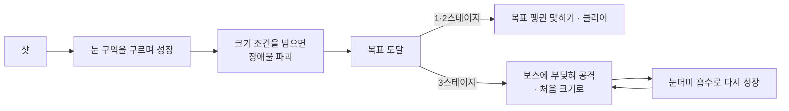
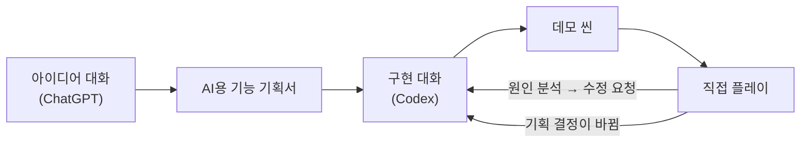
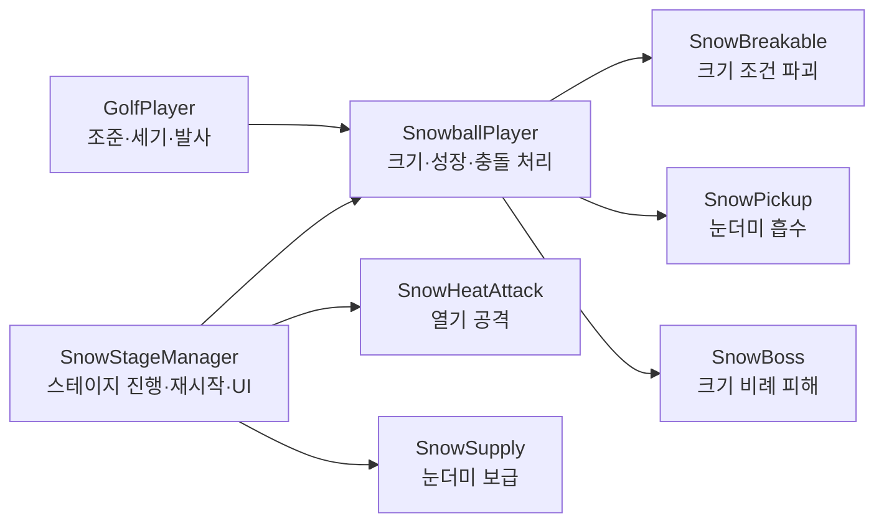

# 눈덩이 골프 기술 문서

> **미니골프 레벨 디자인 과제를 AI와 함께 1~2일 만에 플레이 가능한 프로토타입으로 만든 과정**

> 📷 **이미지 자리** `images/cover.png` — 대표 화면 1장(3스테이지 케이지에서 커진 눈덩이, 펭귄 보스, 바닥의 열기 공격 원이 함께 보이는 장면). 포트폴리오 문서와 발표 덱 표지에 크게 나옵니다.

| 항목      | 내용 |
| --------- | ---- |
| 장르      | 3D 미니골프 · 굴리면 커지는 성장 + 보스전 |
| 개발 기간 | 1~2일 (커밋 기준 2026.10.05 ~ 2026.10.08, 과제 마감 10/8) |
| 인원      | 개인 프로젝트 (레벨 디자인 과제) |
| 담당      | 기획, 레벨 디자인, 플레이 검증, AI 작업 지시 (코드는 AI로 작성 — 풀 바이브 코딩) |
| 개발 환경 | Unity 6000.3.15f1 · C# · URP |
| 사용한 AI | ChatGPT (아이디어·기능 기획서) · Codex (구현) |
| 링크      | [프로젝트 저장소](https://github.com/KooHoo-Dev/3rd-minigolf_level_design-Lets-Gitit) · 시연 영상(추가 예정) |

## 목차

1. [개요](#1-개요)
2. [작업 구조 · 사람과 AI의 역할](#2-작업-구조--사람과-ai의-역할)
3. [핵심 방법 · AI에게 일을 시킨 방법](#3-핵심-방법--ai에게-일을-시킨-방법)
4. [고민과 선택](#4-고민과-선택)
5. [결과 및 회고](#5-결과-및-회고)

---

## 1. 개요

### 1.1 프로젝트 소개

**What — 무엇을 만들었나**

미니골프 레벨 디자인 과제를 "눈덩이 골프"로 바꾼 3스테이지 프로토타입이다. 공은 눈덩이라서 눈 위를 구르면 커지고, 커지면 앞을 막던 장애물을 부수고 지나갈 수 있다. 1·2스테이지에서 성장과 파괴를 배우고, 3스테이지에서는 키운 몸집을 펭귄 보스를 공격하는 데 쓴다.

이 프로젝트는 **풀 바이브 코딩**으로 만들었다. 그래서 이 문서는 코드 분석보다 **AI와 어떻게 소통하며 만들었는지**, 그리고 그 방식으로 레벨 디자인 아이디어를 검증할 프로토타입을 **얼마나 빠르게** 만들 수 있었는지를 중심으로 다룬다.

**Why — 왜 빠른 프로토타입인가**

**《떠올린 발상은 직접 플레이해 보기 전까지 가설일 뿐이다.》**\
기획 단계의 아이디어는 머릿속에서는 재미있어 보인다. 하지만 실제로 손에 쥐어 보기 전에는 다음 세 가지를 알 수 없다고 생각한다.

1. 이 발상이 **실제로 재미있는가**
2. **어떤 요소가 부족하고**, 무엇이 있어야 더 재미있어지는가
3. **어떤 요소를 더 자세히 정해 둬야** 하는가

빠른 프로토타입은 이 세 질문에 답을 얻는 가장 빠른 방법이다. 또 팀 작업에서는 각자 머릿속에 다른 게임을 그리고 있기 쉬운데, 직접 플레이할 수 있는 결과물이 있으면 팀원 모두가 **같은 하나의 게임**을 바라보고 이야기할 수 있다고 생각한다.

이번 과제의 마감은 10/8이었다. 그 안에 아이디어를 정하고, 기능을 구현하고, 직접 플레이하며 고치는 과정을 여러 번 돌리기 위해 구현을 AI에게 맡기고 나는 **기획 의도·판단 기준·검증**에 집중했다.

이 문서는 **사람과 AI의 역할을 나눈 작업 구조, AI에게 일을 시킨 네 가지 방법, 프로토타입을 플레이하며 기획이 바뀐 과정** 세 가지를 중심으로 다룬다.

### 1.2 핵심 플레이 루프



_핵심 규칙은 "굴리면 커지고, 커지면 부순다" 하나다. 세 스테이지 모두 이 규칙 위에서 조건만 바뀐다._

| 스테이지 | 배우는 것 | 진행 |
| --- | --- | --- |
| 1. 굴리면 커진다 | 골프 조작, 구르기 성장, 작은 장애물 파괴 | 처음에는 돌아가야 하던 장애물을 커진 뒤에는 부수고 지나간다. 목표 펭귄을 맞히면 클리어 |
| 2. 눈더미는 크게 키운다 | 눈더미로 한 번에 성장, 큰 장애물 파괴에 따른 크기 소모 | 구르기만으로는 부술 수 없는 장애물이 막고 있다. 주변 눈더미를 먹고 부순 뒤, 줄어든 크기를 다음 눈더미로 다시 채운다 |
| 3. 펭귄 보스전 | 키운 크기를 공격에 소비, 열기 회피, 눈더미 재보급 | 크기에 비례해 보스 체력이 깎이고, 공격하면 처음 크기로 돌아간다. 바닥의 열기 공격을 피해 떨어지는 눈더미를 먹고 다시 공격한다 |

**조작법**: `Space`를 누르고 있으면 공 앞의 주황색 선이 길어졌다 줄어들며 세기가 바뀌고, 떼면 카메라가 보는 방향으로 발사한다. 마우스 오른쪽 드래그로 시점을 돌리고 휠로 확대·축소한다.

> 📷 **이미지 자리** `images/loop_overview.gif` — 1스테이지에서 눈 구역을 굴러 커진 뒤 장애물(노란색으로 바뀐 통나무)을 부수고 목표 펭귄을 맞히는 장면까지(짧게 편집)

---

## 2. 작업 구조 · 사람과 AI의 역할

### 2.1 전체 흐름



_아이디어를 정하는 대화와 구현하는 대화를 나눴다. 둘 사이를 잇는 것은 기능 기획서 한 장이다. 데모가 나온 뒤에는 "플레이 → 요청 → 수정" 루프를 계속 돌렸다._

### 2.2 역할 분담

| 나 | AI |
| --- | --- |
| 기획 의도와 판단 기준을 정한다 | 아이디어 후보를 낸다 |
| 범위를 자른다 (무엇을 만들고, 무엇을 안 만들지) | 기능 기획서를 정리한다 |
| 코스 배치와 수치를 정한다 | 기능을 구현하고 데모 씬을 구성한다 |
| 직접 플레이하며 검증한다 | 원인을 분석하고 해결 방법을 제안한다 |

이 경계는 기획서에도 그대로 적었다. 기획서의 첫 절에 **AI의 작업**과 **사용자의 작업**을 나눠 두고, "AI는 코스 배치를 확정하거나 별도의 퍼즐·스킬·성장 시스템을 추가하지 않는다"고 못박았다. 레벨 디자인 과제에서 배치는 내가 답해야 하는 질문이기 때문이다.

### 2.3 고민과 선택 ① 기획과 구현을 한 대화에서 할 것인가

| | 한 대화에서 기획부터 구현까지 | **기획 대화와 구현 대화를 나눔** ✅ |
| --- | --- | --- |
| 장점 | 앞에서 나눈 이야기를 AI가 바로 이어받는다 | 구현 AI는 확정된 내용(기획서)만 보고 시작한다 |
| 단점 | 버린 아이디어(잠입, 눈사람, 모닥불 등)까지 대화에 남아 구현 판단을 흐린다 | 기획서에 빠진 내용은 구현 AI가 알 수 없다 |

아이디어 대화는 여러 번 방향을 뒤집으며 길어졌다. 이 대화를 그대로 이어서 구현을 시키면, AI가 이미 버린 제안을 근거로 판단할 위험이 있다. 대화가 길어질수록 앞 내용이 흐려지기도 한다. 그래서 확정된 것만 기획서 한 장으로 정리하고, **구현은 새 대화에서 기획서만 보고 시작**하게 했다. 대신 "기획서에 빠진 것은 AI가 알 수 없다"는 단점을 막기 위해 기획서를 기능 목록 수준까지 빠짐없이 쓰게 했다([§3.2](#32-ai가-읽을-기획서-쓰기)).

### 2.4 AI가 만든 게임 쪽 구조



_기존 미니골프 과제의 샷 처리(`GolfPlayer`·`GolfBall`)는 그대로 쓰고, 눈덩이 규칙은 새 컴포넌트로 얹었다. 구현 직후 AI에게 각 클래스가 어떻게 동작하는지 설명하게 하고, "기존 코드를 그대로 반영한 건지, 새로 짠 건지"를 확인했다._

> 📷 **이미지 자리** `images/prompt_explain_classes.png` — 구현 대화에서 "각 클래스의 기능 구현을 어떤 방식으로 했는지 설명해줘." / "기존 코드를 그대로 반영한 거 맞아?"를 묻고 답을 받은 부분

---

## 3. 핵심 방법 · AI에게 일을 시킨 방법

> 이 장에서는 실제로 보낸 요청(프롬프트)을 코드 대신 보여 주고, 왜 그렇게 요청했는지를 설명한다.

### 3.1 판단 기준을 좁혀 가며 아이디어 고르기

처음 AI가 낸 안은 "폐장한 놀이공원 정비 코스"였다. 장애물의 겉모습만 바꾼 안이라 방향을 바꿔 달라고 했다.

> 아니. 좀 식상하다. 다른 장르에서 주요 기믹으로 쓰이는 걸 좀 가져와서 결합 아이디어를 내봐봐.
> 단순하되, 변형 가능성이 많은 아이디어여야 해.
> 자세하게 구상하지 말고, 여러가지 아이디어를 툭툭 던져봐

여기서 받은 열 가지 후보 중 **카타마리식 성장 + 보스전**을 골랐다. 이후 보스의 정체를 정할 때는 AI의 제안을 거절할 때마다 **왜 아닌지**를 함께 말했다.

| 내가 준 기준 | AI의 제안 → 내 판단 |
| --- | --- |
| 눈덩이와 대적하는 성질, 너무 추상적이지 않게 | 숯심장 눈사람 → 눈덩이로 눈사람을 공격하는 건 어울리지 않음 |
| 눈덩이로 공격하는 게 납득되는 상대 | 숯불 소라게, 불씨 도깨비 화로 → 복잡함. 진짜 있는 것 중에서 |
| 직관적이고 유쾌하게 | 모닥불 → 불은 보통 물로 끄지 눈으로 끄지 않음 |
| 눈덩이 마을의 눈덩이가 제압할 만한 것 | 눈싸움하는 아저씨 → 사람이 골탕 먹는 느낌 |
| 선악이 없는 자연물, 일상의 작은 일을 웅장하게 그리는 웃음 | **눈을 이고 있는 소나무** → 결정 |

> 📷 **이미지 자리** `images/prompt_boss_criteria.png` — 아이디어 대화에서 기준을 좁혀 가는 요청 2~3개(예: "쟤를 왜 눈덩이로 공격하는지 납득이 되는 종류로", "자연물이어서, 선악의 구분이 딱히 없는")

**왜 이렇게 요청했나**

- **거절만 하면 AI는 기준을 모른다.** "별로야"라고만 하면 AI는 비슷한 방향에서 다시 고를 수밖에 없다. 거절할 때 이유를 말하면 그 이유가 다음 제안의 기준이 된다. 실제로 기준이 하나씩 쌓일 때마다 후보가 눈에 띄게 좁혀졌다.
- **발산과 수렴을 따로 시켰다.** 처음에는 "자세하게 구상하지 말고 툭툭 던져 봐"라고 해서 넓게 펼치게 했고, 하나를 고른 뒤에는 기준을 줘서 좁혔다. 앞의 두 번은 AI가 안 하나를 자세하게 짜 와서, 마음에 들지 않으면 고를 다른 거리가 없었다.
- **방향은 내가 정했다.** 1스테이지만 "작게 유지하기"라서 2·3스테이지와 성격이 반대라는 문제는 내가 먼저 짚었다. AI가 피신처·갑옷 틈 같은 기믹을 더 얹는 해법을 내자, "차라리 크기 키우기 원툴로 가는 거 어때."라고 해서 1스테이지만 바꾸는 단순한 쪽으로 정했다. AI의 그럴듯한 제안을 계속 받다 보면 방향을 AI가 정하게 되기 쉽다. 3분짜리 게임에 규칙을 더 얹는 대신, 가장 단순한 해법부터 고르는 것을 기준으로 삼았다.

나중에 보스 모델은 펭귄으로 바뀌었지만([§5.2](#52-프로토타입이-바꾼-기획)), "규칙 하나(키우기)로 세 스테이지를 잇는다"는 뼈대는 이 단계에서 정해졌다.

### 3.2 AI가 읽을 기획서 쓰기

아이디어를 굳힌 뒤, 구현 AI에게 넘길 기획서를 요청했다.

> 기준은 ai에게 작업을 시킬 때 ai가 자신이 해야할 일을 알 수 있도록 필요한 기능 목록을 빠짐없이 정의하는거야.
> 레벨 디자인 배치 같은 디테일한 것들은 내가 직접 할거니까, 기능 목록에 집중해서 작성해줘.

이렇게 받은 기획서는 기능 13개(F01~F13), 씬에서 조정할 값, 완료 확인 항목 12개로 이루어져 있다. 아래는 장애물 파괴 기능 하나를 그대로 옮긴 것이다.

```markdown
**F04. 크기 조건에 따른 장애물 파괴**

- 각 장애물에 `파괴 가능 여부`, `요구 크기`, `파괴 시 크기 소모량`을 설정한다.
- 움직이는 플레이어가 충돌할 때 현재 크기가 요구값 이상이면 장애물이 파괴되고,
  플레이어 크기가 소모량만큼 줄어든다. 최소 크기 아래로는 줄지 않는다.
- 크기가 부족하면 일반 골프 장애물처럼 충돌·반발한다.
- 한 장애물은 한 번만 파괴되며, 같은 충돌의 반복 이벤트로 크기가 여러 번 소모되지 않는다.
```

그리고 기획서 끝에는 "다 됐는지"를 판단할 항목을 두었다.

```markdown
## 6. 완료 확인 항목

4. 작은 공은 장애물에 막히고, 충분히 큰 공은 장애물을 부순다.
   큰 장애물 파괴 시 크기 소모는 한 번만 발생한다.
5. 일반 성장 상한으로는 큰 장애물을 부술 수 없고,
   눈더미로 상한을 넘어 커지면 부술 수 있다.
```

> 📷 **이미지 자리** `images/spec_doc.png` — 기능 기획서의 §1 "AI의 작업 / 사용자의 작업"과 F 항목 목록이 함께 보이는 화면

**왜 이렇게 요청했나**

- **읽는 사람을 AI로 정했다.** 구현 AI는 아이디어 대화를 보지 못한다. 그래서 "맥락을 전혀 모르는 동료가 이 문서만 보고 따라 할 수 있는가"를 기준으로, 사람이 읽는 기획서보다 훨씬 구체적으로(어떤 값을 설정할 수 있어야 하는지, 같은 충돌이 반복되면 어떻게 하는지) 쓰게 했다.
- **끝난 상태를 먼저 정했다.** 완료 확인 항목이 없으면 AI도 나도 "어디까지 하면 끝인지" 판단할 수 없다. 끝의 모습을 먼저 적어 두면 AI가 혼자서 끝까지 갈 수 있고, 나는 그 목록으로 결과를 확인할 수 있다.
- **배치는 내 몫으로 남겼다.** 기능과 배치를 나눠서, AI가 만든 기능 위에 내가 코스를 직접 짜도록 했다. 이 과제에서 평가받는 것은 레벨 디자인이기 때문이다.

### 3.3 구현 지시에 품질 기준과 범위를 함께 주기

구현을 시키기 전에 먼저 작업 공간을 정리했다.

> 야 지금 유니티 프로젝트에서 06. Mini golf와 관련되지 않은 파일들 전부 삭제해서 정리해줘.

그다음 새 대화에서 구현을 시키면서, **어느 수준의 코드를 원하는지**를 함께 적었다.

> 눈덩이 골프 폴더에 있는 기능 기획서를 따라서 기능을 구현해줘.
> 불필요한 확장을 고려한 코드나, 당장 치명적인 문제를 일으키지 않는 문제에 대한 과도한 방어 코드 등은 최대한 베재하고 오로지 기능 구현에 집중해서 코드 작성해줘.

데모 씬을 만들게 할 때는 에셋 범위도 정했다.

> 너가 기획서의 의도에 맞게 임시로 기능과 오브젝트를 배치한 데모 씬을 하나 만들어줘.
> 에셋은 간단한 유니티 내부 오브젝트나 프로젝트 폴더에 들어가있는 에셋들을 사용해주면 돼.

> 📷 **이미지 자리** `images/prompt_implement.png` — 구현 대화의 첫 구현 요청과, AI가 "Edited 33 files"로 답한 부분

**왜 이렇게 요청했나**

- **프로토타입의 목적은 검증이다.** 이 코드는 "재미있는가"를 확인하고 나면 버리거나 다시 짤 수 있는 코드다. 확장성이나 방어 코드에 시간을 쓰면 첫 데모가 늦어지고, 코드가 길어져 내가 읽고 확인하기도 어려워진다. 그래서 품질 기준을 "기능이 돌아가는 가장 단순한 코드"로 먼저 정해 줬다.
- **AI가 볼 자료를 골라 줬다.** 프로젝트에는 이전 수업 실습 파일이 많이 섞여 있었다. 관련 없는 파일이 많을수록 AI가 엉뚱한 파일을 근거로 판단할 수 있어서, 구현 전에 미니골프와 관련 없는 에셋 794개를 지웠다.

### 3.4 진단과 수정을 나누기

데모를 플레이하며 문제를 발견하면, 바로 고치라고 하지 않고 **원인부터** 물었다. 원인을 보고 납득한 뒤에야 수정을 시켰다. 구현 대화에서 같은 모양의 요청이 다섯 번 넘게 반복된다.

| 진단 요청 | 수정 지시 |
| --- | --- |
| "한 번 공을 치고 나서 공이 멈추질 않고 계속 움직여서 … 어디가 문제인지 파악해줘" | "적용해줘봐" |
| "원인 파악해줘. 문제가 없는데 눈덩이 크기가 부족했었을 가능성까지 고려해줘." | "파괴 조건을 좀 낮춰줘" |
| "2스테이지 눈덩이 한 번 먹고나면 그 이후로 더이상 눈덩이가 안 커지거든? 뭐가 문제인지 분석해줘" | "수정해줘" |
| "바닥이 문제가 아니라면 왜 이런일이 발생하는지 파악해." | "수정해줘." |
| "공은 거의 멈춰보이는데 … 이 문제 어떻게 해결할 수 있어?" | "업데이트 해줘" |

> 📷 **이미지 자리** `images/prompt_diagnose.png` — 진단 요청에 AI가 원인과 줄 번호를 설명하고 "이번에는 원인만 분석했고 파일은 수정하지 않았어"라고 답한 부분

**왜 이렇게 요청했나**

- **틀린 진단 위에 수정이 쌓이는 것을 막으려고.** "고쳐 줘"라고만 하면 AI는 그럴듯한 원인 하나를 골라 바로 코드를 바꾼다. 그 진단이 틀리면 엉뚱한 수정이 남고, 다음 문제의 원인이 된다. 원인을 먼저 보면 내가 단계마다 확인하고 다음으로 넘어갈 수 있다.
- **가설을 같이 넘겼다.** 2스테이지 장애물이 안 부서질 때 "크기가 부족했을 가능성까지 고려해 줘"라고 했다. AI가 한쪽(코드 버그)만 보지 않게 하려는 것이었고, 실제로 AI는 크기 계산과 충돌 판정 두 경우를 모두 확인했다.

### 3.5 검증은 직접 플레이로, 기준은 말로 못박기

AI는 거의 모든 답의 끝에 "Unity 플레이 모드에서의 동작은 아직 확인하지 못했어"라고 적었다. 컴파일까지는 AI가 확인하지만, **재미있는지, 의도대로 움직이는지는 내가 직접 플레이해야만** 알 수 있었다.

**범위를 벗어나면 바로 멈추게 했다.** 성장하지 않는 일반 땅을 요청했는데 AI가 미끄러지는 얼음 땅을 만들었다.

> 안 커지는 땅 만들랬지 누가 미끄러지는 얼음 땅 만들랬어.

**지켜야 할 설계 원칙은 말로 못박았다.** 공이 어떤 때는 미끄러지고 어떤 때는 뚝 멈추는 문제가 반복되자, 바닥 탓이 아니라고 짚고 원칙을 적었다.

> 공의 움직임은, 오로지 날리는 힘의 세기와 마찰에 의해서만 결정돼야 해. 상황에 따라 매번 달라질 요소가 없다고,

이 한 줄로 AI는 성장 구역에서만 감쇠를 바꾸던 코드와 착지 시 강제로 멈추던 코드를 찾아 지웠다. 이전 수정에서 AI가 스스로 넣었던 코드다.

**직접 튜닝할 수 있는 손잡이를 요구했다.** 수치는 결국 플레이하면서 내가 맞춰야 하므로, AI에게 값을 정해 달라고 하기보다 내가 바꿀 수 있게 만들어 달라고 했다.

> 이 수치들은 내가 직접 테스트하면서 수정할 수 있게 다 직렬화 해놔줘.

> scale 1짜리로 만들어서 단순 네모 콜라이더 붙여서 프리팹화 해둬주라. 내가 스케일 늘려서 다양한 크기로 직접 배치할 수 있게.

> 야 바로 3스테이지 해보는 건 안 돼?

그 결과 장애물 하나에서 파괴 조건을 모두 Inspector로 조절할 수 있게 됐다.

```csharp
// SnowBreakable.cs — 장애물 파괴 판정 (발췌)
public bool canBreak = true;
public bool preserveSpeedOnBreak;
public float requiredSize = 0.75f;
public float minimumImpactSpeed = 3f;
public float sizeCost;

public void TryBreak(SnowballPlayer player, Vector3 velocityBeforeCollision)
{
    Vector3 impactVelocity = Vector3.ProjectOnPlane(velocityBeforeCollision, Vector3.up);
    if (broken || !canBreak || player.Size < requiredSize || impactVelocity.magnitude < minimumImpactSpeed) return;

    broken = true;
    SetHighlighted(false);
    player.ChangeSize(-sizeCost);
    if (preserveSpeedOnBreak)
        player.Body.linearVelocity = impactVelocity;
    // … (파괴 연출 생략)
}
```

| 값 | 플레이하며 정한 이유 |
| --- | --- |
| `requiredSize` · `sizeCost` | 장애물마다 "얼마나 키워야 부술 수 있고, 부수면 얼마나 줄어드는지"가 곧 그 구간의 난이도다 |
| `minimumImpactSpeed` | 천천히 미끄러지듯 닿기만 해도 부서지는 것이 어색해서 추가했다("너무 천천히 미끄러지듯 가서 부딫혔는데 부셔져버리네") |
| `preserveSpeedOnBreak` | 부숴도 멈추지 않고 그대로 뚫고 가는 약한 장애물을 따로 두기 위해 추가했다 |

> 📷 **이미지 자리** `images/breakable_inspector.png` — 통나무 장애물 프리팹의 Inspector에서 `SnowBreakable` 값(Can Break · Preserve Speed On Break · Required Size · Minimum Impact Speed · Size Cost)이 보이는 화면

---

## 4. 고민과 선택

프로토타입에서는 "가장 좋은 방법"보다 **검증에 필요한 만큼을 가장 빨리 만드는 방법**을 골랐다. 큰 작업은 시키기 전에 "얼마나 걸리는지"부터 물었다.

### 4.1 고민과 선택 ② 직접 코딩인가, 풀 바이브 코딩인가

| | 직접 코딩 | **AI로 구현 (풀 바이브 코딩)** ✅ |
| --- | --- | --- |
| 장점 | 코드를 내가 완전히 이해하고 통제한다 | 기획서에서 첫 데모까지 짧다. 남은 시간을 플레이와 수정에 쓸 수 있다 |
| 단점 | 마감(10/8) 안에 기능 13개를 만들고 나면 플레이하며 고칠 시간이 거의 없다 | AI가 만든 코드를 내가 확인해야 하고, AI가 범위를 벗어날 수 있다 |

이 과제에서 평가받는 것은 코드가 아니라 **레벨 디자인**이다. 그리고 레벨 디자인은 직접 플레이해 보고 고치는 횟수가 많을수록 좋아진다. 그래서 구현은 AI에게 맡기고, 내 시간은 플레이·판단·배치에 썼다. 단점은 [§3.4](#34-진단과-수정을-나누기)(원인부터 확인)와 [§3.5](#35-검증은-직접-플레이로-기준은-말로-못박기)(범위 이탈 즉시 중단, 직접 플레이 검증)로 줄였다.

### 4.2 고민과 선택 ③ 장애물이 부서지는 연출

> 좀 오래걸리는 작업인가? 먼저 확인부터 해줘. 그리고 이거 뿐만이 아니라 좀 범용적으로 적용되게 만들고 싶은데. 어떤 장애물이더라도 두 갈래로 쪼개져서 사라지게.

| | 메시를 반으로 쪼개기 | **흔들림 + 축소 + 파편** ✅ |
| --- | --- | --- |
| AI가 답한 비용 | 어떤 모양이든 자동으로 자르려면 하루 이상, 품질에 따라 며칠 | 공통 컴포넌트 하나로 바로 가능 |
| 원본 에셋 | 장애물마다 반쪽 모델을 준비하거나 런타임에 메시를 잘라야 함 | 원본 FBX·재질을 고치지 않음 |
| 재사용 | 모양마다 준비 필요 | 모든 장애물에 같은 연출 |

비용을 들은 뒤 "원본 에셋을 수정하지 않는 선에서 가장 효율적으로 할 수 있는 방법을 제안해줘"라고 다시 물었고, AI가 제안한 흔들림·축소·파편 방식으로 정했다. 프로토타입에서 필요한 것은 "부서졌다"는 느낌이지, 실제로 잘리는 메시가 아니었다.

> 📷 **이미지 자리** `images/break_effect.gif` — 커진 눈덩이가 통나무에 부딪혀 통나무가 흔들리고 작아지며 파편이 튀는 장면

### 4.3 고민과 선택 ④ 부술 수 있는 장애물 알려 주기

| | 주황색 윤곽선 (URP 셰이더) | **부술 수 있을 때 색 바꾸기** ✅ |
| --- | --- | --- |
| AI가 답한 비용 | 공용 셰이더와 연결까지 대략 한 시간 안팎 | 기존 컴포넌트에 색 변경만 추가 |
| 전달력 | 장애물 모양을 따라 테두리가 생김 | 장애물 전체가 노란색으로 바뀜 |

처음에는 통나무 장애물을 약한 것은 노란색, 일반은 갈색으로 고정해 두었다. 그런데 플레이해 보니 정말 알고 싶은 것은 "이 장애물이 약한가"가 아니라 **"지금 내 크기로 이걸 부술 수 있는가"**였다. 그래서 고정 색을 없애고, 공 크기가 장애물의 요구 크기를 넘는 순간 노란색으로 바뀌게 했다. 셰이더 없이도 같은 정보를 줄 수 있어서 더 싼 쪽을 골랐다.

> 📷 **이미지 자리** `images/breakable_highlight.gif` — 눈 구역을 굴러 커지는 동안 앞의 통나무가 갈색에서 노란색으로 바뀌는 순간

---

## 5. 결과 및 회고

### 5.1 결과 — 걸린 시간

| 시각 (커밋 기준) | 한 일 |
| --- | --- |
| 10/5 | 아이디어 대화 → 기능 기획서, 프로젝트 정리 |
| 10/7 18:30 | 기획서대로 만든 3스테이지 데모 완성 |
| 10/7 21:12 ~ 10/8 07:09 | 플레이하며 고친 커밋 11개 → 최종 버전 |

기획서를 받은 뒤 첫 데모까지 Codex의 작업 시간은 구현 약 21분, 데모 씬 구성 약 28분이었다. 첫 데모가 나온 뒤 최종 버전까지는 약 13시간 동안 플레이와 수정을 반복했다.

> 📷 **이미지 자리** `images/result_score.png` — 보스를 처치한 뒤 라운드별 타수와 총 타수가 나오는 결과 화면

### 5.2 프로토타입이 바꾼 기획

첫 데모를 플레이하자, 기획서만으로는 알 수 없던 것들이 나왔다. 개요에서 말한 세 질문으로 나누면 다음과 같다.

**① 실제로 재미있는가 — 템포와 손맛**

| 기획서 (As-Is) | 플레이 후 (To-Be) | 계기 |
| --- | --- | --- |
| 코스 길이·수치는 나중에 조정 | 코스를 늘리고 샷 세기·정지 판정을 여러 번 조정 | "좀 더 템포가 빨랐으면 좋겠어" |
| 보스 공격 후 크기만 처음으로 | **보스에 부딪히면 멀리 튕겨 나감** | "바로 앞에서 그냥 작아지니까 재미가 별로 없어. 뒤로 밀려났다가 다시 다가가는 맛이 좀 재밌을 거 같은데" |
| 목표 나무에 붙은 동료를 구출 | 목표 펭귄이 맞으면 과하게 튀어 날아감 | 펭귄 에셋을 받은 뒤 "공에 맞으면 과하게 팍 튀기며 날라가는 식으로" |

**② 무엇이 부족했나 — 규칙을 읽을 수 있게**

| 기획서 (As-Is) | 플레이 후 (To-Be) | 계기 |
| --- | --- | --- |
| 눈 바닥 여부를 구분 | 모든 땅이 눈이던 것을 **성장 구역 / 일반 땅**으로 분리 | "지금은 모든 땅이 다 눈덩이가 커지는 땅이잖아" |
| 크기 조건만으로 파괴 | **최소 충돌 속도** 조건 추가 | 천천히 닿기만 해도 부서짐 |
| (없음) | **부술 수 있으면 노란색**으로 표시 | 지금 부술 수 있는지 알 수 없음 |
| (없음) | 라운드별·총 타수 결과 화면 | "각 라운드별로 몇 샷만에 클리어 했는지랑, 그 아래 총 몇 샷에 클리어했는지" |

**③ 무엇을 더 정해야 했나 — 수치와 위협**

| 기획서 (As-Is) | 플레이 후 (To-Be) | 계기 |
| --- | --- | --- |
| 크기 수치 미정 | 크기 관련 수치 전부 절반으로 | "8.0일때 눈덩이가 너무너무 크거든" |
| 열기에 맞으면 설정량만큼 작아짐, 위치 후보는 지정 | 맞으면 **처음 크기로**, 3곳 동시·넓은 범위·더 짧은 주기·**보스 피격 시 추가 공격**·**무작위 위치** | "조금 덜 위협적인 거 같아" |
| 눈더미 착지 위치는 지정 | 무작위 위치, 초록색 착지 표시 | 열기 공격 표시와 구분되지 않음 |

> 📷 **이미지 자리** `images/boss_heat.gif` — 3스테이지 케이지에서 열기 공격 원 3개가 예고 후 켜지고, 초록색 표시 위로 눈더미가 떨어져 흡수한 뒤 보스에 부딪혀 튕겨 나가는 장면

이 표의 대부분은 기획서를 쓸 때는 떠올리지 못한 것들이다. 직접 플레이할 수 있는 결과물이 있었기 때문에 짧은 시간 안에 찾고, 바로 반영할 수 있었다.

### 5.3 트러블슈팅

#### 눈더미를 먹을 때 카메라가 떨림

**문제** 눈더미를 먹어 커지는 동안 카메라가 부들부들 떨렸다.

**AI의 첫 두 진단** 처음에는 Rigidbody와 Transform 위치를 중복으로 설정해서라고 했고, 다음에는 카메라의 위치와 시선이 서로 다른 지점을 따라가서라고 했다. 두 번 고쳤지만 떨림은 그대로였다.

**원인** 플레이를 다시 보니 공이 부드럽게 커지는 것이 아니라 **계단식으로 뚝뚝** 커지고 있었다. 크기에 맞춰 공 중심 높이가 바뀌니, 카메라도 뚝뚝 따라간 것이다.

> 이게 부드럽게 쭈르륵 커지는 게 아니라 계단식으로 뚝뚝뚝 커지고 있어. 이게 문제였네.
> 계단식으로 뚝뚝 커지니까 그 위치에 맞춰서 카메라도 뚝뚝 위치가 바꼈던거지.

**해결** 이 관찰을 넘기자 AI가 성장 코루틴이 물리 프레임마다 갱신되고, 보간 곡선 때문에 프레임마다 변화량이 달라지는 것을 찾았다. 렌더 프레임마다 일정하게 커지도록, 한 프레임의 변화량은 최대 0.1로 바꿨다.

```csharp
// SnowballPlayer.cs — 눈더미 흡수 후 0.5초 동안 커지기 (발췌)
private IEnumerator AnimatePickupGrowth()
{
    const float duration = 0.5f;
    const float maxScaleStep = 0.1f;
    float startingSize = size;
    float elapsed = 0f;

    while (true)
    {
        elapsed += Time.deltaTime;
        float progress = Mathf.Clamp01(elapsed / duration);
        float nextSize = Mathf.Lerp(startingSize, pickupGrowthTarget, progress);
        SetSize(Mathf.MoveTowards(size, nextSize, maxScaleStep), true);

        if (progress >= 1f && Mathf.Approximately(size, pickupGrowthTarget))
            break;

        yield return null;
    }

    pickupGrowthRoutine = null;
}
```

**배운 점** AI는 코드를 읽고 그럴듯한 원인을 찾지만, 화면에서 무엇이 보이는지는 모른다. 증상을 "떨린다"가 아니라 "계단식으로 커진다"처럼 **본 그대로** 전달해야 AI가 맞는 곳을 찾는다.

#### 통나무 장애물을 고쳤더니 펭귄이 깨짐

**문제** 1스테이지의 기존 장애물을 지우고 통나무 프리팹에 파괴 컴포넌트를 붙였더니, 목표 펭귄이 쓰러진 애니메이션으로 서 있고 맞아도 날아가지 않았다.

**AI의 첫 진단** 펭귄 코드와 애니메이터 기본 상태를 원인으로 보고 펭귄 쪽을 고쳤다. 이어서 3스테이지의 장애물 구조가 겹친 것을 원인으로 짚었다. 둘 다 빗나갔다.

**원인 찾기** 비교 대상을 짚어 줬다.

> 스테이지 2의 펭귄은 아직 안 건드렸는데 그 부분이랑 비교해서 봐봐 스테이지 2는 잘 작동하거든

> 로그 장애물을 건드렸는데 근데 왜 펭귄이 깨지냐고 구조가 어떻게 돼있길래 그렇게 돼.

그제야 원인이 나왔다. 스테이지 매니저는 Inspector에 등록된 장애물 목록을 먼저 초기화한 다음 펭귄을 연결하는데, 내가 지운 장애물의 참조가 목록에 남아 `NullReferenceException`이 났다. 그 때문에 펭귄 연결과 초기화까지 실행되지 못한 것이다. Unity 로그에도 같은 예외가 남아 있었다.

**해결** 저장된 목록 대신, 스테이지 루트 아래에 실제로 있는 `SnowBreakable`을 찾아 초기화하도록 바꿨다. 이어서 장애물 구조도 정리했다. 통나무 프리팹 하나가 콜라이더와 파괴 기능을 모두 갖고, 예전 블록과 비주얼 래퍼는 지웠다.

> 📷 **이미지 자리** `images/log_prefab_hierarchy.png` — 정리 후 Hierarchy에서 각 스테이지 루트 아래에 통나무 프리팹만 놓인 모습

**배운 점** "잘 되는 쪽과 비교해 보라"는 한 줄이 원인을 찾는 범위를 크게 줄였다. AI에게 문제만 던지기보다, **내가 아는 정상 사례**를 함께 주는 것이 빨랐다.

### 5.4 아쉬운 점과 다음 계획

| 아쉬운 점 | 다음에는 |
| --- | --- |
| 같은 문제를 같은 대화에서 세 번씩 고쳤다(조준선 색, 카메라 떨림). 실패한 시도가 대화에 쌓일수록 AI는 그 위에서 계속 빗나갔다 | 두 번 실패하면 멈추고, 증상과 기대하는 결과를 정리해 새 대화에서 다시 요청한다 |
| AI가 스스로 플레이 검증을 하지 못했다. 거의 모든 답이 "플레이 모드 확인은 아직"으로 끝났고, 검증은 전부 내가 했다 | Unity를 AI 도구와 연결(MCP)하거나 배치 모드 로그·테스트를 쓰게 해서, AI가 컴파일 오류 정도는 스스로 확인하게 한다 |
| AI가 씬·프리팹 파일(YAML)을 직접 고쳤다. 참조가 꼬이기 쉬운 방식이다 | 씬 변경은 Editor 스크립트로 하게 하고, 자주 커밋해 되돌릴 지점을 남긴다 |

### 5.5 배운 점 — AI를 활용한 빠른 프로토타이핑

이번 작업에서 AI는 **아이디어 후보를 내고, 기획서를 정리하고, 코드를 쓰고, 원인을 찾는 일**을 했다. 나는 **무엇을 만들지, 어디까지 만들지, 지금 결과가 맞는지**를 정했다. 기획서 한 장에서 첫 데모가 나오기까지 AI의 작업 시간은 한 시간이 채 되지 않았고, 남은 시간은 모두 플레이하고 판단하는 데 쓸 수 있었다.

그 시간 동안 찾은 것들 — 템포, 넉백, 성장 구역, 부술 수 있다는 표시, 열기 공격의 위협 — 은 기획서를 아무리 오래 들여다봐도 나오지 않았을 것이다. 빠른 프로토타입의 가치는 "빨리 만든다"가 아니라 **"빨리 틀려 보고, 빨리 고친다"**에 있다고 생각한다.

그리고 AI가 구현을 맡을수록, 사람의 몫은 줄어드는 것이 아니라 더 분명해졌다. 판단 기준을 말로 전하고, 범위를 자르고, 직접 플레이해서 확인하는 일이다. AI가 만든 코드라도 내가 이해하고 설명할 수 있어야 내 결과물이라고 생각하기 때문에, 이 문서에도 AI가 만든 구조와 코드를 확인한 과정을 함께 남겼다.
