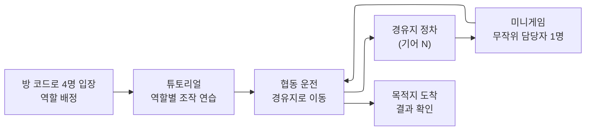
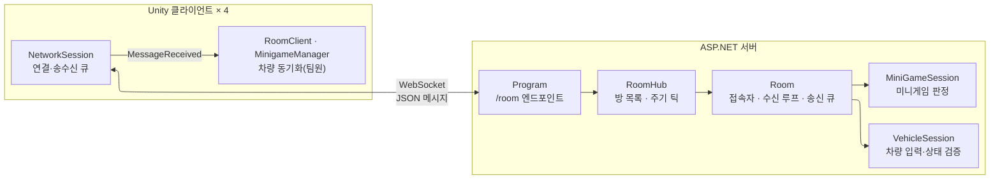
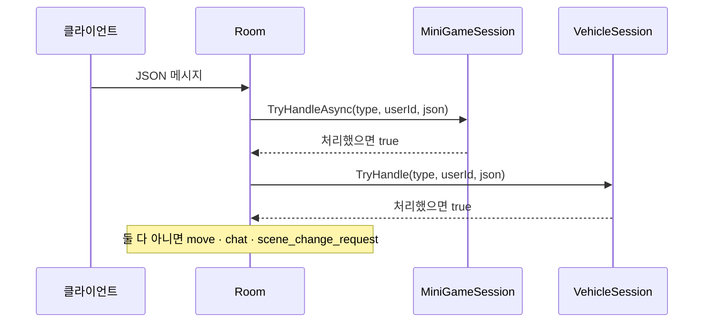
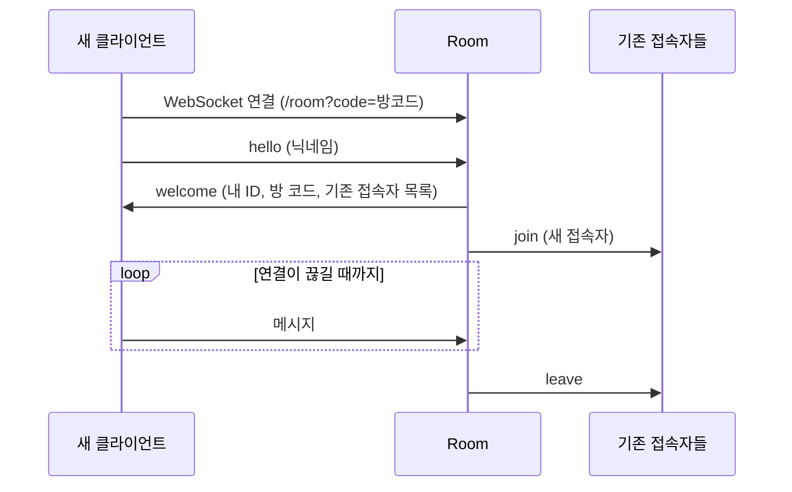
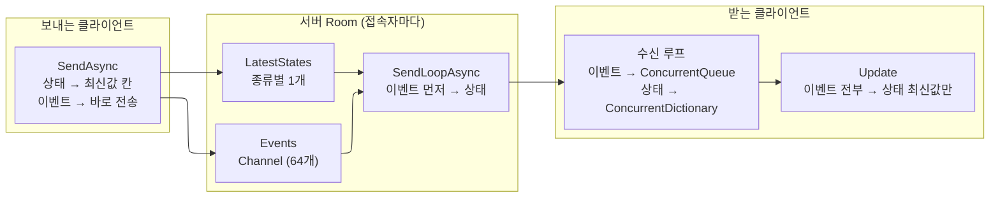
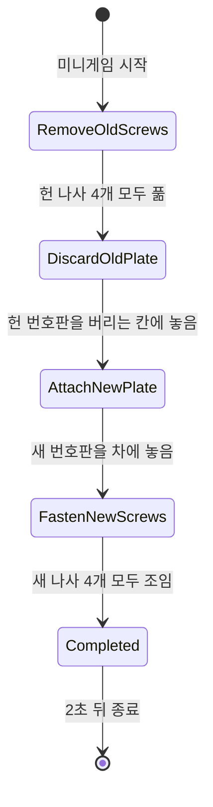
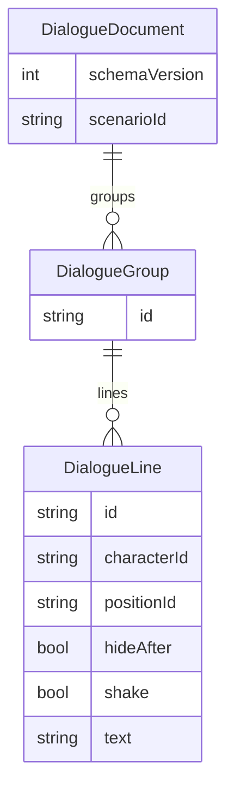

# 누가 이딴 차로 도망을 가! — 4인 협동 운전 게임의 WebSocket 서버와 동기화

> **핸들·액셀·브레이크·기어를 네 명이 나눠 맡아 차 한 대를 함께 모는 온라인 협동 게임에서, 서버(ASP.NET)와 클라이언트 네트워크를 맡아 네 명의 입력이 한 대의 차로 모이게 만든 과정**

> 📷 **이미지 자리** `images/cover.png` — 대표 화면 1장(네 클라이언트 창을 나란히 띄우고 같은 차가 같은 위치에 보이는 장면). 포트폴리오 문서와 발표 덱 표지에 크게 나옵니다.

| 항목      | 내용                                                                                                                                                                                    |
| --------- | --------------------------------------------------------------------------------------------------------------------------------------------------------------------------------------- |
| 장르      | 4인 협동 드라이빙 액션 · 탑다운 · PC 온라인 멀티플레이                                                                                                                                  |
| 개발 기간 | 커밋 기준 2026.08.18 ~ 2026.09.12 (클라이언트) · 2026.08.25 ~ 2026.09.11 (서버)                                                                                                         |
| 인원      | 팀 프로젝트 · 개발 4명                                                                                                                                                                  |
| 담당      | **팀장** + **서버·네트워크**(WebSocket 서버, 클라이언트 네트워크 세션, 서버가 판정하는 미니게임) · 인트로 대화 시스템 · 튜토리얼 진행 연동                                              |
| 개발 환경 | 클라이언트 Unity 6000.3.15f1 (URP) · UniTask · Newtonsoft.Json / 서버 ASP.NET Core (.NET 10) · System.Text.Json · Git(GitHub, Git flow)                                                 |
| 주요 기술 | WebSocket 방 서버 · 메시지 타입 기반 프로토콜 · 실시간 상태와 이벤트를 나눈 송수신 큐(`Channel`·`ConcurrentQueue`·`ConcurrentDictionary`) · `SemaphoreSlim`으로 지킨 미니게임 상태 머신 |
| 링크      | [클라이언트 GitHub](https://github.com/KooHoo-Dev/3rd-TeamProject-CY) · [서버 GitHub](https://github.com/KooHoo-Dev/3rd-TeamProject-CY-Server) · 시연 영상 ✍                            |

## 목차

1. [개요](#1-개요)
2. [전체 구조](#2-전체-구조)
3. [방 입장과 씬 전환](#3-방-입장과-씬-전환)
4. [입력 지연 누적: 상태와 이벤트 나누기](#4-입력-지연-누적-상태와-이벤트-나누기)
5. [서버가 판정하는 미니게임](#5-서버가-판정하는-미니게임)
6. [그 밖에 맡은 것](#6-그-밖에-맡은-것)
7. [결과 및 회고](#7-결과-및-회고)

---

## 1. 개요

### 1.1 프로젝트 소개

《누가 이딴 차로 도망을 가!》는 은행을 털고 도망치는 네 명의 도둑이 **차 한 대의 핸들·액셀·브레이크·기어를 한 명씩 나눠 맡아** 함께 운전하는 탑다운 협동 게임입니다. 네 명은 서로 말로 상황을 전하며 경유지에 들러 미니게임(주유·바리케이드 해킹·번호판 교체)을 마치고, 최대한 빠른 시간 안에 목적지에 도착해야 합니다. 이 게임의 재미는 **각자의 조작 타이밍이 어긋나며 생기는 혼란과, 소통을 반복하며 점점 손발이 맞아 가는 협동**에 있습니다.

서버는 처음 다뤄 보는 영역이었고, 이 프로젝트의 목표는 네트워크 라이브러리에 맡기지 않고 **서버 통신 과정을 직접 구현해 보는 것**이었습니다([§2.4](#24-고민과-선택-①-서버를-무엇으로-만들-것인가)). 작은 채팅·위치 공유용 서버 뼈대에서 시작해, 약 2주(2026.08.25 ~ 09.11) 동안 방 입장·씬 전환·차량 입력과 상태 중계·미니게임 판정을 얹었습니다.

- **구조** — 서버가 무엇을 판정하고, 클라이언트(호스트)가 무엇을 계산하는가 ([§2](#2-전체-구조))
- **접속과 씬 전환** — 네 명이 같은 방, 같은 씬에 있게 만들기 ([§3](#3-방-입장과-씬-전환))
- **지연 누적 문제** — 기다릴수록 입력이 5초에서 20초 넘게 밀리던 문제를, 메시지를 "상태"와 "이벤트"로 나눠 해결한 과정 ([§4](#4-입력-지연-누적-상태와-이벤트-나누기))
- **미니게임 판정** — 네 명이 같은 결과를 보도록 서버가 담당자를 뽑고 단계를 판정하는 상태 머신 ([§5](#5-서버가-판정하는-미니게임))

**목표한 경험**: 네 명이 각자 맡은 페달과 핸들을 조작하면, 그 입력이 한 대의 차에 모여 **"우리가 같이 운전하고 있다"**고 느끼는 것.

### 1.2 역할과 플레이 흐름

| 역할                | 조작                 | 판단해야 하는 것                                                              |
| ------------------- | -------------------- | ----------------------------------------------------------------------------- |
| 핸들                | 좌우 조향            | 도로 방향, 코너 진입 시점                                                     |
| 액셀                | 가속                 | 출발 시점, 직선 가속, 액셀을 떼야 하는 시점                                   |
| 브레이크·내비게이션 | 감속·정지, 전체 지도 | 코너 진입 속도, 장애물 대응, 경유지 정차 위치, 경유지·목적지 위치와 경로 안내 |
| 기어                | D/R/N 변경           | 상황에 맞는 기어, 경유지에서 중립(N)으로 정차                                 |



_경유지 칸 안에 차를 세우고 기어를 중립(N)으로 두면 미니게임이 시작됩니다. 미니게임 중에도 시간은 흐르고, 나머지 세 명은 담당자의 화면을 지켜봅니다._

> 📷 **이미지 자리** `images/gameplay.gif` — 출발 → 경유지 정차 → 미니게임 → 다시 출발까지 한 바퀴(10초 안팎으로 편집)

### 1.3 팀 구성과 내 담당

| 담당           | 맡은 시스템                                                                                                                                     |
| -------------- | ----------------------------------------------------------------------------------------------------------------------------------------------- |
| **팀장(본인)** | **서버·네트워크**(서버, 방 입장·대기실, 씬 전환, 차량 입력·상태 중계, 미니게임 서버 판정) · 인트로 대화 시스템 · 튜토리얼 진행 연동 · 기능 병합 |
| 팀원 1         | 차량·게임플레이 코어(차량 조작·충돌·내구도·타이머·내비게이션, 클라이언트 쪽 차량 동기화 컴포넌트)                                               |
| 팀원 2         | UI·미니게임(HUD·결과창·미니게임 화면 3종)                                                                                                       |
| 팀원 3         | 맵·콘텐츠(레벨 디자인·오브젝트 배치·튜토리얼 레벨)                                                                                              |

팀장으로서는 컨셉 기획서를 쓰고, 범위를 **1차 구현**(4인 멀티에서 한 라운드가 처음부터 끝까지 돈다)과 **2차 구현**(연출·변주·반복 플레이)으로 나눠 작업을 분배했습니다. Git flow와 커밋 메시지 규약을 정하고, 팀원의 기능 브랜치를 `develop`에 병합했습니다(병합 커밋 119개 중 87개).

---

## 2. 전체 구조

### 2.1 구성도



_클라이언트는 `ws://…/room?code=방코드`로 접속합니다. 메시지는 모두 `Type` 필드를 가진 JSON이고, 양쪽은 같은 이름의 메시지 클래스(`*Protocol.cs`)를 나눠 가집니다._

### 2.2 클래스 역할

| 클래스                          | 맡은 일                                                                                                                      |
| ------------------------------- | ---------------------------------------------------------------------------------------------------------------------------- |
| `Program` (서버)                | `/room` 요청을 WebSocket으로 받아 `RoomHub`에 넘긴다. 틱 주기·주유 시간 같은 수치를 `appsettings.json`에서 읽는다            |
| `RoomHub` (서버)                | 방 코드로 `Room`을 찾거나 만들고, 비면 지운다. 정해진 주기(초당 10회)마다 모든 방에 상태 전송과 미니게임 갱신을 시킨다       |
| `Room` (서버)                   | 접속자 한 명마다 수신 루프와 송신 루프를 돌린다. 받은 메시지를 종류에 따라 세션에 넘기고, 보낼 메시지를 접속자별 큐에 넣는다 |
| `MiniGameSession` (서버)        | 미니게임의 시작 조건·담당자·단계를 서버에서 판정하고 결과를 방 전체에 알린다                                                 |
| `VehicleSession` (서버)         | 차량 입력의 범위를 자르고, 차량 상태가 올바른 값인지·현재 씬의 것인지 검사한 뒤 중계한다                                     |
| `NetworkSession` (클라이언트)   | 씬이 바뀌어도 살아 있는 연결 하나. 보낼 메시지·받은 메시지를 큐에 모았다가 메인 스레드의 `Update`에서 구독자에게 나눠 준다   |
| `SingletonBase<T>` (클라이언트) | `NetworkSession`의 부모. 인스턴스를 하나로 유지하고 씬 전환에서 파괴되지 않게 한다                                           |

### 2.3 내가 더한 것

> 서버의 접속·방 생성 부분은 수업에서 제공된 샘플 서버를 참고해 구현하기로 처음부터 정해 두었습니다(기획 문서 「방 생성·코드 참여·대기실」).

| 구분                     | 파일                                                                                                                                            | 내용                                                                                         |
| ------------------------ | ----------------------------------------------------------------------------------------------------------------------------------------------- | -------------------------------------------------------------------------------------------- |
| 받은 뼈대 (첫 커밋, 4개) | `Program.cs` · `Protocol.cs` · `Room.cs` · `RoomHub.cs`                                                                                         | 방 코드로 입장, 채팅, 로비 캐릭터 위치(`move`/`state`) 공유                                  |
| 새로 만든 것 (6개)       | `MiniGames/MiniGameSession.cs` · `VehicleSession.cs` · `MinigameProtocol.cs` · `VehicleProtocol.cs` · `RoundProtocol.cs` · `TrafficProtocol.cs` | 미니게임 판정, 차량 입력·상태 중계, 라운드·교통 상태 메시지                                  |
| 크게 바꾼 것             | `Room.cs` (401줄 → 590줄)                                                                                                                       | 씬 전환과 씬 버전, 세션 위임, 접속자별 송신 큐([§4](#4-입력-지연-누적-상태와-이벤트-나누기)) |

뼈대와 최종 코드를 비교하면 서버 `.cs` 10개 파일에서 1,179줄을 더하고 201줄을 지웠습니다.

### 2.4 고민과 선택 ① 서버를 무엇으로 만들 것인가

> **결정 대상** 네 명이 한 방에서 같은 차를 움직이려면 메시지를 주고받을 서버가 필요합니다. Unity의 네트워크 라이브러리에 맡길지, 서버를 직접 만들지.

|      | [A] Unity 데디케이티드 서버 + 네트워크 라이브러리                                                      | [B] ASP.NET Core WebSocket 서버를 직접 만든다 ✓                                                                                   |
| ---- | ------------------------------------------------------------------------------------------------------ | --------------------------------------------------------------------------------------------------------------------------------- |
| 방식 | 서버도 Unity 빌드로 띄우고, 동기화는 라이브러리(Netcode for GameObjects 등)의 RPC·네트워크 변수로 한다 | 접속·방·메시지 형식·송수신 루프를 C#으로 직접 만든다. 클라이언트는 `ClientWebSocket`으로 붙는다                                   |
| 장점 | 접속·직렬화·상태 동기화를 라이브러리가 맡는다. 서버에서도 Unity 물리를 돌릴 수 있다                    | 통신 과정을 처음부터 끝까지 직접 다룬다. 서버가 가볍고, 수업의 샘플 서버를 출발점으로 쓸 수 있다                                  |
| 단점 | 통신이 라이브러리 안에 감춰져, 메시지가 어떻게 오가는지 직접 다룰 일이 적다                            | 라이브러리가 해 주던 일(메시지 설계, 동시성, 느린 접속 처리)을 모두 직접 해야 한다. TCP 위의 JSON이라 빠른 실시간 게임에는 무겁다 |

**[최종 결정]** [B]. 이 프로젝트에서 얻고 싶었던 것은 서버 통신 과정을 직접 구현해 보는 경험이었습니다. 라이브러리에 맡기면 게임은 더 빨리 돌아가겠지만, 메시지가 어떻게 오가는지는 보이지 않습니다.

**[감수한 대가]** 라이브러리가 감춰 주던 문제를 직접 만났습니다. 가장 컸던 것이 [§4](#4-입력-지연-누적-상태와-이벤트-나누기)의 지연 누적입니다. 상태 메시지까지 이벤트처럼 쌓아 두던 구조를, 상태는 최신값만 남기도록 송신·서버·수신 세 곳에서 직접 바꿨습니다. 또 서버가 Unity가 아니어서 차량 물리를 어디서 계산할지 따로 정해야 했습니다([§2.5](#25-고민과-선택-②-차량-물리를-어디서-계산할-것인가)).

> 참고로 패키지 목록에 있는 Netcode for GameObjects는 Multiplayer Play Mode로 한 PC에서 여러 클라이언트를 띄워 테스트하려고 넣은 것입니다. 실제 통신에는 쓰지 않았습니다.

### 2.5 고민과 선택 ② 차량 물리를 어디서 계산할 것인가

> **결정 대상** 네 명의 입력을 합쳐 차를 움직여야 합니다. 물리 계산을 서버가 할지, 클라이언트 한 명이 할지.

|      | [A] 서버가 물리를 계산                                                                           | [B] 핸들 담당 클라이언트(호스트)가 계산, 서버는 중계 ✓                                                                                |
| ---- | ------------------------------------------------------------------------------------------------ | ------------------------------------------------------------------------------------------------------------------------------------- |
| 방식 | 서버가 입력 네 개를 받아 위치를 계산하고 모두에게 보낸다                                         | 비호스트 세 명은 입력을 보내고, 호스트가 합쳐 `Rigidbody2D`로 움직인 뒤 위치를 보낸다                                                 |
| 장점 | 기준이 서버 한 곳이라 네 명의 화면이 같고, 지연도 네 명이 같다                                   | Unity 물리(`Rigidbody2D`·맵 충돌)와 팀원의 `VehicleController`를 그대로 쓴다. 서버는 중계만 해 단순하다                               |
| 단점 | 서버가 ASP.NET이라 차 물리와 맵 충돌을 다시 구현하거나, 서버를 Unity 헤드리스 빌드로 바꿔야 한다 | 비호스트 세 명의 입력은 서버를 두 번 거쳐 반영된다. 호스트가 나가거나 느리면 모두가 멈춘다. 서버는 호스트 값이 맞는지 검증하지 못한다 |

**[최종 결정]** [B]. 차량 조작은 이미 팀원이 `Rigidbody2D`로 만들고 있었고, 같은 물리를 서버에 다시 만드는 것보다 호스트에 맡기는 편이 일정 안에 4인 운전을 완성하는 데 적합하다고 생각했습니다.

**[감수한 대가]** 서버가 역할과 호스트를 직접 정하지 않으므로, 클라이언트 값을 그대로 믿을 수는 없었습니다. 그래서 서버에 최소한의 검사를 두었습니다 — 입력은 범위를 자르고(`Math.Clamp`), 위치는 `NaN`·무한대를 버리고, 이전 씬에서 온 상태는 씬 버전으로 버립니다([§3.2](#32-씬-전환-서버가-보낸-명령으로만-넘어간다)).

```csharp
// VehicleSession.cs — 클라이언트가 보낸 값을 그대로 중계하지 않는다
private void HandleVehicleInput(string userId, string json)
{
    VehicleInputMessage message =
        JsonSerializer.Deserialize<VehicleInputMessage>(json);

    if (message == null)
        return;

    // (Why) 누가 보냈는지는 클라이언트가 적은 값이 아니라 서버가 아는 접속 ID로 채운다
    message.UserId = userId;
    message.Steer = Math.Clamp(message.Steer, -1f, 1f);
    message.Accel = Math.Clamp(message.Accel, 0f, 1f);
    message.Brake = Math.Clamp(message.Brake, 0f, 1f);
    message.Gear = Math.Clamp(message.Gear, 0, 2);

    _ = broadcastAsync(message);
}
```

[`VehicleSession.cs` 원문](https://github.com/KooHoo-Dev/3rd-TeamProject-CY-Server/blob/ad1b8d75b0db98dcaaaf72fc3ab4aef6d7740740/HelloServer/Vehicle/VehicleSession.cs#L32)

### 2.6 수신 루프: 처리는 맡는 세션에게

받은 뼈대의 `Room`은 메시지 종류마다 `if`로 직접 처리했습니다. 여기에 미니게임과 차량을 그대로 붙이면 `Room` 하나가 방 관리·송수신·미니게임 판정·차량 검사를 모두 떠안게 됩니다.

그래서 첫 미니게임 연동부터 **맡는 영역마다 클래스를 나눴습니다.** `Room`은 방과 송수신만 맡고, 미니게임은 `MiniGameSession`이, 차량은 `VehicleSession`이 맡습니다. `Room`은 접속자 한 명마다 아래 루프를 돌며 메시지를 세션에 넘기고, 세션이 `TryHandle`로 "처리했다(`true`)"를 돌려주면 다음 메시지로 넘어갑니다.

```csharp
// Room.cs — 접속자 한 명의 수신 루프
private async Task ReceiveLoopAsync(Member member, CancellationToken token)
{
    while (token.IsCancellationRequested == false)
    {
        string text = await ReceiveTextAsync(member.Socket, token);
        if (string.IsNullOrEmpty(text)) return;

        TypeOnly kind = JsonSerializer.Deserialize<TypeOnly>(text);

        if (kind?.Type == null) continue;

        // … round_state · traffic_state 처리 (생략)

        bool handledByMiniGame = await miniGameSession.TryHandleAsync(kind.Type, member.User.Id, text);
        if (handledByMiniGame) continue;

        bool handledByVehicle = vehicleSession.TryHandle(kind.Type, member.User.Id, text);
        if (handledByVehicle) continue;

        if (kind?.Type == "move") HandleMove(member, text);
        else if (kind?.Type == "chat") await HandleChatAsync(member, text);
        else if (kind?.Type == "scene_change_request") await HandleSceneChangeAsync(member, text);
    }
}
```



[`Room.ReceiveLoopAsync` 원문](https://github.com/KooHoo-Dev/3rd-TeamProject-CY-Server/blob/ad1b8d75b0db98dcaaaf72fc3ab4aef6d7740740/HelloServer/Room.cs#L141)

그 덕분에 미니게임 3종과 차량이 붙는 동안 `Room`의 수신 루프는 세션마다 두 줄씩만 늘었습니다. 미니게임 상태가 한 클래스에 모여 있어, [§5.4](#54-동시성-semaphoreslim-하나로-상태-지키기)에서 자물쇠 하나로 지킬 수 있었던 것도 이 분리 덕분입니다. 받아서 그대로 다시 보내기만 하는 `round_state`·`traffic_state`는 `Room`에 남겼습니다.

---

## 3. 방 입장과 씬 전환

### 3.1 접속: hello → welcome / join



서버는 첫 메시지가 `hello`가 아니면 방에 들이지 않습니다. 접속자 ID(`u1`, `u2` …)는 클라이언트가 정하지 않고 `RoomHub`가 `Interlocked.Increment`로 매깁니다. 입장·퇴장은 방의 접속자 목록을 바꾸므로 `SemaphoreSlim` 하나(`gate`)로 한 번에 한 명씩 처리합니다(`lock`은 블록 안에서 `await`를 쓸 수 없어서다).

> 📷 **이미지 자리** `images/lobby_join.gif` — 네 클라이언트가 같은 방 코드로 차례로 들어오며 대기실 목록이 함께 바뀌는 장면

### 3.2 씬 전환: 서버가 보낸 명령으로만 넘어간다

로비 → 튜토리얼 → 본 게임으로 넘어갈 때, 버튼을 누른 클라이언트도 **직접 씬을 바꾸지 않습니다.** 요청만 보내고, 서버가 방 전체에 보낸 `scene_change`를 받아 다른 세 명과 같은 순간에 넘어갑니다.

```csharp
// Room.cs — 씬 전환 요청을 받아 방 전체에 전환 명령을 보낸다
private async Task HandleSceneChangeAsync(Member member, string text)
{
    SceneChangeRequestMessage request =
        JsonSerializer.Deserialize<SceneChangeRequestMessage>(text);

    string sceneName = request?.SceneName?.Trim();

    if (string.IsNullOrEmpty(sceneName)) return;

    // (Why) 씬마다 번호를 올려, 이전 씬에서 늦게 도착한 차량 상태를 새 씬에 적용하지 않게 한다
    sceneVersion++;
    vehicleSession.SetSceneVersion(sceneVersion);

    await miniGameSession.ResetForSceneChangeAsync();
    await BroadcastAsync(new SceneChangeMessage { SceneName = sceneName, SceneVersion = sceneVersion });
}
```

[`HandleSceneChangeAsync` 원문](https://github.com/KooHoo-Dev/3rd-TeamProject-CY-Server/blob/ad1b8d75b0db98dcaaaf72fc3ab4aef6d7740740/HelloServer/Room.cs#L209)

씬 버전은 비호스트 화면에서 차 위치가 어긋나던 문제를 고치며 넣었습니다(커밋 `9e2a6dd` · `3cf9986`, 2026-09-08). 호스트는 새 씬의 상태에 씬 버전을 담아 보내고, 서버의 `VehicleSession`은 현재 씬 버전과 다른 상태를 버립니다. 클라이언트의 `NetworkSession`도 `scene_change`를 받는 순간 쌓여 있던 이전 씬의 상태를 비웁니다([§4.4](#44-구조-송신서버수신-모두-최신값만)).

### 3.3 문제 해결: 씬을 넘기면 서버 연결이 끊김

**증상** 로비에서 게임 씬으로 넘어가면 서버 연결이 끊겼습니다.

**원인** 연결을 들고 있는 `NetworkSession`은 `SingletonBase<T>`를 상속해 씬 전환에서 파괴되지 않아야 합니다(`DontDestroyOnLoad`). 그런데 예전 `Awake`는 **`instance`가 비어 있을 때만** `DontDestroyOnLoad`를 불렀습니다. 다른 스크립트가 `Awake`보다 먼저 `NetworkSession.Instance`를 읽으면, `Instance` 속성이 씬에 놓인 컴포넌트를 찾아 `instance`에 넣습니다. 그러면 정작 `Awake`에서는 `instance`가 이미 채워져 있어 `DontDestroyOnLoad`를 건너뛰었습니다. 결국 그 오브젝트는 씬과 함께 파괴되고, 연결도 함께 닫혔습니다.

**해결** `instance`가 자기 자신이면 언제나 `DontDestroyOnLoad`를 부르도록 순서를 바꿨습니다(커밋 `9a91896`, 2026-08-28).

|        | 바꾸기 전                                              | 바꾼 뒤                                                                          |
| ------ | ------------------------------------------------------ | -------------------------------------------------------------------------------- |
| 조건   | `instance == null`일 때만 등록하고 `DontDestroyOnLoad` | 다른 인스턴스가 있으면 파괴, 아니면 **항상** 자신을 등록하고 `DontDestroyOnLoad` |
| 초기화 | 처음 등록할 때 `OnInitialize`                          | `isInitialized`로 한 번만 `OnInitialize`                                         |

```csharp
// SingletonBase.cs — 바꾼 뒤의 Awake
protected virtual void Awake()
{
    T self = this as T;

    if (instance != null && instance != self)
    {
        Debug.LogWarning($"[Singleton] 중복 인스턴스 감지됨: {gameObject.name} 파괴");
        Destroy(gameObject);
        return;
    }

    instance = self;

    // Instance 프로퍼티가 Awake보다 먼저 이 씬의 컴포넌트를 찾은 경우에도
    // 반드시 씬 전환 대상에서 제외한다.
    DontDestroyOnLoad(gameObject);

    if (isInitialized == false)
    {
        OnInitialize();
        isInitialized = true;
    }
}
```

[`SingletonBase.Awake` 원문](https://github.com/KooHoo-Dev/3rd-TeamProject-CY/blob/3b3daec0639f604ec865c601e4d0d78f82b11a1b/Assets/Scripts/Utils/SingletonBase.cs#L50)

---

## 4. 입력 지연 누적: 상태와 이벤트 나누기

### 4.1 증상

로비까지는 네 클라이언트가 같은 타이밍에 움직였습니다. 그런데 튜토리얼에 들어가면 입력이 늦게 반영되기 시작했습니다. 들어가자마자 액셀을 누르면 약 5초 늦었고, **아무것도 하지 않고 조금 기다렸다가 누르면 20초 넘게** 늦었습니다. 로비에서 튜토리얼을 건너뛰고 본 게임(PlayTest)으로 바로 넘어가도 증상은 같았습니다.

"기다릴수록 늘어난다"는 점에서, 조작한 입력이 아니라 **보이지 않는 곳에서 무언가가 계속 쌓이고 있다**고 판단했습니다. 또 PlayTest에서도 같으므로 특정 씬이 아니라 **로비를 벗어나는 순간 공통으로 시작되는 게임 플레이 통신**이 원인이라고 범위를 좁혔습니다.

### 4.2 원인: 모든 메시지를 순서가 중요한 이벤트처럼 다뤘다

게임 씬에 들어가면, 아무도 조작하지 않아도 아래 메시지가 계속 흐릅니다.

| 메시지                              | 보내는 쪽              | 클라이언트 하나가 받는 양 |
| ----------------------------------- | ---------------------- | ------------------------- |
| 비호스트 3명의 입력 `vehicle_input` | 비호스트 (초당 20회씩) | 초당 60개                 |
| 차량 상태 `vehicle_state`           | 호스트 (초당 15회)     | 초당 15개                 |
| 라운드 상태 `round_state`           | 호스트 (초당 5회)      | 초당 5개                  |
| 로비 위치 `state`                   | 서버 (초당 10회)       | 초당 10개                 |
| **합계**                            |                        | **초당 약 90개**          |

초당 90개의 작은 JSON 자체는 서버가 처리하기에 많은 양이 아니었습니다. 문제는 받는 쪽이었습니다. 당시 클라이언트의 수신 루프는 메시지를 하나 받을 때마다 곧바로 모든 구독자를 불렀고, 그 처리가 끝나야 다음 메시지를 읽었습니다. 빌드 클라이언트가 이 속도를 따라가지 못하면 처리하지 못한 메시지가 TCP 수신 버퍼에 쌓입니다. 그리고 **WebSocket(TCP)은 순서를 보장**하므로, 나중에 누른 `Accel = 1`은 앞에 쌓인 수백 개의 `Accel = 0`을 다 읽기 전까지 도착할 수 없습니다. 기다린 시간만큼 지연이 늘어난 이유입니다.

그런데 차량 입력과 위치는 **"지난 값이 모두 필요한 기록"이 아니라 "지금 값 하나만 의미 있는 상태"**다. 호스트에게 필요한 것은 액셀 담당의 마지막 입력 하나이지, 3초 전의 `0`, 2초 전의 `0`이 아니다. 반대로 씬 전환·입장·퇴장·미니게임 완료 같은 것은 하나라도 빠지거나 순서가 바뀌면 안 되는 이벤트입니다.

### 4.3 고민과 선택 ③ 지연을 어떻게 끊을 것인가

|      | [A] 보내는 횟수를 줄인다                                                | [B] 받는 쪽이 더 빨리 처리하게 만든다                        | [C] 상태는 최신값 하나만, 이벤트는 순서대로 ✓                            |
| ---- | ----------------------------------------------------------------------- | ------------------------------------------------------------ | ------------------------------------------------------------------------ |
| 방식 | 입력이 바뀔 때만 보내고, 멈춘 차는 상태를 덜 보낸다                     | 처리 속도를 높여 쌓이기 전에 다 처리한다                     | 메시지마다 상태/이벤트를 구분하고, 상태는 같은 종류의 이전 값을 덮어쓴다 |
| 장점 | 지금 흐르는 양이 바로 준다                                              | 메시지 구조를 바꾸지 않는다                                  | 몇 개가 오든 적용하는 것은 종류별 마지막 하나라, 쌓일 자리가 없다        |
| 단점 | 게임이 커져 **정말로 초당 90개를 보내야 할 때** 같은 문제가 다시 생긴다 | 과거 값을 모두 적용하는 것 자체가 낭비다. 빌드 성능에 기댄다 | 송신 쪽·서버·수신 쪽 세 곳을 함께 바꿔야 한다                            |

**[최종 결정]** [C]. 처음 받은 제안은 [A]였지만, 보내는 양을 줄이는 것은 지금의 숫자를 낮출 뿐 구조는 그대로라고 보았습니다. 실제로 많은 정보를 보내야 하는 상황이 오면 같은 문제가 다시 생깁니다. 그래서 **입력 송신 주기(초당 20회)는 그대로 두고**, 상태 메시지가 어디에도 줄을 서지 않게 바꿨습니다.

### 4.4 구조: 송신·서버·수신 모두 최신값만



| 구분              | 메시지 (키)                                                                                                                                    | 처리                               |
| ----------------- | ---------------------------------------------------------------------------------------------------------------------------------------------- | ---------------------------------- |
| 상태 (덮어씀)     | `vehicle_input:{보낸 사람}` · `vehicle_state` · `round_state` · `traffic_state` · `state` · `fuel_state` · `license_plate_drag:{헌/새 번호판}` | 종류(키)별 마지막 값 하나만 남긴다 |
| 이벤트 (순서대로) | `welcome` · `join` · `leave` · `scene_change` · `chat` · `minigame_started` · 미니게임 완료·실패 · `game_aborted` 등                           | 하나도 버리지 않고 받은 순서대로   |

입력은 보낸 사람별로 키를 나눴습니다(`vehicle_input:u2`). 액셀 담당과 브레이크 담당의 입력이 같은 칸을 덮어쓰면 한 사람의 입력이 사라지기 때문입니다.

#### 서버 쪽

```csharp
// Room.cs — 보낼 메시지를 접속자별 큐에 넣는다
private static void QueueOutgoing(Member member, string json, string stateKey)
{
    if (member.Socket.State != WebSocketState.Open) return;
    if (stateKey != null)
    {
        member.LatestStates[stateKey] = json;
    }
    else if (!member.Events.Writer.TryWrite(json))
    {
        // (Why) 이벤트가 64개 넘게 밀린 클라이언트는 따라올 수 없다고 보고 끊는다. 한 명 때문에 방 전체가 기다리지 않게 한 결정
        member.Socket.Abort();
        return;
    }

    bool shouldSignal = false;

    lock (member.OutboundGate)
    {
        if (!member.OutboundSignalPending)
        {
            member.OutboundSignalPending = true;
            shouldSignal = true;
        }
    }

    if (shouldSignal) member.OutboundSignal.Release();
}

// Room.cs — 접속자 한 명의 송신 루프
private static async Task SendLoopAsync(Member member, CancellationToken token)
{
    try
    {
        while (member.Socket.State == WebSocketState.Open)
        {
            await member.OutboundSignal.WaitAsync(token);

            lock (member.OutboundGate)
                member.OutboundSignalPending = false;

            // 이벤트는 반드시 먼저, FIFO 순서대로 전송한다.
            while (member.Events.Reader.TryRead(out string eventJson))
                await SendRawAsync(member, eventJson, token);

            // 상태는 각 종류별 마지막 값만 전송한다.
            foreach (string key in member.LatestStates.Keys)
            {
                if (member.LatestStates.TryRemove(key, out string stateJson))
                    await SendRawAsync(member, stateJson, token);
            }
        }
    }
    // … 예외 처리 (생략 — 아래 표)
}
```

[`QueueOutgoing` · `SendLoopAsync` 원문](https://github.com/KooHoo-Dev/3rd-TeamProject-CY-Server/blob/ad1b8d75b0db98dcaaaf72fc3ab4aef6d7740740/HelloServer/Room.cs#L289)

뼈대 서버는 방 전체에 보낼 때 접속자마다 보내기 작업을 만들고 `Task.WhenAll`로 **모두 끝날 때까지** 기다렸습니다. 이렇게 하면 느린 접속자 한 명의 송신이 끝나지 않는 동안 그 브로드캐스트를 부른 쪽(수신 루프·틱)도 함께 멈춥니다. 그래서 **접속자마다 송신 루프를 따로 두고**, 보내는 쪽은 큐에 넣고 신호(`OutboundSignal`)만 준 뒤 바로 돌아오게 했습니다. 신호는 `OutboundSignalPending` 플래그로 한 번만 쌓이게 해, 메시지가 100개 들어와도 송신 루프가 100번 깨어나지 않습니다.

| 예외                           | 처리                                                    |
| ------------------------------ | ------------------------------------------------------- |
| 메시지 하나를 3초 안에 못 보냄 | 그 접속자만 연결을 끊는다(`CancelAfter(3초)` → `Abort`) |
| 이벤트 줄(64개)이 가득 참      | 그 접속자만 연결을 끊는다                               |
| 정상 퇴장·서버 종료            | 송신 루프를 조용히 끝낸다(`SendCancellation` 취소)      |

#### 수신 쪽

```csharp
// NetworkSession.cs — 수신 루프는 분류해서 담기만 한다
private void QueueReceivedMessage(string json)
{
    TypeOnly header = JsonConvert.DeserializeObject<TypeOnly>(json);

    if (header == null || string.IsNullOrEmpty(header.Type))
        return;

    string stateKey = GetReceivedStateKey(header.Type, json);

    if (stateKey != null)
    {
        latestReceivedStates[stateKey] = json;
        return;
    }

    eventMessages.Enqueue(new ReceivedMessage
    {
        Type = header.Type,
        Json = json
    });
}

// NetworkSession.cs — 메인 스레드에서 이벤트는 전부, 상태는 최신값만
private void Update()
{
    while (eventMessages.TryDequeue(out ReceivedMessage message))
    {
        if (message.Type == "scene_change")
        {
            // (Why) 씬이 바뀌면 이전 씬의 상태는 적용하지 않고 버린다
            latestReceivedStates.Clear();
            Handle(message.Json);
            return;
        }

        Handle(message.Json);
    }

    foreach (string stateKey in latestReceivedStates.Keys)
    {
        if (latestReceivedStates.TryRemove(stateKey, out string json))
        {
            Handle(json);
        }
    }
}
```

[`QueueReceivedMessage` · `Update` 원문](https://github.com/KooHoo-Dev/3rd-TeamProject-CY/blob/3b3daec0639f604ec865c601e4d0d78f82b11a1b/Assets/Scripts/Network/NetworkSession.cs#L150)

수신 루프는 `ConfigureAwait(false)`로 메인 스레드가 아닌 곳에서 돌기 때문에, 여기서 게임 오브젝트를 건드리지 않고 **담기만** 합니다. 담는 곳이 두 스레드에서 함께 쓰이므로 `ConcurrentQueue`와 `ConcurrentDictionary`를 썼습니다. 실제로 게임에 적용하는 것은 메인 스레드의 `Update`다. 한 프레임 사이에 같은 종류의 상태가 몇 개가 와도 `Handle`은 한 번만 불립니다.

보내는 쪽(`SendAsync`)도 같은 규칙을 따릅니다. 상태 메시지는 종류별 최신값 칸에 넣고, 보내기 루프가 돌 때 마지막 값만 보냅니다. 실제 전송은 `SemaphoreSlim sendLock`으로 한 번에 하나씩 하며, 2초 안에 못 보내면 연결이 망가진 것으로 보고 끊습니다.

### 4.5 진행 순서와 결과

| 날짜            | 커밋                                     | 바꾼 곳                                                            |
| --------------- | ---------------------------------------- | ------------------------------------------------------------------ |
| 2026-09-10      | `c2e49b1`                                | 클라이언트 송신: 상태 메시지를 최신값 칸으로                       |
| 2026-09-10 ~ 11 | `da90ad6` → 되돌림 `70fbc19` → `eda6d6f` | 서버: 접속자별 이벤트 줄(`Channel`) + 최신 상태 칸(`LatestStates`) |
| 2026-09-11      | `153e9b1` · `2ced889`                    | 서버·클라이언트 송신 시간 제한(3초 · 2초)                          |
| 2026-09-12      | `a5dd097`                                | 클라이언트 수신: 최신 상태만 `Update`에서 적용                     |

✍ **결과** — 수정 뒤 지연이 어떻게 됐는지 적어 주세요(예: 튜토리얼에서 1분 기다린 뒤 눌러도 지연이 몇 초인지). 마지막까지 남은 문제가 있었다면 그것도 그대로 적습니다(→ [§7.2](#72-아쉬운-점과-다음-계획)).

> 📷 **이미지 자리** `images/vehicle_sync.gif` — 네 클라이언트 창을 나란히 두고, 튜토리얼에서 한참 기다린 뒤 액셀을 눌러도 네 화면의 차가 함께 움직이는 장면

---

## 5. 서버가 판정하는 미니게임

### 5.1 왜 서버가 판정하는가

경유지 미니게임은 네 명 중 **무작위 한 명**이 수행하고, 나머지 세 명은 그 화면을 지켜봅니다. 담당자를 클라이언트가 각자 뽑으면 네 화면의 담당자가 달라질 수 있고, 담당자가 아닌 사람의 입력이 섞일 수도 있습니다. 그래서 담당자 선정, 담당자 입력만 받기, 단계 진행과 성공·실패 판정을 **모두 서버(`MiniGameSession`)에서** 하고, 클라이언트는 서버가 알려 준 결과를 화면에 그리기만 하게 했습니다.

| 미니게임             | 서버가 판정하는 것                                                                                                                 |
| -------------------- | ---------------------------------------------------------------------------------------------------------------------------------- |
| 주유소 · 정량 주유   | 누른 시각부터 서버가 게이지를 계산해 주기적으로 알림. 뗀 순간의 게이지가 성공 구간(90 ~ 100%, 설정값)인지 판정. 100%를 넘기면 실패 |
| 바리케이드 · 회로    | 정답 순서와 지금 몇 번째까지 맞혔는지. 틀리면 처음부터, 2초 동안 입력을 받지 않음                                                  |
| 정비소 · 번호판 교체 | 나사 4개 풀기 → 헌 번호판 버리기 → 새 번호판 붙이기 → 나사 4개 조이기의 단계                                                       |

### 5.2 시작: 모두 준비되면 담당자를 뽑는다

```csharp
// MiniGameSession.cs — 대기 중인 미니게임을 시작할 수 있으면 시작한다
private async Task TryStartPendingMiniGameAsync()
{
    if (currentMiniGameType != null)
        return;

    // … 미니게임 종류 확인 (생략)

    string[] memberIds = getMemberIds();

    if (memberIds.Length == 0)
        return;

    // (Why) 한 명이라도 미니게임 화면을 준비하지 못했으면 시작하지 않는다. 늦게 들어온 화면이 시작 신호를 놓치지 않게 한 결정
    foreach (string memberId in memberIds)
    {
        if (readyUsers.Contains(memberId) == false)
            return;
    }

    string operatorId = memberIds[Random.Shared.Next(memberIds.Length)];

    currentMiniGameType = pendingMiniGameType;
    pendingMiniGameType = null;

    // … 미니게임별 초기화 (생략)

    await broadcastAsync(new MinigameStartedMessage
    {
        MiniGameType = currentMiniGameType,
        OperatorId = operatorId
    });
}
```

[`TryStartPendingMiniGameAsync` 원문](https://github.com/KooHoo-Dev/3rd-TeamProject-CY-Server/blob/ad1b8d75b0db98dcaaaf72fc3ab4aef6d7740740/HelloServer/MiniGames/MiniGameSession.cs#L215)

시작 요청(`minigame_start_request`)과 각 클라이언트의 준비 완료(`minigame_client_ready`)는 어느 쪽이 먼저 올지 모릅니다. 그래서 둘 중 무엇이 도착하든 이 메서드를 부르고, **조건이 모두 갖춰졌을 때 한 번만** 시작되게 했습니다.

### 5.3 번호판 교체: 서버의 단계 상태 머신



단계마다 받을 수 있는 입력이 다릅니다. 예를 들어 헌 나사를 다 풀기 전에는 번호판을 끌 수 없고, 새 번호판을 붙이기 전에는 새 나사를 조일 수 없습니다. 서버는 지금 단계에 맞지 않는 입력을 버립니다.

```csharp
// MiniGameSession.cs — 나사 하나를 풀거나 조였을 때
private async Task HandleLicensePlateScrewAsync(
    int screwIndex, bool isOldPlate)
{
    LicensePlatePhase expectedPhase = isOldPlate
        ? LicensePlatePhase.RemoveOldScrews
        : LicensePlatePhase.FastenNewScrews;

    if (licensePlatePhase != expectedPhase) return;
    if (screwIndex < 0 || screwIndex >= 4) return;
    if (!licensePlateScrews.Add(screwIndex)) return;

    await broadcastAsync(new LicensePlateScrewMessage
    {
        Type = isOldPlate
            ? "license_plate_old_screw_removed"
            : "license_plate_new_screw_fastened",
        ScrewIndex = screwIndex
    });

    if (licensePlateScrews.Count < 4) return;

    if (isOldPlate)
    {
        licensePlatePhase = LicensePlatePhase.DiscardOldPlate;
        return;
    }

    licensePlatePhase = LicensePlatePhase.Completed;

    await broadcastAsync(new TypeOnly
    {
        Type = "license_plate_completed"
    });

    _ = FinishLicensePlateAfterDelayAsync();
}
```

[`HandleLicensePlateScrewAsync` 원문](https://github.com/KooHoo-Dev/3rd-TeamProject-CY-Server/blob/ad1b8d75b0db98dcaaaf72fc3ab4aef6d7740740/HelloServer/MiniGames/MiniGameSession.cs#L439)

같은 나사를 두 번 눌러도 `HashSet.Add`가 `false`를 돌려주므로 한 번만 셉니다. 번호판을 끄는 위치(`license_plate_drag`)는 담당자의 화면을 세 명이 따라 보기 위한 것이라 **상태**로 다뤄 최신 위치만 보내고([§4.4](#44-구조-송신서버수신-모두-최신값만)), 나사·놓기·완료는 하나도 빠지면 안 되는 **이벤트**로 보냅니다.

> 📷 **이미지 자리** `images/minigame_sync.gif` — 담당자가 번호판을 끄는 동안 다른 클라이언트 화면에서도 번호판이 함께 움직이는 장면

### 5.4 동시성: SemaphoreSlim 하나로 상태 지키기

`MiniGameSession`의 상태(현재 미니게임, 단계, 담당자, 준비한 사람 목록)는 **여러 곳에서 동시에** 바뀝니다.

- 네 접속자의 수신 루프가 각자 입력을 넘깁니다([§2.6](#26-수신-루프-처리는-맡는-세션에게))
- `RoomHub`의 주기 틱이 주유 게이지를 갱신합니다(`UpdateAsync`)
- 접속자가 나가거나 씬이 바뀌면 진행 중인 미니게임을 정리합니다

이 메서드들은 모두 `await broadcastAsync(...)`를 부르므로 `lock`을 쓸 수 없습니다. 그래서 공개 진입점마다 `SemaphoreSlim gate`(1개)를 잡고 시작해, 미니게임 상태는 한 번에 한 흐름만 바꾸게 했습니다.

```csharp
// MiniGameSession.cs — 주유 버튼을 눌렀을 때 (모든 진입점이 같은 모양)
private async Task HandleFuelPressAsync(string userId)
{
    await gate.WaitAsync();

    try
    {
        if (currentMiniGameType != FuelMiniGameType)
            return;

        if (fuelOperatorId != userId)
            return;

        if (fuelPhase != FuelPhase.Ready)
            return;

        fuelPhase = FuelPhase.Fueling;
        fuelPressedAt = DateTime.UtcNow;

        await broadcastAsync(new FuelStateMessage
        {
            GaugePercent = 0f,
            IsPressed = true
        });
    }
    finally
    {
        gate.Release();
    }
}
```

주유 게이지는 클라이언트가 계산해 보내지 않습니다. 서버가 **누른 시각(`fuelPressedAt`)**을 기억하고, 틱마다 지난 시간으로 게이지를 계산해 알립니다. 뗀 순간의 판정도 서버 시각으로 합니다. 게이지가 차는 시간(10초)과 성공 하한(90%)은 `appsettings.json`에 두어 다시 빌드하지 않고 바꿀 수 있게 했습니다.

**예외 처리**

| 상황                        | 처리                                                        |
| --------------------------- | ----------------------------------------------------------- |
| 미니게임 중 접속자가 나감   | 진행 중인 미니게임을 초기화하고 방 전체에 `game_aborted`    |
| 씬이 바뀜                   | 준비한 사람 목록·대기 중인 미니게임·진행 상태를 모두 초기화 |
| 담당자가 아닌 사람의 입력   | 무시                                                        |
| 이미 진행 중일 때 시작 요청 | 무시                                                        |

---

## 6. 그 밖에 맡은 것

| 맡은 것       | 한 일                                                                                                                                                                                                                                                                                 |
| ------------- | ------------------------------------------------------------------------------------------------------------------------------------------------------------------------------------------------------------------------------------------------------------------------------------- |
| 인트로 대화   | `StreamingAssets`의 JSON 대사(문서 → 그룹 → 대사)를 읽어 비주얼 노벨 방식으로 진행한다. 대사마다 화자 위치·초상화·화면 흔들림·퇴장 여부를 데이터로 정하고, 글자를 한 자씩 찍다가 `<delay>` 태그에서 잠시 멈춘다. 클릭하면 남은 글자를 한 번에 보여 준다. 대사 작성과 그림은 팀원 담당 |
| 튜토리얼 연동 | 배정된 역할에 맞는 설명 패널을 보여 주고(`TutorialRoleExplanation`), 정차 체크포인트를 마치면 **호스트만** 본 게임 전환을 요청할 수 있게 했다(`TutorialEndButton`). 비호스트는 호스트가 보낸 라운드 상태로 완료 여부를 안다                                                           |
| 기능 병합     | Git flow(`feature` → `develop` → `main`)로 팀원의 기능 브랜치를 병합했다(병합 커밋 87개)                                                                                                                                                                                              |



_인트로 대사 데이터 구조. 장면 하나가 그룹 하나이고, 연출(흔들림·퇴장)도 대사 줄의 필드로 정합니다._

> 📷 **이미지 자리** `images/intro_dialogue.gif` — 인트로에서 초상화가 들어오고 대사가 한 자씩 찍히다 멈추는 장면

> 📷 **이미지 자리** `images/tutorial.gif` — 튜토리얼에서 역할별 설명 패널이 뜨고, 정차를 마친 뒤 호스트의 다음 버튼이 켜지는 장면

---

## 7. 결과 및 회고

### 7.1 결과

- 4개 클라이언트가 방 코드로 한 방에 모여 역할을 배정받고, 인트로 → 로비 → 튜토리얼 → 본 게임까지 함께 넘어갑니다.
- 차량 입력·상태, 라운드·교통 상태, 미니게임 3종을 서버로 동기화했습니다.
- ✍ 목표한 경험("지연 없이 함께 운전한다")은 어떻게 됐나요? 플레이 테스트에서 확인한 것을 적어 주세요. 확인하지 못했다면 못 했다고 적습니다.
- 플레이 테스트(2026-09-08) 뒤 **내비게이션을 기어 담당에서 브레이크 담당으로 옮겼습니다**(기획서에서는 조작이 적은 기어가 함께 맡았습니다. `NavigationMapPanel.CanUse` → `VehicleRole.Brake`, 커밋 `e627334`). ✍ 어떤 장면이 문제였고 왜 브레이크였는지 한두 문장으로 적어 주세요.

| 단계        | 계획                   | 실제 (커밋 기준)                                               |
| ----------- | ---------------------- | -------------------------------------------------------------- |
| 1차 구현    | 9/4까지 한 라운드 완성 | ✍                                                              |
| 2차 구현    | 9/3 ~ 9/6              | ✍ (추가 미니게임·목적지 무작위 선정은 기간 안에 어렵다고 판단) |
| 통합 테스트 | 9/7 ~ 9/8              | 지연 누적 수정이 9/10 ~ 9/12까지 이어짐                        |

### 7.2 아쉬운 점과 다음 계획

- **미니게임 3종을 한 클래스에 모은 것** — 미니게임은 처음부터 3종으로 정했고, 이번 제작 범위에서 더 늘릴 계획이 없었습니다. 그래서 `MiniGameSession` 한 클래스에 모아도 괜찮다고 판단했습니다. 하지만 주유·바리케이드·번호판의 단계와 판정이 하나씩 붙으면서 이 클래스는 635줄까지 커졌고, `Room`이 길어지는 문제를 한 단계 아래로 옮긴 셈이 되었습니다. 진행하면서 나눌 필요를 느꼈지만, 당장 동작에 문제가 없었고 일정 부담이 커서 리팩토링하지 못했습니다. 이 경험으로 "몇 개까지만 만들 것인가"보다 "한 클래스가 맡는 일이 얼마나 늘어나는가"를 기준으로 봐야 한다는 것을 알았습니다. 다음에는 클래스가 맡는 일이 늘어나는 시점에 바로 나누고, 미니게임처럼 같은 틀이 반복되는 기능은 처음부터 하나씩 클래스로 만들어 공통 흐름(시작·담당자·종료)만 한 곳에 두겠습니다.

✍ 직접 적어 주세요. 이 문서에 나온 일 가운데 고를 만한 것:

- 마지막까지 잡지 못한 문제가 있었다면 그 증상과 지금 상태
- 서버가 역할·호스트를 정하지 않아 클라이언트 값을 믿어야 했던 구조([§2.5](#25-고민과-선택-②-차량-물리를-어디서-계산할-것인가)) — 다음에는 어떻게 하겠는가
- 지연 문제를 통합 테스트 기간이 지나서야 발견한 일 — 다음에는 무엇을 더 일찍 시험하겠는가

### 7.3 배운 점

✍ 직접 적어 주세요. "네트워크의 중요성을 알았다"처럼 다른 프로젝트에도 붙는 문장 대신, 이 문서의 일(예: 상태와 이벤트를 나눈 결정)에서 알게 된 것을 적습니다.
