# 눈덩이 골프 — AI를 활용한 프로토타이핑

> **미니골프 레벨 디자인 과제를 AI와 함께 1~2일 만에 플레이 가능한 프로토타입으로 만든 과정**

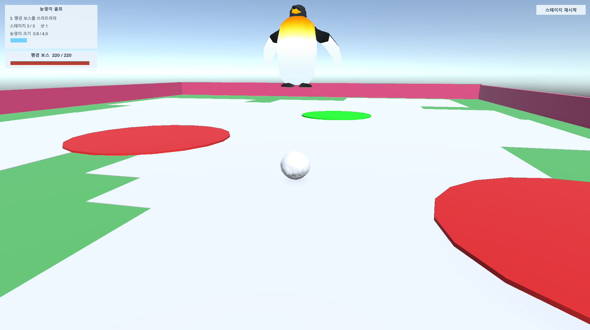

| 항목      | 내용                                                                                                                     |
| --------- | ------------------------------------------------------------------------------------------------------------------------ |
| 장르      | 3D 미니골프 · 굴리면 커지는 성장 + 보스전                                                                                |
| 개발 기간 | 2026.10.05, 2026.10.07 ~ 2026.10.08                                                                                      |
| 인원      | 개인 프로젝트 (레벨 디자인 과제)                                                                                         |
| 담당      | 기획, 레벨 디자인, 플레이 검증, AI 작업 지시                                                                             |
| 개발 환경 | Unity 6000.3.15f1 · C# · Codex(OpenAI)                                                                                   |
| 링크      | [GitHub](https://github.com/KooHoo-Dev/3rd-minigolf_level_design-Lets-Gitit) · [시연 영상](https://youtu.be/86UdlQnCKbo) |

## 목차

1. [개요](#1-개요)
2. [플레이](#2-플레이)
3. [컨셉 · 골프에서 무엇을 바꾸고 무엇을 남겼나](#3-컨셉--골프에서-무엇을-바꾸고-무엇을-남겼나)
4. [기획서 · 구현 AI에게 넘길 한 장](#4-기획서--구현-ai에게-넘길-한-장)
5. [플레이 → 요청 → 수정](#5-플레이--요청--수정)
6. [플레이가 바꾼 기획](#6-플레이가-바꾼-기획)
7. [만들며 생긴 문제](#7-만들며-생긴-문제)
8. [결과와 돌아보기](#8-결과와-돌아보기)

---

## 1. 개요


_눈 구역을 굴러 커진 눈덩이가 노란색으로 바뀐 통나무를 부수고 목표 펭귄을 맞힙니다._

미니골프 레벨 디자인 과제로 만든, 세 스테이지로 이루어진 프로토타입입니다. 공 대신 눈덩이를 굴립니다. 눈덩이는 눈 위를 구를수록 커지고, 충분히 커지면 앞을 막는 장애물을 부술 수 있습니다. 1·2스테이지에서 이 규칙을 익히고, 3스테이지에서는 커진 눈덩이로 거대한 펭귄 보스를 상대합니다.

목표한 경험은 "**굴릴수록 커지는 공으로, 색다른 골프를 치는 경험**"입니다. 공과 목적은 바꾸되 어디로 얼마나 세게 칠지 고르는 골프의 차분한 판단은 그대로 남기고, 보스전도 치열한 승부보다 눈덩이와 펭귄의 유쾌한 다툼으로 그리고 싶었습니다.

AI를 구현을 맡은 개발자 동료로 두고, 저는 기획자로서 방향 설정·의사 결정·플레이 검증을 맡았습니다. 이번 작업의 목표는 **아이디어를 빠르게 플레이 가능한 형태로 만들어 검증하는 것**이었습니다. 기획 단계의 발상은 직접 플레이해 보기 전에는 다음 세 가지를 알 수 없기 때문입니다.

1. 이 발상이 **실제로 재미있는가**
2. 기획서에 **빠진 것은 무엇인가**
3. 플레이해 보니 **수치와 감각은 맞는가**

직접 플레이할 수 있는 결과물이 있으면 이 질문들에 답할 수 있고, 팀이라면 각자 머릿속에 그리던 서로 다른 게임을 하나로 맞출 수도 있습니다. AI의 빠른 개발 속도 덕분에, 그 결과물을 짧은 시간에 만들 수 있었습니다.

---

## 2. 플레이

### 2.1 세 스테이지

세 스테이지 모두 "굴리면 커지고, 커지면 부순다"는 규칙 하나 위에서 조건만 바뀝니다.

| 1. 굴리면 커진다                              | 2. 눈더미는 크게 키운다                         | 3. 펭귄 보스전                                    |
| --------------------------------------------- | ----------------------------------------------- | ------------------------------------------------- |
| 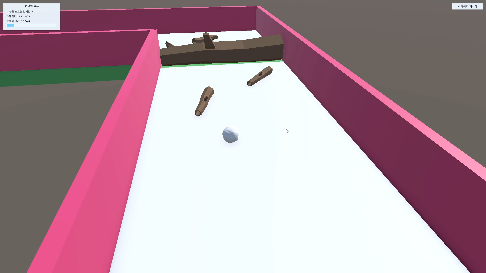               | 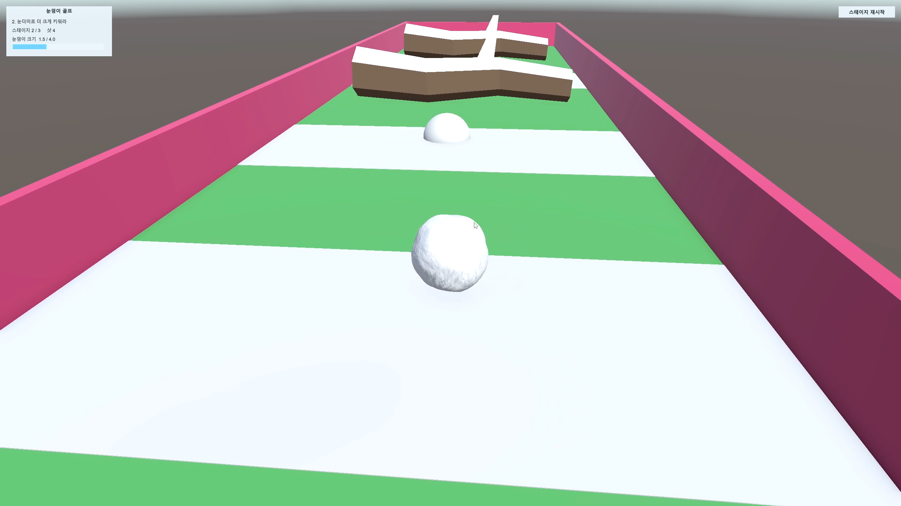                 | 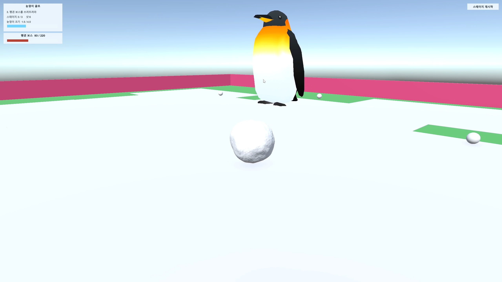                   |
| 커진 뒤에는 돌아가던 장애물을 부수고 지나간다 | 눈더미로 키워 부수고, 줄어든 크기를 다시 채운다 | 키운 크기로 공격하고, 열기를 피해 눈더미를 먹는다 |

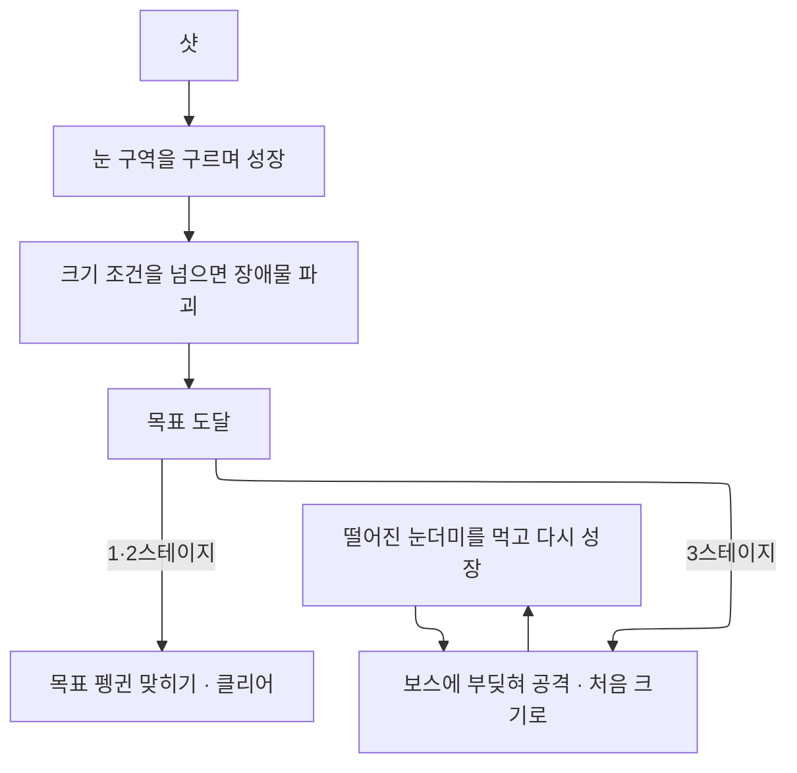

_3스테이지에서는 공격하면 처음 크기로 돌아가므로, 눈더미를 먹고 다시 공격하는 루프를 수행합니다._

### 2.2 조작법

`Space`를 누르고 있으면 공 앞의 주황색 선이 길어졌다 줄어들며 세기가 바뀌고, 떼면 카메라가 보는 방향으로 발사합니다. 마우스 오른쪽 드래그로 시점을 돌리고 휠로 확대·축소합니다.

---

## 3. 컨셉 · 골프에서 무엇을 바꾸고 무엇을 남겼나

### 3.1 후보는 넓게 받고, 고르기는 직접 한다

처음 AI가 내놓은 컨셉은 "폐장한 놀이공원 정비 코스"였는데, 장애물의 겉모습만 바꾸는 데 그쳤습니다. 그래서 하나를 자세히 짜지 말고 여러 방향을 폭넓게 제안해 달라고 했습니다.

> 다른 장르에서 주요 기믹으로 쓰이는 걸 찾아보고 결합 아이디어를 제안해줘.\
> 단순하되, 변형 가능성이 많은 아이디어여야 해. 하나를 자세하게 구상하지 말고, 여러 가지 아이디어를 툭툭 던져봐

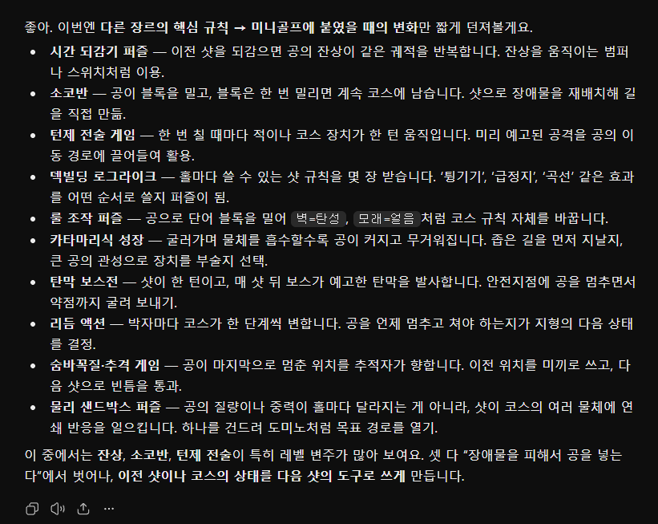

_AI가 낸 열 가지 후보입니다. AI의 추천은 잔상·소코반·턴제 전술이었습니다._

과제 권장안은 장애물을 배치해 골프 코스를 짜는 것이었지만, 저는 여기에 색다른 경험을 더하고 싶었습니다. "다른 장르에서 주요 기믹으로 쓰이는 걸" 요청한 이유입니다. 후보 가운데 카타마리와 보스전을 골라 세 스테이지의 첫 구상을 답했습니다.

> 좋아 카타마리 + 보스전으로 가자.
>
> 1스테이지는 초반에 좁은 길 배치야. 좁은 길은 최대한 적은 수로 굴려나가야 눈덩이가 불어나는 걸 방지해서 좁은 길을 통과할 수 있어. …
>
> 2스테이지는 눈덩이를 키워야 해. 눈더미가 맵 중간에 쌓여 있어서, 거길 지나가면 한 번에 크게 눈덩이를 키울 수 있어. …
>
> 3스테이지는 보스전이야. 몸집을 키워서 보스에게 부딪히면 크기에 비례해서 체력이 깎이게 하는 거지. …

- 아이디어를 고를 때는 넓게 펼치게 했고, 방향이 정해진 뒤에는 기준을 줘서 좁혔습니다.
- 카타마리와 탄막 보스전을 따로 두지 않고 "크기" 하나로 묶기로 했습니다. 지나갈 길, 부술 장애물, 보스에게 주는 피해를 모두 눈덩이의 크기가 정한다는 핵심 규칙을 이 답장에서 처음 세웠습니다.

### 3.2 공과 목적을 바꾸고, 샷과 타수는 남긴다

플레이어에게 색다른 느낌을 주려면, 무엇을 바꿀지부터 정해야 했습니다. 가장 먼저 떠오른 것은 그 장르에서 당연하게 여겨지는 요소를 바꾸는 것이었습니다. 익숙한 것이 바뀌면, 적은 변경으로도 "기존과 확실히 다르다"는 차이가 크게 다가올 것이라고 생각했습니다.

골프에서 가장 당연한 요소는 공입니다. 그래서 공 자체가 바뀌는 카타마리식 성장을 선택했고, 굴러가며 커지는 공에서 눈덩이를 떠올렸습니다. 골프공이 커지는 것은 어색하지만, 눈덩이가 커지는 것은 누구나 납득할 것입니다.

공을 바꾸자 다음 변경점이 자연스럽게 따라 나왔습니다. 공이 커졌는데 작은 구멍에 넣어야 한다면 두 규칙이 서로 충돌합니다. 필요한 것은 **큰 상태여야만 해낼 수 있는 목적**이었고, 그 답이 거대한 상대를 큰 몸집으로 들이받는 보스전이었습니다. "조준해서 치고, 홀에 넣는다"는 장르의 대표 목적이 바뀌면, 공이 바뀐 것처럼 색다르다고 느낄 것이라고 생각했습니다.

다만 바꾸는 요소가 늘어날수록 골프다움은 사라지고, 결국 눈덩이로 하는 액션 게임이 될 수 있습니다. 그래서 **플레이어가 골프를 하고 있다고 느끼게 하는 요소**는 그대로 남겼습니다.

| 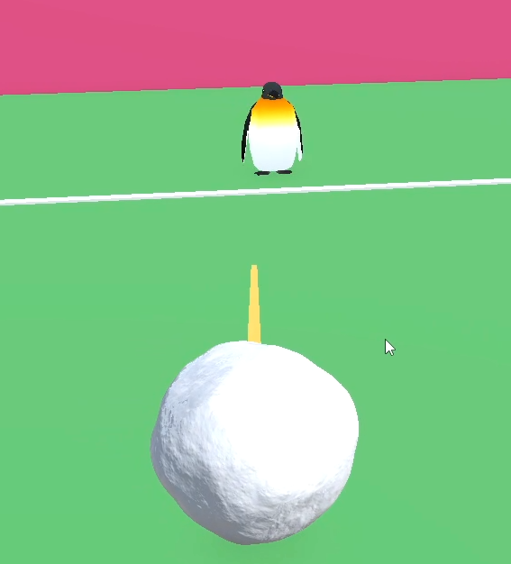 | 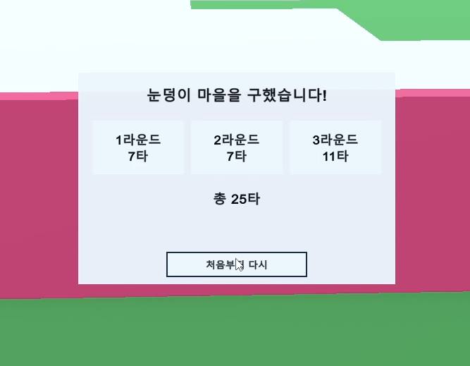 |
| ---------------------------------------------------------------------------- | ---------------------------------------------------------------- |
| 주황색 선의 길이로 세기를 정해 친다                                          | 라운드별 타수와 총 타수가 나온다                                 |

- **조준하고 세기를 정해 치는 샷.** 조작은 기존 골프 게임 그대로 두어 새로 익힐 규칙을 줄였습니다. 보스전에서도 플레이어가 하는 일은 "어디로, 얼마나 세게 칠지" 고르는 것이므로, 빠른 반응보다 신중한 판단을 중시하는 골프의 성격이 유지됩니다.
- **타수로 매기는 결과.** 보스를 쓰러뜨려도 성과를 가르는 기준은 라운드별 타수와 총 타수입니다.

### 3.3 앞선 두 스테이지가 보스전으로 이어지도록

첫 구상에서 1스테이지는 "작게 유지해 좁은 길을 통과하기"였습니다(→ [3.1](#31-후보는-넓게-받고-고르기는-직접-한다)). 커져야 하는 2·3스테이지와 반대 방향이어서 보스전으로 이어지지 않았고, 작은 상태를 보스전에서도 쓰게 할지, 1스테이지를 바꿀지 정해야 했습니다.

|           | 보스전에 작은 상태 기믹을 더한다 (AI 안) | **세 스테이지를 키우기로 통일** ✅ |
| --------- | ---------------------------------------- | ---------------------------------- |
| 1스테이지 | 작게 통과한 뒤 커져서 돌파               | 구르며 커지기                      |
| 보스전    | 작은 공만 들어가는 피신처 · 갑옷 틈      | 키운 크기로 공격                   |
| 크기 규칙 | 작으면 통과, 크면 파괴                   | 키우면 부순다                      |
| 바뀌는 곳 | 1·3스테이지 모두                         | 1스테이지만                        |

> 2, 3 스테이지는 연계가 잘 되는데, 1스테이지는 정반대 성격이라 느낌이 다른 거 같아.

AI는 작은 상태를 보스전에서도 쓰도록 피신처와 갑옷 틈을 더하는 안을 두 번 냈습니다. 하지만 기믹을 더하면 규칙이 복잡해집니다. 그래서 기믹을 더하는 대신 1스테이지 하나만 바꾸기로 했습니다.

> 차라리 크기 키우기에 집중하는 거 어때.\
> 그냥 세 스테이지 다 '키우기'를 테마로 통일시키는거야.

**세 스테이지를 키우기 하나로 통일했습니다.** 1스테이지는 구르며 커지기, 2스테이지는 눈더미로 크게 키우고 소모하기, 3스테이지는 키운 크기로 보스를 공격하기가 되어, 앞선 두 스테이지가 모두 보스전에서 쓸 기믹을 하나씩 배우는 단계가 되었습니다.

### 3.4 제안과 피드백을 반복하며 기준 정하기

보스전을 넣더라도 골프의 차분한 분위기는 지키고 싶었습니다. 보스의 정체가 곧 그 분위기를 좌우하기 때문에, 정체를 정하는 데 오래 공을 들였습니다. 첫 요청에는 보스가 1·2스테이지와 어떻게 이어지는지와 어떤 성질이어야 하는지를 함께 적었습니다.

> 1, 2스테이지에서 이 보스의 작은 버전을 때리거나 부수면서 괴롭히는 식으로 만드는 거야.
> 그런 보스가 3스테이지에서 몸집이 거대해져 강해져서 돌아와서 플레이어를 위협하는 거지.
>
> 눈덩이와 대적하는 위치에 있는 무언가였으면 좋겠어. 너무 추상적인 존재는 말고, 열기와 관련되거나, 아니면 눈사람이거나 하는 식으로.

이후 여섯 차례 제안과 피드백을 주고받았습니다.

| 회차 | AI의 제안                 | 살린 것 ✓ / 버린 것 ✗                | 쌓인 기준               |
| ---- | ------------------------- | ------------------------------------ | ----------------------- |
| 1    | 숯심장 눈사람             | ✓ 안에 숨은 존재 · ✗ 눈과 같은 속성  | 눈과 다른 재료          |
| 2    | 숯불 소라게               | ✗ 심장 설정 · ✗ 공격할 이유가 약하다 | 눈덩이로 공격할 이유    |
| 3    | 불씨 도깨비의 화로        | ✗ 현실성이 없다                      | 실제로 있는 것          |
| 4    | 모닥불                    | ✓ 방향 · ✗ 불은 물로 끈다            | 눈덩이가 제압할 만한 것 |
| 5    | 눈싸움하는 털모자 아저씨  | ✓ 나쁘지 않다 · ✗ 사람이 피해를 본다 | 선악이 없는 자연물      |
| 6    | **눈을 이고 있는 소나무** | ✓ 결정                               | —                       |

- 4회차의 "실제로 있는 것"에는 "단순하고 유쾌하게"가, 5회차의 "자연물"에는 "일상을 웅장하게 그려 코믹하게"가 함께 붙었습니다.
- **살릴 것과 버릴 것을 나눠 말했습니다.** 전부 거절하면 AI는 좋았던 부분까지 버리고 처음부터 다시 고릅니다. 4회차에서 "방향은 맞다"고 한 뒤로는 실제로 있는 단순한 대상이 이어졌고, 5회차에서 부정적인 인상을 지적하자 선악이 없는 소나무가 나왔습니다.
- **거절의 이유가 다음 제안의 기준이 됐습니다.** "별로야"라고만 하면 AI는 비슷한 방향에서 다시 고를 수밖에 없습니다. 눈과 다른 재료, 공격할 이유, 실제로 있는 것, 선악이 없는 자연물처럼 기준이 하나씩 쌓일 때마다 후보가 좁혀졌습니다.

눈을 이고 있는 나무에서 눈이 떨어지는 것은 겨울 숲에서 매일 일어나는 흔한 일입니다. 별것 아닌 일을 보스전의 형식으로 웅장하게 그리면, 보스전이 들어가도 차분하고 유쾌한 분위기가 남습니다. 결정한 뒤에는 바로 구상을 덧붙였습니다.

> 나무면 부딪혔을 때 동료 눈덩이 구하는 컨셉으로 정하면 되고 보스는 나무 몬스터 하나를 구해서 흑화했다고 하면 되겠네.

1·2스테이지는 나무에 붙은 **동료를 구한다**는 이유를, 3스테이지는 계속 들이받힌 나무가 **흑화해 보스가 된다**는 이유를 붙여 세 스테이지를 하나의 이야기로 엮었습니다.

※ 최종 버전에서는 결국 보스는 펭귄이 됐습니다. 구현 중에 모델을 찾다가 펭귄 에셋을 발견했는데, 소나무는 '눈'과 한 번에 이어지는 이미지가 약했고 눈덩이와 펭귄의 유치한 다툼이 더 재미있어 보였습니다. 에셋만 문제였다면 생성형 AI로 나무 모델을 만드는 방법도 있었지만, 펭귄이 더 맞는 방향이라고 판단해 목표와 보스를 모두 펭귄으로 바꿨습니다. 동료 구출과 흑화 설정은 이때 빠졌습니다.

그래도 이 대화에서 쌓은 기준은 그대로 남았습니다. 치열하지 않고 유쾌한 분위기, 선악이 없는 상대, 들이받으면 골인이라는 판정입니다. 여섯 번의 대화는 정답을 고르는 과정이라기보다 **기준을 만드는 과정**이었고, 그 기준이 있었기에 펭귄을 보자마자 더 맞는 방향이라고 판단할 수 있었습니다.

---

## 4. 기획서 · 구현 AI에게 넘길 한 장

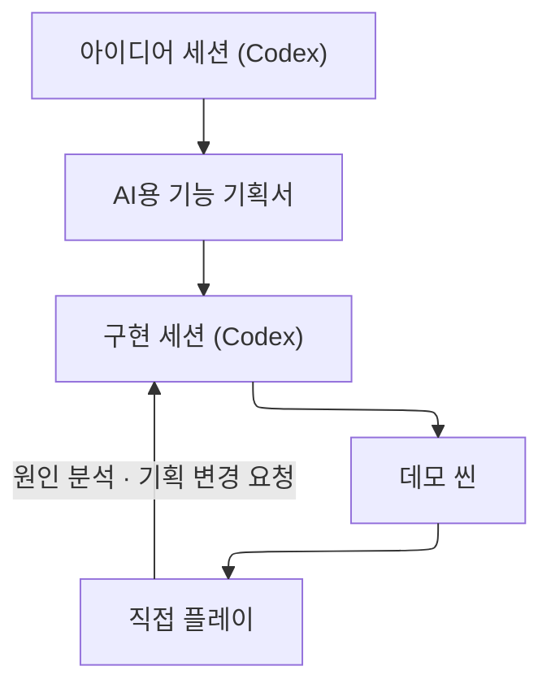

_두 세션을 잇는 것은 기능 기획서 한 장입니다. 데모가 나온 뒤에는 "플레이 → 요청 → 수정"을 반복했습니다._

### 4.1 기획과 구현을 한 세션에서 할 것인가

아이디어가 정해진 뒤, 그 세션에서 구현까지 이어 갈지, 구현은 새 세션에서 시작할지 정해야 했습니다.

|      | 한 세션에서 기획부터 구현까지           | **기획 세션과 구현 세션을 나눈다** ✅   |
| ---- | --------------------------------------- | --------------------------------------- |
| 장점 | 앞의 이야기를 AI가 바로 이어받는다      | 구현 AI는 확정된 기획서만 보고 시작한다 |
| 단점 | 버린 아이디어가 남아 구현 판단을 흐린다 | 기획서에 빠진 것은 구현 AI가 모른다     |

아이디어 세션은 여러 번 방향을 뒤집으며 길어졌습니다. 잠입, 눈사람, 모닥불처럼 버린 아이디어가 세션에 그대로 남아 있었고, 이 세션에서 구현을 맡기면 AI가 이미 버린 제안을 근거로 판단할 위험이 있었습니다. 세션이 길어질수록 앞 내용이 흐려지기도 합니다. **그래서 확정된 것만 기획서 한 장으로 정리하고, 구현은 새 세션에서 기획서만 보고 시작하게 했습니다.**

### 4.2 AI가 읽을 기획서

| 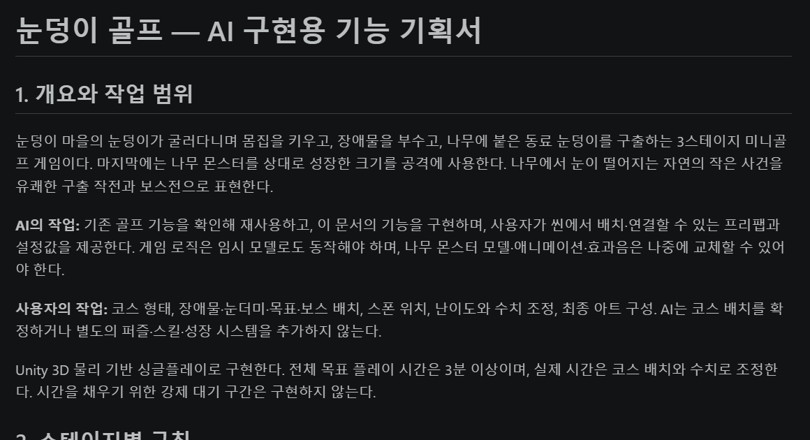 | 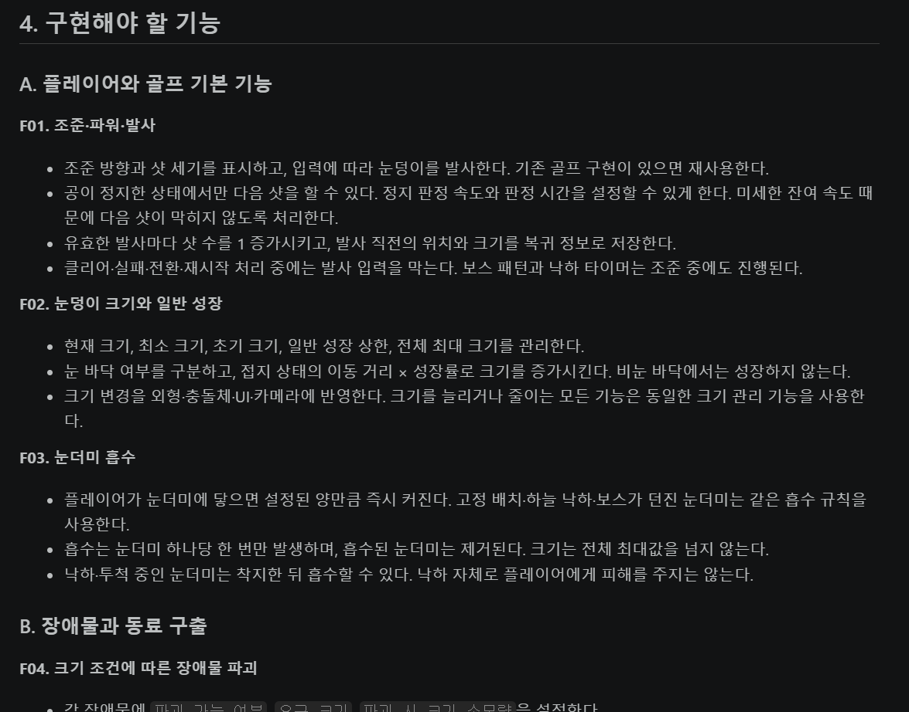 |
| -------------------------------------------------------------------- | ------------------------------------------------------------ |
| 작업 구분                                                            | 기능 목록                                                    |

_기능 13개(F01~F13), 씬에서 조정할 값, 완료 확인 항목 12개로 이루어진 기능 기획서_

> AI에게 작업을 시킬 때 혼동하지 않도록 필요한 기능 목록을 상세하게 정의해야 해. 부족한 부분이 있다면 나한테 질문해서 채워줘.
>
> 레벨 요소 배치 같은 디테일한 것들은 내가 직접 할 거니까, 기능 목록에 집중해서 작성해줘.

기획서의 첫 절에는 사람과 AI의 몫을 나눠 적었습니다.

| 나                             | AI                                |
| ------------------------------ | --------------------------------- |
| 기획 의도와 판단 기준을 정한다 | 아이디어 후보를 낸다              |
| 무엇을 만들고 안 만들지 정한다 | 기능 기획서를 정리한다            |
| 코스 배치와 수치를 정한다      | 기능을 구현하고 데모 씬을 만든다  |
| 직접 플레이하며 검증한다       | 원인을 분석하고 해결책을 제안한다 |

"AI는 코스 배치를 확정하거나 별도의 퍼즐·스킬·성장 시스템을 추가하지 않는다"고도 명시했습니다. 레벨 디자인 과제에서 배치는 제가 답해야 하는 질문이기 때문입니다. 기능은 장애물 파괴(F04)처럼 조건을 하나씩 적게 했고, 기획서 끝에는 작업이 끝났는지를 판단할 완료 확인 항목을 두었습니다.

```markdown
**F04. 크기 조건에 따른 장애물 파괴**

- 각 장애물에 `파괴 가능 여부`, `요구 크기`, `파괴 시 크기 소모량`을 설정한다.
- 움직이는 플레이어가 충돌할 때 현재 크기가 요구값 이상이면 장애물이 파괴되고,
  플레이어 크기가 소모량만큼 줄어든다. 최소 크기 아래로는 줄지 않는다.
- 크기가 부족하면 일반 골프 장애물처럼 충돌·반발한다.
- 한 장애물은 한 번만 파괴되며, 같은 충돌의 반복 이벤트로 크기가 여러 번 소모되지 않는다.
```

```markdown
## 6. 완료 확인 항목

4. 작은 공은 장애물에 막히고, 충분히 큰 공은 장애물을 부순다.
   큰 장애물 파괴 시 크기 소모는 한 번만 발생한다.
5. 일반 성장 상한으로는 큰 장애물을 부술 수 없고,
   눈더미로 상한을 넘어 커지면 부술 수 있다.
```

- **읽는 사람을 AI로 정했습니다.** 구현 AI는 아이디어 세션을 보지 못합니다. "맥락을 전혀 모르는 동료가 이 문서만 보고 따라 할 수 있는가"를 기준으로, 같은 충돌이 반복될 때의 지침도 함께 적었습니다.
- **완료 기준을 먼저 정했습니다.** 완료 확인 항목이 없으면 AI가 작업의 끝을 판단할 수 없습니다. 완료 기준을 적어 두면 AI가 혼자서 끝까지 갈 수 있고, 결과도 그 목록으로 확인할 수 있습니다.

### 4.3 구현 지시에 품질 기준과 범위를 함께 주기

새 세션에서 구현을 요청하면서, 어느 수준의 코드를 원하는지를 함께 적었습니다.

> 눈덩이 골프 기능 기획서를 따라서 기능을 구현해줘.
>
> 불필요한 확장을 고려한 코드나, 당장 치명적인 문제를 일으키지 않는 문제에 대한 과도한 방어 코드는 최대한 배제하고 기능 구현에 집중해서 코드 작성해줘.

데모 씬을 요청할 때는 에셋 범위도 정했습니다.

> 기획서의 의도에 맞게 임시로 기능과 오브젝트를 배치한 데모 씬을 하나 만들어줘.
> 에셋은 간단한 유니티 내부 오브젝트나 프로젝트 폴더에 들어가 있는 에셋들을 사용해주면 돼.

- **품질 기준을 "기능이 돌아가는 가장 단순한 코드"로 정했습니다.** 이 코드는 재미를 확인하고 나면 버리거나 다시 작성할 수 있습니다. 확장성이나 방어 코드에 시간을 쓰면 첫 데모가 늦어지고, 코드가 길어져 확인하기도 어려워집니다.
- **AI가 볼 자료를 골랐습니다.** 관련 없는 파일이 많을수록 AI가 과제와 무관한 파일을 근거로 판단할 수 있어서, 구현 전에 미니골프와 관련 없는 에셋 파일을 지웠습니다.

---

## 5. 플레이 → 요청 → 수정

코드의 오류는 AI가 확인하지만, **재미있는지, 의도대로 움직이는지**는 직접 플레이해야만 알 수 있었습니다. 그래서 플레이에서 찾은 것을 AI에게 어떻게 전하느냐가 수정의 속도를 정했습니다.

### 5.1 원인부터 묻고, 단서를 함께 준다

데모에서 문제를 발견하면 바로 수정을 요청하지 않고 **원인부터** 물었습니다. 증상만 전하지 않고 원인을 좁힐 단서를 함께 제시했고, 원인을 확인하고 납득한 뒤에야 수정을 요청했습니다.

| 플레이에서 본 증상                       | 함께 준 단서                         | AI가 찾은 원인                               |
| ---------------------------------------- | ------------------------------------ | -------------------------------------------- |
| 공이 멈추지 않아 다음 샷을 칠 수 없다    | 직접 플레이한 결과                   | 공의 감속값이 0이다                          |
| 눈더미를 먹고 부딪혀도 장애물이 그대로다 | 가설: 크기가 부족했을 수도 있다      | 충돌 순간의 재검사가 빠졌다                  |
| 첫 눈더미 뒤로 더 커지지 않는다          | 시점과 장소: 2스테이지, 첫 눈더미 뒤 | 구르기 성장 상한이 크기를 덮어쓴다           |
| 미끄러지다가 갑자기 멈추기도 한다        | 원칙: 움직임은 힘과 마찰로만         | 성장 구역의 감속값 변경 · 느려지면 강제 정지 |

- **장애물이 그대로였던 문제**에서 눈덩이 크기는 4.2로, 요구 크기 3.2를 이미 넘어 있었습니다. 가설을 함께 제시하자 AI가 크기와 충돌 처리를 함께 검토한 뒤, 충돌 쪽이 더 유력하다고 답했습니다.
- **더 커지지 않던 문제**는 구르며 커지는 크기 상한 3이 매 프레임 크기를 덮어써, 눈더미로 커진 크기가 되돌아간 것이었습니다.
- **갑자기 멈추던 문제**는 성장 구역에 들어가면 감속값이 1.4에서 0.2로 바뀌고, 속도가 느려지면 코드가 속도를 0으로 만든 것이었습니다.

"고쳐 줘"라고만 하면 AI는 그럴듯한 원인 하나를 골라 바로 코드를 바꿉니다. 그 진단이 틀리면 엉뚱한 수정이 남고 다음 문제의 원인이 됩니다. 원인을 먼저 보면 단계마다 확인하고 넘어갈 수 있고, 가설·시점·원칙 같은 단서를 함께 제시하면 AI가 원인을 더 빨리 좁힐 수 있습니다.

### 5.2 범위와 원칙은 말로 못 박는다

별도의 요청이 없었는데, AI가 일반 땅과 미끄러지는 얼음 땅을 함께 만들었습니다. 범위를 벗어난 작업은 즉시 중단하게 했습니다.

> 미끄러지는 얼음 땅은 기획 범위 밖이야. 별도 지시가 없다면 구현 범위는 기획서 안으로 한정해줘.

공이 어떤 때는 미끄러지고 어떤 때는 갑자기 멈추는 문제가 반복되자, 바닥의 문제가 아니라고 지적하고 지켜야 할 원칙을 명시했습니다.

> 공의 움직임은, 오로지 날리는 힘의 세기와 마찰에 의해서만 결정돼야 해.

이 한 줄로 AI는 성장 구역에서만 감쇠를 바꾸던 코드와 착지 시 강제로 멈추던 코드를 찾아 지웠습니다. 둘 다 이전 수정에서 AI가 스스로 넣었던 코드입니다.

### 5.3 수치는 내가 맞출 수 있게

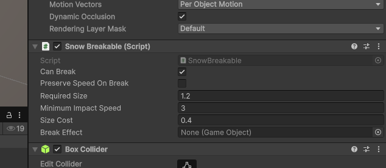

_장애물 하나의 파괴 조건을 모두 Inspector에서 바꿀 수 있습니다._

수치는 결국 플레이하면서 직접 맞춰야 하므로, AI에게 값을 정해 달라고 하기보다 바로 바꿀 수 있게 만들어 달라고 했습니다.

- "이 수치들은 내가 직접 테스트하면서 수정할 수 있게 직렬화 필드로 설정해줘"
- "scale 1짜리 단순 네모 콜라이더 붙여서 프리팹화 해줘. 내가 스케일 늘려서 다양한 크기로 직접 배치할 수 있게."
- "바로 3스테이지 해볼 수 있게 디버그 키 만들어줘."

| 값                        | 플레이하며 정한 이유                              |
| ------------------------- | ------------------------------------------------- |
| Required Size · Size Cost | 장애물마다 다른 난이도를 준다                     |
| Minimum Impact Speed      | 천천히 닿기만 해도 부서지는 것을 막는다           |
| Preserve Speed On Break   | 부숴도 멈추지 않고 뚫고 가는 약한 장애물을 만든다 |

### 5.4 AI가 작성한 코드를 어디까지 들여다볼 것인가

AI가 작성한 코드를 직접 검토하고 다듬을지, 동작만 확인할지 정해야 했습니다.

|      | 코드를 검토하고 직접 다듬기                    | **동작만 확인하고 코드는 AI에게 맡기기** ✅   |
| ---- | ---------------------------------------------- | --------------------------------------------- |
| 장점 | 구조가 깔끔해지고, 나중의 문제를 미리 막는다   | 플레이에 쓸 시간이 그대로 남는다              |
| 단점 | 수정마다 검토 시간이 들어 AI의 속도가 줄어든다 | 구조 문제가 늦게 드러나고, 원인은 AI에 기댄다 |

이 프로토타입의 목적은 발상이 재미있는지 확인하는 것이었습니다. **그래서 코드의 구조나 품질에는 개입하지 않고, 판단 기준을 "의도대로 움직이는가" 하나로 두었습니다.** 대신 구현 직후 AI에게 각 클래스가 어떻게 동작하는지 설명하게 하고, 기존 코드를 그대로 쓴 것인지 새로 작성한 것인지를 확인했습니다.

대가도 있었습니다. 지운 장애물의 참조가 남아 펭귄 애니메이션이 깨진 문제(→ [7.2](#72-통나무-장애물을-고쳤더니-펭귄이-깨진-문제))는 코드를 들여다봤다면 미리 알았을 구조 문제였습니다. 이때도 구조를 설명하게 해서 원인을 찾았습니다. 코드를 직접 읽는 대신 **AI가 구조를 설명하게 하는 것**으로 이해를 대신했습니다.

---

## 6. 플레이가 바꾼 기획

첫 데모를 플레이하자, 재미, 기획서에 빠진 것, 수치와 감각에서 기획서만으로는 알 수 없던 것들이 나왔습니다.

### 6.1 재미있는가 — 템포와 손맛

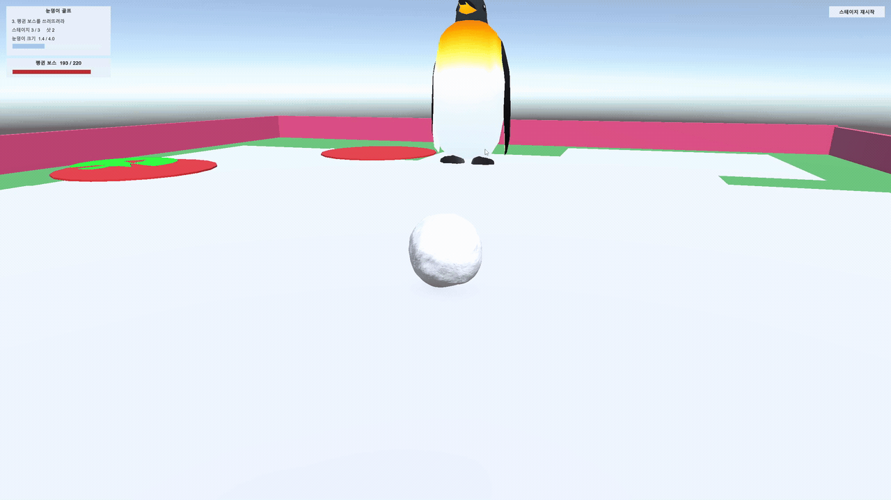

_보스를 공격하면 뒤로 강하게 밀려납니다._

| 기획서 (As-Is)               | 플레이 후 (To-Be)                       | 계기                        |
| ---------------------------- | --------------------------------------- | --------------------------- |
| 코스 길이·수치는 나중에 조정 | 코스를 늘리고 샷 세기·정지 판정 조정    | "좀 더 템포가 빨랐으면"     |
| 보스 공격 후 크기만 처음으로 | **보스에 부딪히면 멀리 튕겨 나간다**    | 바로 앞에서 작아지기만 한다 |
| 목표에 붙은 동료를 구출      | 목표 펭귄이 맞으면 과하게 튀어 날아간다 | 펭귄 에셋을 받은 뒤         |

보스 넉백은 바로 앞에서 작아지기만 하는 것이 재미없다는 생각에서 나왔습니다.

> 바로 앞에서 그냥 작아지니까 재미가 별로 없어. 뒤로 세게 밀려나는 감각이 재밌을 거 같은데

#### 부서지는 느낌을 어디까지 만들 것인가

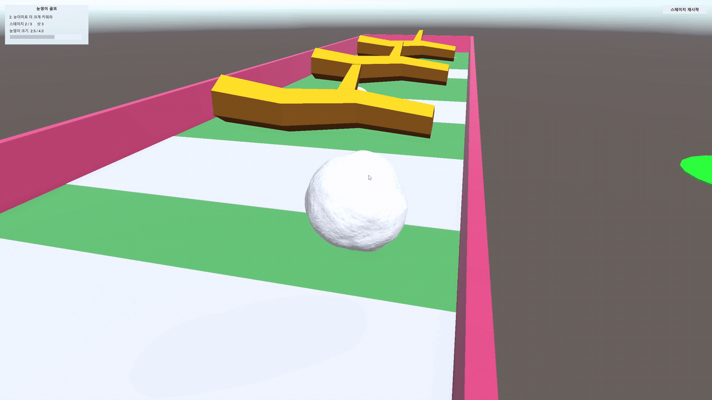

_부딪힌 통나무가 흔들리고 작아지며 파편이 튑니다._

처음에는 장애물이 부서질 때 충돌체와 모델을 끄기만 해서, 부서진다기보다 사라지는 것처럼 보였습니다. 통나무가 가운데를 기준으로 두 갈래로 쪼개져 날아가게 만들고 싶었지만, 앞으로 늘어날 장애물에도 같은 연출을 쓰고 싶어서 만들기 전에 비용부터 물었습니다. AI의 답은 장애물마다 반쪽 모델을 준비하거나 실행 중에 메시를 자르는 방식이었고, 어느 쪽도 프로토타입 단계에는 맞지 않았습니다. 그래서 목표를 "쪼개진다"에서 "부서진다고 느낀다"로 바꿔 다시 물었습니다.

> 원본 에셋을 수정하는 방식은 부서져야 할 모든 메시를 다 수정해야 하니까 비효율적인 것 같아.
> 원본 에셋을 수정하지 않는 선에서 모든 메시에 범용적으로 적용할 수 있는 방법을 제안해줘.

|                | 메시를 반으로 쪼갠다                   | **흔들림 + 축소 + 파편** ✅   |
| -------------- | -------------------------------------- | ----------------------------- |
| AI가 답한 비용 | 하루 이상, 품질에 따라 며칠            | 공통 컴포넌트 하나로 바로     |
| 원본 에셋      | 반쪽 모델 준비 또는 런타임 메시 자르기 | 원본 FBX·재질을 고치지 않는다 |
| 재사용         | 모양마다 준비                          | 모든 장애물에 같은 연출       |

**AI가 제안한 흔들림·축소·파편 방식으로 정했습니다.** 플레이어에게 필요한 것은 "부서졌다"는 느낌이지, 실제로 잘리는 메시가 아니었습니다.

### 6.2 기획서에 무엇이 빠졌나 — 규칙을 읽을 수 있게

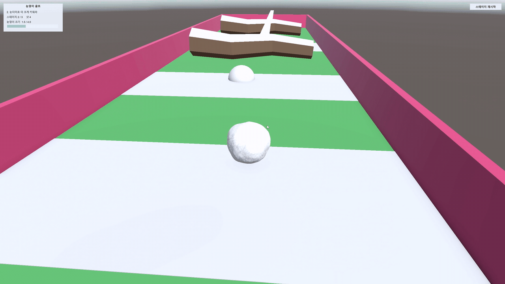

_공이 충분히 커지는 순간, 부술 수 있는 통나무가 노란색으로 바뀝니다._

#### 부술 수 있다는 것을 어떻게 알릴 것인가

지금 크기로 어떤 장애물을 부술 수 있는지 플레이어에게 보여 줘야 했습니다. 처음 떠올린 것은 주황색 윤곽선이었는데, URP에서 물체 모양을 따르는 윤곽선을 그리려면 셰이더를 새로 만들어 장애물에 연결해야 했습니다.

|                | 주황색 윤곽선 (URP 셰이더)            | **부술 수 있을 때 색 바꾸기** ✅ |
| -------------- | ------------------------------------- | -------------------------------- |
| AI가 답한 비용 | 셰이더를 새로 만들어 연결, 약 한 시간 | 이미 있는 색 기능을 고쳐 쓴다    |
| 전달력         | 장애물 모양을 따라 테두리가 생긴다    | 장애물 전체가 노란색이 된다      |

완성된 제품이라면 윤곽선이 더 깔끔한 방법일 수 있습니다. 하지만 플레이어에게 필요한 정보는 "**지금 이 장애물을 부술 수 있는가**"이고, 이 정보는 색만으로도 전할 수 있습니다. **그래서 공 크기가 장애물의 요구 크기를 넘는 순간 노란색으로 바뀌도록 요청했습니다.**

### 6.3 수치와 감각은 맞았나 — 크기와 위협


_열기 원 3개가 동시에 켜지고, 눈더미는 초록색 표시 위로 떨어집니다._

| 기획서 (As-Is)                    | 플레이 후 (To-Be)                      | 계기                            |
| --------------------------------- | -------------------------------------- | ------------------------------- |
| 크기 수치 미정                    | 크기 관련 수치를 모두 절반으로         | "8.0일 때 눈덩이가 너무 커보여" |
| 열기에 맞으면 설정량만큼 작아진다 | 맞으면 **처음 크기로**                 | "조금 더 위협적이어야"          |
| 열기 위치 후보는 지정             | 3곳 동시 · 넓은 범위 · **무작위 위치** | 같은 요청                       |
| 일정한 공격 주기                  | 주기 단축 · **보스 피격 시 추가 공격** | 같은 요청                       |
| 눈더미 착지 위치는 지정           | 무작위 위치 · 초록색 착지 표시         | 열기 공격 표시와 헷갈린다       |

넉백, 성장 구역, 노란색 표시, 열기 공격의 위협처럼 플레이하며 바꾼 것 대부분은 기획서를 쓸 때는 떠올리지 못한 것들입니다. 직접 플레이할 수 있는 결과물이 있었기 때문에 짧은 시간 안에 찾고, 바로 반영할 수 있었습니다.

---

## 7. 만들며 생긴 문제

### 7.1 눈더미를 먹을 때의 카메라 떨림 문제

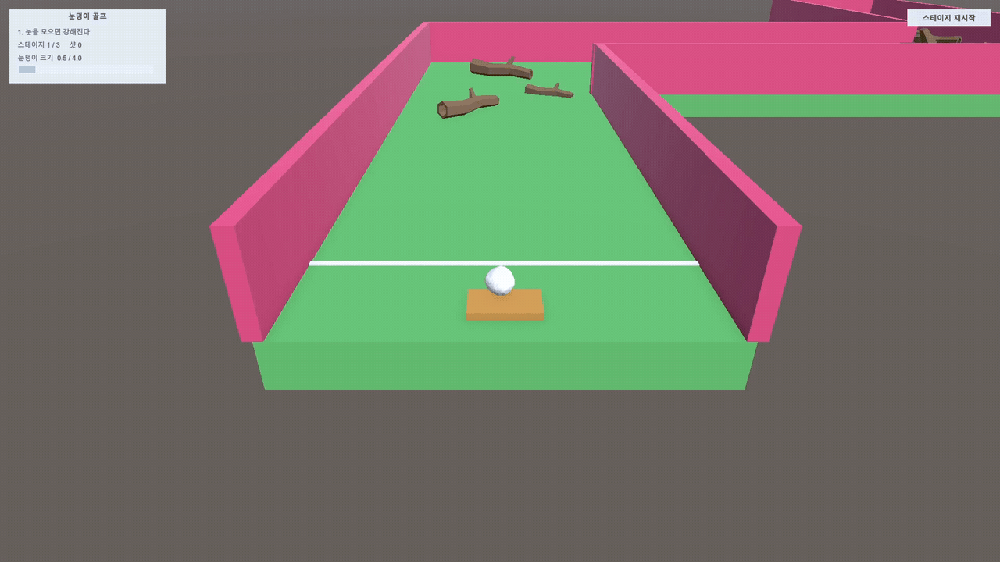

_공의 크기가 계단식으로 바뀌면서 카메라도 함께 튑니다. 고친 뒤에 다시 만들어 찍은 장면이라, 실제로는 이보다 더 심하게 떨렸습니다._

눈더미를 먹어 커지는 동안 카메라가 계속 떨렸습니다. AI는 처음에 Rigidbody와 Transform 위치를 중복으로 설정한 것을 원인으로 보았고, 다음에는 카메라의 위치와 시선이 서로 다른 지점을 따라가는 것을 원인으로 짚었습니다. 두 번 고쳤지만 떨림은 그대로였습니다.

플레이를 다시 보니 공의 크기가 조금씩 늘지 않고 **한 번에 큰 폭으로** 바뀌고 있었습니다. 크기에 맞춰 공의 중심 높이도 그때마다 크게 바뀌었고, 이를 따라가는 카메라 위치도 함께 흔들리면서 떨리는 것처럼 보였습니다.

> 눈덩이가 부드럽게 값이 증가하는 게 아니라 계단식으로 증가하고 있어.
> 계단식으로 증가하니까 그 위치에 맞춰서 카메라도 위치가 바뀌고 있는 것 같아.

이 관찰을 전달하자 AI가 성장 코루틴이 물리 프레임마다 갱신되고, 보간 곡선 때문에 프레임마다 변화량이 달라지는 것을 찾았습니다. 렌더 프레임마다 일정하게 커지도록 하고, 한 프레임의 변화량은 최대 0.1로 제한했습니다.

AI는 코드를 읽고 그럴듯한 원인을 찾지만, 화면에서 무엇이 보이는지는 모릅니다. 증상을 "떨린다"가 아니라 "계단식으로 커진다"처럼 **현상을 정확히 파악해서** 전달해야 AI가 맞는 곳을 찾습니다.

### 7.2 통나무 장애물을 고쳤더니 펭귄이 깨진 문제

1스테이지의 기존 장애물을 지우고 통나무 프리팹에 파괴 컴포넌트를 붙였더니, 목표 펭귄이 쓰러지는 애니메이션만 반복하고 맞아도 날아가지 않았습니다. AI는 처음에 펭귄 코드와 애니메이터 기본 상태를 원인으로 보고 펭귄 쪽을 고쳤고, 이어서 3스테이지의 장애물 구조가 겹친 것을 원인으로 짚었습니다. 두 진단 모두 맞지 않았습니다.

그래서 비교 대상을 제시했습니다.

> 스테이지 2의 펭귄은 아직 수정 전인데 그쪽이랑 비교해서 확인해줘. 스테이지 2는 잘 작동하거든

그 뒤에야 원인이 드러났습니다. 스테이지 매니저는 Inspector에 등록된 장애물 목록을 먼저 초기화한 다음 펭귄을 연결하는데, 앞서 지운 장애물의 참조가 목록에 남아 `NullReferenceException`이 발생했습니다. 그 때문에 펭귄 연결과 초기화까지 실행되지 못했습니다.

저장된 목록 대신, 스테이지 루트 아래에 실제로 있는 `SnowBreakable`을 찾아 초기화하도록 바꿨습니다. 이어서 장애물 구조도 정리했습니다. 통나무 프리팹 하나가 콜라이더와 파괴 기능을 모두 갖고, 예전 블록과 비주얼 래퍼는 지웠습니다.

"잘 되는 쪽과 비교해 보라"는 한 줄이 원인을 찾는 범위를 크게 줄였습니다. AI에게 문제 상황만 전하기보다 **확인 가능한 정상 사례**를 함께 주는 것이 빨랐습니다.

---

## 8. 결과와 돌아보기

### 8.1 결과

기획서대로 만든 3스테이지 데모를 플레이하며 고쳐, 보스전과 결과 화면까지 이어지는 최종 버전을 만들었습니다.

| 날짜        | 한 일                                        | 소요 시간      |
| ----------- | -------------------------------------------- | -------------- |
| 10/5        | 아이디어 세션 → 기능 기획서, 프로젝트 정리   | 기획 약 1시간  |
| 10/7 ~ 10/8 | 3스테이지 데모 → 플레이하며 수정 → 최종 버전 | 개발 약 12시간 |

개요에서 세운 세 질문에는 첫 데모 뒤의 플레이로 답할 수 있었습니다.

| 개요의 질문                 | 플레이로 찾은 것                       | 어디서                                                 |
| --------------------------- | -------------------------------------- | ------------------------------------------------------ |
| 실제로 재미있는가           | 템포, 넉백, 부서지는 느낌              | [6.1](#61-재미있는가--템포와-손맛)                     |
| 기획서에 빠진 것은 무엇인가 | 성장 구역, 노란색 표시, 최소 충돌 속도 | [6.2](#62-기획서에-무엇이-빠졌나--규칙을-읽을-수-있게) |
| 수치와 감각은 맞는가        | 크기 수치, 열기 공격의 위협, 착지 표시 | [6.3](#63-수치와-감각은-맞았나--크기와-위협)           |

### 8.2 아쉬운 점과 다음 계획

| 아쉬운 점                               | 원인                                               | 다음에는                                        |
| --------------------------------------- | -------------------------------------------------- | ----------------------------------------------- |
| AI가 스스로 플레이를 검증하지 못했다    | AI가 현재 상황을 볼 수단이 없었다 (당시 모델 기준) | 로그·테스트로 AI가 간단한 오류를 확인하게 한다  |
| 에셋을 찾느라 플레이·수정 흐름이 끊겼다 | 에셋 준비를 구현 도중에 했다                       | 필요한 에셋은 미리 찾고, 나머지는 임시 에셋으로 |

### 8.3 배운 점: 검증에 필요한 만큼만 만들었는가

이 프로젝트의 선택은 대부분 "가장 좋은 방법"보다 **검증에 필요한 만큼을 가장 빨리 만드는 방법**이었습니다.

| 선택                                                                            | 얻은 것                               | 대가로 치른 것                      |
| ------------------------------------------------------------------------------- | ------------------------------------- | ----------------------------------- |
| [3.3](#33-앞선-두-스테이지가-보스전으로-이어지도록) 세 스테이지를 키우기로 통일 | 규칙이 하나로 남는다                  | 작게 유지하는 좁은 길 기믹을 버렸다 |
| [4.1](#41-기획과-구현을-한-세션에서-할-것인가) 기획 세션과 구현 세션을 나눔     | 구현 AI가 확정된 내용만 보고 시작한다 | 기획서에 빠진 것은 AI가 모른다      |
| [5.4](#54-ai가-작성한-코드를-어디까지-들여다볼-것인가) 코드는 AI에게 맡긴다     | 플레이할 시간이 남는다                | 구조 문제가 늦게 드러났다           |
| [6.1](#부서지는-느낌을-어디까지-만들-것인가) 흔들림·축소·파편                   | 모든 장애물에 바로 쓴다               | 실제로 쪼개지지는 않는다            |
| [6.2](#부술-수-있다는-것을-어떻게-알릴-것인가) 색으로 부술 수 있음을 표시       | 단순하게 색으로만 표현한다            | 윤곽선보다 덜 깔끔할 수 있다        |

플레이하며 찾은 것들(→ [6](#6-플레이가-바꾼-기획))은 기획서를 아무리 오래 들여다봐도 나오지 않았을 것입니다. 빠른 프로토타입의 가치는 "빨리 만든다"가 아니라 "**빨리 틀려 보고, 빨리 고친다**"에 있다고 생각합니다.

AI가 구현을 맡을수록, 사람의 몫은 줄어드는 것이 아니라 더 분명해졌습니다. 판단 기준을 말로 전하고, 범위를 정하고, 직접 플레이해서 확인하는 일입니다.
