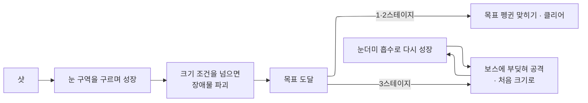
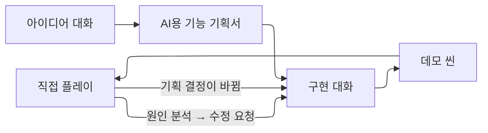
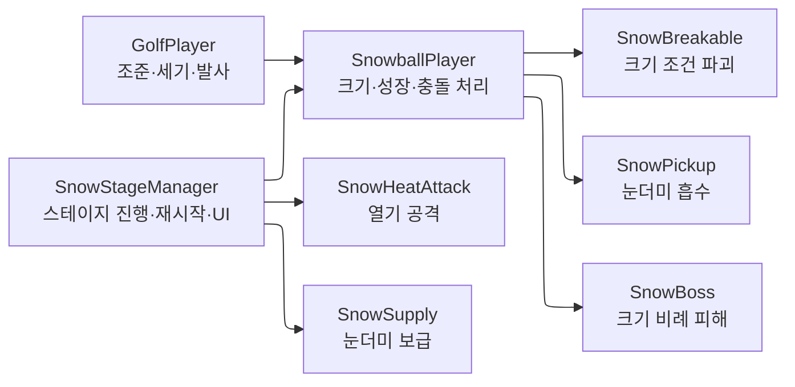
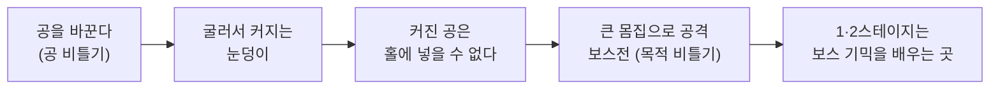

# 눈덩이 골프 프로젝트 문서

> **미니골프 레벨 디자인 과제를 AI와 함께 1~2일 만에 플레이 가능한 프로토타입으로 만든 과정**

> 📷 **이미지 자리** `images/cover.png` — 대표 화면 1장(3스테이지 케이지에서 커진 눈덩이, 펭귄 보스, 바닥의 열기 공격 원이 함께 보이는 장면). 포트폴리오 페이지와 슬라이드 표지에 크게 나옵니다.

| 항목      | 내용                                                                                                         |
| --------- | ------------------------------------------------------------------------------------------------------------ |
| 장르      | 3D 미니골프 · 굴리면 커지는 성장 + 보스전                                                                    |
| 개발 기간 | 1~2일 (커밋 기준 2026.10.05 ~ 2026.10.08, 과제 마감 10/8)                                                    |
| 인원      | 개인 프로젝트 (레벨 디자인 과제)                                                                             |
| 담당      | 기획, 레벨 디자인, 플레이 검증, AI 작업 지시 (코드는 AI로 작성)                                              |
| 개발 환경 | Unity 6000.3.15f1 · C# · URP                                                                                 |
| 사용한 AI | ChatGPT (아이디어·기능 기획서) · Codex (구현)                                                                |
| 링크      | [프로젝트 저장소](https://github.com/KooHoo-Dev/3rd-minigolf_level_design-Lets-Gitit) · 시연 영상(추가 예정) |

## 목차

1. [개요](#1-개요)
2. [작업 구조 · 사람과 AI의 역할](#2-작업-구조--사람과-ai의-역할)
3. [핵심 방법 · AI에게 일을 시킨 방법](#3-핵심-방법--ai에게-일을-시킨-방법)
4. [고민과 선택](#4-고민과-선택)
5. [결과 및 회고](#5-결과-및-회고)

---

## 1. 개요

### 1.1 프로젝트 소개

**눈덩이를 굴려 펭귄 보스를 쓰러뜨리는 미니골프**

미니골프 레벨 디자인 과제로 3스테이지짜리 《눈덩이 골프》 프로토타입을 만들었습니다. 공 대신 눈덩이를 굴립니다. 눈덩이는 눈 위를 구를수록 커지고, 충분히 커지면 앞을 막는 장애물을 부술 수 있습니다. 1·2스테이지에서 이 규칙을 익히고, 3스테이지에서는 커진 눈덩이로 거대한 펭귄을 공격합니다.

**《AI는 개발자, 나는 기획자》**

코드는 AI가 작성하고, 저는 **방향 설정·의사 결정·플레이 검증**을 맡았습니다. 이번 작업의 목적은 **아이디어를 빠르게 플레이 가능한 형태로 만들어 검증하는 것**이었고, **AI의 가장 큰 장점은 개발 속도**였기 때문입니다. 그래서 이 문서는 코드 분석보다 **AI와 어떻게 소통하며 만들었는지**, 그 덕분에 **프로토타입을 얼마나 빨리 만들 수 있었는지**를 실제 대화를 바탕으로 다룹니다.

**《발상은 플레이해 보기 전까지 가설이다》**

기획 단계의 아이디어는 머릿속에서는 재미있어 보입니다. 하지만 직접 플레이해 보기 전에는 다음 세 가지를 알 수 없습니다.

1. 이 발상이 **실제로 재미있는가**
2. 플레이에서 **어디가 아쉽고, 어떻게 보완하면 더 재미있어지는가**
3. 기획에서 **어떤 부분을 더 구체적으로 정해 둬야 하는가**

빠른 프로토타입은 이 질문에 답할 결과물을 가장 짧은 시간에 만드는 방법입니다. 팀 작업이라면 그 결과물은 각자 머릿속에 그리던 서로 다른 게임을 **하나의 게임**으로 맞춰 주는 역할도 합니다.

이 문서는 **사람과 AI의 역할을 나눈 작업 구조, AI에게 일을 시킨 여섯 가지 방법, 플레이하며 기획이 바뀌어 간 과정**을 차례로 다룹니다.

### 1.2 핵심 플레이 루프



_핵심 규칙은 "굴리면 커지고, 커지면 부순다" 하나입니다. 세 스테이지 모두 이 규칙 위에서 조건만 바뀝니다._

| 스테이지                | 배우는 것                                              | 진행                                                                                                                          |
| ----------------------- | ------------------------------------------------------ | ----------------------------------------------------------------------------------------------------------------------------- |
| 1. 굴리면 커진다        | 골프 조작, 구르기 성장, 작은 장애물 파괴               | 처음에는 돌아가야 하던 장애물을 커진 뒤에는 부수고 지나간다. 목표 펭귄을 맞히면 클리어                                        |
| 2. 눈더미는 크게 키운다 | 눈더미로 한 번에 성장, 큰 장애물 파괴에 따른 크기 소모 | 구르기만으로는 부술 수 없는 장애물이 막고 있다. 주변 눈더미를 먹고 부순 뒤, 줄어든 크기를 다음 눈더미로 다시 채운다           |
| 3. 펭귄 보스전          | 키운 크기를 공격에 소비, 열기 회피, 눈더미 재보급      | 크기에 비례해 보스 체력이 깎이고, 공격하면 처음 크기로 돌아간다. 바닥의 열기 공격을 피해 떨어지는 눈더미를 먹고 다시 공격한다 |

**조작법**: `Space`를 누르고 있으면 공 앞의 주황색 선이 길어졌다 줄어들며 세기가 바뀌고, 떼면 카메라가 보는 방향으로 발사합니다. 마우스 오른쪽 드래그로 시점을 돌리고 휠로 확대·축소합니다.

> 📷 **이미지 자리** `images/loop_overview.gif` — 1스테이지에서 눈 구역을 굴러 커진 뒤 장애물(노란색으로 바뀐 통나무)을 부수고 목표 펭귄을 맞히는 장면까지(짧게 편집)

---

## 2. 작업 구조 · 사람과 AI의 역할

### 2.1 전체 흐름



_아이디어를 정하는 대화와 구현하는 대화를 나눴습니다. 둘 사이를 잇는 것은 기능 기획서 한 장입니다. 데모가 나온 뒤에는 "플레이 → 요청 → 수정" 루프를 계속 돌렸습니다._

### 2.2 역할 분담

| 나                                              | AI                                   |
| ----------------------------------------------- | ------------------------------------ |
| 기획 의도와 판단 기준을 정한다                  | 아이디어 후보를 낸다                 |
| 범위를 자른다 (무엇을 만들고, 무엇을 안 만들지) | 기능 기획서를 정리한다               |
| 코스 배치와 수치를 정한다                       | 기능을 구현하고 데모 씬을 구성한다   |
| 직접 플레이하며 검증한다                        | 원인을 분석하고 해결 방법을 제안한다 |

이 경계는 기획서에도 그대로 적었습니다. 기획서의 첫 절에 **AI의 작업**과 **사용자의 작업**을 나눠 두고, "AI는 코스 배치를 확정하거나 별도의 퍼즐·스킬·성장 시스템을 추가하지 않는다"고 못박았습니다. 레벨 디자인 과제에서 배치는 제가 답해야 하는 질문이기 때문입니다.

### 2.3 고민과 선택 ① 기획과 구현을 한 대화에서 할 것인가

|      | 한 대화에서 기획부터 구현까지                                             | **기획 대화와 구현 대화를 나눔** ✅           |
| ---- | ------------------------------------------------------------------------- | --------------------------------------------- |
| 장점 | 앞에서 나눈 이야기를 AI가 바로 이어받는다                                 | 구현 AI는 확정된 내용(기획서)만 보고 시작한다 |
| 단점 | 버린 아이디어(잠입, 눈사람, 모닥불 등)까지 대화에 남아 구현 판단을 흐린다 | 기획서에 빠진 내용은 구현 AI가 알 수 없다     |

아이디어 대화는 여러 번 방향을 뒤집으며 길어졌습니다. 이 대화를 그대로 이어서 구현을 시키면, AI가 이미 버린 제안을 근거로 판단할 위험이 있습니다. 대화가 길어질수록 앞 내용이 흐려지기도 합니다. 그래서 확정된 것만 기획서 한 장으로 정리하고, **구현은 새 대화에서 기획서만 보고 시작**하게 했습니다. 대신 "기획서에 빠진 것은 AI가 알 수 없다"는 단점을 막기 위해 기획서를 기능 목록 수준까지 빠짐없이 쓰게 했습니다([§3.3](#33-ai가-읽을-기획서-쓰기)).

### 2.4 AI가 만든 게임 쪽 구조



_기존 미니골프 과제의 샷 처리(`GolfPlayer`·`GolfBall`)는 그대로 쓰고, 눈덩이 규칙은 새 컴포넌트로 얹었습니다. 구현 직후 AI에게 각 클래스가 어떻게 동작하는지 설명하게 하고, "기존 코드를 그대로 반영한 건지, 새로 짠 건지"를 확인했습니다._

> 📷 **이미지 자리** `images/prompt_explain_classes.png` — 구현 대화에서 "각 클래스의 기능 구현을 어떤 방식으로 했는지 설명해줘." / "기존 코드를 그대로 반영한 거 맞아?"를 묻고 답을 받은 부분

---

## 3. 핵심 방법 · AI에게 일을 시킨 방법

> 이 장에서는 실제로 보낸 요청(프롬프트)을 보여 주고, 왜 그렇게 요청했는지를 설명합니다.

### 3.1 AI의 후보 목록에서 내 컨셉으로 옮겨 내기

처음 AI가 낸 안은 "폐장한 놀이공원 정비 코스"였습니다. 장애물의 겉모습만 바꾸는 데 그치는 안이라, 하나를 자세히 짜지 말고 여러 방향을 넓게 던져 달라고 했습니다.

**① 내 요청**

> 다른 장르에서 주요 기믹으로 쓰이는 걸 찾아보고 결합 아이디어를 제안해줘.\
> 단순하되, 변형 가능성이 많은 아이디어여야 해. 하나를 자세하게 구상하지 말고, 여러 가지 아이디어를 툭툭 던져봐

**② AI의 답변**

> 📷 **이미지 자리** `images/ai_idea_list.png` — AI가 낸 후보 열 가지 답변 전체 화면.

_AI가 낸 열 가지 후보. AI의 추천은 잔상·소코반·턴제 전술이었습니다._

**③ 내 답장**

> 좋아 카타마리 + 보스전으로 가자.
>
> 1스테이지는 초반에 좁은 길 배치야. 좁은 길은 최대한 적은 수로 굴려나가야 눈덩이가 불어나는 걸 방지해서 좁은 길을 통과할 수 있어. 지체돼서 눈덩이가 커지면 좁은 길을 지나가기 어려워질 거야.
>
> 2스테이지는 눈덩이를 키워야 해. 눈더미가 맵 중간에 쌓여 있어서, 거길 지나가면 한 번에 크게 눈덩이를 키울 수 있어. 그렇게 되면 장애물을 부수고 지나갈 수 있게 되면서 장애물을 피해 갈 때보다 더 적은 수의 튕김으로 지나갈 수 있게 되는 거야.
>
> 3스테이지는 보스전이야. 몸집을 키워서 보스에게 부딪히면 크기에 비례해서 체력이 깎이게 하는 거지. 보스는 공격을 해. 열기를 내뿜는데, 맞으면 눈덩이가 줄어들고, 최소 크기에서 맞으면 스테이지가 재시작 돼.
>
> 그리고 일정 시간마다 하늘에서 눈덩이가 떨어지는데, 보스의 공격을 피해서 이 눈덩이에 닿고, 커진 몸집으로 공격해야 하는 거지.

**④ 목록에서 무엇을 봤나**

**기준 — 코스 짜기를 넘는 새로운 경험**\
과제는 장애물을 배치해 코스를 짜는 것이었지만, 여기에 플레이어가 처음 해 보는 경험을 더하고 싶었습니다. ①에서 "다른 장르에서 주요 기믹으로 쓰이는 걸" 요청한 이유입니다.

**비틀기 ① — 공을 바꾼다**\
참신함을 줄 때 가장 선호하는 방법은 장르에서 당연한 요소를 바꾸는 것입니다. 익숙한 것이 바뀌면, 적은 변경으로도 "기존과 확실히 다르다"는 체감이 큽니다.

골프에서 가장 당연한 요소는 공입니다. 그래서 공 자체가 바뀌는 카타마리식 성장을 골랐고, 굴러가며 커지는 공에서 눈덩이를 떠올렸습니다. 골프공이 커지는 것은 어색하지만, 눈덩이가 커지는 것은 누구나 납득합니다.

**비틀기 ② — 목적을 바꾼다**\
다음 변경점은 ①에서 자연스럽게 나왔습니다. 눈덩이가 커진다면 작은 홀에 넣는다는 목적은 성립하지 않습니다. 공이 커졌는데 작은 구멍에 넣어야 한다면 규칙끼리 서로 부딪칩니다. 그렇다면 필요한 것은 **큰 상태여야만 해낼 수 있는 목적**이었고, 그 답이 "거대한 상대를 큰 몸집으로 들이받는 것", 곧 보스전이었습니다.

골프 게임의 일반적인 목적은 "조준해서 치고, 홀에 넣는 것"입니다. 장르를 대표하는 이 목적 자체가 바뀌면, 플레이어는 공이 바뀐 것처럼 "참신한 게임"이라고 느낄 것이라고 생각했습니다.

**유지 — 그래도 골프 게임으로 남게 하기**\
다만 비트는 만큼 지킬 것도 정했습니다. 바꾸는 요소가 늘어날수록 골프다움은 사라지고, 결국 눈덩이로 하는 액션 게임이 됩니다. 그래서 공과 목적은 바꾸되, **플레이어가 골프를 하고 있다고 느끼게 하는 요소**는 그대로 남겼습니다.

- **조준하고 세기를 정해 치는 샷.** 조작은 기존 골프 게임 그대로 두어, 새로 익힐 규칙을 최소한으로 줄였습니다. 보스전에서도 플레이어가 하는 일은 "어디로, 얼마나 세게 칠지" 고르는 것입니다. 빠른 반응보다 신중한 판단이 중요하다는 골프의 성격이 여기서 유지됩니다.
- **타수로 매기는 결과.** 보스를 쓰러뜨려도 마지막 화면에는 라운드별 타수와 총 타수가 나옵니다. "몇 번 만에 해냈는가"라는 골프의 평가 방식을 그대로 둔 것입니다.

**⑤ 어떻게 옮겨 냈나**

| AI가 낸 후보                                            | 처음 옮겨 낸 것 (③ 답장)                                                                           |
| ------------------------------------------------------- | -------------------------------------------------------------------------------------------------- |
| 카타마리: 좁은 길을 먼저 지날지, 관성으로 부술지 고른다 | 한 번의 선택을 **스테이지 흐름으로** 나눴다. 1스테이지는 좁은 길, 2스테이지는 눈더미로 키워 부수기 |
| 카타마리와 탄막 보스전은 서로 별개였다                  | **"크기" 하나로 결합.** 지나갈 길, 부술 장애물, 보스에게 주는 피해를 모두 눈덩이의 크기가 정한다   |



왼쪽에서 오른쪽으로, 앞의 결정이 다음 결정의 이유가 됩니다.

**⑥ 처음 생각을 다듬기**

방향이 정해진 뒤에는, 세 스테이지를 보스전에서 쓸 기믹을 하나씩 배우는 곳으로 짜면 된다고 생각했습니다. 다만 ③의 첫 답장에서 1스테이지는 "작게 유지해 좁은 길을 통과하기"로, 보스전에서는 쓰지 않는 기믹이었습니다. 대화를 이어 가며 이 어긋남을 짚었습니다.

> 2, 3 스테이지는 연계가 잘 되는데, 1스테이지는 정반대 성격이라 느낌이 다른 거 같아.

그리고 세 스테이지를 "키우기" 하나로 통일했습니다. 그 결과 1스테이지는 구르며 커지기, 2스테이지는 눈더미로 크게 키우고 소모하기, 3스테이지는 키운 크기로 보스를 공격하기로, 모두 보스전으로 이어지게 됐습니다.

### 3.2 살릴 것과 버릴 것을 나눠 말하며 보스 정하기

보스전을 넣더라도 골프 게임의 분위기는 지키고 싶었습니다. 골프는 치열한 스포츠라기보다 신중하고 차분한 경기라, 격렬한 액션형 보스전보다 편안한 분위기가 어울린다고 봤습니다. 이 감성까지 사라지면 골프 게임이 아니라 그냥 액션 게임이 됩니다. 보스의 정체가 곧 그 분위기를 좌우하기 때문에, 정체를 정하는 데 오래 공을 들였습니다.

첫 요청에서는 보스가 1·2스테이지와 어떻게 이어지는지와, 어떤 성질이어야 하는지를 함께 적었습니다.

> 1, 2스테이지에서 홀에 골인하는 게 이 보스의 작은 버전을 때리거나 부수면서 괴롭히는 식으로 만드는 거야.
> 그런 보스가 3스테이지에서 몸집이 거대해져 강해져서 돌아와서 플레이어를 위협하는 거지.
>
> 눈덩이와 대적하는 위치에 있는 무언가였으면 좋겠어. 너무 추상적인 존재는 말고, 열기와 관련되거나, 아니면 눈사람이거나 뭐 이런 식으로.

그 뒤로 여섯 번을 주고받았습니다. AI의 제안이 마음에 들지 않을 때 통째로 거절하지 않고, **살릴 것과 버릴 것을 나눠** 말했습니다.

| 회차 | AI의 제안                 | 내 답 (살린 것 ✓ / 버린 것 ✗)                                                                                            | 쌓인 기준                                                       |
| ---- | ------------------------- | ------------------------------------------------------------------------------------------------------------------------ | --------------------------------------------------------------- |
| 1    | 숯심장 눈사람             | ✗ 눈사람은 눈덩이와 속성이 비슷하다. 대립 구도가 드러나면 좋겠다.<br>✓ 안에 심장 같은 다른 존재가 숨어 있다는 건 재밌다. | 눈과 다른 재료일 것                                             |
| 2    | 숯불 소라게               | ✗ 심장 설정은 뺀다.<br>✗ 눈덩이로 공격하는 이유가 납득되어야 한다.                                                       | 눈덩이로 공격하는 게 납득될 것                                  |
| 3    | 불씨 도깨비의 화로        | ✗ 도깨비·소라게는 너무 허무맹랑하다. 실제로 있는 것이어야 한다.                                                          | 실제로 있는 것, 단순하고 유쾌하게                               |
| 4    | 모닥불                    | ✓ 방향은 맞다.<br>✗ 불은 보통 물로 끈다. 눈으로 제압할 이유가 약하다.                                                    | 눈덩이 마을의 눈덩이가 제압할 만한 것                           |
| 5    | 눈싸움하는 털모자 아저씨  | ✓ 나쁘지 않다.<br>✗ 사람이 골탕 먹는 부정적인 느낌이다.                                                                  | 명확한 선악 구분이 없는 자연물, 일상을 웅장하게 그려내 코믹하게 |
| 6    | **눈을 이고 있는 소나무** | ✓ 결정.                                                                                                                  | 결정                                                            |

> 📷 **이미지 자리** `images/prompt_boss_narrowing.png` — 4회차 답장과, 그 기준을 이어받은 AI의 다음 제안(눈싸움)이 함께 보이는 부분

마지막에 받은 소나무는 처음에 바란 분위기와 맞았습니다. 눈을 이고 있는 나무에서 눈이 툭 떨어지는 것은 겨울 숲에서 매일 일어나는 아무것도 아닌 일입니다. 그 일을 보스전의 형식으로 웅장하게 그리면, 보스전이 들어가도 차분하고 유쾌한 분위기가 남습니다.

결정한 뒤에는 바로 구상을 덧붙였습니다.

> 나누면 부딪혔을 때 동료 눈덩이 구하는 식으로 1, 2 스테이지 하면 되고 보스는 나무 몬스터 하나를 구해서 흑화했다고 하면 되겠네.

AI의 소나무 안은 "나무를 들이받아 눈을 털어내면 골인"이었습니다. 거기에 1·2스테이지는 나무에 붙은 **동료를 구한다**는 이유를, 3스테이지는 계속 들이받힌 나무가 **흑화해 보스가 된다**는 이유를 붙여 세 스테이지를 하나의 이야기로 엮었습니다.

**왜 이렇게 요청했나**

- **살릴 것과 버릴 것을 나눠 말했습니다.** 통째로 거절하면 AI는 좋았던 부분까지 버리고 처음부터 다시 고릅니다. 좋았던 점과 걸리는 점을 함께 말하면, 다음 제안은 좋았던 방향을 유지한 채 걸린 점만 피해 옵니다. 4회차 모닥불에서 "방향은 맞다"고 한 뒤로는 실제로 있는 단순한 대상이 이어졌고, 5회차의 부정적인 느낌을 짚자 선악이 없는 자연물인 소나무가 나왔습니다.
- **거절의 이유가 다음 제안의 기준으로 쌓였습니다.** "별로야"라고만 하면 AI는 비슷한 방향에서 다시 고를 수밖에 없습니다. 이유를 말하면 그 이유가 다음 제안의 조건이 됩니다. 표의 오른쪽 칸처럼 기준이 하나씩 쌓일 때마다 후보가 눈에 띄게 좁혀졌습니다.
- **발산과 수렴을 따로 시켰습니다.** 아이디어를 고를 때는 "자세하게 구상하지 말고 툭툭 던져 봐"라고 해서 넓게 펼치게 했고([§3.1](#31-ai의-후보-목록에서-내-컨셉으로-옮겨-내기)), 방향이 정해진 뒤에는 기준을 줘서 좁혔습니다.

**결국 보스는 펭귄이 됐다**

구현 중에 모델을 찾다가 펭귄 에셋을 발견했습니다. 소나무는 '눈'과 한 번에 이어지는 이미지가 약했고, 눈덩이와 펭귄의 유치한 다툼이 더 재밌어 보였습니다. 에셋만 문제였다면 생성형 AI로 나무 모델을 만드는 방법도 있었지만, 펭귄이 더 맞는 방향이라고 판단해 목표와 보스를 모두 펭귄으로 바꿨습니다([§5.2](#52-프로토타입이-바꾼-기획)). 동료 구출과 흑화 설정은 이때 빠졌습니다.

그래도 이 대화에서 쌓은 기준은 그대로 남았습니다. 치열하지 않고 유쾌한 분위기, 선악이 없는 상대, 들이받으면 골인이라는 판정입니다. 여섯 번의 대화는 정답을 고르는 과정이라기보다 **기준을 만드는 과정**이었고, 그 기준이 있었기에 펭귄을 보자마자 더 맞는 방향이라고 판단할 수 있었습니다.

### 3.3 AI가 읽을 기획서 쓰기

아이디어를 굳힌 뒤, 구현 AI에게 넘길 기획서를 요청했습니다.

> AI에게 작업을 시킬 때 혼동하지 않도록 필요한 기능 목록을 상세하게 정의해야 해. 부족한 부분이 있다면 나한테 질문해서 채워야 해.
>
> 레벨 요소 배치 같은 디테일한 것들은 내가 직접 할 거니까, 기능 목록에 집중해서 작성해줘.

이렇게 받은 기획서는 기능 13개(F01~F13), 씬에서 조정할 값, 완료 확인 항목 12개로 이루어져 있습니다. 아래는 장애물 파괴 기능 하나를 그대로 옮긴 것입니다.

```markdown
**F04. 크기 조건에 따른 장애물 파괴**

- 각 장애물에 `파괴 가능 여부`, `요구 크기`, `파괴 시 크기 소모량`을 설정한다.
- 움직이는 플레이어가 충돌할 때 현재 크기가 요구값 이상이면 장애물이 파괴되고,
  플레이어 크기가 소모량만큼 줄어든다. 최소 크기 아래로는 줄지 않는다.
- 크기가 부족하면 일반 골프 장애물처럼 충돌·반발한다.
- 한 장애물은 한 번만 파괴되며, 같은 충돌의 반복 이벤트로 크기가 여러 번 소모되지 않는다.
```

그리고 기획서 끝에는 "다 됐는지"를 판단할 항목을 두었습니다.

```markdown
## 6. 완료 확인 항목

4. 작은 공은 장애물에 막히고, 충분히 큰 공은 장애물을 부순다.
   큰 장애물 파괴 시 크기 소모는 한 번만 발생한다.
5. 일반 성장 상한으로는 큰 장애물을 부술 수 없고,
   눈더미로 상한을 넘어 커지면 부술 수 있다.
```

> 📷 **이미지 자리** `images/spec_doc.png` — 기능 기획서의 §1 "AI의 작업 / 사용자의 작업"과 F 항목 목록이 함께 보이는 화면

**왜 이렇게 요청했나**

- **읽는 사람을 AI로 정했습니다.** 구현 AI는 아이디어 대화를 보지 못합니다. 그래서 "맥락을 전혀 모르는 동료가 이 문서만 보고 따라 할 수 있는가"를 기준으로, 사람이 읽는 기획서보다 훨씬 구체적으로(어떤 값을 설정할 수 있어야 하는지, 같은 충돌이 반복되면 어떻게 하는지) 쓰게 했습니다.
- **끝난 상태를 먼저 정했습니다.** 완료 확인 항목이 없으면 AI가 "어디까지 하면 끝인지" 판단할 수 없습니다. 끝의 모습을 먼저 적어 두면 AI가 혼자서 끝까지 갈 수 있고, 결과도 그 목록으로 확인할 수 있습니다.
- **배치는 제 몫으로 남겼습니다.** 기능과 배치를 나눠서, AI가 만든 기능 위에 제가 코스를 직접 짜도록 했습니다. 이 과제에서 평가받는 것은 레벨 디자인이기 때문입니다.

### 3.4 구현 지시에 품질 기준과 범위를 함께 주기

새 세션에서 구현을 시키면서, **어느 수준의 코드를 원하는지**를 함께 적었습니다.

> 눈덩이 골프 기능 기획서를 따라서 기능을 구현해줘.
>
> 불필요한 확장을 고려한 코드나, 당장 치명적인 문제를 일으키지 않는 문제에 대한 과도한 방어 코드는 최대한 배제하고 오로지 기능 구현에 집중해서 코드 작성해줘.

데모 씬을 만들게 할 때는 에셋 범위도 정했습니다.

> 기획서의 의도에 맞게 임시로 기능과 오브젝트를 배치한 데모 씬을 하나 만들어줘.
> 에셋은 간단한 유니티 내부 오브젝트나 프로젝트 폴더에 들어가 있는 에셋들을 사용해주면 돼.

> 📷 **이미지 자리** `images/prompt_implement.png` — 구현 대화의 첫 구현 요청과, AI가 "Edited 33 files"로 답한 부분

**왜 이렇게 요청했나**

- **프로토타입의 목적은 검증입니다.** 이 코드는 "재미있는가"를 확인하고 나면 버리거나 다시 짤 수 있는 코드입니다. 확장성이나 방어 코드에 시간을 쓰면 첫 데모가 늦어지고, 코드가 길어져 읽고 확인하기도 어려워집니다. 그래서 품질 기준을 "기능이 돌아가는 가장 단순한 코드"로 먼저 정해 줬습니다.
- **AI가 볼 자료를 골라 줬습니다.** 관련 없는 파일이 많을수록 AI가 엉뚱한 파일을 근거로 판단할 수 있어서, 구현 전에 미니골프와 관련 없는 에셋 파일을 지웠습니다.

### 3.5 진단과 수정을 나누기

데모를 플레이하며 문제를 발견하면, 바로 고치라고 하지 않고 **원인부터** 물었습니다. 이때 증상만 던지지 않고, 원인을 좁힐 단서(가설·시점·지켜야 할 원칙)를 함께 줬습니다. 원인을 보고 납득한 뒤에야 수정을 시켰습니다.

| 플레이에서 본 증상                                    | 함께 준 단서                                             | AI가 찾은 원인                                                                            |
| ----------------------------------------------------- | -------------------------------------------------------- | ----------------------------------------------------------------------------------------- |
| 한 번 치면 공이 멈추지 않아 다음 샷을 칠 수 없음      | 직접 플레이해 본 결과                                    | 공의 감속값이 0이라 정지 판정 속도까지 떨어지지 않음                                      |
| 눈더미를 먹고 부딪혀도 장애물이 반응 없음             | **가설**: 크기가 부족했을 가능성까지 볼 것               | 크기는 기준을 넘음(4.2 > 3.2). 충돌 순간 재검사가 빠진 것이 더 유력                       |
| 2스테이지에서 눈더미를 한 번 먹은 뒤로 더 커지지 않음 | **시점과 장소**: 첫 눈더미 이후, 2스테이지               | 구르며 커지는 크기 상한(3)이 매 프레임 크기를 덮어써, 눈더미로 커진 크기가 되돌아감       |
| 어떤 때는 과하게 미끄러지고, 어떤 때는 뚝 멈춤        | **원칙**: 공의 움직임은 날리는 힘과 마찰로만 정해져야 함 | 성장 구간에 들어가면 감속값이 바뀌고(1.4 → 0.2), 느려지면 코드가 속도를 강제로 0으로 만듦 |

> 📷 **이미지 자리** `images/prompt_diagnose.png` — 진단 요청에 AI가 원인과 줄 번호를 설명하고 "이번에는 원인만 분석했고 파일은 수정하지 않았어"라고 답한 부분

**왜 이렇게 요청했나**

- **틀린 진단 위에 수정이 쌓이는 것을 막으려고.** "고쳐 줘"라고만 하면 AI는 그럴듯한 원인 하나를 골라 바로 코드를 바꿉니다. 그 진단이 틀리면 엉뚱한 수정이 남고, 다음 문제의 원인이 됩니다. 원인을 먼저 보면 단계마다 확인하고 다음으로 넘어갈 수 있습니다.
- **단서를 같이 넘겼습니다.** 증상만 주면 AI는 코드에서 그럴듯한 원인 하나를 골라 거기서 멈춥니다. 다른 가설을 함께 주면 AI가 확인하는 범위가 넓어지고, 지켜야 할 원칙을 주면 그 원칙에 어긋나는 코드가 곧 원인 후보가 됩니다.

### 3.6 검증은 직접 플레이로, 기준은 말로 못박기

코드의 오류는 AI가 확인하지만, **재미있는지, 의도대로 움직이는지**는 제가 직접 플레이해야만 알 수 있었습니다.

**범위를 벗어나면 바로 멈추게 했습니다.** 성장하지 않는 일반 땅을 요청했는데 AI가 미끄러지는 얼음 땅을 함께 만들었습니다.

> 미끄러지는 얼음 땅은 기획 범위 밖이야. 별도 지시가 없다면 구현 범위는 기획서 안으로 한정해줘.

**지켜야 할 설계 원칙은 다시 한 번 명시했습니다.** 공이 어떤 때는 미끄러지고 어떤 때는 뚝 멈추는 문제가 반복되자, 바닥 탓이 아니라고 짚고 원칙을 적었습니다.

> 공의 움직임은, 오로지 날리는 힘의 세기와 마찰에 의해서만 결정돼야 해. 상황에 따라 매번 달라질 요소가 없어.

이 한 줄로 AI는 성장 구역에서만 감쇠를 바꾸던 코드와 착지 시 강제로 멈추던 코드를 찾아 지웠습니다. 이전 수정에서 AI가 스스로 넣었던 코드입니다.

**직접 튜닝할 수 있는 손잡이를 요구했습니다.** 수치는 결국 플레이하면서 직접 맞춰야 하므로, AI에게 값을 정해 달라고 하기보다 인스펙터에서 바로 바꿀 수 있게 만들어 달라고 했습니다.

> 이 수치들은 내가 직접 테스트하면서 수정할 수 있게 다 직렬화 필드로 설정해줘

> scale 1짜리로 만들어서 단순 네모 콜라이더 붙여서 프리팹화 해줘. 내가 스케일 늘려서 다양한 크기로 직접 배치할 수 있게.

> 바로 3스테이지 해볼 수 있게 디버그 키 만들어줘.

그 결과 장애물 하나에서 파괴 조건을 모두 인스펙터로 조절할 수 있게 됐습니다.

```csharp
// SnowBreakable.cs — 장애물 파괴 판정 (발췌)
public float requiredSize = 0.75f;
public float minimumImpactSpeed = 3f;
public float sizeCost;
public bool preserveSpeedOnBreak;

public void TryBreak(SnowballPlayer player, Vector3 velocityBeforeCollision)
{
    Vector3 impactVelocity = Vector3.ProjectOnPlane(velocityBeforeCollision, Vector3.up);
    if (player.Size < requiredSize || impactVelocity.magnitude < minimumImpactSpeed) return;

    player.ChangeSize(-sizeCost);
    if (preserveSpeedOnBreak)
        player.Body.linearVelocity = impactVelocity;
    // … (중복 파괴 방지·파괴 연출 생략)
}
```

| 값                          | 플레이하며 정한 이유                                                                                |
| --------------------------- | --------------------------------------------------------------------------------------------------- |
| `requiredSize` · `sizeCost` | 장애물마다 "얼마나 키워야 부술 수 있고, 부수면 공 크기가 얼마나 줄어드는지"가 곧 그 구간의 난이도다 |
| `minimumImpactSpeed`        | 천천히 미끄러지듯 닿기만 해도 부서지는 것이 어색해서 추가했다                                       |
| `preserveSpeedOnBreak`      | 부숴도 멈추지 않고 그대로 뚫고 가는 약한 장애물을 따로 두기 위해 추가했다                           |

> 📷 **이미지 자리** `images/breakable_inspector.png` — 통나무 장애물 프리팹의 인스펙터에서 `SnowBreakable` 값(Can Break · Preserve Speed On Break · Required Size · Minimum Impact Speed · Size Cost)이 보이는 화면

---

## 4. 고민과 선택

프로토타입에서는 "가장 좋은 방법"보다 **검증에 필요한 만큼을 가장 빨리 만드는 방법**을 골랐습니다. 큰 작업은 시키기 전에 "얼마나 걸리는지"부터 확인했습니다.

### 4.1 고민과 선택 ② AI가 짠 코드를 어디까지 들여다볼 것인가

|      | 코드를 검토하고 직접 다듬기                                      | **동작만 확인하고 코드는 AI에게 맡기기** ✅                                           |
| ---- | ---------------------------------------------------------------- | ------------------------------------------------------------------------------------- |
| 장점 | 구조가 깔끔해지고, 나중에 생길 문제를 미리 막을 수 있다          | 플레이에 쓸 시간이 그대로 남는다. 판단 기준이 "의도대로 움직이는가" 하나로 단순해진다 |
| 단점 | 수정할 때마다 검토 시간이 들어, AI로 빨리 만드는 의미가 줄어든다 | 구조에서 생긴 문제는 늦게 드러나고, 원인도 AI의 설명에 기대야 한다                    |

이 프로토타입의 목적은 발상이 재미있는지 확인하는 것이었습니다. 그래서 코드의 구조나 품질에는 개입하지 않고, 결과물이 의도대로 움직이는지만 플레이로 판단했습니다.

대가도 있었습니다. 지운 장애물의 참조가 남아 펭귄이 깨진 문제([§5.3](#53-트러블슈팅))는 코드를 들여다봤다면 미리 알았을 구조 문제였습니다. 이때도 "구조가 어떻게 되어 있는지 설명해 줘"라고 물어 원인을 찾았습니다. 코드를 제가 직접 읽지 않고, **AI가 구조를 설명하게 하는 것**으로 이해를 대신했습니다.

### 4.2 고민과 선택 ③ 장애물이 부서지는 연출

처음에는 장애물이 부서질 때 충돌체와 모델을 끄기만 해서, 부서진다기보다 그냥 사라졌습니다. 통나무 모델을 장애물로 쓰면서, 공에 맞으면 가운데를 기준으로 두 갈래로 쪼개져 날아가고 서서히 사라지게 만들고 싶었습니다. 다만 앞으로 늘어날 장애물에도 같은 연출을 쓰고 싶어서, 만들기 전에 비용부터 확인했습니다.

AI의 답은 장애물마다 반쪽 모델을 따로 준비하거나, 실행 중에 메시를 자르는 방식이었습니다. 앞의 것은 장애물이 늘 때마다 모델을 새로 만들어야 했고, 뒤의 것은 품질에 따라 시간이 오래 걸린다고 했습니다. 어느 쪽도 프로토타입 단계에서 원하는 방식은 아니었습니다. 그래서 목표를 "쪼개진다"에서 "부서진다고 느낀다"로 바꿔 다시 물었습니다.

> 원본 에셋을 수정하는 방식은 부서져야 할 모든 메시를 다 수정해야 하니까 비효율적인 것 같아.
> 원본 에셋을 수정하지 않는 선에서 모든 메시에 범용적으로 적용할 수 있는 방법을 제안해줘.

|                | 메시를 반으로 쪼개기                                        | **흔들림 + 축소 + 파편** ✅    |
| -------------- | ----------------------------------------------------------- | ------------------------------ |
| AI가 답한 비용 | 어떤 모양이든 자동으로 자르려면 하루 이상, 품질에 따라 며칠 | 공통 컴포넌트 하나로 바로 가능 |
| 원본 에셋      | 장애물마다 반쪽 모델을 준비하거나 런타임에 메시를 잘라야 함 | 원본 FBX·재질을 고치지 않음    |
| 재사용         | 모양마다 준비 필요                                          | 모든 장애물에 같은 연출        |

AI가 제안한 흔들림·축소·파편 방식으로 정했습니다. 프로토타입에서 필요한 것은 "부서졌다"는 느낌이지, 실제로 잘리는 메시가 아니었습니다.

> 📷 **이미지 자리** `images/break_effect.gif` — 커진 눈덩이가 통나무에 부딪혀 통나무가 흔들리고 작아지며 파편이 튀는 장면

### 4.3 고민과 선택 ④ 부술 수 있는 장애물 알려 주기

|                | 주황색 윤곽선 (URP 셰이더)                              | **부술 수 있을 때 색 바꾸기** ✅ |
| -------------- | ------------------------------------------------------- | -------------------------------- |
| AI가 답한 비용 | 윤곽선 셰이더를 새로 만들어 장애물에 연결, 대략 한 시간 | 이미 있는 색 적용 기능을 고쳐 씀 |
| 전달력         | 장애물 모양을 따라 테두리가 생김                        | 장애물 전체가 노란색으로 바뀜    |

공 크기로 부술 수 있는 장애물을 따로 표시하고 싶었습니다. 처음 떠올린 것은 주황색 윤곽선이었는데, URP에서 물체 모양을 따르는 윤곽선을 그리려면 셰이더를 새로 만들어 장애물에 연결해야 했습니다. AI는 대략 한 시간 안팎이 걸린다고 답했습니다.

완성된 제품이라면 윤곽선이 더 깔끔한 방법일 수 있습니다. 하지만 이것은 규칙이 플레이어에게 전달되는지 확인하는 프로토타입이었습니다. 플레이어에게 필요한 정보는 "**지금 이 장애물을 부술 수 있는가**"이고, 이 정보는 윤곽선이 아니어도 색만으로 전할 수 있습니다. 마침 통나무 장애물에는 약한 것은 노란색, 일반은 갈색으로 색을 입히는 기능이 이미 있었습니다. 그래서 셰이더를 새로 만드는 대신 고정 색을 없애고, 공 크기가 장애물의 요구 크기를 넘는 순간 노란색으로 바뀌도록 기존 기능을 고쳐 썼습니다.

> 📷 **이미지 자리** `images/breakable_highlight.gif` — 눈 구역을 굴러 커지는 동안 앞의 통나무가 갈색에서 노란색으로 바뀌는 순간

---

## 5. 결과 및 회고

### 5.1 결과 — 걸린 시간

| 날짜        | 한 일                                                                   | 소요 시간      |
| ----------- | ----------------------------------------------------------------------- | -------------- |
| 10/5        | 아이디어 대화 → 기능 기획서, 프로젝트 정리                              | 기획 약 1시간  |
| 10/7 ~ 10/8 | 기획서대로 3스테이지 데모 개발 → 플레이하며 수정(커밋 11개) → 최종 버전 | 개발 약 12시간 |

> 📷 **이미지 자리** `images/result_score.png` — 보스를 처치한 뒤 라운드별 타수와 총 타수가 나오는 결과 화면

### 5.2 프로토타입이 바꾼 기획

첫 데모를 플레이하자, 기획서만으로는 알 수 없던 것들이 나왔습니다. 개요에서 말한 세 질문으로 나누면 다음과 같습니다.

**① 실제로 재미있는가 — 템포와 손맛**

| 기획서 (As-Is)               | 플레이 후 (To-Be)                              | 계기                                                                                                  |
| ---------------------------- | ---------------------------------------------- | ----------------------------------------------------------------------------------------------------- |
| 코스 길이·수치는 나중에 조정 | 코스를 늘리고 샷 세기·정지 판정을 여러 번 조정 | "좀 더 템포가 빨랐으면 좋겠어"                                                                        |
| 보스 공격 후 크기만 처음으로 | **보스에 부딪히면 멀리 튕겨 나감**             | "바로 앞에서 그냥 작아지니까 재미가 별로 없어. 뒤로 밀려났다가 다시 다가가는 감각이 재밌을 거 같은데" |
| 목표 나무에 붙은 동료를 구출 | 목표 펭귄이 맞으면 과하게 튀어 날아감          | 펭귄 에셋을 받은 뒤 "공에 맞으면 과하게 팍 튀기며 날아가는 식으로"                                    |

**② 무엇이 부족했나 — 규칙을 읽을 수 있게**

| 기획서 (As-Is)       | 플레이 후 (To-Be)                                      | 계기                                                                      |
| -------------------- | ------------------------------------------------------ | ------------------------------------------------------------------------- |
| 눈 바닥 여부를 구분  | 모든 땅이 눈이던 것을 **성장 구역 / 일반 땅**으로 분리 | "지금은 모든 땅이 다 눈덩이가 커지는 땅이니까 학습이 잘 안 돼."           |
| 크기 조건만으로 파괴 | **최소 충돌 속도** 조건 추가                           | 천천히 미끄러져 닿기만 해도 부서짐                                        |
| (없음)               | **부술 수 있으면 노란색**으로 표시                     | 지금 크기로 부술 수 있는지 알 수 없음                                     |
| (없음)               | 라운드별·총 타수 결과 화면                             | "각 라운드별로 몇 샷 만에 클리어 했는지, 그 아래 총 몇 샷에 클리어했는지" |

**③ 무엇을 더 정해야 했나 — 수치와 위협**

| 기획서 (As-Is)                                    | 플레이 후 (To-Be)                                                                                  | 계기                              |
| ------------------------------------------------- | -------------------------------------------------------------------------------------------------- | --------------------------------- |
| 크기 수치 미정                                    | 크기 관련 수치 전부 절반으로                                                                       | "8.0일 때 눈덩이가 너무 커보여"   |
| 열기에 맞으면 설정량만큼 작아짐, 위치 후보는 지정 | 맞으면 **처음 크기로**, 3곳 동시·넓은 범위·더 짧은 주기·**보스 피격 시 추가 공격**·**무작위 위치** | "조금 더 위협적이어야 할 거 같아" |
| 눈더미 착지 위치는 지정                           | 무작위 위치, 초록색 착지 표시                                                                      | 열기 공격 표시와 구분되지 않음    |

> 📷 **이미지 자리** `images/boss_heat.gif` — 3스테이지 케이지에서 열기 공격 원 3개가 예고 후 켜지고, 초록색 표시 위로 눈더미가 떨어져 흡수한 뒤 보스에 부딪혀 튕겨 나가는 장면

이 표의 대부분은 기획서를 쓸 때는 떠올리지 못한 것들입니다. 직접 플레이할 수 있는 결과물이 있었기 때문에 짧은 시간 안에 찾고, 바로 반영할 수 있었습니다.

### 5.3 트러블슈팅

#### 눈더미를 먹을 때 카메라가 떨림

> 📷 **이미지 자리** `images/camera_shake.gif` - 눈덩이를 먹고 공이 커질 때 카메라가 뚝뚝 끊기며 커지는 모습 gif

**문제** 눈더미를 먹어 커지는 동안 카메라가 부들부들 떨렸습니다.

**AI의 첫 두 진단** 처음에는 Rigidbody와 Transform 위치를 중복으로 설정해서라고 했고, 다음에는 카메라의 위치와 시선이 서로 다른 지점을 따라가서라고 했습니다. 두 번 고쳤지만 떨림은 그대로였습니다.

**원인** 플레이를 다시 보니 공의 크기가 조금씩 늘지 않고, **한 번에 큰 폭으로** 바뀌고 있었습니다. 크기에 맞춰 공의 중심 높이도 그때마다 크게 바뀌니, 이를 따라가는 카메라 위치도 함께 튀면서 떨리는 것처럼 보였습니다.

> 지금은 눈덩이가 부드럽게 값이 증가하는 게 아니라 계단식으로 커지고 있어.
> 계단식으로 커지니까 그 위치에 맞춰서 카메라도 위치가 바뀌었던 거지.

**해결** 이 관찰을 넘기자 AI가 성장 코루틴이 물리 프레임마다 갱신되고, 보간 곡선 때문에 프레임마다 변화량이 달라지는 것을 찾았습니다. 렌더 프레임마다 일정하게 커지도록, 한 프레임의 변화량은 최대 0.1로 바꿨습니다.

```csharp
// SnowballPlayer.cs — 눈더미 흡수 후 0.5초 동안 커지기 (발췌)
private IEnumerator AnimatePickupGrowth()
{
    const float duration = 0.5f;
    const float maxScaleStep = 0.1f;
    float startingSize = size;
    float elapsed = 0f;

    while (true)
    {
        elapsed += Time.deltaTime;
        float progress = Mathf.Clamp01(elapsed / duration);
        float nextSize = Mathf.Lerp(startingSize, pickupGrowthTarget, progress);
        SetSize(Mathf.MoveTowards(size, nextSize, maxScaleStep), true);
        // … (목표 크기에 닿으면 종료)
        yield return null;
    }
}
```

**배운 점** AI는 코드를 읽고 그럴듯한 원인을 찾지만, 화면에서 무엇이 보이는지는 모릅니다. 증상을 "떨린다"가 아니라 "계단식으로 커진다"처럼 **현상을 정확히 파악해서** 전달해야 AI가 맞는 곳을 찾습니다.

#### 통나무 장애물을 고쳤더니 펭귄이 깨짐

**문제** 1스테이지의 기존 장애물을 지우고 통나무 프리팹에 파괴 컴포넌트를 붙였더니, 목표 펭귄이 쓰러진 애니메이션으로 서 있고 맞아도 날아가지 않았습니다.

**AI의 첫 진단** 펭귄 코드와 애니메이터 기본 상태를 원인으로 보고 펭귄 쪽을 고쳤습니다. 이어서 3스테이지의 장애물 구조가 겹친 것을 원인으로 짚었습니다. 둘 다 빗나갔습니다.

**원인 찾기** 비교 대상을 짚어 줬습니다.

> 스테이지 2의 펭귄은 아직 수정 전인데 그쪽이랑 비교해서 확인해줘. 스테이지 2는 잘 작동하거든

그제야 원인이 나왔습니다. 스테이지 매니저는 인스펙터에 등록된 장애물 목록을 먼저 초기화한 다음 펭귄을 연결하는데, 앞서 지운 장애물의 참조가 목록에 남아 `NullReferenceException`이 났습니다. 그 때문에 펭귄 연결과 초기화까지 실행되지 못한 것입니다. Unity 로그에도 같은 예외가 남아 있었습니다.

**해결** 저장된 목록 대신, 스테이지 루트 아래에 실제로 있는 `SnowBreakable`을 찾아 초기화하도록 바꿨습니다. 이어서 장애물 구조도 정리했습니다. 통나무 프리팹 하나가 콜라이더와 파괴 기능을 모두 갖고, 예전 블록과 비주얼 래퍼는 지웠습니다.

> 📷 **이미지 자리** `images/log_prefab_hierarchy.png` — 정리 후 Hierarchy에서 각 스테이지 루트 아래에 통나무 프리팹만 놓인 모습

**배운 점** "잘 되는 쪽과 비교해 보라"는 한 줄이 원인을 찾는 범위를 크게 줄였습니다. AI에게 문제만 던지기보다, **확인 가능한 정상 사례**를 함께 주는 것이 빨랐습니다.

### 5.4 아쉬운 점과 다음 계획

| 아쉬운 점                                                                                                         | 다음에는                                                                                                                   |
| ----------------------------------------------------------------------------------------------------------------- | -------------------------------------------------------------------------------------------------------------------------- |
| AI가 스스로 플레이 검증을 하지 못했다. 거의 모든 답이 "플레이 모드 확인은 아직"으로 끝났고, 검증은 전부 내가 했다 | 로그·테스트 등 현재 상황을 정확히 파악할 수 있게 해서, AI가 간단한 오류 정도는 스스로 확인하게 한다                        |
| 기능을 만들고 고치는 도중에 에셋을 찾고 받고 설정하느라 플레이·수정 흐름이 여러 번 끊겼다.                        | 꼭 필요한 에셋은 구현 전에 미리 찾아 두고, 당장 중요하지 않은 에셋은 임시 에셋으로 대신하여 에셋으로 인한 병목을 방지한다. |

### 5.5 배운 점 — AI를 활용한 빠른 프로토타이핑

플레이하며 찾은 것들 — 템포, 넉백, 성장 구역, 부술 수 있다는 표시, 열기 공격의 위협 — 은 기획서를 아무리 오래 들여다봐도 나오지 않았을 것입니다. 빠른 프로토타입의 가치는 "빨리 만든다"가 아니라 "**빨리 틀려 보고, 빨리 고친다**"에 있다고 생각합니다.

그리고 AI가 구현을 맡을수록, 사람의 몫은 줄어드는 것이 아니라 더 분명해졌습니다. 판단 기준을 말로 전하고, 범위를 자르고, 직접 플레이해서 확인하는 일입니다.
