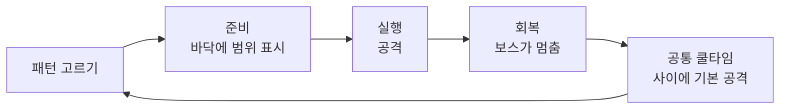
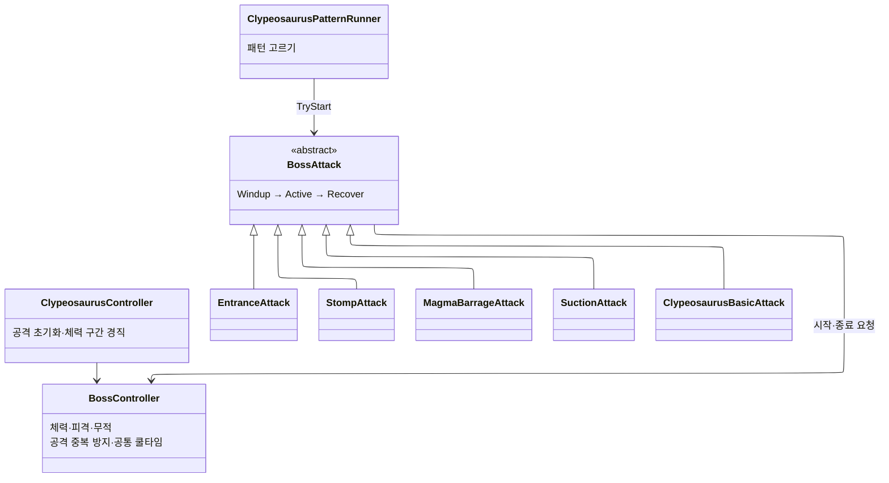
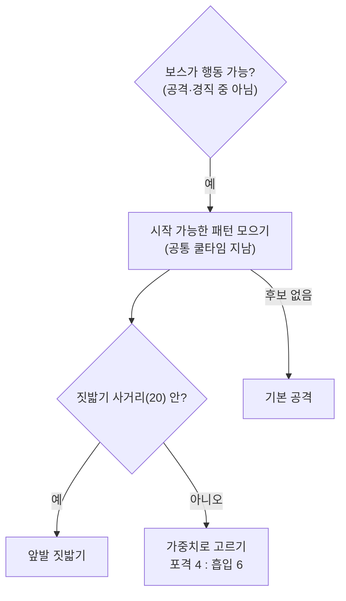

# Hive Purge 기술문서 — 8~9장 재구성 초안

> 이 파일은 **초안**입니다. `src/1-hive-purge/기술문서.md`는 건드리지 않았습니다.
> `src/_drafts/`는 이름이 `_`로 시작해 빌드가 읽지 않습니다.
> 아래 「검토 메모」를 보고 정해 주시면, 「초안 본문」만 기술문서의 8~9장 자리(425~967줄)에 넣습니다.

---

## 검토 메모

### A. 옛 절 → 새 절 대응표

| 피드백 목차              | 새 절   | 가져온 옛 내용                                     |
| ------------------------ | ------- | -------------------------------------------------- |
| 핵심 전투 루프           | 8.1.1   | 9.1 개요 + 8.2의 "준비=읽는 시간, 회복=반격 시간" |
| 패턴 변경 의사결정       | 8.1.2   | 9.9 결정 ⑤                                         |
| 데이터 테이블 이원화     | 8.2.1   | 8.3                                                |
| 클래스 책임과 상속 구조  | 8.2.2   | 8.1 클래스 그림 + 8.2 `BossAttack` 사용법 표       |
| 시스템 간 통신           | 8.2.3   | 8.4 결정 ③                                         |
| 패턴 선정                | 8.3.1   | 9.2 흐름 그림 + 9.3                                |
| 공격 실행 생명주기       | 8.3.2   | 8.2 (단계 진행 코드, 시작·종료 요청)               |
| 패턴 A~E                 | 8.4.1~5 | 9.6 · (짓밟기 없음) · 9.4 · 9.5 · 9.7의 기본 공격  |
| (전투 상호작용)          | 8.4.6   | 9.7의 나머지 (경직·범위 표시·건물 부수기)          |
| 구조 확장성 검증         | 8.5     | 8.4 결정 ④                                         |
| 방어적 예외 처리와 이유  | 8.6     | 8.2 예외 처리 + 9.8                                |

- 9장이 없어지고 10장 트러블슈팅 → **9장**, 11장 결과 및 회고 → **10장**이 됩니다.
- 결정 ③④⑤는 제목(`#####`)으로 남겨, 다른 장에서 거는 링크(201·326·421·1084줄)가 그대로 살아 있습니다.

### B. 정해 주셔야 할 것

1. ~~8.4.2 앞발 짓밟기 재료~~ → **반영함.** 말씀해 주신 맥락(몸 아래 사각지대, 근접 무저항)과 Unity 프로젝트의 `StompAttack.cs`·`ClypeosaurusTable.tsv` 값으로 썼습니다.
   - `StompAttack.cs`는 `code/`에 아직 없습니다. 원문 링크는 GitHub로 걸었으니 없어도 되지만, 다른 코드와 맞추려면 `code/`에 복사해 두는 것이 좋습니다.
   - 애니메이션 직접 제작 한 줄은 ✍(넣을지 선택)로 남겼습니다.
   - `images/boss_stomp.gif` 이미지 자리를 새로 만들었습니다(촬영목록에 없음).
2. ~~8.6.1 `try`/`finally`~~ → **짧게 남김.** "보스가 늘면 다른 사람이 채울 칸이라 넣었다"는 두 문장만 남겼습니다.
3. ~~8.5 넣어도 되는지~~ → **넣음.** Unity 프로젝트 코드로 확인했습니다: Tyranopode 공격 9종이 `TyranopodeAttack : BossAttack`을 상속하고, `TyranopodeController`가 `BossController`를 씁니다(커밋 대부분 MinSeong). `BossTable.tsv`의 Tyranopode 줄 `PatternCooldown` 0과 그 이유 주석도 확인했습니다. "그대로 쓴 것 / 덧붙인 것" 표로 바꿨습니다.
4. **8.3.1 제목.** 피드백 "제목이랑 내용+코드가 맞는거니?" — 옛 9.3 코드에는 거리를 재는 줄이 없고, 거리는 `CanStart()` 안(짓밟기의 시작 조건)에 숨어 있었습니다.
   그래서 제목을 **"사거리 안이면 짓밟기, 밖이면 가중치로"**로 바꾸고, 코드 앞에 "거리는 어디서 재는가"를 먼저 말하게 했습니다. 공통 `BossPatternRunner`(후보 중 무작위)와 무엇이 다른지도 한 줄 넣었습니다(`code/BossPatternRunner.cs`에서 확인).

### C. 제가 새로 쓴 문장 (확인해 주세요)

옛 문서를 옮기지 않고 제가 쓴 곳입니다. 사실은 문서·코드에 있는 것만 썼지만, 말투와 이유가 본인 생각과 맞는지 봐 주세요.

- 8장 첫머리 소개 두 문장
- 8.1.1 전투 루프 그림과 그 아래 한 문단
- 8.2.1 마지막 문장(왜 둘로 나눴는지 → 7.3 연결)
- 8.3.1 첫 두 문단(거리는 어디서 재는가, 공통 패턴 선택기와 다른 점)
- 8.4.5 기본 공격 전체(9.7 한 줄을 풀어 씀)
- 8.4.2 전체 (말씀하신 맥락을 문장으로 옮김)
- 8.5 [결과] 표와 그 아래 문단 (Tyranopode 코드에서 확인한 사실로 씀)
- 8.6 첫머리 소개, 8.6.1의 `OnCancelled` 설명과 `try`/`finally` 두 문장

### D. 기록만 해 둔 다른 피드백 (이번에는 손대지 않음)

| # | 위치                       | 피드백                                                                                       | 메모                                                                                                     |
| - | -------------------------- | -------------------------------------------------------------------------------------------- | -------------------------------------------------------------------------------------------------------- |
| 1 | 2.2 경험 단계 표 · 다이어그램 | "주도권 회복", "보스와 대치" 등 감정 이름이 맞는지 다시 써 볼 것                            | 다이어그램의 "주도권 회복 / 새로운 위협으로 다시 흔들림 / 보스의 갑작스러운 등장"에 물음표               |
| 2 | 2.3 라운드 시나리오 표     | 시간표를 **간트 차트**로 바꿀 것                                                              | 보내 주신 mermaid `gantt` 코드 보관. 표의 시간과 겹치는지(돌진형·후반 압박 둘 다 2:00 시작) 넣을 때 확인 |
| 3 | 목차·제목 단계             | Part를 나누려면 `# Part 1.` → `## 1.` → `### 1.1` 규칙으로                                  | 지금은 Part가 굵은 글씨 줄이라 제목 단계가 아님. 바꾸면 모든 절의 `#`이 한 단계씩 내려감                  |
| 4 | 7.1 이미지 자리            | `boss_components.png`를 7장 첫머리 쪽으로 올리고, 다이어그램과 7.2 표를 같이 볼 수 있게 배치 | 배치(나란히 보기)는 상세 문서 렌더러 쪽 일이라 방법을 따로 정해야 함                                     |
| 5 | 8~9장 링크                 | 재구성을 넣으면 7.2 표 "자세히" 칸의 §8.x·§9.x 링크와 201·958·966줄 링크를 새 번호로 고쳐야 함 | 본문을 넣을 때 함께 고침                                                                                 |

---

## 초안 본문

> ↓ 여기부터가 기술문서 425줄(`## 8. 보스 공통 클래스…`)부터 967줄(9.9 끝)까지를 바꿀 내용입니다.

## 8. 보스 전투 시스템

이 장은 첫 번째 보스 Clypeosaurus의 전투를 **의도 → 데이터와 클래스 → 행동 절차 → 패턴 → 확장성 → 예외 처리** 순서로 다룹니다. 7장의 지도에서 본 공통 계층과 보스별 계층이 실제로 어떻게 움직이는지 보여 줍니다.

### 8.1 전투 기획 의도와 패턴 구조

#### 8.1.1 핵심 전투 루프

첫 번째 보스 Clypeosaurus는 **어렵지는 않지만 충분히 위협적인, 학습용 보스**로 구상했습니다. 플레이어가 "패턴 → 반격 → 패턴"이 반복되는 보스전 자체에 익숙해지게 하는 것이 목적입니다.



_준비는 플레이어가 공격을 읽는 시간, 회복은 공격 뒤 반격할 수 있는 시간입니다._

이 순서는 카드 "보스가 준비·공격·회복을 거치며 공격 패턴을 전환·반복할 수 있다"의 구현 목표를 그대로 옮긴 것입니다. 모든 패턴이 같은 순서를 따르기 때문에, 플레이어는 패턴이 바뀌어도 "예고를 보고 피한 뒤, 멈춘 틈에 반격한다"는 같은 리듬으로 싸웁니다.

> 📷 **이미지 자리** `images/boss_phase.gif` — 공격 하나의 세 단계: 바닥에 범위가 표시되는 준비(예고) → 공격 → 보스가 멈춰 있는 회복(반격 시간). 앞발 짓밟기가 가장 잘 보입니다

| 패턴        | 하는 일                                         | 자세히                    |
| ----------- | ----------------------------------------------- | ------------------------- |
| 등장 낙하   | 그림자로 착지 지점을 예고한 뒤 착지 충격파      | [§8.4.1](#841-등장-낙하--navmeshagent를-잠시-떼고-떨어뜨리기) |
| 앞발 짓밟기 | 앞발을 들어 예고한 뒤 원형 충격파               | [§8.4.2](#842-앞발-짓밟기--가까이-붙은-플레이어에게-주는-저항) |
| 마그마 포격 | 플레이어 주변에 착탄 구역을 표시한 뒤 연속 낙하 | [§8.4.3](#843-마그마-포격--착탄-지점-계획과-연속-발사) |
| 공기 흡입   | 플레이어를 보스 앞으로 끌어당긴 뒤 공격         | [§8.4.4](#844-공기-흡입--흡입-api-위에서-끝난-이유로-분기) |
| 기본 공격   | 패턴 쿨타임 사이 근접 공격                      | [§8.4.5](#845-기본-공격--패턴-사이를-채우는-공격) |

처음 기획한 패턴 중 원거리 전격 포 발사는 개발 중 **공기 흡입**으로 바꿨습니다. 바로 아래 8.1.2에서 다룹니다.

#### 8.1.2 패턴 변경 의사결정

##### 결정 ⑤ 원거리 전격 포를 공기 흡입으로 바꾼 이유

> **결정 대상** 기획에 정해 둔 보스 패턴(원거리 전격 포 발사)을 그대로 지킬 것인가, 바꿀 것인가.

**[기획서의 의도]** 기획서는 첫 번째 보스를 "크고 움직임은 둔하지만 공격 하나의 위협은 큰" 보스로 정했습니다. 플레이어가 보스와 대치하며 공격 범위를 읽고, 회피와 반격을 연결하는 경험이 목표였습니다(→ [§2.2](#22-aesthetics-core-fun--플레이어가-느껴야-할-감정)). 수정 전 기획의 원거리 전격 포 발사는 플레이어 방향으로 일직선의 전격 포를 날려, 멀리 있는 플레이어에게도 피해를 주는 패턴이었습니다.

**[문제]** 첫 번째 보스는 이동 속도를 느리게 설정했기 때문에, 플레이어가 마음먹으면 보스에게서 멀리 떨어진 채 싸울 수 있었습니다. 원거리 전격 포는 멀리 있는 플레이어도 공격할 수 있었지만, 플레이어가 멀리 떨어진 상태를 유지할 수 있다는 문제는 그대로였습니다. 이 거리에서는 짓밟기 같은 보스의 위협적인 패턴이 닿지 않아 보스전의 난이도가 급격하게 내려갔고, 플레이어는 보스의 다양한 패턴을 보지 못했습니다. "충분히 위협적인 학습용 보스"라는 의도와 달랐습니다.

| 방식                          | 문제                                                                                                       |
| ----------------------------- | ---------------------------------------------------------------------------------------------------------- |
| 원거리 전격 포 발사 (수정 전) | 멀리 있는 플레이어도 공격할 수 있지만, 플레이어가 멀리 떨어진 상태를 유지할 수 있어 난이도가 급격히 내려감 |
| **공기 흡입**                 | 초기에 합의한 기획을 고쳐야 함. 끌어당김은 플레이어 담당 팀원의 흡입 API 위에서 만들어야 함                |

**[결정과 이유]** 팀 리딩에서는 피드백을 "초기 의도를 벗어나지 않는가"로 걸렀습니다(→ [결정 ②](#결정-②-무엇을-기준으로-피드백을-반영하고-보류할-것인가)). 원거리 전격 포는 그 초기 의도를 담아 기획한 패턴이라, 바꾸는 것은 기획을 고치는 일이었습니다.

그래도 바꾼 것은, 기획한 패턴은 의도를 구현하는 수단이지 의도 자체가 아니기 때문입니다. 지켜야 할 것은 "보스와 대치하며 패턴을 읽고 반격하는 경험"이었습니다. 멀리 있는 플레이어를 공격하는 것만으로는 이 경험이 생기지 않았고, 플레이어를 보스 앞으로 데려와야 했습니다. 그래서 플레이어가 너무 멀어지면 보스 앞으로 강제로 끌어와, 보스의 위협적인 패턴들을 다양하게 볼 수 있게 하는 흡입 패턴으로 바꿨습니다. 패턴은 바뀌었지만, 판단 기준은 결정 ②와 같습니다. "우리가 정한 경험을 더 잘 느끼게 하는가"입니다.

**[결과]** 빌드 테스트에서 "엄폐물 때문에 보스가 멀리서 쏘기만 하는 구도가 되어 쉬워진다", "흡입이 더 자주 나와도 좋겠다"는 의견이 나왔습니다. 그래서 흡입이 더 자주, 더 자연스러운 상황에 나오도록 패턴 고르기 조건을 바꿨습니다(→ [§8.3.1](#831-패턴-선정--사거리-안이면-짓밟기-밖이면-가중치로)).

- 흡입 패턴 발동의 거리 조건을 지웠습니다.
- 짓밟기 사거리(20) 안이면 짓밟기를 우선합니다.
- 사거리 밖이면 포격 4 : 흡입 6 가중치로 고릅니다.

이제 거리를 유지하는 플레이어도 포격과 흡입을 모두 보게 되고, 흡입에 끌려오면 짓밟기 사거리 안에 들어와 근접 패턴까지 이어집니다.

**[감수한 대가]** 끌어당기는 동작은 플레이어 이동 코드와 맞물려 있어, 흡입 API를 플레이어 담당 팀원에게 맡기고 그 위에서 만들어야 했습니다(→ [§8.4.4](#844-공기-흡입--흡입-api-위에서-끝난-이유로-분기)).

### 8.2 데이터 테이블 및 클래스 구조

#### 8.2.1 데이터 테이블 이원화

보스 수치는 코드가 아니라 TSV 표에 있습니다. 표를 두 개로 나눴습니다.

| 표                              | 들어 있는 값             | 예                                                                               |
| ------------------------------- | ------------------------ | -------------------------------------------------------------------------------- |
| `BossTable` (공통)              | 모든 보스에 있는 값      | Id, MaxHp, MoveSpeed, PatternCooldown, Prefab                                    |
| `ClypeosaurusTable` (보스 전용) | 이 보스의 공격 수치 32칸 | StompDamage 38, StompTelegraphTime 1.8, BarrageRadius 4, SuctionMaxDuration 10 … |

`ClypeosaurusController`는 `DataManager.Clypeosaurus`(전용 표)에서 `BossId`를 읽어 `DataManager.Bosses`(공통 표)의 보스 정의를 찾고, 두 값을 각각 `BossController`와 공격 5종에 넘깁니다.

> 📷 **이미지 자리** `images/boss_table.png` — 구글 시트의 `BossTable`과 `ClypeosaurusTable` 화면(두 표를 나란히). 공통 값과 보스 전용 공격 수치가 나뉘어 있는 것이 보이게

표를 나눈 기준은 코드를 나눈 기준과 같습니다. 모든 보스에 있는 값은 공통 표에, 공격과 그 수치는 보스별 표에 둡니다(→ [§7.3](#73-나누는-기준-두-번째-보스에도-그대로-필요한가)).

#### 8.2.2 클래스 책임과 상속 구조

이 그림에서 볼 것: **위 줄(공통)은 보스가 바뀌어도 그대로이고, 아래 줄(Clypeosaurus)만 보스마다 새로 만듭니다.**



_위 그림은 상속과 호출만 추린 것입니다. 주요 클래스의 하는 일과 하지 않는 일은 [§7.2 주요 클래스 역할](#72-주요-클래스-역할)에 있습니다._

하위 공격은 `BossAttack`의 정해진 칸만 채웁니다.

| 호출                                             | 누가                     | 하는 일                                                     |
| ------------------------------------------------ | ------------------------ | ----------------------------------------------------------- |
| `InitializeAttack(target, 준비 시간, 회복 시간)` | 하위 공격의 `Initialize` | 대상과 단계 시간을 정함. 대상에 `IDamageable`이 없으면 예외 |
| `MeetsStartCondition()` _(선택)_                 | 하위 공격                | 공격마다 다른 시작 조건 (예: 짓밟기 사거리, 등장은 한 번만) |
| `OnWindup()` _(선택)_                            | 하위 공격                | 준비에 들어갈 때 — 범위 표시, 준비 동작                     |
| `OnActiveStarted()` _(필수)_                     | 하위 공격                | 실행에 들어갈 때 — 공격 동작 시작                           |
| `OnActiveTick(dt)` _(선택)_                      | 하위 공격                | 실행 중 매 프레임. 끝나면 `CompleteActive()` 호출           |
| `OnCancelled()` _(선택)_                         | 하위 공격                | 취소될 때 — 투사체·이펙트 정리                              |
| `RaiseImpacted(point)`                           | 하위 공격                | 땅·대상에 닿은 순간 알림 (사운드가 구독)                    |
| `CanStart()` / `TryStart()`                      | 패턴 선택기              | 시작할 수 있는지 확인 / 시작                                |
| `PhaseChanged` 이벤트                            | 사운드 등                | 단계가 바뀔 때마다 알림                                     |

새 공격은 `BossAttack`을 상속해 `OnActiveStarted()`만 구현하면 단계 진행·회복·쿨타임·취소 정리를 공통 클래스에서 받습니다. 공격 5종 모두 이 방식으로 만들었습니다.

#### 8.2.3 시스템 간 통신

##### 결정 ③ 보스 등장을 다른 파트에 어떻게 알릴 것인가

> **결정 대상** 보스가 등장하면 플레이어 시점 전환, 카메라 흔들림, 사운드, 보스전 보상 집계가 함께 반응해야 한다. 이 파트들에 직접 호출로 알릴 것인가, 이벤트로 알릴 것인가.

**[결정과 이유]** 기본은 직접 호출로 두고, 아래 질문에 모두 "이벤트" 쪽으로 답할 수 있을 때만 이벤트를 썼습니다. 이벤트를 쓰는 것 자체가 목적이 아니라, 연결하고 고치는 수고를 줄이는 것이 목적이었기 때문입니다.

| 질문                              | 이벤트가 맞는 답                         | 보스 등장의 경우                                |
| --------------------------------- | ---------------------------------------- | ----------------------------------------------- |
| 무엇을 전달하는가?                | 이미 일어난 사실 (작업 요청이 아님)      | "보스가 등장했다"는 사실                        |
| 받는 쪽의 책임은 서로 독립적인가? | 한쪽을 고쳐도 다른 쪽은 고칠 이유가 없음 | 플레이어·카메라·사운드·보상이 각자 다른 일을 함 |
| 보내는 쪽이 결과를 받아야 하는가? | 아니오                                   | 아니오. 반응과 관계없이 등장은 이미 일어남      |

**[결과]** 보스 등장은 세 질문 모두 이벤트 쪽이라, 라운드가 `BossWarningEvent`·`BossAppearedEvent`를 발행하고 플레이어(시점 전환·카메라 흔들림), `GameSoundRouter`(사운드), `UpgradeManager`(보상 집계)가 각자 구독하게 했습니다. 반대로 보스 공격의 시작·종료는 보내는 쪽이 결과(공격을 시작해도 되는지)를 받아야 해서 `BossAttack` → `BossController` 직접 호출로 두었습니다(→ [§8.3.2](#832-공격-실행-생명주기--준비--실행--회복)).

### 8.3 보스 행동 절차

#### 8.3.1 패턴 선정 — 사거리 안이면 짓밟기, 밖이면 가중치로

거리는 패턴 선택기가 직접 재지 않습니다. 각 공격의 `CanStart()`가 쿨타임과 그 공격의 시작 조건을 함께 확인하는데, 짓밟기의 시작 조건이 "플레이어가 사거리 20 안에 있는가"입니다. 그래서 선택기가 후보를 모을 때 짓밟기가 후보에 들어왔다면, 그것이 곧 "가까이 있다"는 뜻입니다.

공통 패턴 선택기(`BossPatternRunner`)는 시작할 수 있는 후보 중 하나를 무작위로 고릅니다. Clypeosaurus용 선택기(`ClypeosaurusPatternRunner`)는 여기에 두 가지를 더했습니다. 짓밟기가 후보에 있으면 짓밟기만 남기고, 없으면 포격과 흡입을 가중치로 고릅니다.



```csharp
// ClypeosaurusPatternRunner.cs — 지금 쓸 수 있는 패턴 중 하나를 고른다
foreach (var attack in attacks)
{
    // … 다른 오브젝트의 공격·중복 확인 (생략)
    if (attack.UsesPatternCooldown == false || attack.CanStart() == false) continue;

    // (Why) 가까이 있으면 근접 패턴이 가장 자연스럽다 → 짓밟기를 우선한다
    if (attack is StompAttack)
    {
        candidates.Clear();
        candidates.Add(attack);
        break;
    }

    if (GetWeight(attack) > 0f) candidates.Add(attack);
}

if (candidates.Count > 0)
{
    BossAttack selected = SelectPattern();
    if (selected.TryStart()) return;
}

// … 패턴을 시작하지 못하면 기본 공격 (생략)
```

```csharp
// ClypeosaurusPatternRunner.cs — 사거리 밖 패턴의 가중치 (Inspector에서 조정)
private float GetWeight(BossAttack attack)
{
    if (attack is MagmaBarrageAttack) return Mathf.Max(0f, barrageWeight);
    // (Why) 멀리서 버티는 플레이를 깨기 위해 흡입을 더 자주
    if (attack is SuctionAttack) return Mathf.Max(0f, suctionWeight);
    return 1f;
}
```

[`ClypeosaurusPatternRunner` 원문](https://github.com/KooHoo-Dev/3rd_3D_1-3D-Project-team_even/blob/db706ef5ab2280158b830f0b714556cf02ecf6ce/Assets/Scripts/Boss/Clypeosaurus/ClypeosaurusPatternRunner.cs#L24-L85)

가까우면 짓밟기, 멀면 포격과 흡입이 나옵니다. 포격과 흡입 중에서는 흡입이 더 자주 나와, 멀리 떨어진 플레이어를 다시 보스 앞으로 데려옵니다.

> 📷 **이미지 자리** `images/boss_pattern_distance.gif` — 가까이 있을 때 앞발 짓밟기, 멀리 떨어지자 흡입(또는 포격)이 나오는 장면을 이어서

#### 8.3.2 공격 실행 생명주기 — 준비 · 실행 · 회복

고른 공격은 `BossAttack`이 같은 순서로 진행합니다. 하위 공격은 "각 단계에 들어갈 때 무엇을 할지"만 채웁니다.

```csharp
// BossAttack.cs — 공격 하나를 준비 → 실행 → 회복 순서로 진행한다
private void Update()
{
    if (IsRunning == false) return;
    if (Boss.IsAlive == false || Boss.isActiveAndEnabled == false || TargetRoot == null) { Cancel(); return; }

    switch (Phase)
    {
        case SkillPhase.Windup:
            // … (패턴 준비 동작: 예고 시간이 지나면 실행 단계로)
            break;
        case SkillPhase.Active:
            // … (패턴 실행 동작: 하위 공격이 매 프레임 처리)
            break;
        case SkillPhase.Recover:
            // … (패턴 회복 동작: 회복 시간이 지나면 공격 종료·공통 쿨타임 시작)
            break;
    }
}
```

공격 두 개가 겹치지 않게 하는 것은 `BossController`가 맡습니다. 공격은 시작할 때 보스에게 허락을 받고, 끝날 때 알립니다.

```csharp
// BossController.cs — 공격은 한 번에 하나만, 끝나면 공통 쿨타임
internal bool TryBeginAttack(BossAttack attack)
{
    if (CanStartAttackFor(attack) == false) return false;
    currentAttack = attack;
    movement.Pause();
    return true;
}

internal void EndAttack(BossAttack attack, bool completed = false)
{
    if (currentAttack != attack) return;
    currentAttack = null;

    // (Why) 끝까지 수행한 패턴만 쿨타임을 건다. 일반 공격은 쿨타임과 별개
    if (completed && attack.UsesPatternCooldown) nextAttackTime = Time.time + Def.PatternCooldown;

    if (IsAlive == false || isActiveAndEnabled == false) movement.Stop();
    else if (IsReacting == false) movement.Resume();
}
```

[`BossAttack.Update` 원문](https://github.com/KooHoo-Dev/3rd_3D_1-3D-Project-team_even/blob/db706ef5ab2280158b830f0b714556cf02ecf6ce/Assets/Scripts/Boss/BossAttack.cs#L87-L118) · [`TryBeginAttack`·`EndAttack` 원문](https://github.com/KooHoo-Dev/3rd_3D_1-3D-Project-team_even/blob/db706ef5ab2280158b830f0b714556cf02ecf6ce/Assets/Scripts/Boss/BossController.cs#L117-L144)

공격 도중 경직·사망으로 끊기는 경우는 [§8.6](#86-방어적-예외-처리와-이유)에서 다룹니다.

### 8.4 개별 패턴 및 전투 상호작용

#### 8.4.1 등장 낙하 — `NavMeshAgent`를 잠시 떼고 떨어뜨리기

| 단계                 | 하는 일                                                                        |
| -------------------- | ------------------------------------------------------------------------------ |
| 준비                 | 무적 켜기, `NavMeshAgent` 끄기, 착지 지점 위 30m(기본값)로 옮기기, 그림자 표시 |
| 준비 중 매 프레임    | 그림자 반경을 0에서 `EntranceRadius`(15)까지 키움                              |
| 낙하 (0.8초, 기본값) | `progress²`로 점점 빨라지며 떨어짐                                             |
| 착지                 | `NavMeshAgent` 다시 켜기 → 포효 · 충격파 · 반경 안 플레이어에게 피해 35        |
| 포효가 끝나면        | 무적 끄기 → 회복                                                               |

```csharp
// EntranceAttack.cs — 준비: 무적, Agent 분리, 공중으로 이동, 그림자 예고
protected override void OnWindup()
{
    Boss.SetInvulnerable(true);
    used = true;

    if (fixedLandingPoint == false) landingPoint = transform.position;
    fallStartPoint = landingPoint + Vector3.up * fallHeight;

    agent.enabled = false;
    agentDetached = true;
    transform.position = fallStartPoint;

    Range.Show(shadowPrefab, landingPoint, 0f, 0.05f);
    view.PlayState(IdleState);
}
```

```csharp
// EntranceAttack.cs — 착지: Agent를 되돌리지 못하면 등장을 취소한다
private void Land()
{
    stage = EntranceStage.Roaring;

    if (RestoreAgent() == false)
    {
        Debug.LogError("[Entrance] 착지 지점에 navMesh가 없습니다.", this);
        Cancel();
        return;
    }

    Range.Clear();
    view.PlayState(RoarState);
    RaiseImpacted(landingPoint);
    // … 충격파 이펙트 생성 (생략)
    ApplyLandingDamage();
}
```

[`EntranceAttack` 원문](https://github.com/KooHoo-Dev/3rd_3D_1-3D-Project-team_even/blob/db706ef5ab2280158b830f0b714556cf02ecf6ce/Assets/Scripts/Boss/Clypeosaurus/EntranceAttack.cs#L79-L171)

실행 단계 안은 `EntranceStage`(낙하 → 포효)로 한 번 더 나뉩니다. 무적은 준비에서 켜고 포효가 끝나야 끕니다. 착지 지점에 NavMesh가 없으면 오류를 남기고 등장을 취소하며, 취소할 때도 `OnCancelled`가 `NavMeshAgent`를 되돌립니다. 밖에서 착지 지점을 지정하면(`SetLandingPoint`) 착지 후 `NavMeshAgent`가 다시 켜져도 연출 중에는 그 위치를 유지합니다.

> 📷 **이미지 자리** `images/boss_entrance.gif` — 그림자가 커지며 착지 지점을 예고하고, 보스가 떨어져 착지 충격파와 포효가 나오는 장면

#### 8.4.2 앞발 짓밟기 — 가까이 붙은 플레이어에게 주는 저항

짓밟기는 처음 기획에 없던 패턴입니다. 보스가 크다 보니 두 가지 빈틈이 생겼습니다.

- **몸 아래 사각지대** — 보스의 몸 아래로 들어가면 어떤 공격도 받지 않고, 위를 보며 공격할 수 있었습니다.
- **근접 무저항** — 바짝 붙어도 아무 저항이 없었습니다. 공통 쿨타임 동안에는 기본 공격만 나오기 때문에, 가까이 붙은 플레이어를 밀어낼 수단이 없었습니다.

그래서 가까이 있는 플레이어를 노리는 짓밟기를 더하고, 사거리 안이면 다른 패턴보다 먼저 고르게 했습니다([§8.3.1](#831-패턴-선정--사거리-안이면-짓밟기-밖이면-가중치로)).

| 항목      | 값                                                   |
| --------- | ---------------------------------------------------- |
| 시작 조건 | 플레이어가 수평 거리 20 안 (`StompStartMaxDistance`) |
| 준비      | 앞발 위치에 범위 표시 · 1.8초                        |
| 실행      | 반경 13 원형 충격파 · 피해 38                        |
| 회복      | 3초                                                  |

```csharp
// StompAttack.cs — 시작 조건: 플레이어가 짓밟기 사거리 안에 있는가
protected override bool MeetsStartCondition()
{
    Vector3 offset = TargetRoot.position - transform.position;
    offset.y = 0f;

    float maxDistance = data.StompStartMaxDistance;
    return offset.sqrMagnitude <= maxDistance * maxDistance;
}
```

[`StompAttack` 원문](https://github.com/KooHoo-Dev/3rd_3D_1-3D-Project-team_even/blob/db706ef5ab2280158b830f0b714556cf02ecf6ce/Assets/Scripts/Boss/Clypeosaurus/StompAttack.cs#L40-L47)

이 조건이 8.3.1에서 말한 "거리"입니다. 패턴 선택기는 거리를 직접 재지 않고, 짓밟기가 후보에 들어왔는지로 가까움을 판단합니다.

✍ (넣을지 선택) 보스 에셋에 짓밟기 애니메이션이 없어 Claude를 활용해 직접 만들었습니다.

> 📷 **이미지 자리** `images/boss_stomp.gif` — 보스 몸 아래에 있던 플레이어 쪽으로 앞발 범위가 표시되고 충격파가 터지는 장면

#### 8.4.3 마그마 포격 — 착탄 지점 계획과 연속 발사

보스 등의 발사관이 하나씩 점등된 뒤, 켜져 있는 발사관 수만큼 플레이어 주변에 착탄 구역(반경 4)을 표시하고 마그마를 차례로 떨어뜨립니다.

> 📷 **이미지 자리** `images/boss_magma.gif` — 발사관이 점등되고, 플레이어 주변에 착탄 구역이 표시된 뒤 마그마가 차례로 떨어지는 장면

| 단계           | 하는 일                                                                      | 코드                         |
| -------------- | ---------------------------------------------------------------------------- | ---------------------------- |
| 준비 (1.5초)   | 켜진 발사관을 모으고, 발사관 수 × `BarrageVolleyCount`(2)발을 쏠 계획을 세움 | `OnWindup`                   |
| 착탄 지점 계획 | 발사관마다 플레이어 주변 반경 6 안에서 지면 위 착탄 지점을 하나씩 고름       | `BuildVolleyPlan`            |
| 발사           | 애니메이션 이벤트에서 첫 발, 이후 0.6초(`BarrageInterval`)마다 한 발         | `OnBarrageFire` · `FireNext` |
| 비행 · 착탄    | 2초(`BarrageFlightTime`) 동안 포물선으로 날아가 착탄 지점에서 범위 판정      | `MagmaProjectile`            |
| 회복 (2.5초)   | 모든 발사가 끝나고 투사체가 모두 사라지면 회복으로                           | `OnActiveTick`               |

**착탄 지점 계획: 지면 위, 서로 겹치지 않게**

```csharp
// MagmaBarrageAttack.cs — 발사관마다 플레이어 주변의 착탄 지점을 하나씩 정한다
private bool BuildVolleyPlan()
{
    landingPoints.Clear();
    if (sources.Count == 0 || TargetRoot == null) return false;

    Vector3 center = TargetRoot.position;
    float minimumDistance = data.BarrageRadius * 0.5f;

    for (int i = 0; i < sources.Count; i++)
    {
        bool placed = false;
        for (int attempt = 0; attempt < PlacementAttempts; attempt++)
        {
            Vector2 offset = UnityEngine.Random.insideUnitCircle * data.BarrageSpreadRadius;
            Vector3 origin = center + new Vector3(offset.x, groundProbeHeight, offset.y);

            // (Why) 맵에 높낮이가 있어 지점마다 실제 지면 높이를 찾고, 지면이 없는 곳(맵 밖)은 고르지 않는다
            if (Physics.Raycast(origin, Vector3.down, out var hit, groundProbeDistance, groundMask,
                    QueryTriggerInteraction.Ignore) == false) continue;
            if (hit.collider.TryGetDamageable(out _)) continue;
            if (HasOverlap(hit.point, minimumDistance)) continue;

            landingPoints.Add(hit.point);
            placed = true;
            break;
        }
        if (placed == false) return false;
    }
    return true;
}
```

[`BuildVolleyPlan` 원문](https://github.com/KooHoo-Dev/3rd_3D_1-3D-Project-team_even/blob/db706ef5ab2280158b830f0b714556cf02ecf6ce/Assets/Scripts/Boss/Clypeosaurus/MagmaBarrageAttack.cs#L93-L126)

착탄 지점은 위에서 아래로 Raycast를 쏴서 찾습니다. 맞은 대상이 몬스터·플레이어처럼 피해를 받는 대상이면 그 지점은 버리고 다시 고릅니다. 이미 고른 지점과 너무 가까워도 다시 고릅니다. `FireNext`는 매 발사 전에 이 계획을 다시 세우므로, 플레이어가 움직이면 다음 묶음은 새 위치 주변에 떨어집니다.

**발사 진행: 애니메이션 이벤트로 시작하되, 이벤트가 없어도 멈추지 않게**

```csharp
// MagmaBarrageAttack.cs — 실행 중 매 프레임: 남은 발사 → 투사체 정리 → 끝났는지 확인
protected override void OnActiveTick(float deltaTime)
{
    if (fireStarted && nextShot < totalShots && Time.time >= nextShotTime)
    {
        FireNext();
        if (Phase != SkillPhase.Active) return;
    }
    // … 끝난 투사체를 목록에서 제거 (생략)

    bool clipFinished = Time.frameCount > animationStartedFrame && view.IsStateFinished(BarrageState);
    if (animationFinished == false && clipFinished)
    {
        // (Why) 이벤트가 누락되어도 Active 상태에 갇히지 않도록 처리
        if (fireStarted == false) { view.PlayIdle(); CompleteActive(); return; }

        if (nextShot < totalShots) PlayBarrageAnimation();
        else { animationFinished = true; view.PlayIdle(); }
    }

    if (nextShot >= totalShots && animationFinished && projectiles.Count == 0) CompleteActive();
}
```

[`OnActiveTick` 원문](https://github.com/KooHoo-Dev/3rd_3D_1-3D-Project-team_even/blob/db706ef5ab2280158b830f0b714556cf02ecf6ce/Assets/Scripts/Boss/Clypeosaurus/MagmaBarrageAttack.cs#L163-L209)

첫 발은 발사 애니메이션의 이벤트(`OnBarrageFire`)가 시작합니다. 이벤트가 두 번 불려도 발사는 한 번만 시작하고(`fireStarted`), 이벤트가 아예 오지 않으면 애니메이션이 끝나는 순간 공격을 마칩니다. 마지막 투사체가 땅에 닿을 때까지 회복으로 넘어가지 않기 때문에, 회복(반격) 시간은 포격이 완전히 끝난 뒤에 시작됩니다.

**투사체: 정해진 시간에 정확히 착탄하는 포물선과 엄폐 판정**

```csharp
// MagmaProjectile.cs — 비행 시간(2초) 뒤 정확히 착탄 지점에 닿는 초기 속도
Vector3 arrival = landingPoint + Vector3.up * worldRadius;
float duration = data.BarrageFlightTime;

initialVelocity = (arrival - startPoint - 0.5f * gravity * duration * duration) / duration;
```

```csharp
// MagmaProjectile.cs — 착탄 지점과 플레이어 사이에 엄폐물이 있으면 피해 없음
private bool HasCover(Vector3 origin, Vector3 destination)
{
    Vector3 difference = destination - origin;
    float distance = difference.magnitude;
    if (distance < 0.001f) return false;

    foreach (var hit in Physics.RaycastAll(origin, difference / distance, distance, coverMask, QueryTriggerInteraction.Ignore))
    {
        if (hit.collider.transform.IsChildOf(owner.transform)) continue;
        if (hit.collider.TryGetDamageable(out var blocker) && object.ReferenceEquals(blocker, target))
            continue;
        return true;
    }
    return false;
}
```

[`MagmaProjectile` 원문](https://github.com/KooHoo-Dev/3rd_3D_1-3D-Project-team_even/blob/db706ef5ab2280158b830f0b714556cf02ecf6ce/Assets/Scripts/Boss/Clypeosaurus/MagmaProjectile.cs#L50-L159)

투사체는 물리 엔진 대신 "도착 = 시작 + v·t + ½·g·t²"를 v에 대해 푼 식으로 초기 속도를 정하고, 매 프레임 위치를 계산해 예고한 시간에 예고한 지점에 떨어집니다. 투사체의 콜라이더는 모두 끄고, 착탄 순간 플레이어가 반경 안에 있는지와 엄폐물 뒤에 있는지만 따로 판정합니다.

> 📷 **이미지 자리** `images/magma_cover.png` — 착탄 구역 안이지만 엄폐물 뒤에 숨어 피해를 받지 않는 장면(엄폐물·착탄 구역·플레이어가 한 화면에)

#### 8.4.4 공기 흡입 — 흡입 API 위에서 끝난 이유로 분기

플레이어를 끌어당기는 속도 계산은 플레이어 담당 팀원이 만든 흡입 API(`InhaleSource`)가 맡습니다. 저는 이 API에 넘길 설정을 표에서 만들고, 흡입이 **왜 끝났는지**에 따라 공격으로 이어갈지 취소할지를 정했습니다.

| `InhaleSettings` 값                | 표의 칸                          | 값      |
| ---------------------------------- | -------------------------------- | ------- |
| `NearRadius` (위험 구역 반경)      | `SuctionNearRadius`              | 19      |
| `FarExtraSpeed` / `NearExtraSpeed` | 바깥·안쪽에서 더하는 당기는 속도 | 3 / 0.5 |
| `MaxDuration`                      | `SuctionMaxDuration`             | 10초    |
| `NearDwellTime`                    | 위험 구역에 머물면 끝나는 시간   | 2초     |

```csharp
// SuctionAttack.cs — 흡입이 끝난 이유에 따라 공격으로 이어가거나 취소한다
protected override void OnActiveTick(float deltaTime)
{
    // … 대상이 피해를 받을 수 없으면 취소, 할퀴기 중이면 애니메이션이 끝날 때 공격 종료 (생략)

    if (activeInhale == null) { Cancel(); return; }
    if (activeInhale.IsRunning) return;

    InhaleEndReason reason = activeInhale.EndReason;
    StopInhale();
    if (reason != InhaleEndReason.Timeout && reason != InhaleEndReason.NearDwell) { Cancel(); return; }

    attacking = true;
    attackStartedFrame = Time.frameCount;
    view.PlayState(AttackState);
}
```

[`OnActiveTick` 원문](https://github.com/KooHoo-Dev/3rd_3D_1-3D-Project-team_even/blob/db706ef5ab2280158b830f0b714556cf02ecf6ce/Assets/Scripts/Boss/Clypeosaurus/SuctionAttack.cs#L118-L165)

실행 단계 안이 다시 "흡입 → 할퀴기" 두 단계로 나뉩니다. 흡입이 10초 동안 이어졌거나(`Timeout`) 플레이어가 위험 구역에 2초 머물렀을 때(`NearDwell`)만 할퀴기로 이어집니다. 피해는 할퀴기 애니메이션의 이벤트(`OnSuctionAttackHit`)에서 공격 반경(10) 안의 플레이어에게 한 번만 줍니다(`hitApplied`). 흡입 API가 "플레이어가 리셋됨", "흡입 중심이 사라짐" 같은 이유로 끝나면 공격하지 않고 취소합니다.

> 📷 **이미지 자리** `images/boss_suction.gif` — 흡입 범위(바깥)와 위험 구역(안쪽)이 표시되고, 반대로 달려도 끌려가다가 할퀴기로 이어지는 장면

#### 8.4.5 기본 공격 — 패턴 사이를 채우는 공격

기본 공격(`ClypeosaurusBasicAttack`)은 `UsesPatternCooldown`을 `false`로 두어, 공통 쿨타임과 상관없이 패턴 사이에 씁니다(피해 20, 간격 2초). 패턴 선택기는 시작할 수 있는 패턴이 하나도 없을 때 기본 공격을 시도합니다([§8.3.1](#831-패턴-선정--사거리-안이면-짓밟기-밖이면-가중치로)). 그래서 공통 쿨타임 동안에도 보스가 가만히 서 있지 않습니다.

#### 8.4.6 전투 상호작용: 경직 · 범위 표시 · 건물 부수기

- **체력 구간 경직** — 피해를 받을 때마다 체력 비율이 75%·50%·25%를 처음 넘었는지 확인하고, 넘었으면 `BossController.StartHitReaction()`으로 공격을 취소하고 경직합니다. 한 번에 두 구간을 넘어도 경직은 한 번입니다(`ClypeosaurusController.OnDamaged`).
- **환경 폭발 경직** — 연료 셀 폭발 같은 환경 충격을 받으면 8초(기본값)에 한 번까지 경직합니다. 등장 중(무적)에는 받지 않습니다(`ClypeosaurusController.TryStagger`).
- **공격 범위 표시** — 각 공격은 `BossAttackRange`로 바닥에 범위를 표시합니다. 회복으로 넘어갈 때(`CompleteActive`)와 취소될 때(`Cancel`) 공통 클래스가 표시를 지웁니다.
- **건물 부수기** — 0.1초마다 보스의 몸통·다리 콜라이더와 겹친 건물을 찾아, 파괴 이펙트를 남기고 없앱니다(`BossBuildingBreaker` → `BreakableBuilding.Break`). 공통 계층에 두어 다른 보스에도 붙일 수 있습니다.

### 8.5 구조 확장성 검증

##### 결정 ④ 보스 코드를 어떻게 나눌 것인가

> **결정 대상** 체력·피격·공격 단계처럼 모든 보스에 필요한 코드와, 공격 패턴처럼 보스마다 다른 코드를 어디에 둘 것인가.

**[결정과 이유]** 처음부터 공통 클래스(`BossController`·`BossAttack`)와 보스별 클래스로 나누어 만들었습니다. 기획상 두 번째 보스가 예정되어 있었고, 그 담당은 다른 사람이 될 가능성이 컸습니다. 그 사람이 같은 틀 위에서 바로 자기 보스의 패턴을 만들 수 있도록 공통 부분을 더 명확하게 정리해 두어야 했습니다. 공통 클래스에 무엇을 넣을지는 회의에서 논의한 내용을 바탕으로 정했습니다.

**[결과]** 두 번째 보스 Tyranopode는 팀원이 맡아, 공통 클래스를 고치지 않고 그 위에서 만들었습니다.

| 공통 틀에서 그대로 쓴 것                                                                 | Tyranopode가 덧붙인 것                                                       |
| ---------------------------------------------------------------------------------------- | ---------------------------------------------------------------------------- |
| `BossController` — 체력·피해(`TakeDamage`)·사망(`Died`)·초기화                           | 준비 중 매 프레임 할 일(`WindupTick`) — `BossAttack`에는 없는 칸              |
| `BossAttack` — 공격 9종이 `TyranopodeAttack`을 거쳐 상속 (물기·돌진·알 던지기·촉수 휘두르기 등) | 패턴 고르기 — 거리 구간 가중치 × 부위 파괴 × 난이도 보정 (자기 컨트롤러)    |
| `BossTable` — 공통 값 표에 한 줄 추가                                                    | 공격 간격 — 공통 쿨타임 대신 `TyranopodeTable`로 (`PatternCooldown` 0)      |

공격 9종이 모두 같은 준비 → 실행 → 회복 진행과 "공격은 한 번에 하나" 규칙을 받았고, 보스마다 다른 것(패턴 고르기, 공격 간격)은 각 보스가 정했습니다. 공통에 둔 것과 보스별로 남긴 것의 경계([§7.3](#73-나누는-기준-두-번째-보스에도-그대로-필요한가))가 다른 사람이 만든 보스에서도 그대로 지켜졌습니다.

> 📷 **이미지 자리** `images/tyranopode.png` — 두 번째 보스 Tyranopode 전투 화면(같은 공통 틀 위에서 만들어진 다른 보스)

### 8.6 방어적 예외 처리와 이유

보스 공격은 도중에 경직·사망으로 끊기거나, 애니메이션 이벤트·NavMesh처럼 코드 밖의 것에 기대다 실패할 수 있습니다. 어느 경우든 지킨 것은 하나입니다. **보스가 "공격 중" 상태에 갇혀 다음 공격을 못 하게 되지 않는 것**입니다.

#### 8.6.1 공통 계층: 공격 도중 경직 · 사망 · 비활성

```csharp
// BossController.cs — 피격 경직: 진행 중인 공격을 취소하고 멈춘다
public void StartHitReaction()
{
    if (isActiveAndEnabled == false || IsAlive == false) return;
    if (IsInvulnerable) return;

    // (Why) 공격 취소 중 이동이 재개되지 않도록 먼저 설정한다.
    IsReacting = true;

    currentAttack?.Cancel();
    movement.Pause();
    view.PlayHit();
}
```

공격을 끊는 쪽은 모두 `BossAttack.Cancel()`을 부릅니다. `Cancel`은 두 가지를 합니다. 하위 공격에게 정리를 맡기고(`OnCancelled`), 보스에게 공격이 끝났다고 알립니다(`EndAttack`).

`OnCancelled`는 하위 공격이 자기가 만든 것을 치우는 칸입니다. 마그마 포격은 날아가던 투사체를, 공기 흡입은 흡입과 위험 구역 표시를, 등장 낙하는 `NavMeshAgent`를 되돌립니다.

```csharp
// BossAttack.cs — 취소: 하위 공격의 정리가 실패해도 보스는 반드시 풀어 준다
public void Cancel()
{
    Range.Clear();
    if (IsRunning == false) return;

    Phase = SkillPhase.Idle;
    try
    {
        OnCancelled();
    }
    finally
    {
        Boss.EndAttack(this);
        NotifyPhase();
    }
}
```

지금 공격들의 `OnCancelled`는 예외를 던지지 않으니, `try`/`finally`는 방어 코드입니다. 앞으로 보스가 늘면 다른 사람이 이 칸을 채우게 되므로, 그 정리 코드가 실패하더라도 보스가 "공격 중"에 갇히지 않게 하려고 넣었습니다.

[`StartHitReaction` 원문](https://github.com/KooHoo-Dev/3rd_3D_1-3D-Project-team_even/blob/db706ef5ab2280158b830f0b714556cf02ecf6ce/Assets/Scripts/Boss/BossController.cs#L97-L110) · [`Cancel` 원문](https://github.com/KooHoo-Dev/3rd_3D_1-3D-Project-team_even/blob/db706ef5ab2280158b830f0b714556cf02ecf6ce/Assets/Scripts/Boss/BossAttack.cs#L132-L152)

| 상황                            | 처리                                                                   |
| ------------------------------- | ---------------------------------------------------------------------- |
| 공격 중 보스 사망               | `TakeDamage`가 이동을 멈추고 공격 취소 → 사망 동작                     |
| 공격 중 보스 비활성·대상 사라짐 | 다음 `Update`에서 `Cancel`                                             |
| 공격 컴포넌트 비활성            | `OnDisable`에서 `Cancel`                                               |
| 무적(등장) 중 피해·경직         | 피해와 경직을 모두 무시                                                |
| 취소된 공격                     | `completed: false`라 공통 쿨타임을 걸지 않음                           |
| 하위 공격의 정리 코드에서 예외  | `finally`로 `EndAttack`은 반드시 실행 → 보스가 "공격 중"에 갇히지 않음 |

#### 8.6.2 공격별: 실패하면 어떻게 끝나는가

| 상황                               | 처리                                                             | 위치                                                               |
| ---------------------------------- | ---------------------------------------------------------------- | ------------------------------------------------------------------ |
| 착탄 지점을 한 곳이라도 못 찾음    | 경고 후 취소, 1초 동안 포격 후보에서 제외                        | `MagmaBarrageAttack.OnWindup` · `FireNext` · `MeetsStartCondition` |
| 발사 애니메이션 이벤트가 오지 않음 | 애니메이션이 끝나면 발사 없이 회복으로                           | `MagmaBarrageAttack.OnActiveTick`                                  |
| 이벤트가 두 번 불림                | 발사·피해는 한 번만 (`fireStarted` · `hitApplied`)               | `OnBarrageFire` · `OnSuctionAttackHit`                             |
| 공격 중 취소                       | 날아가던 투사체·흡입·그림자·범위 표시를 모두 정리                | 각 공격의 `OnCancelled`                                            |
| 흡입 API를 찾지 못함               | 경고 후 취소                                                     | `SuctionAttack.OnActiveStarted`                                    |
| 착지 지점에 NavMesh 없음           | 오류 후 취소, `NavMeshAgent` 복구                                | `EntranceAttack.Land`                                              |
| 프리팹·발사관 연결 누락            | 초기화에서 예외로 바로 알림                                      | 각 공격의 `Initialize`                                             |
| 씬에 보스만 놓고 테스트            | 라운드가 초기화하지 않았으면 `Start`에서 데이터 표로 직접 초기화 | `ClypeosaurusController.Start`                                     |

> ↑ 초안 본문 끝. 넣을 때는 이 뒤에 `---`와 `## 9. 트러블슈팅`(옛 10장)이 이어집니다.
